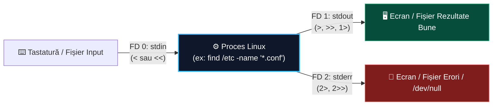
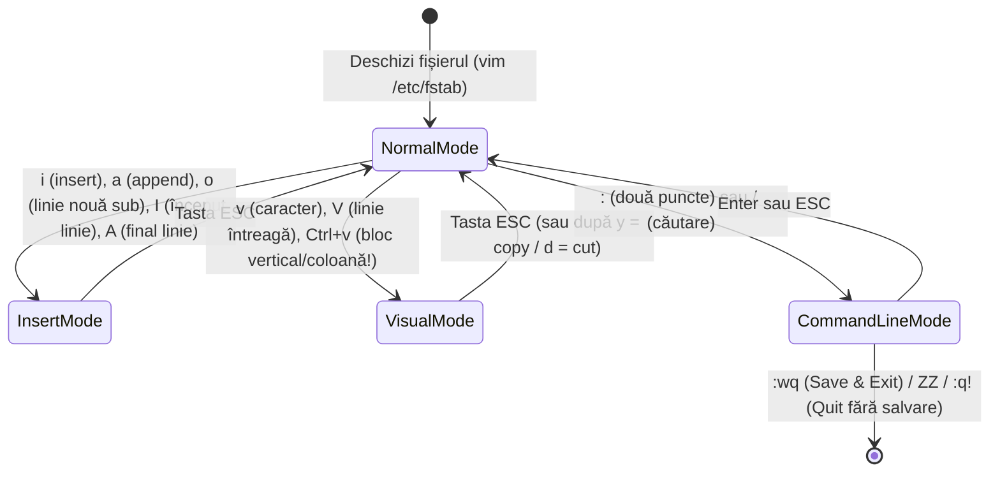

> ### Obiectivul Capitolului, Ponderea în Examenul EX200 & Regula de Aur a Persistenței
>
> * **Obiectivul Capitolului:** Înțelegerea completă a mecanicii interne a interpretului de comenzi **GNU Bash (`Bourne-Again SHell`)**, a ciclului de încărcare a fișierelor de profil (*Login* vs. *Non-Login Shell*), a arhitecturii **File Descriptors (`0`, `1`, `2`)** la nivel de Kernel, a redirecționărilor I/O și *Pipelines*, a diferenței fundamentale dintre **Bash Globbing** și **Expresii Regulare (Regex)**, stăpânirea editorului **`vim`** la viteză de examen și exploatarea chirurgicală a documentației offline (**`man`**, **`mandb`**, **`apropos`**, **`/usr/share/doc`**).
>
> * **Ponderea în Examenul EX200:** **Vitală (15–20% direct în task-uri de căutare/redirecționare/variabile + 100% impact asupra vitezei de lucru).** În EX200 vei avea task-uri explicite care îți cer să redirecționezi output-ul unei comenzi (fără erori sau cu tot cu erori) într-un fișier exact, să setezi variabile de mediu sau alias-uri persistente pentru un utilizator, și vei edita zeci de fișiere în `/etc` folosind `vim`. În plus, știind să cauți în `man -k` în 3 secunde, nu vei rămâne niciodată blocat la o comandă uitată.
>
> * **Regula de Aur a Persistenței (EX200 Survival Rule):**
>   1. Orice variabilă (`export VAR=valoare`), modificare de `$PATH` sau `alias` tastată direct în promptul Bash trăiește **exclusiv în memoria RAM a procesului curent `bash`**. În secunda în care închizi terminalul sau serverul primește `reboot`, acestea dispar! Pentru persistență la nivel de utilizator le scriem în **`~/.bashrc`** (sau `~/.bash_profile`), iar pentru întregul sistem (toți utilizatorii) creăm un script `.sh` în **`/etc/profile.d/`**.
>   2. Orice setare vizuală a editorului `vim` (`:set number`, `:set ai`) se pierde la închiderea fișierului dacă nu este salvată persistent în **`~/.vimrc`** sau **`/etc/vimrc`**.

:::analogy
În Capitolul 0.1 am văzut că nucleul Linux (**Kernel Space — Ring 0**) este ofițerul blindat care controlează hardware-ul. Dar tu, ca inginer de sistem, nu vorbești în cod binar cu kernelul. Tu ai nevoie de un **translator inteligent** care să îți preia comenzile scrise în text, să le interpreteze, să caute programele pe disc și să îi ceară kernelului să le execute. Acest translator este **Shell-ul** (în RHEL, standardul este **`/bin/bash`**).

Cea mai mare greșeală pe care o văd la candidații EX200 și chiar la administratori cu 2-3 ani experiență este că tratează linia de comandă ca pe o „cutie neagră”: știu că `> fisier.txt` salvează textul, dar când văd construcția `find / -name "*.conf" > rezultat.txt 2>&1` vs. `2>&1 > rezultat.txt`, se blochează complet! Sau, și mai grav, confundă wildcard-ul `*` din Bash (*Globbing*) cu cuantificatorul `*` din Expresiile Regulare (`grep`), ajungând să șteargă sau să filtreze fișiere complet greșite!

### Analogia Vizuală: Procesul Linux ca o Uzină Hidraulică cu 3 Conducte Numerotate

Imaginează-ți fiecare comandă pe care o rulezi în Linux (`ls`, `grep`, `find`, `cat`) ca pe o **Mică Uzină de Procesare** care este construită instantaneu de kernel. În momentul în care uzina este ridicată, inginerul-șef (**Kernelul**) îi conectează din oficiu **3 conducte numerotate (File Descriptors)**:

1. **Conducta `0` (`stdin` — Standard Input):** Este **Pâlnia de Intrare** a materiei prime. În mod implicit, această pâlnie este legată direct la **Tastatura ta**.
2. **Conducta `1` (`stdout` — Standard Output):** Este **Banda Transportoare pentru Produsul Finit Bun**. În mod implicit, această bandă varsă produsele direct pe **Ecranul Terminalului tău**.
3. **Conducta `2` (`stderr` — Standard Error):** Este **Toboganul de Urgență pentru Deșeuri și Alarme de Avarie**. În mod implicit, și acest tobogan varsă erorile tot pe **Ecranul Terminalului tău** (motiv pentru care pe ecran vezi amestecate și rezultatele bune, și mesajele de eroare `Permission denied`!).

Ce este **Redirecționarea I/O (`>`, `2>`, `&>`, `|`)** în această analogie? Este **Instalația de Țevi pe care o montezi tu, ca inginer, ÎNAINTE ca uzina să pornească**:
* Când pui `2> /dev/null`, tu deconectezi toboganul de erori (`2`) de la ecran și îl bagi direct într-un incinerator fără fund (`/dev/null`), astfel încât pe ecran să îți curgă doar produsul finit curat de pe banda `1`!
* Când pui o bară verticală `|` (*Pipe*) între două comenzi (`comanda1 | comanda2`), tu sudezi direct **Banda de Produs Finit (`1` - stdout)** a primei uzine la **Pâlnia de Intrare (`0` - stdin)** a celei de-a doua uzine!
:::

:::architecture
### 2.1. Anatomia Shell-ului `bash`, Terminale (`TTY` vs. `PTS`) și Cum se Execută o Comandă

Să definim mai întâi termenii fundamentali conform regulii *Zero-Assumptions*:

* **Shell (`bash` — *Bourne-Again SHell*):**
  * *(1) Origine:* Scris de Brian Fox în 1989 pentru proiectul GNU, ca înlocuitor liber și îmbunătățit al shell-ului original UNIX `sh` (*Bourne Shell*, creat de Stephen Bourne la Bell Labs în 1977).
  * *(2) Ce reprezintă:* Un program din *User Space* (`/usr/bin/bash`) care oferă o interfață în linie de comandă (**CLI — *Command Line Interface***) și un limbaj complet de scripting.
  * *(3) Cum funcționează sub capotă:* Când te conectezi prin SSH sau deschizi o consolă, serviciul `sshd` sau `agetty` pornește un proces `/usr/bin/bash`. Acest proces intră într-o buclă infinită numită **REPL (*Read-Eval-Print Loop*)**: afișează promptul (`[root@node1 ~]#`), citește linia tastată de tine, o parsează (expandează variabilele `$VAR` și wildcard-urile `*`), apoi apelează sistemul de operare prin apelurile de sistem **`fork()`** (clonarea procesului curent) și **`execve()`** (înlocuirea clonei cu programul cerut, de ex. `/usr/bin/ls`), așteptând terminarea lui cu **`wait4()`**.

* **TTY (*Teletypewriter*) vs. PTY/PTS (*Pseudo-Terminal Slave*):**
  * Dacă te loghezi direct la consola fizică/virtuală KVM a serverului (apăsând `Ctrl+Alt+F1` până la `F6`), lucrezi pe un terminal virtual de kernel: **`/dev/tty1` .. `/dev/tty6`**.
  * Dacă te conectezi prin rețea cu **SSH** sau deschizi o fereastră de terminal în interfața grafică GNOME, lucrezi pe un **Pseudo-Terminal**: **`/dev/pts/0`**, **`/dev/pts/1`** etc. Poți verifica oricând pe ce terminal ești rulând comanda **`tty`**.

#### Cele 4 Tipuri de Comenzi în Bash și Ordinea de Căutare (`type` & `which`)

Când tastezi un cuvânt în terminal (de exemplu `ls` sau `cd`) și apeși `Enter`, de unde știe `bash` ce să execute? El caută în exact această ordine de prioritate:

1. **Shell Alias (`alias`):** Scurtături definite în memorie. De exemplu, în RHEL, când tastezi `ls` sau `ll`, tu nu rulezi direct `/usr/bin/ls`, ci un alias (`alias ll='ls -l --color=auto'`).
2. **Shell Function (Funcții Bash):** Blocuri de cod încărcate în memoria shell-ului.
3. **Shell Built-in (Comandă Internă a lui `bash`):** Comenzi care sunt compilate **direct în interiorul binarului `/usr/bin/bash`** (`cd`, `pwd`, `echo`, `export`, `alias`, `history`, `ulimit`, `source`, `type`, `kill`).
   * *De ce `cd` este obligatoriu o comandă internă (built-in) și nu există un fișier `/usr/bin/cd` pe disc?* (Întrebare clasică de interviu!): Pentru că fiecare proces are propriul său *Current Working Directory* în kernel. Dacă `cd` ar fi un program extern, `bash` ar face `fork()`, procesul-copil `cd` și-ar schimba propriul director curent și apoi ar muri (`exit()`), lăsând procesul-părinte `bash` exact în același director ca înainte!
4. **Comandă Externă (Binar ELF sau Script pe disc, căutat prin variabila `$PATH`):** Dacă numele tastat nu este nici alias, nici funcție, nici *built-in*, `bash` citește variabila de mediu **`$PATH`** (o listă de directoare separate prin două puncte `:`, de exemplu `/root/.local/bin:/root/bin:/usr/local/sbin:/usr/local/bin:/usr/sbin:/usr/bin`) și caută de la stânga la dreapta primul fișier executabil cu acel nume!

```bash
# Cum verificăm în examen ce tip de comandă este un cuvânt? Cu built-in-ul 'type':
[root@node1 ~]# type -a ls cd echo dnf
ls is aliased to `ls --color=auto'
ls is /usr/bin/ls
cd is a shell builtin
echo is a shell builtin
echo is /usr/bin/echo
dnf is /usr/bin/dnf
```

### 2.2. Variabile de Mediu și Arhitectura Fișierelor de Profil (`Login` vs. `Non-Login Shell`)

În Bash există două tipuri de variabile:
1. **Variabile Locale de Shell (*Shell Variables*):** Create prin `NUME="valoare"` (fără spații în jurul semnului `=`). Sunt vizibile **DOAR** în procesul `bash` curent. Dacă pornești un script sau un sub-proces din acest terminal, el **nu** va moșteni variabila!
2. **Variabile de Mediu (*Environment Variables*):** Create sau promovate cu comanda **`export NUME="valoare"`**. Acestea sunt stocate în blocul de mediu al procesului (`/proc/<PID>/environ`) și sunt **moștenite automat de toate procesele-copil** pornite din acel shell!

#### Ciclul de Încărcare a Fișierelor de Configurare Bash (Esențial pentru Persistență în EX200!)

De ce uneori pui o variabilă în `~/.bash_profile` și nu se încarcă atunci când deschizi un sub-shell cu comanda `bash`? Pentru că `bash` încarcă fișiere diferite în funcție de modul în care este pornit:

* **Login Shell (Shell de Autentificare):** Apare când te conectezi prin `ssh user@node1`, la consola fizică `tty`, sau când rulezi `su - user` (**cu liniuță `-`**) ori `bash --login`.
* **Non-Login Interactive Shell (Shell Interactiv Fără Autentificare):** Apare când ești deja logat și deschizi un tab nou de terminal în GUI, când rulezi `su user` (**fără liniuță `-`!**) sau când tastezi pur și simplu `bash`.

```mermaid
flowchart TD
    subgraph Login["1. LOGIN SHELL (ssh user@node1 | su - user | login pe tty)"]
        L1["/etc/profile\n(Global: Setează PATH, USER, HOSTNAME pentru toți userii)"] --> L2["/etc/profile.d/*.sh\n(Global Modular: Scripturi custom pentru toți userii!)"]
        L2 --> L3["~/.bash_profile\n(Specific Utilizatorului la Login)"]
        L3 -->|Apelează intern| L4["~/.bashrc\n(Specific Utilizatorului: Alias-uri și Funcții)"]
        L4 -->|Apelează intern| L5["/etc/bashrc\n(Global: Promptul PS1, umask, shell options)"]
    end

    subgraph NonLogin["2. NON-LOGIN INTERACTIVE SHELL (su user [fără -] | subshell 'bash')"]
        NL1["~/.bashrc\n(Pornește DIRECT de aici!)"] --> NL2["/etc/bashrc"]
        NL2 --> NL3["/etc/profile.d/*.sh"]
    end

    style Login fill:#064e3b,stroke:#34d399,color:#ffffff
    style NonLogin fill:#1e3a8a,stroke:#60a5fa,color:#ffffff
    style L4 fill:#b91c1c,stroke:#f87171,color:#ffffff,stroke-width:2px
    style L2 fill:#7e22ce,stroke:#c084fc,color:#ffffff,stroke-width:2px
```



> **Regula de Aur pentru Examenul EX200 (Unde scriem variabilele și alias-urile?):**
> Uită-te la diagrama de mai sus! Care este **singurul fișier din directorul utilizatorului** care este executat **ATÂT** la *Login Shell*, **CÂT ȘI** la *Non-Login Shell* (pentru că `~/.bash_profile` îl apelează automat)?
> Răspuns: **`~/.bashrc`**!
> * Dacă în examen ți se cere: *„Configurați un alias `qstat` sau o variabilă `EXPORT_DIR=/data` pentru utilizatorul `natasha`”*, scrie-le în **`/home/natasha/.bashrc`** (și eventual și în `/home/natasha/.bash_profile` pentru siguranță dublă)! Astfel, indiferent dacă scriptul de notare al lui Red Hat verifică cu `su - natasha` sau cu `su natasha`, setarea ta va fi prezentă 100%!
> * Dacă ți se cere: *„Configurați o variabilă sau un alias **global pentru toți utilizatorii din sistem**”*, nu edita `/etc/profile` direct; creează un fișier nou **`/etc/profile.d/custom.sh`**!

### 2.3. Arhitectura File Descriptors (`0`, `1`, `2`), Redirecționări I/O și Pipelines

La nivel de **Linux Kernel**, fiecare proces activ are în structura sa internă (`task_struct`) un tabel de pointeri către fișierele deschise, vizibil în sistemul de fișiere virtual la adresa **`/proc/<PID>/fd/`**. Intrările în acest tabel se numesc **File Descriptors (FD)** și sunt numere întregi pozitive începând de la `0`:

* **`FD 0` (`stdin` — Standard Input):** Fluxul de intrare standard.
* **`FD 1` (`stdout` — Standard Output):** Fluxul de ieșire normală (rezultatele de succes).
* **`FD 2` (`stderr` — Standard Error):** Fluxul de ieșire pentru mesaje de diagnostic și erori.



#### Tabelul Complet al Operatorilor de Redirecționare (Memorare Obligatorie pentru EX200!)

| Operator în Bash | Ce File Descriptor afectează? | Ce face tehnic la nivel de Kernel & VFS (`open()` flags) | Exemplu Practic de Examen |
| :--- | :--- | :--- | :--- |
| **`> fisier`** *(sau `1> fisier`)* | **`FD 1` (`stdout`)** | Deschide `fisier` cu flag-urile `O_WRONLY \| O_CREAT \| O_TRUNC`. Dacă fișierul nu există, îl creează; **dacă există, îl ȘTERGE (trunchiază la 0 bytes)** înainte de a scrie! Erorile (`FD 2`) rămân pe ecran. | `grep "root" /etc/passwd > /root/root_users.txt` |
| **`>> fisier`** *(sau `1>> fisier`)* | **`FD 1` (`stdout`)** | Deschide `fisier` cu flag-ul `O_APPEND`. Păstrează conținutul existent și **adaugă la sfârșitul fișierului**. | `date >> /var/log/audit_run.log` |
| **`2> fisier`** | **`FD 2` (`stderr`)** | Redirecționează **DOAR erorile** în `fisier` (suprascriind fișierul). Output-ul bun (`FD 1`) rămâne pe ecran. | `find / -user student 2> /dev/null` *(ascunde toate erorile `Permission denied`!)* |
| **`2>> fisier`** | **`FD 2` (`stderr`)** | Adaugă (**append**) doar erorile la finalul lui `fisier`. | `dnf update -y 2>> /root/dnf_errors.log` |
| **`> fisier_ok 2> fisier_err`** | **`FD 1` și `FD 2` separat** | Trimite rezultatele bune în `fisier_ok` și erorile separat în `fisier_err`. | `find /etc -name "*.conf" > /tmp/ok.txt 2> /tmp/err.txt` |
| **`&> fisier`** *(sau `> fisier 2>&1`)* | **`FD 1` + `FD 2` împreună** | Trimite **și rezultatele bune, și erorile în același fișier** (suprascriere). | `systemctl status sshd &> /root/sshd_state.txt` |
| **`&>> fisier`** *(sau `>> fisier 2>&1`)* | **`FD 1` + `FD 2` împreună** | Adaugă (**append**) și rezultatele bune, și erorile la finalul aceluiași fișier. | `./backup.sh &>> /var/log/backup.log` |
| **`< fisier`** | **`FD 0` (`stdin`)** | Preia intrarea standard dintr-un fișier în loc de tastatură. | `tr 'a-z' 'A-Z' < /etc/issue` |
| **`<< 'EOF'`** *(Here-Document)* | **`FD 0` (`stdin`)** | Trimite un bloc de text pe mai multe linii direct către `stdin`-ul unei comenzi până la întâlnirea delimitatorului `EOF`. | `cat << 'EOF' > /etc/motd` |
| **`cmd1 \| cmd2`** *(Pipe)* | **`FD 1` (`cmd1`) -> `FD 0` (`cmd2`)** | Creează un *Anonymous Pipe* în RAM (buffer de 64 KB în kernel): `stdout`-ul lui `cmd1` devine `stdin` pentru `cmd2`. | `ps aux \| grep sshd` |
| **`cmd1 \| tee fisier \| cmd2`** | **Bifurcație în „T” (`tee`)** | Citește din `stdin` și scrie simultan **și pe ecran (`stdout`)**, **și în `fisier`** (cu `tee -a` face *append*!). | `df -h \| tee /root/disk_report.txt` |

> **Subtilitate Tehnică de Interviu și Examen: De ce ordinea `> fisier 2>&1` funcționează, dar `2>&1 > fisier` NU prinde erorile în fișier?**
> Bash evaluează redirecționările strict **de la stânga la dreapta** folosind apelul de sistem `dup2()` (duplicarea descriptorului de fișier):
> * În **`> fisier 2>&1`**:
>   1. Mai întâi, `> fisier` îndreaptă conducta `1` (`stdout`) către `fisier`.
>   2. Apoi, `2>&1` îi spune kernelului: *„Trimite conducta `2` (`stderr`) exact acolo unde țintește conducta `1` în acest moment (adică tot în `fisier`)!”* -> **Rezultat: Ambele merg în `fisier`.**
> * În **`2>&1 > fisier` (GREȘIT!)**:
>   1. Mai întâi, `2>&1` îndreaptă conducta `2` acolo unde țintește conducta `1` în acel moment (adică spre **Ecranul Terminalului**!).
>   2. Abia apoi, `> fisier` mută conducta `1` spre `fisier`, lăsând conducta `2` (`stderr`) conectată în continuare la ecran!
> * **Sfat RHCA pentru Examen:** În RHEL 9 / RHEL 10, folosește sintaxa modernă și imposibil de greșit **`&> fisier`** (pentru suprascriere) și **`&>> fisier`** (pentru adăugare la final)!

### 2.4. Bash Globbing (Pathname Expansion) vs. Expresii Regulare (Regex)

Aceasta este una dintre cele mai mari surse de confuzie în Linux. Trebuie să înțelegi cine face evaluarea:
1. **Globbing (Wildcards):** Este evaluat de către **Shell-ul `bash` ÎNAINTE ca programul (`ls`, `cp`, `rm`) să fie măcar pornit**! Folosește caractere speciale pentru a potrivi **nume de fișiere și căi existente pe disc**.
2. **Regular Expressions (Regex):** Sunt evaluate de **uneltele de procesare a textului (`grep`, `sed`, `awk`, `vim`) ÎN INTERIORUL conținutului unui fișier** sau al unui flux de text! Pentru ca `bash` să nu încerce să expandeze el expresia regulată înainte de a ajunge la `grep`, **expresiile regulare se pun ÎNTOTDEAUNA între ghilimele simple `'...'`!**

#### Tabel Comparativ Crucial pentru Examen: Globbing vs. Regex

| Simbol | În **Bash Globbing** (Nume de fișiere pe disc: `ls`, `cp`, `rm`) | În **Expresii Regulare / Regex** (Conținut text în `grep -E`, `sed`, `vim`) |
| :--- | :--- | :--- |
| **`*`** | **Orice șir de caractere** (inclusiv 0 caractere). Ex: `*.conf` = orice fișier terminat în `.conf`. | **Zero sau mai multe apariții ale caracterului PRECEDENT!** Ex: `'ab*c'` potrivește `ac`, `abc`, `abbbc` (NU orice caracter!). |
| **`?`** | **Exact UN SINGUR caracter oarecare.** Ex: `node?.txt` potrivește `node1.txt`, dar NU `node10.txt`. | **Zero sau O SINGURĂ apariție a caracterului PRECEDENT** (opțional). Ex: `'colou?r'` potrivește `color` și `colour`. |
| **`.`** | Este doar un caracter punct literal (`.`). | **Orice caracter singular!** (Echivalentul lui `?` din Globbing!). Prin urmare, „orice șir de caractere” în Regex se scrie **`.*`**, NU `*`! |
| **`[abc]`** | Un caracter din lista `a`, `b` sau `c`. | Un caracter din lista `a`, `b` sau `c`. |
| **`[^abc]`** sau **`[!abc]`** | În Globbing negarea se scrie cu **`[!abc]`** (sau `[^abc]`). | În Regex negarea în paranteze pătrate se scrie cu **`[^abc]`** (orice caracter în afară de `a`, `b`, `c`). |
| **`^` și `$`** | Nu au sens special de ancoră în Globbing. | **Ancore de linie:** **`^`** = Începutul liniei (`'^root'`); **`$`** = Sfârșitul liniei (`'bash$'`). **`^$`** = Linie complet goală! |
| **`{a,b,c}`** | **Brace Expansion** (generare de șiruri în Bash înainte de Globbing!). Ex: `mkdir -p /data/{dev,prod}_{2025,2026}`. | În Regex (`grep -E`), **`{n,m}`** este un cuantificator numeric: de la `n` până la `m` apariții ale caracterului precedent! |

#### Mecanismul de Quoting în Bash (Ghilimele Simple vs. Duble vs. Backslash)

* **Backslash `\` (*Escape Character*):** Anulează semnificația specială a **unui singur caracter** imediat următor (ex: `echo \$HOME` afișează literal `$HOME`).
* **Ghilimele Duble `"..."` (*Weak Quoting*):** Dezactivează Globbing-ul (`*`, `?`), dar **PERMITE expandarea variabilelor (`$VAR`) și a substituției de comenzi (`$(...)`)**!
  * Exemplu: `echo "Salut $USER"` -> afișează `Salut root`.
* **Ghilimele Simple `'...'` (*Strong / Literal Quoting*):** Dezactivează **ABSOLUT ORICE interpretare**! Tot ce se află între `'...'` este transmis literal, caracter cu caracter, către comandă.
  * Exemplu: `echo 'Salut $USER'` -> afișează literal `Salut $USER`.

### 2.5. Editorul `vim` (*Vi IMproved*) de Supraviețuire și Viteză în Examenul EX200

În examenul EX200 vei edita cel puțin 15–20 de fișiere (`/etc/fstab`, `/etc/sudoers`, `/etc/chrony.conf`, `/etc/exports`, scripturi Bash). Deși `nano` este adesea instalat, un inginer RHCSA/RHCA folosește **`vim`** deoarece îți permite să faci modificări masive în 2 secunde.

#### Arhitectura Celor 4 Moduri ale Editorului `vim`



#### Tabelul Comenzilor `vim` de Viteză Extremă în Examen

| Acțiune Dorită în Examen | Comanda în `vim` (Din *Normal Mode* - după apăsarea `ESC`) | De ce îți salvează minute prețioase în EX200? |
| :--- | :--- | :--- |
| **Afișare numere de linie** | `:set nu` *(sau `:set number`)* | Când un serviciu dă eroare la „linia 42”, sari direct la ea! |
| **Salt direct la o linie / final / început** | **`gg`** (linia 1), **`G`** (ultima linie), **`42G`** sau **`:42`** (linia 42) | Nu pierzi timp apăsând săgeată-jos de 500 de ori într-un fișier lung. |
| **Ștergere (Cut) rapidă** | **`dd`** (șterge 1 linie), **`5dd`** (șterge 5 linii), **`dG`** (șterge tot până la final!), **`D`** (șterge până la capătul liniei) | Curăță instantaneu blocuri de configurare greșite. |
| **Copiere (Yank) și Lipire (Paste)** | **`yy`** (copiază linia), **`p`** (lipește sub linie), **`P`** (lipește deasupra) | Când creezi o regulă nouă în `/etc/fstab` sau `/etc/hosts`, duplici linia existentă cu `yy` + `p` și doar o modifici! |
| **Undo (Anulare) și Redo** | **`u`** (Undo ultimul pas), **`Ctrl + r`** (Redo) | Ai șters din greșeală jumătate de fișier? Apasă `u`! |
| **Căutare în fișier** | **`/cuvant`** + `Enter` (apoi **`n`** = următorul, **`N`** = anteriorul) | Găsești instantaneu directiva `Port` în `/etc/ssh/sshd_config`. |
| **Search & Replace Global** | **`:%s/vechi/nou/g`** *(sau `/gc` cu confirmare)* | Schimbă un IP sau un nume de user în tot fișierul într-o secundă! |
| **Citirea output-ului unei comenzi direct în fișier!** | **`:r !blkid /dev/vdb1`** | **TRUCUL SUPREM PENTRU `/etc/fstab` ÎN EX200!** Nu tasta niciodată un UUID cu mâna! În timp ce ești în `vim /etc/fstab`, rulezi `:r !blkid /dev/vdb1` și `vim` îți inserează direct UUID-ul exact în fișier! |
| **Salvare și Ieșire** | **`:wq`** sau **`ZZ`** (cu Shift+z de două ori) / **`:q!`** (ieșire forțată fără salvare) | Dacă un fișier e read-only dar ești `root`, folosește **`:wq!`** |

### 2.6. Sistemul de Documentație Offline în RHEL (`man`, `mandb`, `apropos`, `/usr/share/doc`)

La examenul EX200 **nu ai acces la internet**. Dar Red Hat îți oferă toată documentația în sistemul de pagini de manual (**`man` — *Manual Pages***).

#### Cele 9 Secțiuni Numerotate ale Paginilor `man` (De ce `man passwd` != `man 5 passwd`!)

Mulți candidați tastează `man passwd` sau `man crontab` când vor să vadă formatul fișierului `/etc/passwd` sau `/etc/crontab`, dar primesc pagina comenzii executabile și cred că „nu scrie în `man`”!
Motivul este că manualul Linux este împărțit în **9 secțiuni numerotate** (vizibile cu `man man`):

| Număr Secțiune | Ce Conține Această Secțiune a Manualului? | Exemple Critice pentru Examenul EX200 |
| :---: | :--- | :--- |
| **`1`** | **User Commands (Comenzi de Utilizator):** Programe executabile pe care le poate rula oricine. *(Secțiunea deschisă implicit dacă nu specifici numărul!)* | `man 1 passwd`, `man 1 crontab`, `man 1 chmod`, `man 1 podman` |
| **`2`** | **System Calls (Apeluri de Sistem Kernel):** Funcțiile expuse de nucleul Linux către `glibc`. | `man 2 open`, `man 2 fork`, `man 2 chmod` |
| **`3`** | **Library Functions (Funcții de Bibliotecă C):** Funcții din `glibc`. | `man 3 printf`, `man 3 malloc` |
| **`4`** | **Special Files (Dispozitive din `/dev`):** Drivere și noduri hardware. | `man 4 null`, `man 4 tty`, `man 4 sd` |
| **`5`** | **File Formats and Conventions (Formate de Fișiere din `/etc`!):** **MINA DE AUR ÎN EX200!** Descrie sintaxa exactă a fișierelor de configurare! | **`man 5 passwd`**, **`man 5 shadow`**, **`man 5 fstab`**, **`man 5 crontab`**, **`man 5 exports`**, **`man 5 sudoers`**, **`man 5 tmpfiles.d`** |
| **`7`** | **Miscellaneous (Concepte, Standarde, Arhitectură):** Prezentări generale și sintaxe globale. | `man 7 file-hierarchy`, `man 7 systemd.time`, `man 7 regex` |
| **`8`** | **System Administration Commands (Comenzi de `root` din `/usr/sbin`):** Utilitare de administrare și daemoni. | `man 8 useradd`, `man 8 lvm`, `man 8 mount`, `man 8 semanage` |
:::

:::exam-alert
### 💀 Capcana Mortală #1: Suprascrierea Accidentală cu `>` în loc de `>>`
Dacă cerința nr. 4 din examen îți cere să adaugi o linie în `/etc/fstab` sau într-un fișier de configurare existent și tu folosești:
`echo "UUID=... /mnt/data xfs defaults 0 0" > /etc/fstab` (**un singur `>` în loc de `>>`!**),
**ai șters instantaneu tot conținutul original din `/etc/fstab`** (inclusiv montarea pentru `/` și `/boot`)! Dacă nu observi și dai reboot, serverul este mort!
* **Regula RHCA:** Când adaugi o linie cu `echo` într-un fișier de sistem existent, verifică de două ori că ai scris **`>>`** (*append*), sau editează fișierul direct în `vim`!

### 💀 Capcana Mortală #2: `man -k` (`apropos`) dă eroarea `nothing appropriate`!
În timpul examenului EX200, vrei să cauți toate paginile de manual care conțin cuvântul `extents` sau `autofs`, așa că rulezi `man -k autofs` (sau `apropos autofs`). Pe o mașină proaspăt instalată, primești adesea răspunsul frustrant:
`autofs: nothing appropriate.`
De ce? Pentru că baza de date de indexare a paginilor `man` nu a fost încă generată!
* **Antidotul în 3 secunde:** Rulează ca `root` comanda:
  ```bash
  mandb
  ```
  În 5 secunde, `mandb` scanează toate paginile din `/usr/share/man` și construiește indexul. Imediat după aceea, `man -k <cuvant_cheie>` îți va găsi orice comandă sau fișier de configurare din sistem!

### 💀 Capcana Mortală #3: Comanda `find` umple fișierul rezultat cu erori de tip `Permission denied`
Dacă în examen ți se cere să rulezi o căutare ca un utilizator neprivilegiat sau să salvezi rezultatul unei comenzi într-un fișier `/root/out.txt`, dar comanda generează și erori pe `stderr`, asigura-te că știi dacă cerința vrea **doar rezultatele valide** (`> /root/out.txt 2> /dev/null`) sau **întregul output inclusiv erorile** (`&> /root/out.txt`). Citește cu atenție enunțul!
:::

:::interview
### Întrebarea 1 (Nivel Junior -> Mid):
> **Intervievator:** *„Care este diferența exactă dintre comenzile `su student` și `su - student` (sau `su -l student`)? De ce este recomandat în producție să folosim mereu varianta cu liniuță `-`?”*

**Răspunsul Ideal:**
> „Diferența constă în tipul de shell pornit și în modul de moștenire a variabilelor de mediu:
> 1. **`su student` (fără `-`):** Pornește un **Non-Login Interactive Shell**. El schimbă doar UID-ul și GID-ul procesului în cel al utilizatorului `student`, dar **păstrează mediul utilizatorului anterior** (inclusiv directorul curent `PWD`, variabila `$PATH` și multe variabile de mediu ale utilizatorului de pe care ai plecat), executând doar `~/.bashrc`. Acest lucru poate duce la bug-uri periculoase în care `student` încearcă să scrie în directorul `/root` sau are un `$PATH` poluat.
> 2. **`su - student` (cu liniuță `-`):** Simulează un **Full Login Shell** complet curat, identic cu o conectare nouă prin SSH. El șterge toate variabilele de mediu vechi, mută automat directorul curent în `/home/student`, setează `$USER`, `$HOME`, `$SHELL` și `$PATH` specifice utilizatorului `student` și execută tot lanțul complet de autentificare (`/etc/profile` -> `/etc/profile.d/*.sh` -> `~/.bash_profile` -> `~/.bashrc`).”

### Întrebarea 2 (Nivel Mid -> Senior / DevOps):
> **Intervievator:** *„Ai un folder cu 500.000 de fișiere `.log` și rulezi comanda `rm *.log`, dar primești eroarea `bash: /usr/bin/rm: Argument list too long`. De ce apare această eroare la nivel de Kernel și cum ștergi fișierele?”*

**Răspunsul Ideal:**
> „Eroarea `Argument list too long` (`E2BIG`) nu este o limitare a comenzii `rm`, ci este rezultatul interacțiunii dintre **Bash Globbing** și limita bufferului `ARG_MAX` a apelului de sistem **`execve()`** din Kernel!
>
> Înainte de a porni `/usr/bin/rm`, shell-ul `bash` evaluează wildcard-ul `*.log` și îl înlocuiește în memorie cu o listă uriașă formată din toate cele 500.000 de nume de fișiere (`rm fisier1.log fisier2.log ... fisier500000.log`). Când `bash` încearcă să paseze acest vector `argv[]` către kernel prin syscall-ul `execve()`, dimensiunea în megabytes a argumentelor depășește limita maximă permisă de kernel (`getconf ARG_MAX`, de obicei 2 MB).
>
> **Cum o rezolv fără a folosi Globbing-ul din Bash:** Folosesc comanda `find` (care citește intrările din director una câte una prin syscall-ul `getdents64()` fără a le expanda în linia de comandă):
> ```bash
> find . -maxdepth 1 -name "*.log" -delete
> # sau cu xargs (care împarte automat lista în loturi mici sub limita ARG_MAX):
> find . -maxdepth 1 -name "*.log" -print0 | xargs -0 rm -f
> ```
> ”
:::

:::lab
Conectează-te prin SSH ca `root` pe **`node1.lab.example.com`** și execută următorul laborator practic:
:::

:::exam
Pune-ți cronometrul pe **15 minute** și rezolvă pe **`node1.lab.example.com`**:

### Partea A: Cele 3 Task-uri Practice (Stil Oficial EX200)

1. **Task 1 (Variabile și Alias-uri Persistente):**
   Configurați mediul pentru utilizatorul `student` astfel încât la fiecare autentificare (sau deschidere de shell interactiv) să fie definită variabila de mediu `RHCSA_LAB` cu valoarea `NODE1_READY`, iar comanda scurtă `ports` să fie un alias care execută `ss -tulpn`. În plus, definiți variabila de mediu globală `GLOBAL_TIMEOUT=600` astfel încât să fie activă automat pentru toți utilizatorii sistemului la autentificare.
2. **Task 2 (Redirecționare Avansată a Fluxurilor `stdout` și `stderr`):**
   Rulați comanda `find /etc /proc/1 -name "*.conf"` ca utilizator `student` (de exemplu prin `su - student -c "..."`).
   * Toate căile de fișiere găsite cu succes (`stdout`) trebuie salvate în fișierul `/home/student/conf_files.txt`.
   * Toate mesajele de eroare (`stderr`, cum ar fi `Permission denied`) trebuie salvate separat în fișierul `/home/student/conf_errors.txt`.
   * Ambele fișiere trebuie să aparțină utilizatorului `student`.
3. **Task 3 (Brace Expansion & Creare Rapidă de Structuri):**
   Folosind o singură comandă în Bash (*Brace Expansion*), creați în `/var/tmp/project_matrix/` o structură de subdirectoare pentru 3 medii (`dev`, `stage`, `prod`) și 2 ani (`2025`, `2026`), de forma `/var/tmp/project_matrix/dev_2025`, `/var/tmp/project_matrix/dev_2026`, ..., `/var/tmp/project_matrix/prod_2026` (6 subdirectoare în total), și în interiorul fiecăruia creați câte un fișier gol numit `readme.md`.
:::

:::solution
#### Rezolvarea Pas cu Pas a Task-urilor Practice:

##### Rezolvare Task 1 (Variabile și Alias-uri Persistente):
```bash
# 1. Configurăm ~/.bashrc pentru utilizatorul student:
cat << 'EOF' >> /home/student/.bashrc
export RHCSA_LAB="NODE1_READY"
alias ports='ss -tulpn'
EOF

# 2. Configurăm variabila globală în /etc/profile.d/:
echo 'export GLOBAL_TIMEOUT=600' > /etc/profile.d/global_timeout.sh
chmod 0644 /etc/profile.d/global_timeout.sh
```

##### Rezolvare Task 2 (Separarea `stdout` și `stderr` pentru utilizatorul `student`):
```bash
# Executăm comanda direct sub identitatea utilizatorului student:
su - student -c 'find /etc /proc/1 -name "*.conf" > /home/student/conf_files.txt 2> /home/student/conf_errors.txt'

# Verificăm că primul fișier conține doar căi valide, iar al doilea doar erori:
head -n 5 /home/student/conf_files.txt
head -n 5 /home/student/conf_errors.txt
```

##### Rezolvare Task 3 (Brace Expansion):
```bash
# Creăm toate cele 6 directoare dintr-o singură comandă:
mkdir -p /var/tmp/project_matrix/{dev,stage,prod}_{2025,2026}

# Creăm fișierele readme.md în toate cele 6 directoare dintr-o singură comandă:
touch /var/tmp/project_matrix/{dev,stage,prod}_{2025,2026}/readme.md

# Verificăm structura:
ls -la /var/tmp/project_matrix/*
```

#### Scriptul de Verificare Automată (Grading Script pentru Capitolul 0.2)

```bash
#!/bin/bash
# ==============================================================================
# RHCSA (EX200) - Script Automat de Evaluare: Capitolul 0.2
# ==============================================================================
SCORE=0
TOTAL=30

echo "========================================================"
echo " Evaluare Obiective Capitolul 0.2 pe $(hostname)"
echo "========================================================"

# Verificare Task 1: Variabile și Alias persistente
USER_VAR=$(su - student -c 'echo $RHCSA_LAB')
GLOBAL_VAR=$(su - student -c 'echo $GLOBAL_TIMEOUT')
if [[ "$USER_VAR" == "NODE1_READY" ]] && \
   [[ "$GLOBAL_VAR" == "600" ]] && \
   grep -q "alias ports=" /home/student/.bashrc; then
    echo "[ PASS ] Task 1: Variabilele RHCSA_LAB, GLOBAL_TIMEOUT și alias-ul 'ports' sunt persistente (+10p)"
    SCORE=$((SCORE + 10))
else
    echo "[ FAIL ] Task 1: Variabilele sau alias-ul nu sunt configurate persistent (0p)"
fi

# Verificare Task 2: Redirecționare stdout vs stderr
if [[ -s /home/student/conf_files.txt ]] && \
   [[ -s /home/student/conf_errors.txt ]] && \
   ! grep -q "Permission denied" /home/student/conf_files.txt && \
   grep -q "Permission denied" /home/student/conf_errors.txt; then
    echo "[ PASS ] Task 2: Fluxurile stdout (FD 1) și stderr (FD 2) au fost separate corect (+10p)"
    SCORE=$((SCORE + 10))
else
    echo "[ FAIL ] Task 2: Fișierele conf_files.txt / conf_errors.txt lipsesc sau au fluxurile amestecate (0p)"
fi

# Verificare Task 3: Brace Expansion
COUNT_READMES=$(ls -1 /var/tmp/project_matrix/{dev,stage,prod}_{2025,2026}/readme.md 2>/dev/null | wc -l)
if [[ "$COUNT_READMES" -eq 6 ]]; then
    echo "[ PASS ] Task 3: Toate cele 6 directoare și fișierele readme.md au fost create corect (+10p)"
    SCORE=$((SCORE + 10))
else
    echo "[ FAIL ] Task 3: Structura din /var/tmp/project_matrix/ este incompletă (0p)"
fi

echo "--------------------------------------------------------"
echo " PUNCTAJ FINAL CAPITOLUL 0.2: $SCORE / $TOTAL"
echo "========================================================"
```
:::

:::references
1. **Cursul Oficial Red Hat RH124 (*Red Hat System Administration I*):**
   * Capitolul 2: *Access the Command Line*
   * Capitolul 3: *Manage Files from the Command Line*
   * Capitolul 4: *Get Help in Red Hat Enterprise Linux*
   * Capitolul 5: *Create, View, and Edit Text Files*
2. **Pagini de Manual (`man`) Esențiale din Sistem:**
   * `man 1 bash` (Secțiunile *INVOCATION*, *REDIRECTION* și *Pathname Expansion*)
   * `man 1 man`, `man 8 mandb`, `man 1 apropos`
   * `man 1 vim` și comanda interactivă `vimtutor`
:::
