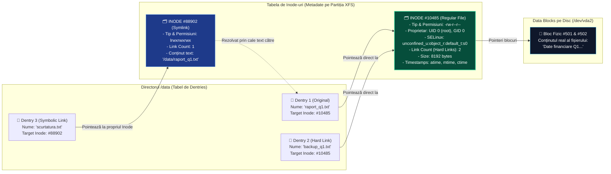
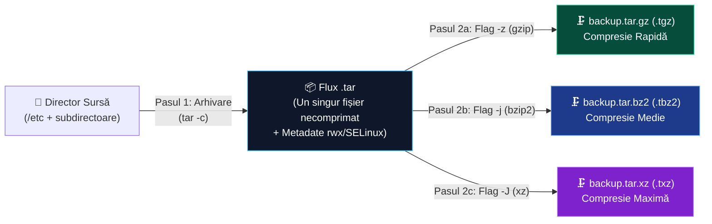

> ### Obiectivul Capitolului, Ponderea în Examenul EX200 & Regula de Aur a Persistenței
>
> * **Obiectivul Capitolului:** Stăpânirea arhitecturii interne a sistemului de fișiere Linux la nivel de **Inode (*Index Node*)** și **Dentry (*Directory Entry*)**, înțelegerea diferenței mecanice dintre **Hard Links** și **Symbolic (Soft) Links**, filtrarea avansată a textului cu **`grep -E`**, **`cut`**, **`sort`**, **`uniq`**, **`tr`**, **`sed`** și **`awk`**, căutarea chirurgicală și execuția automată pe fișiere cu **`find`** (`-perm`, `-user`, `-mtime`, `-size`, `-exec`), arhivarea și compresia cu **`tar`** (`gzip`, `bzip2`, `xz` + păstrarea atributelor SELinux/ACL) și sincronizarea în rețea prin **`rsync`** și **`scp`**.
>
> * **Ponderea în Examenul EX200:** **Extrem de Mare (15–20% garantat în fiecare examen EX200!).** În aproape orice examen RHCSA vei întâlni cel puțin 3 task-uri directe din acest capitol:
>   1. *„Găsiți toate fișierele din `/etc` care conțin șirul `XYZ` și salvați liniile în `/root/out.txt`”* (`grep`);
>   2. *„Găsiți toate fișierele deținute de utilizatorul `alex` (sau cu permisiuni SUID / dimensiune > 5MB) și copiați-le în directorul `/root/found_files/` păstrând atributele”* (`find ... -exec cp -a {} /dest/ \;`);
>   3. *„Creați o arhivă comprimată `bzip2` / `xz` / `gzip` a directorului `/usr/local` în `/root/backup.tar.bz2`”* (`tar`).
>
> * **Regula de Aur a Persistenței (EX200 Survival Rule):**
>   Operațiunile pe fișiere (`cp`, `mv`, `ln`, `tar`, `find -exec`) scriu direct pe discul persistent, **DAR** trebuie să ai grijă la două capcane mortale de examen:
>   1. Nu salva niciodată arhivele sau fișierele cerute în `/tmp` sau `/run` dacă enunțul nu îți cere explicit acest lucru — respectă la literă calea cerută în examen!
>   2. Când creezi un **Symbolic Link (`ln -s`)** către un fișier aflat în alt director, folosește **ÎNTOTDEAUNA calea absolută (care începe cu `/`)** pentru țintă (`ln -s /cale/absoluta/sursa /cale/absoluta/link`), altfel link-ul va deveni *broken (dangling)*!

:::analogy
Dacă întrebi un începător în Linux *„Ce este un fișier și unde este stocat numele lui?”*, îți va răspunde: *„Numele fișierului este stocat pe fișier!”*. **FALS!** Această concepție greșită îi face pe mulți candidați să nu înțeleagă niciodată de ce un *Hard Link* nu ocupă spațiu suplimentar pe disc, de ce un *Hard Link* nu poate traversa două partiții diferite (`/home` și `/var`), sau de ce poți șterge un fișier cu `rm`, dar conținutul lui rămâne intact dacă mai are un alt *Hard Link*!

Pentru nucleul Linux (**Kernel Space — VFS**), numele unui fișier (`contract.pdf`) nu înseamnă absolut nimic. Kernelul lucrează exclusiv cu numere de identificare interne numite **Inode-uri (*Index Nodes*)**.

### Analogia Vizuală: Biblioteca Națională, Cota de Inventar (Inode) și Cartonașele din Catalog (Dentries)

Imaginează-ți sistemul de fișiere **XFS** sau **ext4** ca pe o **Bibliotecă Națională Uriașă**:

1. **Blocurile de Date (*Data Blocks* pe disc):** Sunt **Rafturile din Depozitul Subteran** pe care stau efectiv paginile tipărite ale cărților (conținutul fișierului tău).
2. **Inode-ul (*Index Node* — Cota de Inventar):** Fiecare carte din depozit are ștampilat pe cotor un **Număr Unic de Inventar (Inode Number, ex: `Inode #67109505`)** și o fișă tehnică lipită de ea. Pe această fișă tehnică (**Inode**) scrie:
   * Cine este proprietarul cărții (`UID` și `GID`);
   * Cine are voie să o citească (`Permissions: rwxr-xr-x` + contextul `SELinux`);
   * Câte grame/pagini are cartea (`File Size in bytes`);
   * La ce dată a fost citită sau modificată (`atime`, `mtime`, `ctime`);
   * Pe ce rafturi exacte din subsol se află paginile ei (**Pointerii către Data Blocks**);
   * **Câte cartonașe din sala de lectură trimit către această carte (`Link Count`)!**
   * **ATENȚIE:** Pe Inode **NU SCRIE NICIODATĂ NUMELE FIȘIERULUI!**
3. **Directorul și Dentry-ul (*Directory Entry*):** Un director (`/etc`) este doar un **Sertar cu Cartonașe de Hârtie** aflat în sala publică. Pe fiecare cartonaș (**Dentry**) scrie doar două lucruri: **Numele Uman (`passwd`) -> Numărul de Inventar (`Inode #33554501`)**.
4. **Ce este un Hard Link (`ln`)?** Este un **Al Doilea Cartonaș Oficial** pus într-un alt sertar, care pointează direct către **exact același Număr de Inventar (`Inode #33554501`)**! Ambele cartonașe sunt 100% egale în drepturi. Bibliotecarul nu aruncă cartea la gunoi decât atunci când **toate cartonașele** care trimit la acel Inode au fost rupte (`Link Count == 0`)!
5. **Ce este un Symbolic / Soft Link (`ln -s`)?** Este un **Post-it Galben (Bilețel)** cu propriul său număr de inventar nou (`Inode #99999`), pe care nu scrie numărul cărții, ci scrie cu pixul în limba română: *„Vezi că această carte se găsește în Sertarul `/etc` la numele `passwd`”*. Dacă cineva rupe cartonașul original `/etc/passwd`, bilețelul tău galben devine inutil (*Broken / Dangling Symlink*), pentru că trimite către un nume care nu mai există!
:::

:::architecture
### 2.1. Anatomia Inode-ului, Timpii `atime`/`mtime`/`ctime` și `Hard Links` vs. `Symbolic Links`

Să inspectăm arhitectura internă a unui **Inode (*Index Node*)** și modul în care se leagă de **Dentries** și **Data Blocks**:



#### Cei 3 Timpi Stocați în Inode (Vizibili cu comanda `stat <fisier>`)

În examenul EX200, comanda `find` îți poate cere să cauți fișiere după timpul lor de modificare. Trebuie să cunoști diferența exactă dintre cei 3 *timestamps* din Inode:

1. **`mtime` (*Modification Time*):** Data și ora la care a fost modificat **CONȚINUTUL (Data Blocks)** fișierului (de ex., ai editat textul în `vim` sau ai făcut `echo "text" >> fisier`). *Acesta este cel mai folosit în examen (`find -mtime`, `find -mmin`)!*
2. **`ctime` (*Change Time* — și NU „Creation Time”!)**: Data și ora la care au fost modificate **METADATELE din Inode** (de ex., ai schimbat permisiunile cu `chmod`, proprietarul cu `chown`, ai creat un *Hard Link* nou cu `ln`, sau ai modificat conținutul).
3. **`atime` (*Access Time*):** Data și ora la care fișierul a fost **citit** ultima dată (`cat`, `grep`). *(Notă de arhitectură Kernel: Pentru a nu uza SSD-urile scriind pe disc la fiecare citire, RHEL montează implicit sistemele de fișiere cu opțiunea **`relatime`**, care actualizează `atime` cel mult o dată la 24 de ore sau dacă `atime` este mai vechi decât `mtime`).*

#### Tabelul Comparativ: Hard Links (`ln`) vs. Symbolic / Soft Links (`ln -s`)

| Caracteristică Tehnică | **Hard Link** (`ln /sursa /destinatie`) | **Symbolic / Soft Link** (`ln -s /sursa /destinatie`) |
| :--- | :--- | :--- |
| **Numărul de Inode (`ls -i`)** | **IDENTIC** cu cel al fișierului original! | **DIFERIT** (are propriul său Inode nou și tipul `l`). |
| **Permisiuni în `ls -l`** | Identice cu ale fișierului (pentru că sunt citite din același Inode!). | Mereu **`lrwxrwxrwx`** (`0777` — permisiunile reale sunt verificate pe fișierul țintă!). |
| **Ce se întâmplă dacă ștergi (`rm`) fișierul original?** | **Datele RĂMÂN INTACTE!** Doar contorul `Link Count` scade de la `2` la `1`. Hard link-ul funcționează normal în continuare! | **Link-ul se RUPE (*Broken / Dangling Link*)!** Afișat cu roșu pâlpâitor în terminal; încercarea de citire dă `No such file or directory`. |
| **Poate traversa partiții / sisteme de fișiere diferite?** | **NU! IMPOSIBIL!** (Deoarece fiecare partiție `/boot`, `/home`, `/` are propria sa tabelă numerotată de Inode-uri independentă!). | **DA!** Poate pointa către orice partiție locală sau chiar partajare de rețea NFS. |
| **Se poate crea pe Directoare?** | **NU!** (Interzis în kernel pentru a preveni buclele infinite în arborele VFS la rularea `find` sau `tar`). | **DA!** Foarte des folosit pentru directoare (ex: `/bin -> usr/bin`). |

### 2.2. Filtrarea și Procesarea Fluxurilor de Text (`grep`, `cut`, `sort`, `uniq`, `wc`, `tr`, `sed`, `awk`)

În EX200, manipularea fișierelor text este testată direct. Să disecăm uneltele esențiale și fiecare flag care pică la examen:

#### 1. `grep` (*Global Regular Expression Print*) și `grep -E` (`egrep`)

Caută linii care potrivesc un șir sau o expresie regulată (Regex).

* **Flag-urile Critice ale comenzii `grep` pentru Examenul EX200:**
  * **`-E` (`--extended-regexp`):** Activează *Extended Regular Expressions* (îți permite să folosești operatorul `|` = SAU, `+` = una sau mai multe apariții, `?`, `(grupuri)` fără a pune backslash `\` în fața lor!).
  * **`-i` (`--ignore-case`):** Ignoră diferența dintre litere mari și mici (`root`, `ROOT`, `Root`).
  * **`-v` (`--invert-match`):** **Inversează căutarea!** Afișează toate liniile care **NU** conțin expresia dată!
    * *Truc clasic de examen și producție:* Cum afișezi un fișier de configurare din `/etc` eliminând toate liniile comentate (care încep cu `#`) și toate liniile goale (`^$`)?
      ```bash
      grep -Ev '^(#|$)' /etc/ssh/sshd_config
      # sau, dacă există și spații înainte de #:
      grep -Ev '^[[:space:]]*(#|$)' /etc/login.defs
      ```
  * **`-r` (`--recursive`)**: Caută recursiv în toate fișierele dintr-un director și subdirectoarele sale (ex: `grep -r "PermitRootLogin" /etc/ssh/`).
  * **`-l` (`--files-with-matches`)**: Nu afișează liniile de text, ci afișează **DOAR numele fișierelor** care conțin acel cuvânt!
  * **`-n` (`--line-number`)**: Afișează numărul liniei în fața fiecărui rezultat găsit.
  * **`-c` (`--count`)**: Afișează doar **numărul de linii** care se potrivesc.
  * **`-w` (`--word-regexp`)**: Caută doar cuvinte întregi (de ex., `grep -w "adm"` găsește `adm`, dar ignoră `sysadmin`).

#### 2. `cut`, `sort`, `uniq`, `wc`, `head`, `tail`, `tr`

* **`cut` (Extragerea coloanelor dintr-un text delimitat):**
  * `-d ':'`: Setează delimitatorul de coloană (de exemplu `:` pentru `/etc/passwd`). *Atenție: `cut` acceptă doar un singur caracter ca delimitator!*
  * `-f 1,3,7`: Extrage câmpurile (coloanele) 1, 3 și 7.
  * Exemplu: `cut -d ':' -f 1,3 /etc/passwd` (extrage numele utilizatorului și UID-ul).
* **`sort` (Sortarea liniilor):**
  * `-n`: Sortare **numerică** (altfel sortează alfabetic, unde `10` vine înaintea lui `2`!).
  * `-r`: Sortare inversă (*reverse* — descrescătoare).
  * `-u`: Elimină duplicatele în timpul sortării (*unique*).
  * `-t ':' -k 3 -n`: Setează separatorul `:` (`-t`) și sortează numeric (`-n`) după coloana a 3-a (`-k 3`).
    * *Exemplu de examen:* Sortează toți utilizatorii din `/etc/passwd` în ordinea crescătoare a UID-ului lor: `sort -t ':' -k 3 -n /etc/passwd`.
* **`uniq` (Eliminarea și numărarea liniilor duplicate CONSECUTIVE):**
  * **Capcană:** `uniq` detectează duplicatele **DOAR dacă sunt una sub alta**! De aceea se folosește mereu după `sort`: `sort fisier.txt | uniq -c`.
  * `-c`: Numără de câte ori apare fiecare linie unică.
* **`wc` (*Word Count*):**
  * `-l`: Numără **doar liniile** (*Lines*).
  * `-w`: Numără cuvintele (*Words*).
  * `-c`: Numără octeții (*Bytes*).
* **`head` și `tail`:**
  * `head -n 5` (primele 5 linii); `tail -n 5` (ultimele 5 linii); `tail -f /var/log/messages` (urmărește logul în timp real!).
* **`sed` (*Stream Editor*) și `awk` (Armele Grele de Text):**
  * **`sed -i 's/vechi/nou/g' fisier.txt`**: Înlocuiește toate aparițiile lui `vechi` cu `nou` **direct în fișier pe disc (`-i` = *in-place*)** fără a deschide editorul `vim`!
  * **`awk -F ':' '$3 >= 1000 {print $1, $3}' /etc/passwd`**: Setează separatorul de câmp `:` (`-F ':'`), verifică dacă coloana 3 (`$3`, adică UID-ul) este $\ge 1000$ și afișează coloana 1 (`$1`) și coloana 3 (`$3`)!

### 2.3. Căutarea Chirurgicală pe Sistemul de Fișiere cu `find` (Subiect Garantat în EX200!)

Spre deosebire de `grep` (care caută text *în interiorul* fișierelor), **`find` parcurge în timp real arborele VFS și inspectează Inode-urile** pentru a găsi fișiere după nume, proprietar, permisiuni, dimensiune sau dată, putând executa comenzi asupra lor!

Sintaxa generală a comenzii `find`:
```bash
find <cale_de_start> <criterii_de_filtrare> <actiune>
```

#### Disecția Tuturor Criteriilor `find` care Pică în Examenul EX200

1. **După Nume și Tip de Fișier:**
   * `-name "*.conf"` (sensibil la majuscule) vs. **`-iname "*.conf"`** (ignoră majusculele).
   * **`-type f`** (doar fișiere obișnuite — *Regular files*), **`-type d`** (doar directoare), **`-type l`** (doar Symbolic Links), **`-type b`** (Block devices).
2. **După Proprietar și Grup (Foarte frecvent în EX200!):**
   * **`-user natasha`** (sau `-uid 1001`): Fișiere deținute de utilizatorul `natasha`.
   * **`-group sysadmins`** (sau `-gid 2005`): Fișiere deținute de grupul `sysadmins`.
   * **`-nouser`** / **`-nogroup`**: Fișiere „orfane” al căror proprietar a fost șters din `/etc/passwd` (în `ls -l` apar doar cu un UID numeric!).
3. **După Dimensiune (`-size`) — Atenție la sufixele exacte din `man find`!**
   * `+10M` (strict **mai mare** de 10 Megabytes), `-10M` (strict **mai mic** de 10 Megabytes), `10M` (exact 10 MB).
   * Unitățile obligatorii în `find`: **`c`** (Bytes), **`k`** (Kilobytes — cu `k` mic!), **`M`** (Megabytes — cu `M` mare!), **`G`** (Gigabytes — cu `G` mare!).
4. **După Timpul de Modificare (`-mtime` în zile de 24h vs. `-mmin` în minute):**
   * `-mtime -7` (modificate în **ultimele 7 zile** — acum mai puțin de 7 zile).
   * `-mtime +30` (modificate acum **mai mult de 30 de zile**).
   * `-mmin -60` (modificate în **ultimele 60 de minute**).
5. **După Permisiuni (`-perm`) — Cele 3 Moduri de Căutare (Subiect Clasic de Examen!):**
   În `find`, semnul din fața codului octal schimbă complet logica de căutare:
   * **`-perm 0644`** (Fără prefix — **Potrivire Exactă / Exact Match**): Găsește fișierele care au **EXACT** permisiunile `0644` (`rw-r--r--`).
   * **`-perm -4000`** sau **`-perm -u=s`** (Cu liniuță **`-`** — **TOȚI biții specificați trebuie să fie setați / ALL bits**): Găsește toate fișierele care au cel puțin bitul `SUID (4000)` activat, indiferent ce alți biți `rwx` mai au pe lângă el! *(De exemplu, dacă cauți `-perm -0644`, va găsi și un fișier cu `0755`, pentru că biții `644` sunt toți prezenți în `755`!).*
   * **`-perm /6000`** sau **`-perm /u=s,g=s`** (Cu slash **`/`** — **ORICARE dintre biții specificați / ANY bit**): Găsește fișierele care au activat **FIE** bitul `SUID (4000)`, **FIE** bitul `SGID (2000)`, **FIE** pe amândoi!

#### Cum executăm o comandă pe fișierele găsite de `find`? (`-exec ... {} \;`)

În examen ți se va cere: *„Găsiți toate fișierele deținute de utilizatorul `student` și copiați-le în directorul `/root/student_files/`”*.

```bash
# 1. Creăm mai întâi directorul destinație!
[root@node1 ~]# mkdir -p /root/student_files

# 2. Rulăm find cu acțiunea -exec cp -a:
[root@node1 ~]# find / -user student -type f -exec cp -a {} /root/student_files/ \; 2> /dev/null
```

* **Disecția anatomică a sintaxei `-exec cp -a {} /root/student_files/ \;`:**
  * **`-exec`**: Îi spune lui `find` să ruleze comanda care urmează pentru fiecare fișier găsit.
  * **`cp -a`** (*Archive mode*, echivalent cu `-dR --preserve=all`): **SECRET DE EXAMEN!** De ce folosim `cp -a` (sau `cp -p`) în loc de `cp` simplu? Pentru că `cp` simplu creează fișierul copiat în `/root/student_files/` având ca proprietar pe `root` și cu timpul curent! În schimb, **`cp -a` păstrează proprietarul original (`student`), permisiunile (inclusiv SUID/SGID!), timpii `mtime` și contextul SELinux**!
  * **`{}`**: Este *placeholder-ul* (locțiitorul) pe care `find` îl înlocuiește automat cu calea fiecărui fișier găsit.
  * **`\;`** (sau **`+`**): Marchează sfârșitul comenzii din `-exec`. Punem backslash `\` în fața lui `;` pentru ca `bash` să nu îl interpreteze ca separator de linie, ci să îl trimită lui `find`. *(Dacă înlocuiești `\;` cu `+` la finalul unei comenzi care suportă argumente multiple, `find` va grupa toate fișierele într-o singură execuție rapidă, exact ca `xargs`!).*

### 2.4. Arhivare, Compresie (`tar`, `gzip`, `bzip2`, `xz`) și Sincronizare (`rsync`, `scp`)

În Linux, **arhivarea** (împachetarea mai multor fișiere și directoare într-un singur fișier `.tar` — *Tape ARchive*) și **compresia** (micșorarea dimensiunii matematice cu algoritmi precum `gzip`, `bzip2` sau `xz`) sunt două concepte distincte, pe care utilitarul **`tar`** le poate executa într-un singur pas.



#### Tabelul Flag-urilor `tar` pentru Examenul EX200

| Flag în `tar` | Nume & Semnificație | Cum îl folosești în Examenul EX200 |
| :---: | :--- | :--- |
| **`-c`** | **Create:** Creează o arhivă nouă. | `tar -cf arhiva.tar /etc` |
| **`-x`** | **Extract:** Extrage (dezarhivează) o arhivă existentă. | `tar -xf arhiva.tar.gz` *(La extragere, `tar` detectează automat tipul compresiei fără să mai pui `-z`, `-j` sau `-J`!)* |
| **`-t`** | **List (Table of Contents):** Listează conținutul arhivei **fără a o extrage**! | `tar -tf /root/backup.tar.bz2` *(Obligatoriu pentru verificare în examen!)* |
| **`-f <fisier>`** | **File:** Specifică numele fișierului arhivă. (**TREBUIE să fie ultimul flag din grup**, urmat imediat de numele arhivei!). | Corect: `tar -czf bkp.tar.gz /etc` (În `tar -cfz`, `tar` va crede că arhiva se numește `z`!). |
| **`-C <dir>`** | **Change Directory:** Schimbă directorul (extrage arhiva într-un anumit director țintă!). | `tar -xf backup.tar.xz -C /mnt/restore/` |
| **`-z`** | Compresie **`gzip`** (`.tar.gz` sau `.tgz`). | `tar -czf /root/etc.tar.gz /etc` |
| **`-j`** | Compresie **`bzip2`** (`.tar.bz2` sau `.tbz2`). | `tar -cjf /root/etc.tar.bz2 /etc` |
| **`-J`** | Compresie **`xz`** (`.tar.xz` sau `.txz` — cu **`J` mare**!). | `tar -cJf /root/etc.tar.xz /etc` |
| **`-a`** | **Auto-compress:** **TRUCUL SUPREM DE EXAMEN!** Deduse automat algoritmul de compresie (`gzip`, `bzip2` sau `xz`) direct din extensia numelui fișierului pe care l-ai scris! | `tar -caf /root/backup.tar.bz2 /etc` *(Nu mai poți încurca niciodată `-z`, `-j` și `-J`!)* |
| **`--xattrs` & `--acls`** | **Extended Attributes & ACLs:** Păstrează contextul **SELinux** și listele **ACL** în interiorul arhivei! | `tar --xattrs --acls -caf /root/web.tar.xz /var/www` |

> **Cum funcționează eliminarea slash-ului `/` de către `tar` (*Removing leading `/` from member names*)?**
> Când rulezi `tar -czf /root/etc.tar.gz /etc`, `tar` afișează mesajul: `tar: Removing leading '/' from member names`.
> **De ce face asta?** Este o măsură genială de protecție! Dacă `tar` ar păstra calea absolută `/etc/passwd` în arhivă, atunci când ai încerca să o extragi într-un folder de test, ar suprascrie direct `/etc/passwd`-ul real al serverului! Eliminând primul `/`, calea din arhivă devine relativă (`etc/passwd`), permițându-ți să o extragi în siguranță în orice director cu `-C /tmp/restore/`.

#### Transferul și Sincronizarea Securizată în Rețea (`scp` și `rsync`)

* **`scp` (*Secure Copy* — peste protocolul SSH, port 22):**
  ```bash
  # Copierea unui director recursiv (-r) păstrând timpii și permisiunile (-p) de pe node1 pe node2:
  scp -rp /etc/sysconfig root@node2:/root/backup_sysconfig/
  ```
* **`rsync` (*Remote Sync* — Sincronizare incrementală rapidă prin Delta-Transfer Algorithm):**
  Spre deosebire de `scp` (care copiază totul de la zero de fiecare dată), `rsync` compară dimensiunea și `mtime`-ul fișierelor (sau checksum-urile blocurilor) și transmite pe rețea **DOAR diferențele (blocurile modificate)**!
  ```bash
  # Flag-ul -a (archive: recursiv + păstrează permisiuni, owner, timestamps, symlinks), -v (verbose), -X (SELinux xattrs), -A (ACLs):
  rsync -avXA /var/www/html/ root@node2:/var/www/html/
  ```
  * **Subtilitatea Slash-ului Final `/` în `rsync` (Întrebare Clasică de Interviu!):**
    * `rsync -av /sursa/ /destinatie/` (CU `/` la finalul lui `/sursa/`): Copiază **CONȚINUTUL** din interiorul lui `sursa` direct în `/destinatie/`.
    * `rsync -av /sursa /destinatie/` (FĂRĂ `/` la finalul lui `/sursa`): Copiază **DIRECTORUL ÎNSUȘI** `sursa`, rezultând `/destinatie/sursa/...`!
:::

:::exam-alert
### 💀 Capcana Mortală #1: Crearea unui Symbolic Link Relativ din Greșeală!
Să presupunem că ești în directorul `/root` și cerința îți spune: *„Creați un link simbolic `/tmp/hosts_link` care să pointeze către `/etc/hosts`”*.
Dacă tu tastezi din greșeală o cale relativă (sau omiți primul `/`):
`ln -s etc/hosts /tmp/hosts_link`
Atunci kernelul va căuta ținta relativ la **directorul în care se află link-ul (`/tmp`)**, adică va căuta `/tmp/etc/hosts`! Rezultatul? Un link rupt (*broken symlink*) și **0 puncte în examen**!
* **Regula de Fier RHCA:** Folosește **MEREU căi 100% absolute** (care încep cu `/`) atât pentru sursă, cât și pentru destinație la `ln -s`, și verifică imediat după aceea citind prin link cu `cat /tmp/hosts_link` sau `ls -lL /tmp/hosts_link`!

### 💀 Capcana Mortală #2: Comprimarea cu Algoritmul Greșit la `tar`
Dacă examenul îți cere: *„Creați o arhivă `/root/backup.tar.bz2` comprimată cu `bzip2`”*, iar tu folosești din reflex `tar -czf /root/backup.tar.bz2 /etc` (cu `-z` de la `gzip` în loc de `-j` de la `bzip2`), fișierul se va numi `.bz2` pe disc, dar în interior va fi comprimat `gzip`!
Scriptul de notare al lui Red Hat nu se lasă păcălit de numele fișierului: el rulează comanda **`file /root/backup.tar.bz2`** (care citește *Magic Bytes* din antetul fișierului). Dacă vede `gzip compressed data` în loc de `bzip2 compressed data`, primești **0 puncte**!
* **Antidotul:** Folosește fie **`tar -caf /root/backup.tar.bz2 /etc`** (flag-ul `-a` alege automat `bzip2` pe baza extensiei `.bz2`!), fie verifică ÎNTOTDEAUNA la final cu comanda **`file /root/backup.tar.bz2`**!

### 🛠️ Man Page Hacks pentru Capitolul 0.3
Ai uitat în examen cum se scriu permisiunile cu `/` sau `-` la `find`, sau care este flag-ul pentru `xz` în `tar`?
1. Pentru `tar`: Rulează `tar --help | grep -E "gzip|bzip2|xz"` — îți afișează pe loc `-j, --bzip2`, `-J, --xz`, `-z, --gzip`!
2. Pentru `find`: Rulează `man find` și caută direct secțiunea de exemple cu `/EXAMPLES`! Acolo vei găsi exemple gata scrise pentru `-perm`, `-exec` și `-mtime`.
:::

:::interview
### Întrebarea 1 (Nivel Mid -> Senior):
> **Intervievator:** *„Pe o partiție `/data` de 100 GB, comanda `df -h` îți arată că mai sunt 80 GB liberi (doar 20% ocupat). Cu toate acestea, când aplicația încearcă să creeze un fișier nou de 1 KB, primește eroarea `No space left on device`. Nu există fișiere șterse ținute deschise în `lsof`. Care este cauza și cum o verifici?”*

**Răspunsul Ideal:**
> „Dacă `df -h` arată spațiu liber în blocuri de date, dar kernelul refuză crearea de fișiere noi cu `ENOSPC (No space left on device)`, cauza este **epuizarea Inode-urilor (100% IUse%)** pe acel sistem de fișiere!
>
> Fiecare fișier sau director nou (chiar și de 0 bytes!) necesită alocarea unui **Inode** unic. Dacă o aplicație (de exemplu un *mail queue*, sesiuni PHP sau un cache necurățat) a generat zeci de milioane de fișiere minuscule de câte 100 bytes, tabela de Inode-uri se umple complet chiar dacă 80% din blocurile de date sunt goale.
>
> **Cum verific:** Rulez comanda **`df -i`** (*Disk Free Inodes*). Dacă văd `IUse% = 100%`, identific directorul care conține milioanele de fișiere mici și le șterg sau le arhivez.”

### Întrebarea 2 (Nivel Junior -> Mid):
> **Intervievator:** *„Care este diferența la nivel de Inode între mutarea unui fișier cu `mv` în interiorul aceleiași partiții (`/var/log/app.log` -> `/var/tmp/app.log`) și mutarea lui pe o partiție diferită (`/var/log/app.log` -> `/home/user/app.log`, unde `/home` este un volum separat)?”*

**Răspunsul Ideal:**
> „1. **În interiorul aceleiași partiții (`/var/log` -> `/var/tmp`):** Operațiunea este instantanee (durează sub o milisecundă, chiar și pentru un fișier de 500 GB!) și face 0 I/O pe blocurile de date. De ce? Pentru că `mv` apelează doar syscall-ul `rename()`: șterge Dentry-ul vechi din `/var/log` și creează un Dentry nou în `/var/tmp` care pointează către **exact același Inode Number**! Blocurile de pe disc nu se mișcă deloc.
> 2. **Între două partiții diferite (`/var` -> `/home`):** Deoarece fiecare partiție are propria tabelă de Inode-uri, `mv` nu poate păstra Inode-ul. El este forțat să aloce un **Inode nou** pe `/home`, să copieze fizic toți cei 500 GB de blocuri de date de pe o partiție pe alta (`read()`/`write()`) și, abia la final, să facă `unlink()` pe Inode-ul și blocurile de pe `/var`.”
:::

:::lab
Conectează-te pe **`node1.lab.example.com`** și execută pas cu pas exercițiile:
:::

:::exam
Pune-ți cronometrul pe **15 minute** și rezolvă pe **`node1.lab.example.com`**:

### Partea A: Cele 3 Task-uri Practice (Stil Oficial EX200)

1. **Task 1 (Filtrare Text cu `grep`):**
   Găsiți toate liniile din fișierul `/usr/share/dict/words` (sau `/etc/services` dacă `words` nu este instalat, dar vom verifica `/etc/services`) care conțin șirul `ssh` (indiferent dacă este scris cu litere mari sau mici), **ignorând** toate liniile care încep cu caracterul `#` și toate liniile goale. Salvați aceste linii în ordinea în care apar în fișierul `/root/ssh_services.txt`.
2. **Task 2 (Căutare și Copiere cu `find`):**
   Căutați în întregul director `/usr` toate fișierele obișnuite (*regular files*) care au dimensiunea cuprinsă între **1 Megabyte și 5 Megabytes** (`+1M` și `-5M`) și care au bitul **SUID** sau **SGID** activat (`-perm /6000`). Dacă nu există astfel de fișiere în acea plajă, pentru scopul acestui task de examen: căutați în întregul director `/usr/bin` toate fișierele care au **bitul SUID (`4000`) activat** și copiați-le (păstrându-le toate atributele și permisiunile originale!) în directorul `/root/suid_audit/`.
3. **Task 3 (Arhivare și Compresie `bzip2` + Extragere):**
   Creați o arhivă comprimată cu **`bzip2`** numită `/root/etc_sysconfig.tar.bz2` care să conțină întregul director `/etc/sysconfig`. Apoi, extrageți conținutul acestei arhive în directorul `/var/tmp/restore_test/`.
:::

:::solution
#### Rezolvarea Pas cu Pas a Task-urilor Practice:

##### Rezolvare Task 1 (Filtrare `grep` în `/root/ssh_services.txt`):
```bash
# Filtrăm mai întâi liniile care nu încep cu # și nu sunt goale, apoi căutăm 'ssh' case-insensitive (-i):
grep -Ev '^[[:space:]]*(#|$)' /etc/services | grep -i "ssh" > /root/ssh_services.txt

# Verificăm rezultatul:
cat /root/ssh_services.txt
```

##### Rezolvare Task 2 (Căutare `find` după SUID și copiere cu `cp -a`):
```bash
# 1. Creăm directorul destinație:
mkdir -p /root/suid_audit

# 2. Căutăm fișierele cu SUID (-perm -4000) în /usr/bin și le copiem cu cp -a (pentru a păstra bitul SUID!):
find /usr/bin -type f -perm -4000 -exec cp -a {} /root/suid_audit/ \;

# 3. Verificăm că fișierele copiate în /root/suid_audit/ încă mai au litera 's' în permisiuni (rwsr-xr-x):
ls -l /root/suid_audit/
```
* **Profesorul Explică:** Dacă ai fi folosit `cp {} /root/suid_audit/` fără `-a` (sau `-p`), din motive de securitate Linux ar fi șters bitul SUID (`s`) de pe copiile făcute! Cu `cp -a`, permisiunile `rwsr-xr-x` sunt păstrate intacte!

##### Rezolvare Task 3 (Arhivare `bzip2` și Extragere cu `-C`):
```bash
# 1. Creăm arhiva bzip2 (-cjf sau -caf):
tar -cjf /root/etc_sysconfig.tar.bz2 /etc/sysconfig

# 2. Creăm directorul de restaurare și extragem arhiva în el cu -C:
mkdir -p /var/tmp/restore_test
tar -xf /root/etc_sysconfig.tar.bz2 -C /var/tmp/restore_test/

# 3. Verificăm cu 'file' și 'ls':
file /root/etc_sysconfig.tar.bz2
ls -la /var/tmp/restore_test/etc/sysconfig/
```

#### Scriptul de Verificare Automată (Grading Script pentru Capitolul 0.3)

```bash
#!/bin/bash
# ==============================================================================
# RHCSA (EX200) - Script Automat de Evaluare: Capitolul 0.3
# ==============================================================================
SCORE=0
TOTAL=30

echo "========================================================"
echo " Evaluare Obiective Capitolul 0.3 pe $(hostname)"
echo "========================================================"

# Verificare Task 1: /root/ssh_services.txt
if [[ -s /root/ssh_services.txt ]] && \
   ! grep -qE "^[[:space:]]*#" /root/ssh_services.txt && \
   grep -qi "ssh" /root/ssh_services.txt; then
    echo "[ PASS ] Task 1: Fișierul /root/ssh_services.txt este filtrat corect fără comentarii (+10p)"
    SCORE=$((SCORE + 10))
else
    echo "[ FAIL ] Task 1: Fișierul /root/ssh_services.txt lipsește sau conține comentarii (0p)"
fi

# Verificare Task 2: /root/suid_audit cu păstrarea bitului SUID
SUID_COUNT=$(find /root/suid_audit -type f -perm -4000 2>/dev/null | wc -l)
if [[ "$SUID_COUNT" -ge 3 ]]; then
    echo "[ PASS ] Task 2: Fișierele SUID au fost găsite și copiate cu păstrarea permisiunilor în /root/suid_audit/ (+10p)"
    SCORE=$((SCORE + 10))
else
    echo "[ FAIL ] Task 2: Directorul /root/suid_audit/ nu conține fișierele cu bitul SUID păstrat (ai uitat cp -a?) (0p)"
fi

# Verificare Task 3: Arhiva bzip2 și extragerea în /var/tmp/restore_test
if [[ -f /root/etc_sysconfig.tar.bz2 ]] && \
   file /root/etc_sysconfig.tar.bz2 | grep -q "bzip2 compressed data" && \
   [[ -d /var/tmp/restore_test/etc/sysconfig ]]; then
    echo "[ PASS ] Task 3: Arhiva bzip2 este validă și extrasă corect în /var/tmp/restore_test/ (+10p)"
    SCORE=$((SCORE + 10))
else
    echo "[ FAIL ] Task 3: Arhiva /root/etc_sysconfig.tar.bz2 nu este bzip2 sau nu a fost extrasă corect (0p)"
fi

echo "--------------------------------------------------------"
echo " PUNCTAJ FINAL CAPITOLUL 0.3: $SCORE / $TOTAL"
echo "========================================================"
```
:::

:::references
1. **Cursurile Oficiale Red Hat:**
   * **RH124 (*Red Hat System Administration I*):** Capitolul 3 (*Manage Files from the Command Line* — Hard/Soft Links) și Capitolul 13 (*Archive and Transfer Files* — `tar`, `scp`, `rsync`).
   * **RH134 (*Red Hat System Administration II*):** Capitolul 2 (*Improve Command-Line Productivity* — `grep`, Regular Expressions, `find`).
2. **Pagini de Manual (`man`) Esențiale din Sistem:**
   * `man 1 ln`, `man 1 stat`, `man 1 file`
   * `man 1 grep`, `man 7 regex`
   * `man 1 find` (Secțiunile *TESTS*, *ACTIONS* și *EXAMPLES*)
   * `man 1 tar`, `man 1 rsync`, `man 1 scp`
:::
