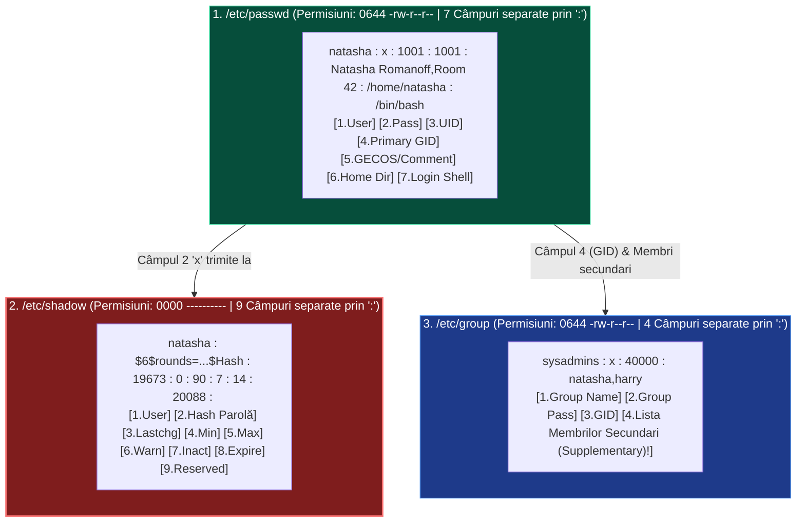

> ### Obiectivul Capitolului, Ponderea în Examenul EX200 & Regula de Aur a Persistenței
>
> * **Obiectivul Capitolului:** Stăpânirea completă a arhitecturii de identitate locală în Red Hat Enterprise Linux (RHEL 9 / RHEL 10): disecția la nivel de câmp a bazelor de date locale (`/etc/passwd`, `/etc/shadow`, `/etc/group`, `/etc/gshadow`), parametrii impliciți din `/etc/login.defs` și `/etc/skel`, arhitectura UID/GID și diferența dintre **Primary Group (`-g`)** și **Supplementary Groups (`-G` / `-aG`)**, conturile de serviciu fără shell interactiv (`/sbin/nologin`), politicile de expirare a parolelor (**Password Aging** cu `chage` și `/etc/login.defs`) și escaladarea privilegiilor prin **`sudo`** (`visudo`, `/etc/sudoers.d/`, `NOPASSWD`).
>
> * **Ponderea în Examenul EX200:** **Critică și Garantată 100% (10–15% din punctajul examenului + dependență pentru alte 3-4 subiecte!).** Absolut fiecare examen RHCSA are un task dedicat de forma:
>
>   * *„Creați grupul `sysadmins` (cu GID 40000). Creați utilizatorii `natasha` și `harry` care să aibă `sysadmins` ca grup secundar (supplementary group). Creați utilizatorul `sarah` care să nu aibă acces la un shell interactiv pe sistem și să nu fie membru în `sysadmins`. Toți trei trebuie să aibă parola `flectrag`. Configurați `sudo` astfel încât membrii grupului `sysadmins` să poată executa orice comandă administrativă fără a li se cere parola (`NOPASSWD`).”*
>
>   * **Atenție:** Dacă greșești crearea acestor utilizatori sau grupuri, vei pierde puncte și la task-urile ulterioare de **Directoare Colaborative (SGID)**, **ACL-uri**, **Cron jobs** și **Containere Rootless Podman** care îți cer să lucrezi cu aceiași utilizatori!
>
> * **Regula de Aur a Persistenței (EX200 Survival Rule):**
>   Comenzile `useradd`, `usermod`, `groupadd`, `passwd`, `chage` scriu direct în fișierele persistente din `/etc` (`/etc/passwd`, `/etc/shadow`, `/etc/group`). **ÎNSĂ** există două reguli vitale de persistență în examen:
>
>   1. Dacă ți se cere ca *„toți utilizatorii **care vor fi creați în viitor** să aibă parola valabilă maxim 30 de zile (sau să conțină un fișier `README` în directorul lor home)”*, nu este suficient să rulezi `chage` pe userii existenți! Trebuie să modifici șabloanele persistente din **`/etc/login.defs`** (pentru parole) și **`/etc/skel/`** (pentru fișierele din home), deoarece scriptul de notare al lui Red Hat va crea un utilizator nou de test (`useradd testuser_grading`) după reboot pentru a verifica dacă a moștenit setările!
>
>   2. Pentru `sudo`, nu edita niciodată fișierul principal dacă poți crea un fișier modular curat în **`/etc/sudoers.d/<nume>`**, validat obligatoriu cu **`visudo -c`**!

:::analogy
Pentru un om, identitatea ta pe server este numele **`natasha`** sau **`root`**. Pentru nucleul Linux (**Kernel Space — Ring 0**), numele `natasha` **nu există**! Kernelul nu stochează șiruri de caractere cu nume de utilizatori în structurile de procese (`task_struct`) sau în Inode-urile de pe disc. Kernelul cunoaște exclusiv numere întregi pe 32 de biți:

* **UID (*User Identifier* — ID-ul numeric al utilizatorului)**;

* **GID (*Group Identifier* — ID-ul numeric al grupului primar)**;

* **Supplementary GIDs (Lista de ID-uri numerice ale grupurilor secundare)**.

Fișierele `/etc/passwd` și `/etc/group` sunt doar „cărți de telefon” folosite de aplicațiile din *User Space* (`ls`, `id`, `ps`, `bash` prin biblioteca `glibc` și *Name Service Switch* `/etc/nsswitch.conf`) pentru a traduce numărul `UID 1001` în textul prietenos `natasha` când îl afișează pe ecran!

### Analogia Vizuală: Clădirea Corporativă, Ecusonul Magnetic (UID/GID) și Seiful de la HR (`/etc/shadow`)

Imaginează-ți serverul tău RHEL ca pe o **Clădire de Birouri de Înaltă Securitate**:

1. **UID-ul (`User ID`):** Este **Codul Numeric Unic de pe Ecusonul Magnetic** al fiecărui angajat:

   * **Ecusonul `#0` (`UID 0` — `root`):** Este **Cardul Master al Directorului General**. Deschide absolut orice ușă din clădire, fără ca sistemul de control acces (DAC) să mai întrebe cine este. *(Dacă îi dai și altui angajat `UID 0` în `/etc/passwd`, el devine instantaneu `root`, indiferent ce nume are pe ecuson!)*

   * **Ecusoanele `#1` – `#999` (`System / Service Accounts`):** Sunt **Roboții de Curățenie și Sistemele Automate ale Clădirii** (`sshd`, `apache`, `chrony`, `postgres`). Acești roboți au nevoie de un ecuson pentru a accesa doar camera lor tehnică, dar **nu au voie să intre pe ușa principală a recepției** (au shell-ul setat pe `/sbin/nologin`)!

   * **Ecusoanele `#1000+` (`Regular Users`):** Sunt **Angajații Umani** (`student`, `natasha`, `harry`).

2. **Primary Group (`GID` — Grupul Primar) vs. Supplementary Groups (Grupurile Secundare):**

   * **Grupul Primar (`-g`):** Este **Departamentul Oficial pe Statul de Plată** al angajatului (în RHEL, implicit fiecare angajat primește un departament privat cu propriul său nume, sistem numit **UPG — *User Private Group***). Când angajatul tipărește un document nou (creează un fișier pe disc), ștampila pusă automat pe acel document este cea a **Grupului său Primar**!

   * **Grupurile Secundare (`-G` / `-aG`):** Sunt **Comitetele și Proiectele Speciale** din care mai face parte angajatul (`wheel`, `sysadmins`, `devops`). Ele nu apar ca ștampilă implicită pe documentele noi, dar îi dau dreptul să deschidă ușile sălilor de ședință ale acelor departamente!

3. **`/etc/passwd` vs. `/etc/shadow`:**

   * `/etc/passwd` este **Lista Publică de la Recepție** cu numele angajaților, biroul lor (`/home/natasha`) și numărul de interior. Oricine din clădire are voie să o citească (`-rw-r--r--`).

   * `/etc/shadow` este **Seiful Blindat de la Departamentul de Securitate**, unde sunt ținute amprentele criptografice ale parolelor și datele de expirare a contractelor. Are permisiuni **`0000` (`----------`)** — niciun utilizator obișnuit nu poate nici măcar să se uite la el!
:::

:::architecture
### 2.1. Arhitectura Numerică UID/GID în RHEL 9 / RHEL 10 (Conform `/etc/login.defs`)

În RHEL, plajele de numere UID și GID sunt strict reglementate în fișierul `/etc/login.defs`:

| Plajă UID / GID | Tipul Contului | Cum este alocat și ce rol are în arhitectura RHEL? | 
| ----- | ----- | ----- | 
| **`0`** | **Superuser (`root`)** | Contul administrativ suprem. Kernelul ocolește verificările standard de permisiuni DAC (`rwx`) pentru orice proces care are *Effective UID (`EUID`) = `0`*. | 
| **`1` – `200`** | **Static System Users** | Alocate static de către Red Hat pentru procese critice de sistem (`bin`, `daemon`, `sshd`, `systemd-network`, `apache` = `48`). | 
| **`201` – `999`** | **Dynamic System / Service Users** | Alocate dinamic (în ordine descrescătoare de la `999` în jos!) când instalezi pachete `.rpm` de servicii (`chrony`, `polkitd`, `colord`) sau când rulezi **`useradd -r <nume>`**. Nu creează director în `/home`! | 
| **`1000` – `60000`** | **Regular Human Users** | Utilizatori obișnuiți creați cu `useradd <nume>`. Primul utilizator creat la instalare (`student`) primește **`UID 1000`**, următorul `1001` etc. (`UID_MIN 1000`, `UID_MAX 60000` în `/etc/login.defs`). | 
| **`65534`** | **Unmapped User (`nobody`)** | Cont special fără niciun privilegiu, folosit de `NFSv4` (*root squashing*) și de **Containerele Rootless Podman** (*User Namespaces*) pentru UID-urile nemapate! | 

### 2.2. Disecția Chirurgicală a Celor 4 Fișiere de Identitate din `/etc`

Pentru examenul EX200 și pentru interviuri, trebuie să poți citi o linie din `/etc/passwd`, `/etc/shadow` și `/etc/group` dintr-o singură privire (iar dacă uiți ordinea câmpurilor în examen, rulezi **`man 5 passwd`**, **`man 5 shadow`** sau **`man 5 group`**!).



#### 1. Anatomia `/etc/passwd` (Cele 7 Câmpuri — `man 5 passwd`)

Exemplu de linie: `natasha:x:1001:1001:Natasha Romanoff:/home/natasha:/bin/bash`

1. **Username (`natasha`):** Numele de login.

2. **Password Placeholder (`x`):** În UNIX-ul anilor '80, aici stătea direct hash-ul parolei! Dar cum `/etc/passwd` trebuie să fie citibil de toată lumea (`0644`) pentru ca `ls -l` să poată traduce UID-urile în nume, oricine putea copia hash-urile și le spărgea cu *brute-force*. Astăzi, litera **`x`** înseamnă: *„Parola criptată a fost mutată în siguranță în `/etc/shadow`”*.

3. **UID (`1001`):** Identificatorul numeric al utilizatorului.

4. **Primary GID (`1001`):** Identificatorul numeric al **Grupului Primar** (care trebuie să existe în `/etc/group`).

5. **GECOS / Comment (`Natasha Romanoff`):** Numele complet sau descrierea contului (setat cu `useradd -c "..."`).

6. **Home Directory (`/home/natasha`):** Directorul în care este plasat utilizatorul imediat după autentificare (`$HOME`).

7. **Login Shell (`/bin/bash`):** Primul proces pornit pentru utilizator după autentificare.

   * **Cazul Special de Examen (`/sbin/nologin` vs. `/bin/false`):** Dacă cerința din EX200 îți spune: *„Utilizatorul `sarah` nu trebuie să aibă acces la un shell interactiv pe sistem”*, setezi acest câmp nr. 7 la **`/sbin/nologin`** (sau `/usr/sbin/nologin`) folosind **`useradd -s /sbin/nologin sarah`**! Ce face `/sbin/nologin`? Când `sarah` încearcă să se logheze prin SSH sau la consolă, îi afișează politicos mesajul *"This account is currently not available."* și îi închide instantaneu sesiunea, dar îi permite în continuare să dețină fișiere, să folosească FTP/Samba sau să ruleze joburi non-interactive!

#### 2. Anatomia `/etc/shadow` (Cele 9 Câmpuri & Formatul Criptografic — `man 5 shadow`)

Exemplu: `natasha:$y$j9T$SaltString$HashValue...:19673:0:90:7:14:20088:`

1. **Username (`natasha`):** Corespunde numelui din `/etc/passwd`.

2. **Encrypted Password Hash:** Format din 3 părți separate prin simbolul `$`: **`$ID_Algoritm$Salt$Hash`**:

   * **`$6$`** = Algoritmul **SHA-512** (standardul în RHEL 8 / RHEL 9 inițial);

   * **`$y$`** = Algoritmul **yescrypt** (noul standard ultra-rezistent la atacuri GPU din RHEL 9.4+ / RHEL 10!);

   * **`Salt`** = Un șir aleatoriu adăugat parolei înainte de *hashing*, astfel încât dacă doi utilizatori (`natasha` și `harry`) au exact aceeași parolă (`flectrag`), hash-urile lor din `/etc/shadow` să arate **100% diferit** (împiedicând atacurile cu *Rainbow Tables*)!

   * **Ce înseamnă caracterele speciale `!` sau `!!` sau `*` în Câmpul 2?**

     * **`!!`** = Contul a fost proaspăt creat cu `useradd`, dar nu i s-a setat încă nicio parolă (autentificarea cu parolă este imposibilă).

     * **`!`** (un semn de exclamare în fața hash-ului) = Contul a fost **blocat (*locked*)** de administrator cu `usermod -L` sau `passwd -l`.

     * **`*`** = Cont de sistem/serviciu pe care nu a fost și nu va fi permisă niciodată autentificarea cu parolă.

3. **Last Password Change (`19673`):** Numărul de zile scurse de la **Unix Epoch (`1 Ianuarie 1970`)** până în ziua în care a fost schimbată ultima dată parola!

   * *(Notă: Dacă acest câmp este setat la **`0`** — prin `chage -d 0 <user>` sau `passwd -e <user>` — utilizatorul este **forțat să își schimbe parola imediat la primul login**!)*

4. **Minimum Password Age (`0` — `chage -m`):** Numărul minim de zile pe care utilizatorul trebuie să le aștepte înainte de a avea voie să își schimbe din nou parola.

5. **Maximum Password Age (`90` — `chage -M`):** **CÂMPUL FAVORIT ÎN EX200!** Numărul maxim de zile în care parola este validă (implicit `99999` zile $\approx 273$ ani).

6. **Warning Period (`7` — `chage -W`):** Cu câte zile înainte de expirarea parolei începe sistemul să îl avertizeze pe utilizator la login.

7. **Inactivity Period (`14` — `chage -I`):** Numărul de zile de grație **DUPĂ ce parola a expirat** în care utilizatorul mai are voie să se logheze pentru a-și reseta parola, înainte ca întregul cont să fie blocat.

8. **Account Expiration Date (`20088` — `chage -E`):** Data absolută (în zile de la `1970-01-01`, dar o setăm ușor în format `YYYY-MM-DD`, ex: `chage -E 2026-12-31 natasha`) la care **întregul cont expiră definitiv** (de exemplu, când se termină contractul unui consultant extern), indiferent dacă parola lui încă mai era validă!

9. **Reserved Field:** Câmp gol rezervat pentru utilizări viitoare.

#### 3. Anatomia `/etc/group` (Cele 4 Câmpuri — și o Capcană Clasică de Interviu!)

Exemplu:

```
natasha:x:1001:
sysadmins:x:40000:natasha,harry

```

1. **Group Name (`sysadmins`)**

2. **Group Password Placeholder (`x`)** -> trimite la `/etc/gshadow`.

3. **GID (`40000`)** -> ID-ul numeric al grupului.

4. **Group Members (`natasha,harry`)**: Lista utilizatorilor care au acest grup ca **Supplementary Group (Grup Secundar)**!

   * **Întrebare Capcană de Interviu:** *„De ce pe linia `natasha:x:1001:` din `/etc/group`, câmpul 4 (lista de membri) este complet gol? Nu face parte `natasha` din grupul `natasha`?”*

   * **Răspunsul de Arhitect:** În `/etc/group`, în câmpul 4 sunt trecuți **DOAR membrii secundari (*supplementary members*)**! Membrii care au acel grup drept **Grup Primar (*Primary Group*)** sunt deja legați de el prin câmpul 4 din `/etc/passwd` (`1001`), deci nu mai sunt duplicați în `/etc/group`! Pentru a vedea toate grupurile reale (primar + secundare) ale unui utilizator, rulăm întotdeauna comanda **`id natasha`**!

### 2.3. Comenzile de Gestiune a Utilizatorilor și Grupurilor (Disecția Tuturor Flag-urilor EX200)

#### 1. Crearea și Modificarea Grupurilor (`groupadd`, `groupmod`, `groupdel`)

```
# Crearea unui grup simplu:
groupadd sysadmins

# Crearea unui grup cu un GID specific cerut în examen (-g):
groupadd -g 40000 devops

# Crearea unui grup de sistem (-r, GID < 1000):
groupadd -r app_service

# Redenumirea unui grup (-n) sau schimbarea GID-ului (-g) unui grup existent:
groupmod -n nou_nume vechi_nume
groupmod -g 45000 devops

```

#### 2. Crearea Utilizatorilor cu `useradd` și Modificarea cu `usermod`

| Flag la `useradd` / `usermod` | Semnificație & Acțiune în Sistem | Exemplu Exact de Examen EX200 | 
| ----- | ----- | ----- | 
| **`-u <UID>`** | Setează manual **UID-ul** numeric al utilizatorului. | `useradd -u 2500 alex` | 
| **`-g <grup>`** *(cu **`g` mic**!)* | Setează **Primary Group (Grupul Primar — 1 singur!)**. | `useradd -g developers alex` | 
| **`-G <g1,g2>`** *(cu **`G` mare**!)* | Setează lista de **Supplementary Groups (Grupuri Secundare)**! | `useradd -G sysadmins,wheel natasha` | 
| **`-aG <grup>`** *(DOAR la `usermod`!)* | **Append to Supplementary Group:** Adaugă utilizatorul într-un grup secundar nou **FĂRĂ a-l șterge din grupurile secundare în care era deja**! | **`usermod -aG sysadmins harry`** | 
| **`-s <shell>`** | Setează **Login Shell-ul** (câmpul 7 din `/etc/passwd`). | **`useradd -s /sbin/nologin sarah`** | 
| **`-d <cale>`** | Specifică calea directorului Home (la `usermod`, combină cu `-m` pentru a muta și fișierele existente: `usermod -d /home/new -m user`). | `useradd -d /opt/custom_home bob` | 
| **`-m` / `-M`** | `-m` forțează crearea Home Dir (implicit pentru useri normali); **`-M`** interzice crearea directorului Home! | `useradd -M -s /sbin/nologin svc_web` | 
| **`-r`** | Creează un **System Account** (`UID < 1000`, fără Home Dir implicit și fără expirare). | `useradd -r -s /sbin/nologin prometheus` | 
| **`-c "<text>"`** | Setează câmpul 5 (**GECOS / Comment** — Numele complet). | `useradd -c "Sarah Connor" sarah` | 
| **`-L` / `-U`** *(la `usermod`)* | **Lock (`-L`)** blochează parola adăugând `!` în `/etc/shadow`; **Unlock (`-U`)** o deblochează. | `usermod -L harry` | 

#### 3. Setarea Parolelor în Examen: Interactiv vs. Intr-o Singură Linie (`--stdin` / `chpasswd`)

În examenul EX200 ți se va cere să setezi aceeași parolă (de exemplu `flectrag`) pentru 3 sau 4 utilizatori. Dacă rulezi `passwd natasha` manual și tastezi parola de două ori fără să vezi ce scrii pe ecran, riști să faci o greșeală de tastare (*typo*)!
**Metoda Infailibilă RHCA (Copy-Paste direct din enunțul examenului!):**

```
# În RHEL, comanda passwd suportă flag-ul genial --stdin (citește parola din pipe!):
echo 'flectrag' | passwd --stdin natasha
echo 'flectrag' | passwd --stdin harry
echo 'flectrag' | passwd --stdin sarah

# Sau, alternativ, cu utilitarul standard POSIX chpasswd:
echo 'natasha:flectrag' | chpasswd

```

Cu `echo 'flectrag' | passwd --stdin natasha`, vezi exact parola pe ecran (îi dai Copy-Paste din browserul de examen!) și nu poți greși niciodată!

### 2.4. Gestiunea Expirării Parolelor (Password Aging): `chage` vs. `/etc/login.defs`

În examenul EX200, cerințele despre expirarea parolelor vin în **două forme diferite** — iar confundarea lor duce la pierderea punctelor:

1. **Forma A: Pentru un utilizator EXISTENT (ex: *„Parola utilizatorului `natasha` trebuie să expire la fiecare 60 de zile și să ceară schimbarea parolei la primul login”*):**
   Folosim comanda **`chage` (*Change Age*)**:

   ```
   # -M 60 (Max days = 60), -m 2 (Min days = 2), -W 7 (Warn = 7), -I 14 (Inactive = 14), -E 2027-12-31 (Expire date):
   chage -M 60 -m 2 -W 7 -I 14 -E 2027-12-31 natasha
   
   # Cum forțăm utilizatorul să își schimbe parola IMEDIAT la următoarea autentificare?
   chage -d 0 natasha
   # (Setează Last Password Change = 0, adică 1 Ianuarie 1970 -> parola e considerată expirată pe loc!)
   
   # Cum verificăm setările de aging ale unui utilizator? Cu chage -l (List):
   chage -l natasha
   
   ```

2. **Forma B: Pentru TOȚI utilizatorii NOU-CREAȚI în viitor (ex: *„Configurați sistemul astfel încât toți utilizatorii care vor fi creați pe viitor să aibă durata maximă de valabilitate a parolei de 30 de zile”*):**
   Comanda `chage` modifică doar o linie existentă din `/etc/shadow`! Pentru utilizatorii care vor fi creați în viitor (de scriptul de evaluare al examenului!), `useradd` își citește valorile implicite din fișierul **`/etc/login.defs`**!
   Deschidem `/etc/login.defs` în `vim` și modificăm directivele:

   ```
   PASS_MAX_DAYS   30
   PASS_MIN_DAYS   0
   PASS_WARN_AGE   7
   
   ```

### 2.5. Escaladarea Privilegiilor: `su` vs. `sudo`, `visudo` și `/etc/sudoers.d/`

De ce în mediile enterprise moderne nu dăm parola de `root` tuturor administratorilor (folosind `su -`), ci folosim **`sudo` (*Superuser Do / Substitute User Do*)**?

1. **Granularitate:** Cu `su -`, dai totul sau nimic (`UID 0` complet). Cu `sudo`, poți permite unui operator junior să ruleze doar `/usr/bin/systemctl restart httpd`, fără a putea șterge discurile.

2. **Auditabilitate Completă (în `/var/log/secure` și `journalctl`):** Când rulezi `sudo <comanda>`, utilizatorul se autentifică cu **propria sa parolă** (sau cu `NOPASSWD`), iar în `/var/log/secure` rămâne înregistrat exact ce utilizator uman a executat ce comandă, de pe ce terminal și în ce director!

#### Anatomia Regulilor din `/etc/sudoers` și `/etc/sudoers.d/`

În RHEL, grupul administrativ standard este grupul **`wheel`**. Dacă ne uităm în `/etc/sudoers`, vedem două linii celebre:

```
## Allows people in group wheel to run all commands
%wheel  ALL=(ALL)       ALL

## Same thing without a password
# %wheel        ALL=(ALL)       NOPASSWD: ALL

```

Să disecăm matematic fiecare componentă a sintaxei `sudoers`:

$$
\underbrace{\text{\%sysadmins}}_{\text{1. Cine? (User sau \%Grup)}} \quad \underbrace{\text{ALL}}_{\text{2. Pe ce Hostname?}} = \underbrace{\text{(ALL : ALL)}}_{\text{3. Ca ce (User : Grup)?}} \quad \underbrace{\text{NOPASSWD:}}_{\text{4. Tag Opțional}} \quad \underbrace{\text{ALL}}_{\text{5. Ce comenzi?}}
$$

1. **Cine (`user` sau `%grup`):**

   * Dacă scrii `natasha` (**fără `%`**), regula se aplică **utilizatorului** `natasha`.

   * Dacă scrii **`%sysadmins`** (**CU semnul procent `%` în față!**), regula se aplică **grupului** `sysadmins`! *(Dacă uiți semnul `%` în fața numelui de grup în examenul EX200, `sudo` va căuta un utilizator cu numele `sysadmins` și vei primi **0 puncte**!)*

2. **Pe ce Host (`ALL`):** Pe ce server se aplică regula (aproape mereu `ALL`).

3. **Ca ce identitate țintă (`(ALL)` sau `(ALL:ALL)`):** În numele cărui utilizator și grup are voie să execute comanda (ex: `(ALL)` îi permite să devină `root` sau orice alt utilizator).

4. **Tag-ul `NOPASSWD:`:** **CRITIC ÎN EXAMEN!** Dacă cerința specifică *„fără a li se cere parola (without password)”*, trebuie să pui exact **`NOPASSWD:`** (cu două puncte la final!) înaintea listei de comenzi!

5. **Ce comenzi (`ALL` sau căi absolute):** Fie `ALL` (orice comandă), fie o listă de căi absolute separate prin virgulă (ex: `/usr/sbin/useradd, /usr/bin/passwd`).

> **Procedura Oficială și Sigură pentru Examenul EX200 (`/etc/sudoers.d/` + `visudo -c`):**
> La finalul fișierului `/etc/sudoers` există directiva `@includedir /etc/sudoers.d`. În loc să modifici fișierul mare `/etc/sudoers`, creează un fișier dedicat în `/etc/sudoers.d/sysadmins`:
>
> ```
> # 1. Creăm fișierul direct sau cu visudo -f:
> echo "%sysadmins ALL=(ALL) NOPASSWD: ALL" > /etc/sudoers.d/sysadmins
> chmod 0440 /etc/sudoers.d/sysadmins
> 
> # 2. VALIDAREA OBLIGATORIE DE SINTAXĂ CU visudo -c:
> visudo -c
> # Output obligatoriu:
> # /etc/sudoers: parsed OK
> # /etc/sudoers.d/sysadmins: parsed OK
> 
> ```
>
> **De ce este `visudo -c` vital?** Dacă faci o greșeală de sintaxă într-un fișier din `/etc/sudoers.d/`, `sudo` refuză din motive de securitate să mai funcționeze pentru **orice utilizator de pe server**! Comanda `visudo -c` verifică gramatica tuturor fișierelor și îți confirmă `parsed OK`!

---

> **➕ Aprofundare.** De aici până la sfârșitul secțiunii, textul este o extindere adăugată de Claude la cererea lui Alex (nu face parte din capitolul original).

### 2.6. Ștergerea, Redenumirea și Inventarul Conturilor

Crearea conturilor este jumătate din muncă. Cealaltă jumătate este să le scoți curat și să știi cine are acces.

```bash
# Șterge contul, dar LASĂ directorul home și fișierele pe disc:
userdel harry

# Șterge contul împreună cu directorul home și căsuța de mail (-r = remove):
userdel -r harry

# Redenumește contul (-l = login) și mută-i directorul home la noul nume:
usermod -l henry -d /home/henry -m harry

# Scoate un utilizator dintr-un singur grup secundar, fără să atingi celelalte:
gpasswd -d natasha sysadmins

# Șterge un grup (refuză dacă este grupul primar al unui utilizator):
groupdel devops
```

După un `userdel` fără `-r`, fișierele fostului utilizator rămân pe disc și apar în `ls -l` cu un număr în loc de nume, fiindcă UID-ul nu mai are corespondent în `/etc/passwd`. Le găsești cu `find / -xdev -nouser`. Riscul: următorul utilizator creat poate primi același UID și devine, fără să vrea nimeni, proprietarul acelor fișiere.

Comenzi de inventar, utile la orice audit:

| Întrebare | Comandă |
| :--- | :--- |
| Ce conturi există, cu UID, grup, ultimul login și starea parolei? | `lslogins` |
| Detalii despre un singur cont | `lslogins natasha` |
| Cine este conectat acum și de unde? | `who`, respectiv `w` (arată și ce rulează) |
| Istoricul conectărilor | `last` (reușite), `lastb` (eșuate, doar ca `root`) |
| Când s-a conectat ultima dată fiecare cont? | `lastlog` |
| Din ce grupuri face parte un utilizator? | `id natasha` sau `groups natasha` |
| Cine sunt membrii unui grup? | `getent group sysadmins` |

`getent` merită reținut: citește prin *Name Service Switch*, deci vede și conturile care nu sunt în fișierele locale (de exemplu cele dintr-un director LDAP), spre deosebire de `grep` în `/etc/passwd`.

### 2.7. Valorile Implicite ale lui `useradd`: `/etc/default/useradd` și `/etc/login.defs`

Când rulezi `useradd nume` fără opțiuni, comanda ia deciziile din două fișiere.

```bash
# Valorile implicite curente:
useradd -D
```

```text
GROUP=100
HOME=/home
INACTIVE=-1
EXPIRE=
SHELL=/bin/bash
SKEL=/etc/skel
CREATE_MAIL_SPOOL=yes
```

Acestea vin din `/etc/default/useradd` și se pot schimba tot cu `useradd -D`: de exemplu `useradd -D -s /sbin/nologin` face ca toate conturile viitoare să primească `/sbin/nologin`, iar `useradd -D -f 30` setează perioada de inactivitate implicită la 30 de zile.

Din `/etc/login.defs` vin, pe lângă regulile de expirare a parolei din secțiunea 2.4:

| Directivă | Ce stabilește |
| :--- | :--- |
| `UID_MIN` / `UID_MAX` | Plaja de UID-uri pentru utilizatori obișnuiți (`1000`–`60000`). |
| `SYS_UID_MIN` / `SYS_UID_MAX` | Plaja pentru conturile de sistem create cu `useradd -r`. |
| `CREATE_HOME` | Dacă `useradd` creează directorul home fără să i se ceară cu `-m` (`yes` în RHEL). |
| `UMASK` și `HOME_MODE` | Permisiunile cu care se creează directorul home (`0700` în RHEL 9 și 10). |
| `USERGROUPS_ENAB` | Dacă se creează un grup privat cu numele utilizatorului (`yes`). |
| `ENCRYPT_METHOD` | Algoritmul cu care se criptează parolele noi (`SHA512` sau `YESCRYPT`). |

Atenție la deosebire: `PASS_MAX_DAYS` din `/etc/login.defs` se aplică doar conturilor create **după** modificare. Conturile existente se schimbă numai cu `chage`.

### 2.8. Calitatea Parolelor și Blocarea după Încercări Eșuate

Două mecanisme PAM controlează parolele dincolo de expirare.

**Complexitatea parolei: `pwquality`.** Regulile stau în `/etc/security/pwquality.conf` și se aplică atunci când un utilizator obișnuit își schimbă parola:

| Opțiune | Semnificație |
| :--- | :--- |
| `minlen = 12` | Lungimea minimă. |
| `dcredit = -1` | Cel puțin o cifră (valoarea negativă înseamnă „minimum atâtea”). |
| `ucredit = -1`, `lcredit = -1`, `ocredit = -1` | Cel puțin o majusculă, o minusculă, un caracter special. |
| `maxrepeat = 3` | Cel mult trei caractere identice la rând. |
| `dictcheck = 1` | Respinge parolele bazate pe cuvinte din dicționar. |
| `enforce_for_root` | Aplică regulile și când `root` setează parola. |

Fără `enforce_for_root`, `root` primește doar un avertisment (`BAD PASSWORD`) și parola este acceptată. De aceea în laborator poți seta parole simple precum `flectrag` când lucrezi ca `root`.

**Blocarea contului: `faillock`.** Contorizează autentificările eșuate și blochează temporar contul. Se activează cu `authselect enable-feature with-faillock`, iar pragurile stau în `/etc/security/faillock.conf` (`deny = 3` încercări, `unlock_time = 600` secunde).

```bash
# Câte încercări eșuate are un utilizator și de unde au venit:
faillock --user natasha

# Deblocarea contului înainte să expire timpul:
faillock --user natasha --reset
```

Dacă un utilizator spune „parola mea e corectă, dar nu pot intra”, verifici în ordine: `faillock --user`, `chage -l` (parolă sau cont expirat), `passwd -S` (cont blocat cu `-L`) și shell-ul din `/etc/passwd`.

### 2.9. `sudo` Dincolo de `ALL`: Alias-uri, Comenzi Limitate și Verificare

Regula `NOPASSWD: ALL` este cea cerută de obicei în examen. În producție dai fiecărui rol doar ce îi trebuie.

```text
# Fișier: /etc/sudoers.d/operatori  (editat cu: visudo -f /etc/sudoers.d/operatori)

# Un alias de comenzi: căi ABSOLUTE, separate prin virgulă
Cmnd_Alias SERVICII_WEB = /usr/bin/systemctl restart httpd, /usr/bin/systemctl status httpd
Cmnd_Alias JURNALE      = /usr/bin/journalctl

# Membrii grupului 'operatori' pot rula doar aceste comenzi, cu propria parolă:
%operatori  ALL=(root)  SERVICII_WEB, JURNALE

# Utilizatorul 'backup' poate rula rsync ca root fără parolă (pentru scripturi):
backup      ALL=(root)  NOPASSWD: /usr/bin/rsync
```

Comenzi pentru lucrul zilnic cu `sudo`:

| Comandă | Ce face |
| :--- | :--- |
| `sudo -l` | Arată ce are voie să ruleze utilizatorul curent. |
| `sudo -l -U natasha` | Ca `root`: arată ce are voie să ruleze `natasha`. Verificare excelentă după ce scrii o regulă. |
| `sudo -i` | Deschide un shell de login ca `root` (mediu curat, director `/root`), echivalentul lui `su -`. |
| `sudo -s` | Deschide un shell ca `root`, dar păstrează mediul și directorul curent. |
| `sudo -u apache comandă` | Rulează comanda ca alt utilizator decât `root`. |
| `sudo -k` | Uită parola memorată; următorul `sudo` o cere din nou. |
| `visudo -f /etc/sudoers.d/nume` | Editează un fișier de reguli cu verificarea sintaxei la salvare. |

După ce introduci parola, `sudo` nu o mai cere timp de 5 minute (`timestamp_timeout`). Fiecare comandă rulată prin `sudo` ajunge în jurnal; o găsești cu `journalctl _COMM=sudo` sau în `/var/log/secure`.

O regulă de proiectare: nu permite prin `sudo` comenzi care pot deschide un shell sau pot edita orice fișier (`vim`, `less`, `find`, `awk`), fiindcă din ele se poate ajunge la un shell de `root`. Pentru editarea controlată a unui fișier există `sudoedit`.

### 2.10. Verificarea Consistenței Fișierelor de Conturi și Editarea lor în Siguranță

Fișierele din secțiunea 2.2 sunt text simplu, deci pot fi stricate: o linie cu un câmp lipsă, un utilizator fără grup primar, un UID duplicat. Sistemul oferă unelte care le verifică și un mod sigur de a le edita.

```bash
pwck          # verifică /etc/passwd și /etc/shadow: câmpuri, directoare home, shell-uri existente
grpck         # verifică /etc/group și /etc/gshadow
pwck -r       # doar raportează, fără să propună corecturi (read-only)
```

Mesaje tipice: *user 'x': directory '/home/x' does not exist* (cont creat cu `-M` sau home șters) și *no matching password file entry in /etc/shadow*. Nu toate sunt erori; conturile de serviciu fără director home sunt normale.

Dacă trebuie totuși să editezi manual aceste fișiere, nu folosi `vim` direct:

| Comandă | Ce editează | De ce e mai sigură |
| :--- | :--- | :--- |
| `vipw` | `/etc/passwd` | Blochează fișierul cât timp îl editezi, ca nicio altă comandă (`useradd`, `passwd`) să nu scrie în el în același timp. |
| `vipw -s` | `/etc/shadow` | La fel. |
| `vigr` | `/etc/group` | La fel. |

În practică, aproape orice modificare se poate face cu `usermod`, `groupmod` și `chage`, iar editarea manuală rămâne pentru reparații.

**Administratorii de grup și comenzile rulate cu alt grup:**

```bash
gpasswd -A natasha sysadmins    # natasha devine administrator al grupului sysadmins
gpasswd -a harry sysadmins      # (rulată de natasha) adaugă un membru, fără drepturi de root
gpasswd -d harry sysadmins      # scoate un membru

newgrp sysadmins                # shell nou, în care grupul PRIMAR este temporar sysadmins
sg sysadmins -c "touch /srv/proiect/raport.txt"    # o singură comandă cu alt grup primar
```

`newgrp` și `sg` sunt utile când vrei ca fișierele pe care le creezi să primească un anumit grup, fără să depinzi de un director cu SGID.

### 2.11. De Unde Vin Utilizatorii: `nsswitch`, `sssd` și `authselect`, pe Scurt

Pe serverele unei companii, conturile oamenilor nu stau în `/etc/passwd`, ci într-un director central (LDAP, Active Directory, Red Hat Identity Management). Examenul EX200 lucrează cu utilizatori locali, dar trebuie să înțelegi schema, fiindcă explică de ce un utilizator „există” deși nu apare în `/etc/passwd`.

Trei piese lucrează împreună:

| Piesă | Rol |
| :--- | :--- |
| `/etc/nsswitch.conf` | Spune **unde** se caută conturile și în ce ordine. Linia `passwd: files sss` înseamnă: întâi fișierele locale, apoi serviciul `sssd`. |
| `sssd` | Serviciul care vorbește cu directorul central și ține un cache local, ca autentificarea să meargă și când directorul nu răspunde. |
| PAM (`/etc/pam.d/`) | Lanțul de module care hotărăște **cum** se face autentificarea: parolă, blocare după încercări eșuate, crearea directorului home. |

Fișierele `nsswitch.conf` și cele din `/etc/pam.d/` nu se editează manual pe RHEL. Sunt generate de `authselect`, dintr-un profil:

```bash
authselect current                          # profilul activ și funcțiile lui
authselect list                             # profilurile disponibile (local/minimal, sssd, winbind)
authselect list-features sssd               # funcțiile opționale ale unui profil
authselect select sssd with-mkhomedir       # schimbă profilul și activează crearea automată a directorului home
authselect enable-feature with-faillock     # adaugă o funcție la profilul curent
```

Funcția `with-mkhomedir` creează directorul home la prima autentificare a unui utilizator din directorul central (are nevoie de serviciul `oddjobd` pornit). `with-faillock` este cea folosită în secțiunea 2.8.

Diagnostic rapid când un cont nu este găsit sau nu se poate autentifica:

| Întrebare | Comandă |
| :--- | :--- |
| Vede sistemul contul, prin oricare sursă? | `getent passwd utilizator` |
| Din ce grupuri face parte? | `id utilizator` |
| Rulează serviciul de identități? | `systemctl status sssd` |
| De ce a fost respinsă autentificarea? | `journalctl -u sshd -n 30` și `/var/log/secure` |

`getent` este testul corect, pentru că parcurge exact sursele din `nsswitch.conf`. Un `grep` în `/etc/passwd` vede doar conturile locale.
:::

:::exam-alert
### 💀 Capcana Mortală #1: `usermod -G` FĂRĂ `-a` (Ștergerea Accidentală din Grupurile Existente!)

Aceasta este greșeala clasică: utilizatorul `natasha` este deja în grupul `wheel`. Mai târziu în examen, un alt task îți cere să o adaugi și în grupul `devops`.
Dacă rulezi:
`usermod -G devops natasha` (**FĂRĂ `-a`!**),
comanda `usermod` **SUPRASCRIE** întreaga listă de grupuri secundare a lui `natasha`, scoțând-o din `wheel` (sau din `sysadmins`, unde o puseseși la Task-ul 1)!

* **Regula de Aur RHCA:** Când adaugi un utilizator existent într-un grup secundar, folosește **ÎNTOTDEAUNA `-aG`** (*append to supplementary Groups*):

  ```
  usermod -aG devops natasha
  
  ```

### 💀 Capcana Mortală #2: Uitarea Semnului `%` pentru Grupuri în `/etc/sudoers.d/`

În examen ți se cere: *„Membrii grupului `admin` trebuie să poată rula orice comandă cu `sudo` fără parolă”*.
Dacă scrii în `/etc/sudoers.d/admin`:
`admin ALL=(ALL) NOPASSWD: ALL` (fără `%`),
regula va funcționa doar pentru un utilizator numit `admin`, **NU** pentru membrii grupului `admin`! Pentru grupuri, semnul **`%`** este obligatoriu:
`%admin ALL=(ALL) NOPASSWD: ALL`

### 💀 Capcana Mortală #3: Confuzia între `-g` (Primary) și `-G` (Supplementary)

Citește enunțul examenului cu lupa:

* Dacă scrie *„belongs to `sysadmins` as a **secondary / supplementary** group”* -> folosești **`-G sysadmins`** (sau `-aG sysadmins`).

* Dacă scrie *„has `sysadmins` as their **primary / default** group”* -> folosești **`-g sysadmins`**.

### 🛠️ Man Page Hacks pentru Capitolul 1.1

Ai uitat în timpul examenului sintaxa exactă pentru `NOPASSWD` în `sudoers`?
Nu trebuie să cauți nici măcar în `man`! Deschide pur și simplu fișierul **`/etc/sudoers`** (`grep -C 3 wheel /etc/sudoers`) și la linia \~110 vei găsi linia **gata scrisă de Red Hat**, doar comentată cu `#`:
`# %wheel        ALL=(ALL)       NOPASSWD: ALL`
Doar o copiezi, înlocuiești `%wheel` cu `%grupul_cerut` și ai rezolvat subiectul în 10 secunde cu 0% șanse de eroare!

---

> **➕ Aprofundare.** De aici până la sfârșitul secțiunii, textul este o extindere adăugată de Claude la cererea lui Alex (nu face parte din capitolul original).

### ⚠️ Capcană în plus: Fișierul din `/etc/sudoers.d/` cu punct în nume este ignorat
`sudo` sare, fără niciun mesaj, peste fișierele din `/etc/sudoers.d/` al căror nume **conține un punct** sau **se termină cu `~`**. Un fișier numit `/etc/sudoers.d/sysadmins.conf` sau `ops.team` nu este citit niciodată, deși `visudo -c` poate să nu semnaleze nimic în neregulă. Folosește nume simple, din litere, cifre, liniuță și underscore (`sysadmins`, `ops_team`) și confirmă cu `sudo -l -U <utilizator>` că regula apare.

### ⚠️ Capcană în plus: Ai adăugat utilizatorul în grup, dar sesiunea lui nu vede grupul
Lista de grupuri a unui proces se stabilește la autentificare. Dacă `natasha` era deja conectată când ai rulat `usermod -aG sysadmins natasha`, în sesiunea ei `id` arată în continuare vechile grupuri și `sudo` o refuză. Trebuie să se deconecteze și să se reconecteze (sau să ruleze `newgrp sysadmins`). Când testezi ca `root`, folosește `su - natasha`, care deschide o sesiune nouă cu grupurile actualizate.
:::

:::interview
### Întrebarea 1 (Nivel Mid -> Senior / Security Engineer):

> **Intervievator:** *„Am blocat un utilizator pe serverul de producție folosind comanda `passwd -l developer` (sau `usermod -L developer`). Cu toate acestea, văd în logurile `/var/log/secure` că utilizatorul `developer` încă se conectează fără probleme pe server prin SSH în fiecare dimineață! Cum este posibil acest lucru și cum blochezi cu adevărat complet un cont în RHEL?”*

**Răspunsul Ideal:**

> „Comenzile `passwd -l` și `usermod -L` fac un singur lucru: pun un semn de exclamare (`!`) în fața hash-ului parolei din câmpul 2 al fișierului `/etc/shadow`. Aceasta invalidează exclusiv **autentificarea bazată pe parolă**!
>
> Dacă utilizatorul `developer` are configurată o cheie publică SSH în `~/.ssh/authorized_keys`, daemonul `sshd` (împreună cu modulul PAM `pam_unix.so`) verifică dacă contul în sine este valid și, deoarece autentificarea prin cheie criptografică SSH nu folosește deloc hash-ul parolei din `/etc/shadow`, îi permite accesul!
>
> **Cum blochez 100% un cont (inclusiv pentru SSH Keys și Cron jobs):**
> Setez data de expirare a întregului cont în trecut (ex: ziua `1`, adică 2 Ianuarie 1970) și îi schimb shell-ul în `/sbin/nologin`:
>
> ```
> chage -E 1 developer
> usermod -L -s /sbin/nologin developer
> 
> ```
>
> Când modulul PAM `pam_unix` verifică secțiunea `account` la conectarea SSH și vede că `Account Expiration Date (câmpul 8 din /etc/shadow)` a expirat, blochează instantaneu autentificarea indiferent dacă se folosește parolă sau cheie SSH!”

### Întrebarea 2 (Nivel Junior -> Mid):

> **Intervievator:** *„Cum poate un utilizator obișnuit (`UID 1001`) să își schimbe propria parolă rulând comanda `/usr/bin/passwd`, având în vedere că parola este salvată în `/etc/shadow`, un fișier care are permisiunile `0000 (----------)` și aparține lui `root`?”*

**Răspunsul Ideal:**

> „Secretul se află în permisiunile binarelor: dacă rulăm `ls -l /usr/bin/passwd`, vedem `-rwsr-xr-x. 1 root root ... /usr/bin/passwd`. Litera **`s`** din permisiunile proprietarului indică faptul că binarul are bitul **SUID (*Set User ID*, octal `4000`)** activat!
>
> La nivel de Kernel, când utilizatorul `UID 1001` execută `/usr/bin/passwd`, procesul are:
>
> * **Real UID (`RUID`) = `1001`** (cine a pornit procesul — astfel încât `passwd` să știe a cui parolă trebuie schimbată și să îi ceară parola veche);
>
> * **Effective UID (`EUID`) = `0` (`root`)** (datorită bitului SUID de pe binar!).
>   Deoarece kernelul evaluează permisiunile de acces la fișiere pe baza lui **EUID (`0`)**, procesul `/usr/bin/passwd` poate modifica `/etc/shadow` doar pentru linia corespunzătoare lui `RUID (1001)`.”

---

> **➕ Aprofundare.** De aici până la sfârșitul secțiunii, textul este o extindere adăugată de Claude la cererea lui Alex (nu face parte din capitolul original).

### Întrebare în plus (Nivel Mid):
> **Intervievator:** *„Un coleg pleacă din companie astăzi. Contul lui are fișiere în mai multe directoare de proiect, joburi `cron` și o cheie SSH autorizată pe server. Ce faci, în ce ordine, și de ce nu rulezi pur și simplu `userdel -r`?”*

**Răspunsul Ideal:**
> „Nu șterg contul imediat, pentru că aș pierde legătura dintre UID și fișierele lui și aș șterge directorul home, care poate conține lucruri de care echipa mai are nevoie. Procedez în trei etape.
>
> **Blochez accesul pe loc:** `usermod -L -s /sbin/nologin coleg` blochează parola și shell-ul, iar `chage -E 0 coleg` expiră contul. Expirarea este pasul important, fiindcă blocarea parolei nu oprește autentificarea cu cheie SSH, iar un cont expirat este refuzat de PAM indiferent de metodă. Închid sesiunile deschise cu `pkill -KILL -u coleg`.
>
> **Opresc ce rulează în numele lui:** verific `crontab -l -u coleg` și îl elimin cu `crontab -r -u coleg`, verific joburile `at` cu `atq`, eventualele servicii `systemd --user` și dacă mai are `linger` activ (`loginctl disable-linger coleg`). Caut și regulile lui din `/etc/sudoers.d/`.
>
> **Inventariez și predau datele:** `find / -xdev -user coleg` îmi arată toate fișierele lui. Pe cele de proiect le trec pe alt proprietar cu `chown`, iar directorul home îl arhivez. Abia după perioada de păstrare stabilită de companie rulez `userdel -r` și verific cu `find / -xdev -nouser` că nu au rămas fișiere orfane.”
:::

:::lab
Conectează-te pe **`node1.lab.example.com`** ca `root` și execută pas cu pas laboratorul complet:
:::

:::exam
Pune-ți cronometrul pe **15 minute** și rezolvă pe **`node1.lab.example.com`**:

### Partea A: Cele 3 Task-uri Practice (Stil Oficial EX200)

1. **Task 1 (Grupuri, Utilizatori, UID/GID și Shell Non-Interactiv):**

   * Creați un grup numit `ops_team` având GID-ul `35000`.

   * Creați utilizatorul `alison` cu UID-ul `3501`, care să aibă grupul `ops_team` ca **grup secundar (*supplementary group*)**.

   * Creați utilizatorul `bruno` care să aibă grupul `ops_team` tot ca **grup secundar**.

   * Creați utilizatorul `carlos` care să **nu** fie membru în `ops_team` și să **nu** aibă acces la un shell interactiv pe sistem (`/sbin/nologin`).

   * Toți cei trei utilizatori (`alison`, `bruno`, `carlos`) trebuie să aibă parola setată la `RedHatPass99!`.

2. **Task 2 (Password Aging — Existent vs. Viitor):**

   * Configurați contul utilizatorului `bruno` astfel încât parola sa să expire după maxim **45 de zile**, să primească avertizare cu **10 zile** înainte de expirare, și forțați-l să își schimbe parola la prima autentificare.

   * Configurați sistemul astfel încât pentru **orice utilizator nou care va fi creat în viitor**, durata maximă de valabilitate a parolei să fie de **60 de zile** și în directorul său home să fie creat automat un fișier gol numit `.onboarding_done`.

3. **Task 3 (Escaladarea Privilegiilor cu `sudo`):**
   Configurați `sudo` (într-un fișier dedicat `/etc/sudoers.d/ops_team`) astfel încât toți membrii grupului `ops_team` să poată executa orice comandă ca orice utilizator **fără a li se solicita parola**.
:::

:::solution
#### Rezolvarea Pas cu Pas a Task-urilor Practice:

##### Rezolvare Task 1 (Grupul `ops_team` și utilizatorii `alison`, `bruno`, `carlos`):

```
# 1. Creăm grupul ops_team cu GID 35000:
groupadd -g 35000 ops_team

# 2. Creăm utilizatorii conform specificațiilor exacte:
useradd -u 3501 -G ops_team alison
useradd -G ops_team bruno
useradd -s /sbin/nologin carlos

# 3. Setăm parola 'RedHatPass99!' pentru toți trei:
for u in alison bruno carlos; do
    echo 'RedHatPass99!' | passwd --stdin "$u"
done

```

##### Rezolvare Task 2 (Password Aging pentru `bruno` + Viitorii Utilizatori):

```
# 1. Setăm regulile de aging pentru utilizatorul existent bruno (-M 45, -W 10, și -d 0 pentru schimbare la primul login):
chage -M 45 -W 10 -d 0 bruno

# 2. Modificăm PASS_MAX_DAYS la 60 în /etc/login.defs pentru toți utilizatorii viitori:
sed -i 's/^PASS_MAX_DAYS.*/PASS_MAX_DAYS\t60/' /etc/login.defs
grep "^PASS_MAX_DAYS" /etc/login.defs

# 3. Creăm fișierul .onboarding_done în /etc/skel/:
touch /etc/skel/.onboarding_done

```

##### Rezolvare Task 3 (Configurare `sudo` pentru grupul `%ops_team`):

```
echo "%ops_team ALL=(ALL) NOPASSWD: ALL" > /etc/sudoers.d/ops_team
chmod 0440 /etc/sudoers.d/ops_team
visudo -c

# Verificăm cu utilizatorul alison (care nu are parola expirată):
su - alison -c "sudo whoami"
# Output așteptat: root

```

#### Scriptul de Verificare Automată (Grading Script pentru Capitolul 1.1)

```
#!/bin/bash
# ==============================================================================
# RHCSA (EX200) - Script Automat de Evaluare: Capitolul 1.1
# ==============================================================================
SCORE=0
TOTAL=30

echo "========================================================"
echo " Evaluare Obiective Capitolul 1.1 pe $(hostname)"
echo "========================================================"

# Verificare Task 1: Grupul ops_team și utilizatorii alison, bruno, carlos
if [[ $(getent group ops_team | cut -d: -f3) == "35000" ]] && \
   [[ $(id -u alison 2>/dev/null) == "3501" ]] && \
   id -nG alison | grep -qw "ops_team" && \
   id -nG bruno | grep -qw "ops_team" && \
   ! id -nG carlos 2>/dev/null | grep -qw "ops_team" && \
   getent passwd carlos | cut -d: -f7 | grep -q "nologin"; then
    echo "[ PASS ] Task 1: Grupul ops_team (35000) și utilizatorii alison, bruno, carlos sunt configurați corect (+10p)"
    SCORE=$((SCORE + 10))
else
    echo "[ FAIL ] Task 1: Eroare la UID/GID, apartenența la grupul ops_team sau shell-ul lui carlos (0p)"
fi

# Verificare Task 2: Password aging bruno + /etc/login.defs + /etc/skel
BRUNO_SHADOW=$(getent shadow bruno)
BRUNO_LASTCHG=$(echo "$BRUNO_SHADOW" | cut -d: -f3)
BRUNO_MAX=$(echo "$BRUNO_SHADOW" | cut -d: -f5)
BRUNO_WARN=$(echo "$BRUNO_SHADOW" | cut -d: -f6)
if [[ "$BRUNO_LASTCHG" == "0" ]] && \
   [[ "$BRUNO_MAX" == "45" ]] && \
   [[ "$BRUNO_WARN" == "10" ]] && \
   grep -qE "^PASS_MAX_DAYS[[:space:]]+60" /etc/login.defs && \
   [[ -f /etc/skel/.onboarding_done ]]; then
    echo "[ PASS ] Task 2: Politicile chage pentru bruno, /etc/login.defs (60 zile) și /etc/skel sunt corecte (+10p)"
    SCORE=$((SCORE + 10))
else
    echo "[ FAIL ] Task 2: Eroare la chage pentru bruno, PASS_MAX_DAYS în /etc/login.defs sau /etc/skel/.onboarding_done (0p)"
fi

# Verificare Task 3: Sudo NOPASSWD pentru ops_team
if visudo -c &>/dev/null && \
   [[ $(su - alison -c "sudo -n whoami" 2>/dev/null) == "root" ]]; then
    echo "[ PASS ] Task 3: Membrii grupului ops_team pot executa sudo fără parolă (NOPASSWD) (+10p)"
    SCORE=$((SCORE + 10))
else
    echo "[ FAIL ] Task 3: Configurația sudo pentru %ops_team lipsește sau cere parolă (0p)"
fi

echo "--------------------------------------------------------"
echo " PUNCTAJ FINAL CAPITOLUL 1.1: $SCORE / $TOTAL"
echo "========================================================"

```
:::

:::references
1. **Cursul Oficial Red Hat RH124 (*Red Hat System Administration I*):**

   * Capitolul 6: *Manage Local Users and Groups* (`useradd`, `usermod`, `groupadd`, `/etc/passwd`, `/etc/shadow`, `/etc/group`).

   * Capitolul 7: *Control Access to Files* (Introducere în identitatea de grup și `sudo`).

2. **Pagini de Manual (`man`) Esențiale din Sistem:**

   * `man 5 passwd`, `man 5 shadow`, `man 5 group`, `man 5 login.defs`

   * `man 8 useradd`, `man 8 usermod`, `man 8 groupadd`, `man 1 chage`

   * `man 5 sudoers`, `man 8 visudo`, `man 8 sudo`
:::
