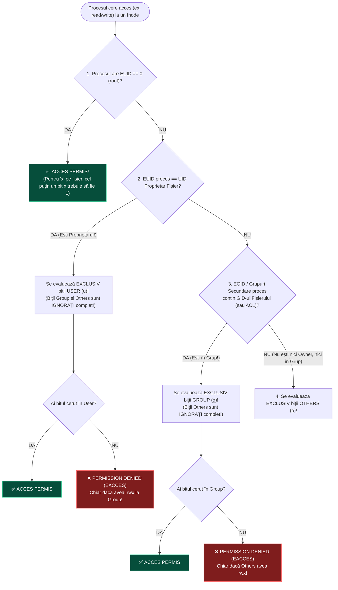

> ### Obiectivul Capitolului, Ponderea în Examenul EX200 & Regula de Aur a Persistenței
>
> * **Obiectivul Capitolului:** Înțelegerea matematică și arhitecturală a modului în care nucleul Linux evaluează permisiunile **DAC (*Discretionary Access Control*)** în VFS, diferența fundamentală dintre permisiunile `rwx` aplicate pe **Fișiere** vs. **Directoare**, stăpânirea celor 3 biți speciali (**`SUID 4000`**, **`SGID 2000`** și **`Sticky Bit 1000`**), calculul măștii de creație **`umask`**, implementarea listelor granulare de control al accesului **POSIX ACLs (`getfacl`, `setfacl`, Default ACLs, Mask)** și a atributelor extinse de imutabilitate (**`lsattr`**, **`chattr +i / +a`**).
>
> * **Ponderea în Examenul EX200:** **URIAȘĂ (15% garantat în 100% din examenele EX200!).** Există două subiecte din acest capitol care apar aproape în fiecare examen RHCSA:
>   1. **Directorul Colaborativ cu SGID (`2770`):** *„Creați directorul `/home/managers` cu următoarele caracteristici: să aparțină grupului `sysadmins`, membrii grupului `sysadmins` să poată citi, scrie și accesa directorul, niciun alt utilizator să nu aibă acces (cu excepția lui `root`), iar **orice fișier creat în interiorul `/home/managers` să moștenească automat grupul `sysadmins`**.”*
>   2. **Permisiuni Granulare cu ACL (`setfacl`):** *„Copiați fișierul `/etc/fstab` în `/var/tmp/fstab`. Configurați permisiunile pe `/var/tmp/fstab` astfel încât utilizatorul `natasha` să aibă drepturi de citire și scriere (`rw-`), utilizatorul `harry` să nu aibă niciun drept (`---`), iar toți ceilalți utilizatori prezenți și viitori să aibă drept de citire (`r--`).”*
>
> * **Regula de Aur a Persistenței (EX200 Survival Rule):**
>   1. Comenzile `chmod`, `chown`, `chgrp`, `setfacl` și `chattr` modifică direct **Inode-ul de pe discul XFS/ext4**, deci sunt **100% persistente la reboot**.
>   2. **EXCEPȚIA CRITICĂ (`umask`):** Dacă rulezi `umask 0027` în terminal, modificarea se aplică **doar sesiunii curente `bash`** și se pierde la reboot! Pentru a face un `umask` persistent pentru un utilizator, trebuie adăugat în **`~/.bashrc`** (sau `~/.bash_profile`), iar pentru întregul sistem în **`/etc/profile.d/custom_umask.sh`** sau **`/etc/login.defs`**.

:::analogy
De ce iau mulți candidați **0 puncte** la task-ul cu directorul colaborativ în examenul EX200, deși au rulat `chmod` și `chown`? Pentru că nu înțeleg două lucruri fundamentale din arhitectura UNIX/Linux:
1. Ce înseamnă cu adevărat permisiunea **`w` (Write)** și **`x` (Execute)** pe un **Director** (și de ce poți șterge un fișier care aparține lui `root` și are permisiuni `0000` dacă ai drept de `w` și `x` pe directorul în care se află!).
2. Cum funcționează algoritmul de decizie al Kernelului (*First-Match Short-Circuit Evaluation*): de ce un utilizator care este proprietarul unui fișier cu permisiuni `0070` (`----rwx---`) primește `Permission denied`, chiar dacă face parte din grupul care are `rwx`!

### Analogia Vizuală: Camera de Arhivă (Directorul) vs. Dosarul din Dulap (Fișierul)

În Capitolul 0.3 am învățat că un **Director** este doar un tabel (*Dentries*) care leagă **Numele Fișierelor** de **Numerele lor de Inode**. Prin urmare, imaginează-ți:
* **Un Director (`/home/managers`):** Este o **Cameră de Arhivă cu Ușă Încuiată** pe al cărei perete se află **Tabelul Nominal de Inventar**.
  * Dreptul **`r` (Read) pe Director** = Ai voie să aprinzi lumina și să citești lista cu numele dosarelor de pe perete (`ls`), dar dacă nu ai și `x`, nu poți păși în cameră să atingi niciun dosar!
  * Dreptul **`x` (Execute / Search) pe Director** = Este **Cheia de la Ușa Camerei**! Îți dă dreptul să pășești înăuntru (`cd /home/managers`) și să accesezi Inode-urile dosarelor al căror nume îl știi deja. **Fără `x` pe un director, nu poți face absolut nimic în el (nici măcar cu `r` sau `w` active)!**
  * Dreptul **`w` (Write) pe Director** *(împreună cu `x`)* = Îți dă dreptul să **modifici Tabelul de pe Perete**: adică să adaugi nume noi (**să creezi fișiere**), să le schimbi numele (`mv`) sau **să ștergi orice nume de pe tabel (`rm`), CHIAR DACĂ dosarul în sine nu îți aparține ție!**
* **Ce este `Sticky Bit (1000 / +t)` în această analogie?** Este **Lacătul Personal pe Tabelul din Piața Publică (`/tmp`)**: toată lumea are voie să adauge dosare noi în cameră (`rwxrwxrwt`), dar paznicul (Kernelul) nu îți dă voie să ștergi de pe tabel decât dosarele pe care scrie numele tău!
* **Ce este `SGID (2000 / g+s)` pe un Director?** Este **Ștampila Automată de la Intrarea în Cameră**: ori de câte ori un membru al echipei creează un dosar nou în acea cameră, ușa ștampilează automat dosarul cu numele **Grupului Camerei (`sysadmins`)**, nu cu grupul personal al angajatului!
:::

:::architecture
### 2.1. Cum Evaluează Kernelul Permisiunile DAC (`rwx`) — Algoritmul First-Match!

Fiecare Inode stochează 12 biți de permisiuni împărțiți în 4 grupuri de câte 3 biți (reprezentați în baza 8 / **Octal** prin 4 cifre, de exemplu `0750` sau `2770`):
1. **Primul grup de 3 biți (Octal `0`–`7`):** Biții Speciali (**SUID = `4`**, **SGID = `2`**, **Sticky = `1`**).
2. **Al doilea grup (`u` — User / Owner):** Permisiunile proprietarului fișierului (**`r` = `4`**, **`w` = `2`**, **`x` = `1`**).
3. **Al treilea grup (`g` — Group):** Permisiunile grupului căruia îi aparține fișierul (**`r` = `4`**, **`w` = `2`**, **`x` = `1`**).
4. **Al patrulea grup (`o` — Others):** Permisiunile pentru toți ceilalți utilizatori din sistem (**`r` = `4`**, **`w` = `2`**, **`x` = `1`**).

> **Algoritmul Kernelului (De ce ordinea `User -> Group -> Others` este exclusivă!):**
> Când un proces cu `EUID` și `EGID` încearcă să deschidă un fișier prin syscall-ul `open()`, kernelul **NU adună** permisiunile de la User, Group și Others! El aplică o logică strictă de tip **`if / else if / else`** (*se oprește la prima potrivire!*):



#### Tabelul Comparativ: Efectul Permisiunilor `r`, `w`, `x` pe Fișiere vs. Directoare

| Bit Permisiune | Valoare Octală | Efect pe un **FIȘIER OBIȘNUIT (`-`)** | Efect pe un **DIRECTOR (`d`)** |
| :---: | :---: | :--- | :--- |
| **`r` (Read)** | **`4`** | Poți citi conținutul fișierului (`cat`, `less`, `cp`). | Poți lista **doar numele** fișierelor din director (`ls`). *(Dacă nu ai și `x`, `ls -l` va afișa `?????????` la permisiuni și proprietar, pentru că nu poate citi Inode-urile!)* |
| **`w` (Write)** | **`2`** | Poți modifica sau trunchia conținutul fișierului (`vim`, `>`). **Nu îți dă dreptul să ștergi fișierul!** | *(Necesită obligatoriu și `x`!)* Poți **crea fișiere noi**, **redenumi** sau **ȘTERGE (`rm`) orice fișier din acel director**, indiferent cine este proprietarul fișierului și ce permisiuni are fișierul! |
| **`x` (Execute)** | **`1`** | Poți executa fișierul ca program/script în memorie (`execve()`). *(Pentru scripturi Bash/Python ai nevoie de **`r` + `x`**; pentru binare compilate ELF e suficient doar **`x`**!).* | **Bitul de Traversare (*Search / Traverse*):** Îți permite să intri în director (`cd`) și să accesezi Inode-urile fișierelor din interior. |

### 2.2. Disecția Biților Speciali: `SUID (4000)`, `SGID (2000)` și `Sticky Bit (1000)`

Această secțiune valorează aur curat în examenul EX200 și la orice interviu tehnic:

| Bit Special | Valoare Octală | Simbol Simbolic (`chmod`) | Cum apare în `ls -l` (cu `x` vs. fără `x`) | Efect pe un **FIȘIER EXECUTABIL** | Efect pe un **DIRECTOR** |
| :--- | :---: | :---: | :--- | :--- | :--- |
| **SUID** (*Set User ID*) | **`4000`** (`4---`) | **`u+s`** | În câmpul **User**: **`s`** mic (`rwsr-xr-x`) dacă are și `x`, sau **`S` MARE** (`rwSr-xr-x`) dacă lipsește `x`! | Procesul pornit nu rulează cu UID-ul utilizatorului curent, ci cu **EUID-ul PROPRIETARULUI fișierului** (ex: `/usr/bin/passwd` rulează ca `root`). | *Ignorat în Linux (nu are niciun efect pe directoare).* |
| **SGID** (*Set Group ID*) | **`2000`** (`2---`) | **`g+s`** | În câmpul **Group**: **`s`** mic (`rwxr-sr-x`) dacă are și `x`, sau **`S` MARE** (`rwxr-Sr-x`) dacă lipsește `x`! | Procesul pornit rulează cu **EGID-ul GRUPULUI fișierului**. | **REGELE EX200 (Directoare Colaborative!):** Orice fișier sau subdirector nou creat în interior **moștenește automat GRUPUL directorului părinte** (iar subdirectoarele noi moștenesc automat și bitul `g+s`!). |
| **Sticky Bit** (*Restricted Deletion Flag*) | **`1000`** (`1---`) | **`o+t`** *(sau `+t`)* | În câmpul **Others**: **`t`** mic (`rwxrwxrwt`) dacă are și `x`, sau **`T` MARE** (`rwxrwxrwT`) dacă lipsește `x`! | *Ignorat în Linux pe fișiere.* | **Prevenirea Ștergerii de către Colegi:** Chiar dacă toată lumea are drept de `w` pe director, un fișier din interior poate fi șters/redenumit **DOAR de proprietarul fișierului**, de proprietarul directorului sau de `root`! |

> **De ce apare uneori litera mare `S` sau `T` în `ls -ld` și de ce este un semnal de alarmă în examen?**
> Dacă în examen ți se cere să creezi un director colaborativ `/home/managers` pentru grupul `sysadmins` și tu rulezi din greșeală `chmod 2660 /home/managers` (uitând bitul `x` pe grup!), `ls -ld` îți va afișa:
> `drw-rwS---. 2 root sysadmins ... /home/managers`
> Litera **`S` MARE** (sau **`T` MARE**) îți strigă: *„Ai pus bitul special SGID/Sticky, dar **ai uitat să pui bitul de execuție `x` dedesubt**, deci nimeni nu poate intra în director!”*
>Pe un director colaborativ în EX200, permisiunea corectă este aproape întotdeauna **`2770` (`drwxrws---`)** — cu **`s` mic**!

#### Receta Completă în 3 Pași pentru Task-ul de Director Colaborativ în EX200 (`2770`)

Când examenul îți cere: *„Creați directorul `/home/managers` deținut de grupul `sysadmins`, accesibil (citire, scriere, acces) doar membrilor `sysadmins`, fără acces pentru alții, în care toate fișierele noi aparțin automat grupului `sysadmins`”*, execuți exact aceste 3 comenzi:

```bash
# Pasul 1: Creăm directorul
mkdir -p /home/managers

# Pasul 2: Setăm grupul proprietar pe 'sysadmins' (folosind chown :grup sau chgrp grup)
chown :sysadmins /home/managers

# Pasul 3: Setăm permisiunile 2770 (2 = SGID pentru moștenirea grupului, 7 = rwx pt owner, 7 = rwx pt grup, 0 = nimic pt others)
chmod 2770 /home/managers

# Verificare obligatorie (trebuie să vezi drwxrws--- și grupul sysadmins!):
ls -ld /home/managers
# drwxrws---. 2 root sysadmins 6 Nov 12 12:00 /home/managers
```

### 2.3. Masca de Creație a Fișierelor: `umask` (*User File-Creation Mode Mask*)

Când creezi un fișier nou cu `touch fisier.txt` sau un director nou cu `mkdir folder`, de unde știe kernelul ce permisiuni inițiale să le pună?
1. **Permisiunile de Bază Maximale (*Base Permissions*) cerute de aplicații prin syscall-urile `open()` și `mkdir()`:**
   * Pentru un **DIRECTOR NOU**, baza este **`0777` (`rwxrwxrwx`)**.
   * Pentru un **FIȘIER NOU**, baza este **`0666` (`rw-rw-rw-`)** — *din motive de securitate, sistemul de operare nu acordă niciodată bitul de execuție `x` din oficiu la crearea unui fișier nou!*
2. **Calculul cu `umask`:** Kernelul aplică operația logică pe biți `BASE & (~UMASK)` (în practică, pentru fișiere fără biți de execuție în mască, scădem matematic `umask`-ul din `0777` pentru directoare și eliminăm biții corespunzători din `0666` pentru fișiere):

| Utilizator în RHEL 9 / 10 | Valoarea `umask` Implicită | Permisiuni Rezultate pe **DIRECTOR NOU** (`0777 - umask`) | Permisiuni Rezultate pe **FIȘIER NOU** (`0666 & ~umask`) |
| :--- | :---: | :---: | :---: |
| **`root` (`UID 0`)** și **Utilizatori Normali (`UID >= 1000`) în RHEL 9 / 10** *(setat în `/etc/login.defs`)* | **`0022`** | **`0755`** (`drwxr-xr-x`) | **`0644`** (`-rw-r--r--`) |
| **Configurație Restrictivă (Securitate Sporită — cerută des în EX200!)** | **`0027`** | **`0750`** (`drwxr-x---`) | **`0640`** (`-rw-r-----`) |
| **Configurație Privată Totală (Doar proprietarul are acces!)** | **`0077`** | **`0700`** (`drwx------`) | **`0600`** (`-rw-------`) |
| **Configurație Colaborativă de Grup** | **`0002`** | **`0775`** (`drwxrwxr-x`) | **`0664`** (`-rw-rw-r--`) |

> **Atenție la calculul `umask` pe Fișiere când `umask` conține cifre impare (ex: `umask 0027` vs. `umask 0037`):**
> `umask` nu „scade aritmetic”, ci **dezactivează biții prezenți în mască**! Deoarece fișierele pleacă de la `0666` (nu au bitul `1 = x`), atât `umask 0027`, cât și `umask 0037` vor produce pe un fișier nou tot **`0640` (`-rw-r-----`)**, dar pe un director nou `0027` va da `0750` (`drwxr-x---`), în timp ce `0037` va da `0740` (`drwxr-----`)!

### 2.4. POSIX Access Control Lists (`ACL` — `getfacl` & `setfacl`)

Permisiunile standard UNIX au o limitare majoră: un fișier poate avea **un singur proprietar (`u`)** și **un singur grup (`g`)**.
Dar ce faci în examenul EX200 când cerința îți spune: *„Pe fișierul `/var/tmp/fstab` (care aparține lui `root:root`), acordați utilizatorului `natasha` drept de `rw-`, utilizatorului `harry` niciun drept `---`, și grupului `devops` drept de `r-x`”*?
Răspunsul este **POSIX ACLs (*Access Control Lists*)**, stocate în atributele extinse ale Inode-ului!

* **Cum recunoști instantaneu în `ls -l` că un fișier are un ACL configurat?**
  La finalul celor 10 caractere de permisiuni, în loc de punctul `.` (care indică doar SELinux), apare semnul plus **`+`**:
  `-rw-rw-r--+ 1 root root 545 Nov 12 12:10 /var/tmp/fstab`

#### Comenzile `getfacl` și `setfacl` (Sintaxa Completă pentru EX200)

```bash
# 1. Citirea ACL-urilor unui fișier sau director:
getfacl /var/tmp/fstab

# 2. Adăugarea / Modificarea (-m) unei reguli ACL pentru un UTILIZATOR:
setfacl -m u:natasha:rw- /var/tmp/fstab
setfacl -m u:harry:--- /var/tmp/fstab

# 3. Adăugarea / Modificarea (-m) unei reguli ACL pentru un GRUP:
setfacl -m g:sysadmins:r-x /var/tmp/fstab

# 4. Modificarea permisiunilor OTHERS prin setfacl:
setfacl -m o::r-- /var/tmp/fstab

# 5. Ștergerea (-x) unei singure intrări ACL (fără a pune permisiuni la final!):
setfacl -x u:harry /var/tmp/fstab

# 6. Ștergerea COMPLETĂ (-b = remove all base ACLs) a tuturor ACL-urilor de pe un fișier:
setfacl -b /var/tmp/fstab
```

#### Concepte Avansate ACL: `Default ACLs (d:)` pe Directoare și `ACL Mask`

1. **Default ACLs (`d:u:user:rwx` sau `-d -m`) — Moștenirea ACL-urilor pe Directoare:**
   Dacă pui un ACL normal (`setfacl -m u:natasha:rwx /data/proiect`) pe un director, `natasha` poate intra acum în `/data/proiect`. Dar când alt coleg creează un fișier nou `raport.txt` în acel director, fișierul nou **NU** va avea ACL-ul pentru `natasha`!
   Pentru ca **toate fișierele și subdirectoarele create în viitor** în `/data/proiect` să moștenească automat ACL-ul pentru `natasha`, trebuie să setezi și un **Default ACL** (prefixul **`d:`**):
   ```bash
   # Pasul 1: ACL de acces pe directorul existent (și recursiv cu -R pe ce există deja):
   setfacl -R -m u:natasha:rwx /data/proiect
   # Pasul 2: DEFAULT ACL pentru tot ce se va crea în viitor în acel director:
   setfacl -m d:u:natasha:rwx /data/proiect
   ```

2. **Ce este `mask::` în output-ul `getfacl` și Capcana `chmod` după `setfacl`!**
   Când rulezi `getfacl`, vezi o linie numită `mask::rw-`.
   * **Ce reprezintă `mask`:** Este **Limita Maximă Efectivă (Plafonul)** de permisiuni pe care o poate avea orice utilizator nominalizat în ACL sau grupul proprietar!
   * **Capcana Mortală:** Atunci când un fișier are ACL-uri active, coloana de mijloc din `ls -l` (permisiunile de grup) **NU mai afișează permisiunile grupului proprietar, ci afișează valoarea lui `ACL mask`!** Dacă tu setezi mai întâi ACL-ul `setfacl -m u:natasha:rw- fisier` și **DUPĂ aceea** rulezi `chmod 0600 fisier` (sau `chmod g-rw fisier`), comanda `chmod` va coborî `mask::` la `---`, iar `getfacl` îți va arăta:
     `user:natasha:rw-    #effective:---` -> **Accesul lui `natasha` a fost blocat de mască!**
   * **Regula de Aur:** Rulează **ÎNTOTDEAUNA `chmod` ÎNAINTE de `setfacl`**, niciodată după!

### 2.5. Atribute Extinse de Sistem de Fișiere (`lsattr` și `chattr`)

Pe lângă permisiunile `rwx` și ACL-uri, sistemele de fișiere XFS și ext4 suportă atribute la nivel de Inode care se aplică **chiar și împotriva utilizatorului `root` (`UID 0`)**!
* **`chattr +i <fisier>` (*Immutable* — Imutabil):** Nimeni — **nici măcar `root`!** — nu mai poate modifica, șterge, redenumi sau face *hard link* către acel fișier până când `root` nu scoate atributul cu **`chattr -i <fisier>`**!
* **`chattr +a <fisier>` (*Append-Only*):** Fișierul poate fi deschis doar în mod adăugare (`>>`) pentru scriere de loguri; nimeni (nici `root`) nu poate șterge sau suprascrie liniile deja existente în el!
* **Cum verificăm aceste atribute?** Cu comanda **`lsattr <fisier>`**!
:::

:::exam-alert
### 💀 Capcana Mortală #1: Task-ul cu `/var/tmp/fstab` — Greșeala de a rula `chmod` DUPĂ `setfacl`!
În celebrul task de examen cu `/var/tmp/fstab`, mulți candidați pun mai întâi ACL-urile pentru `natasha` și `harry`, și la final văd partea din cerință *„toți ceilalți utilizatori trebuie să aibă doar drept de citire”*, așa că rulează `chmod 644 /var/tmp/fstab` la sfârșit.
Acea comandă `chmod 644` resetează `mask::r--`, tăind dreptul de scriere (`w`) al lui `natasha` (`#effective:r--`)!
* **Antidotul:** Verifică întotdeauna la final cu **`getfacl /var/tmp/fstab`** că în dreptul liniei `user:natasha:rw-` **NU** apare comentariul `#effective:r--`, și testează efectiv scrierea cu:
  `su - natasha -c "echo '# test' >> /var/tmp/fstab"` (apoi șterge linia de test!).

### 💀 Capcana Mortală #2: Uitarea Permisiunii `0` pentru `Others` la Directorul Colaborativ!
În examen, cerința pentru directorul colaborativ spune aproape mereu: *„Directorul `/home/managers` nu trebuie să fie accesibil niciunui alt utilizator (cu excepția lui `root`)”*.
Dacă tu creezi directorul cu `mkdir /home/managers` (care are permisiunile implicite `0755`) și apoi rulezi doar `chmod g+ws /home/managers`, permisiunile devin **`2775` (`drwxrwsr-x`)** — adică *Others* au rămas cu `r-x` și pot citi toate fișierele din interior -> **0 puncte în examen!**
* **Antidotul:** Folosește întotdeauna notația octală completă în 4 cifre: **`chmod 2770 /home/managers`**!

### 🛠️ Man Page Hacks pentru Capitolul 1.2
Ai uitat în examen sintaxa pentru Default ACLs la `setfacl`?
Rulează:
```bash
man setfacl
```
și caută `/EXAMPLES` la finalul paginii: vei găsi exact exemplele `setfacl -m u:lisa:r /var/tmp/file` și `setfacl -m d:u:lisa:rwx dir`!
:::

:::interview
### Întrebarea 1 (Nivel Mid -> Senior):
> **Intervievator:** *„Ești logat ca `root` (`UID 0`) pe un server RHEL 9. Încerci să ștergi un fișier de configurare cu `rm -f /etc/app.conf`, dar primești eroarea `rm: cannot remove '/etc/app.conf': Operation not permitted`. Sistemul de fișiere `/` este montat Read-Write (`rw`) și SELinux este în modul Permissive. Care este cauza și cum ștergi fișierul?”*

**Răspunsul Ideal:**
> „Dacă `root` primește `Operation not permitted (EPERM)` pe un sistem de fișiere montat `rw`, cauza este că fișierul `/etc/app.conf` (sau directorul `/etc` în care se află) are setat atributul extins de **Imutabilitate (`i` — Immutable)** sau **Append-only (`a`)** în Inode!
>
> **Cum verific și rezolv:**
> 1. Rulez **`lsattr /etc/app.conf`** și verific dacă apare litera `i` (`----i---------e------- /etc/app.conf`).
> 2. Elimin atributul imutabil rulând **`chattr -i /etc/app.conf`**.
> 3. Acum pot șterge normal fișierul cu `rm -f /etc/app.conf`.”

### Întrebarea 2 (Nivel Junior -> Mid):
> **Intervievator:** *„Fișierul `/data/secret.txt` are proprietarul `alice`, grupul `developers` și permisiunile `0070 (----rwx---)`. Utilizatorul `alice` este membru în grupul `developers`. Când `alice` rulează `cat /data/secret.txt`, primește `Permission denied`, deși toți ceilalți colegi din grupul `developers` pot citi și modifica fișierul! De ce?”*

**Răspunsul Ideal:**
> „Deoarece algoritmul de evaluare DAC din Kernelul Linux nu cumulează permisiunile, ci evaluează în cascadă exclusivă: **Owner -> Group -> Others**.
> Când `alice` încearcă să deschidă `/data/secret.txt`, kernelul compară `EUID`-ul procesului (`alice`) cu `UID`-ul proprietarului din Inode (`alice`). Deoarece se potrivesc, kernelul verifică **EXCLUSIV primii 3 biți (cei de User/Owner: `---`)**, vede că bitul `r` este `0` și returnează imediat `EACCES (Permission denied)`, fără să mai verifice vreodată dacă `alice` face parte din grupul `developers`!”
:::

:::lab
Conectează-te pe **`node1.lab.example.com`** (unde în Capitolul 1.1 am creat deja grupul `sysadmins` și utilizatorii `natasha`, `harry` și `sarah`) și execută următoarele scenarii:
:::

:::exam
Pune-ți cronometrul pe **15 minute** și rezolvă pe **`node1.lab.example.com`** (folosind grupul `ops_team` și utilizatorii `alison`, `bruno`, `carlos` creați la simularea din Capitolul 1.1):

### Partea A: Cele 3 Task-uri Practice (Stil Oficial EX200)

1. **Task 1 (Director Colaborativ cu SGID & Sticky Bit):**
   Creați directorul `/srv/ops_shared` cu următoarele reguli:
   * Directorul trebuie să aparțină grupului `ops_team`.
   * Membrii grupului `ops_team` trebuie să aibă drepturi complete de citire, scriere și traversare în director, dar niciun alt utilizator (în afară de `root`) să nu aibă vreun drept asupra lui.
   * Orice fișier creat în `/srv/ops_shared` trebuie să aparțină automat grupului `ops_team`.
   * În plus, utilizatorii din `ops_team` trebuie să își poată șterge din `/srv/ops_shared` **doar propriile fișiere**, fără a putea șterge fișierele create de ceilalți colegi din echipă (*Sticky Bit*).
2. **Task 2 (Configurare ACL pe Fișier și Director cu Default ACL):**
   * Copiați fișierul `/etc/chrony.conf` în `/var/tmp/chrony.conf`. Configurați ACL-uri pe `/var/tmp/chrony.conf` astfel încât utilizatorul `alison` să aibă drepturi de citire și scriere (`rw-`), utilizatorul `bruno` să nu aibă niciun drept (`---`), iar toți ceilalți utilizatori să aibă doar drept de citire (`r--`).
   * Pe directorul `/srv/ops_shared`, configurați un **ACL (atât de acces curent, cât și Default ACL pentru fișierele viitoare)** care să îi ofere utilizatorului `natasha` drepturi de citire și execuție (`r-x`), fără drept de scriere.
3. **Task 3 (Configurare Persistentă `umask`):**
   Configurați contul utilizatorului `alison` astfel încât toate fișierele noi create de ea în sesiunile viitoare să aibă permisiunile implicite `0600` (`-rw-------`), iar toate directoarele noi create de ea să aibă permisiunile implicite `0700` (`drwx------`).
:::

:::solution
#### Rezolvarea Pas cu Pas a Task-urilor Practice:

##### Rezolvare Task 1 (Director Colaborativ `/srv/ops_shared` cu SGID `2000` + Sticky Bit `1000` = `3770`):
```bash
# 1. Creăm directorul și îi atribuim grupul ops_team:
mkdir -p /srv/ops_shared
chown :ops_team /srv/ops_shared

# 2. Calculăm bitul special: SGID (2) + Sticky Bit (1) = 3! Deci codul octal este 3770:
chmod 3770 /srv/ops_shared

# 3. Verificăm permisiunile (trebuie să vedem 's' la grup și 'T' la others, deoarece others nu are x):
ls -ld /srv/ops_shared
# drwxrws--T. 2 root ops_team 6 Nov 12 12:45 /srv/ops_shared
```
* **Profesorul Explică:** Observă ce frumos funcționează aritmetica octală! SGID este `2`, Sticky Bit este `1`, deci suma lor este **`3`** (`chmod 3770 /srv/ops_shared`, sau simbolic `chmod g+s,o+t /srv/ops_shared`). Deoarece *Others* au permisiunea `0` (nu au `x`), Sticky Bit-ul este afișat corect cu **`T` mare** la finalul permisiunilor (`drwxrws--T`)!

##### Rezolvare Task 2 (ACL pe `/var/tmp/chrony.conf` și Default ACL pe `/srv/ops_shared`):
```bash
# Partea 1: /var/tmp/chrony.conf
cp /etc/chrony.conf /var/tmp/chrony.conf
chmod 0644 /var/tmp/chrony.conf
setfacl -m u:alison:rw- /var/tmp/chrony.conf
setfacl -m u:bruno:--- /var/tmp/chrony.conf
getfacl /var/tmp/chrony.conf

# Partea 2: Acces ACL + Default ACL pentru natasha pe /srv/ops_shared
setfacl -m u:natasha:r-x /srv/ops_shared
setfacl -m d:u:natasha:r-x /srv/ops_shared
getfacl /srv/ops_shared
```

##### Rezolvare Task 3 (`umask 0077` persistent pentru `alison`):
```bash
# Pentru ca directoarele să aibă 0700 (0777 - 0077) și fișierele 0600 (0666 - 0066), umask-ul este 0077:
echo "umask 0077" >> /home/alison/.bashrc

# Testăm prin su - alison:
su - alison -c "umask; touch /home/alison/test_secret.txt; ls -l /home/alison/test_secret.txt"
# Output așteptat: 0077 și -rw-------. 1 alison alison
```

#### Scriptul de Verificare Automată (Grading Script pentru Capitolul 1.2)

```bash
#!/bin/bash
# ==============================================================================
# RHCSA (EX200) - Script Automat de Evaluare: Capitolul 1.2
# ==============================================================================
SCORE=0
TOTAL=30

echo "========================================================"
echo " Evaluare Obiective Capitolul 1.2 pe $(hostname)"
echo "========================================================"

# Verificare Task 1: /srv/ops_shared (3770 și grupul ops_team)
if [[ -d /srv/ops_shared ]] && \
   [[ $(stat -c "%a:%G" /srv/ops_shared) == "3770:ops_team" ]]; then
    echo "[ PASS ] Task 1: Directorul /srv/ops_shared are permisiunile 3770 (SGID + Sticky) și grupul ops_team (+10p)"
    SCORE=$((SCORE + 10))
else
    echo "[ FAIL ] Task 1: /srv/ops_shared nu are permisiunile 3770 sau grupul ops_team (0p)"
fi

# Verificare Task 2: ACL pe /var/tmp/chrony.conf și Default ACL pe /srv/ops_shared
if [[ -f /var/tmp/chrony.conf ]] && \
   getfacl -p /var/tmp/chrony.conf | grep -q "^user:alison:rw-$" && \
   getfacl -p /var/tmp/chrony.conf | grep -q "^user:bruno:---$" && \
   getfacl -p /srv/ops_shared | grep -q "^user:natasha:r-x$" && \
   getfacl -p /srv/ops_shared | grep -q "^default:user:natasha:r-x$"; then
    echo "[ PASS ] Task 2: Regulile ACL și Default ACL sunt configurate impecabil (+10p)"
    SCORE=$((SCORE + 10))
else
    echo "[ FAIL ] Task 2: Eroare la ACL-urile de pe /var/tmp/chrony.conf sau /srv/ops_shared (0p)"
fi

# Verificare Task 3: umask 0077 persistent pentru alison
ALISON_UMASK=$(su - alison -c "umask" 2>/dev/null)
if [[ "$ALISON_UMASK" == "0077" ]]; then
    echo "[ PASS ] Task 3: Umask-ul persistent pentru alison este 0077 (+10p)"
    SCORE=$((SCORE + 10))
else
    echo "[ FAIL ] Task 3: Umask-ul pentru alison este '$ALISON_UMASK' în loc de 0077 (0p)"
fi

echo "--------------------------------------------------------"
echo " PUNCTAJ FINAL CAPITOLUL 1.2: $SCORE / $TOTAL"
echo "========================================================"
```
:::

:::references
1. **Cursurile Oficiale Red Hat:**
   * **RH124 (*Red Hat System Administration I*):** Capitolul 7 (*Control Access to Files* — `chmod`, `chown`, `SUID/SGID/Sticky`, `umask`).
   * **RH134 (*Red Hat System Administration II*):** Capitolul 3 (*Control Access to Files with ACLs* — `getfacl`, `setfacl`, Default ACLs, Mask).
2. **Pagini de Manual (`man`) Esențiale din Sistem:**
   * `man 1 chmod`, `man 1 chown`, `man 1 chgrp`
   * `man 1 getfacl`, `man 1 setfacl`, `man 5 acl`
   * `man 1 chattr`, `man 1 lsattr`
:::
