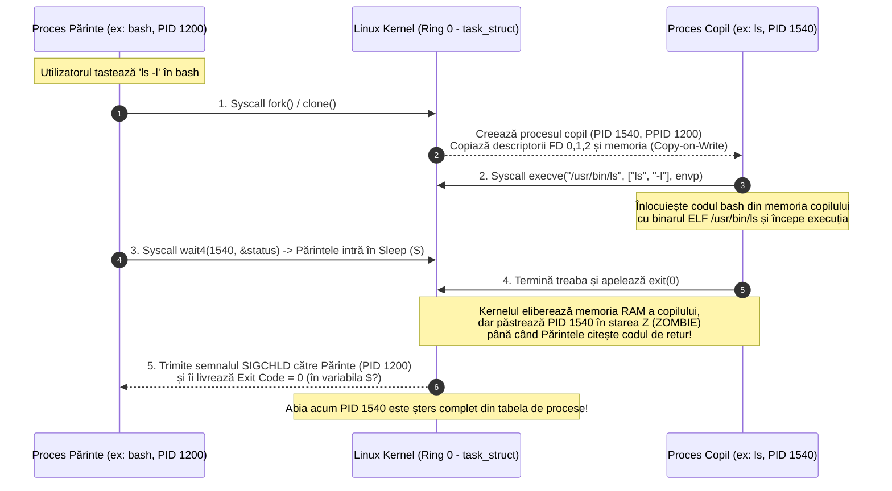
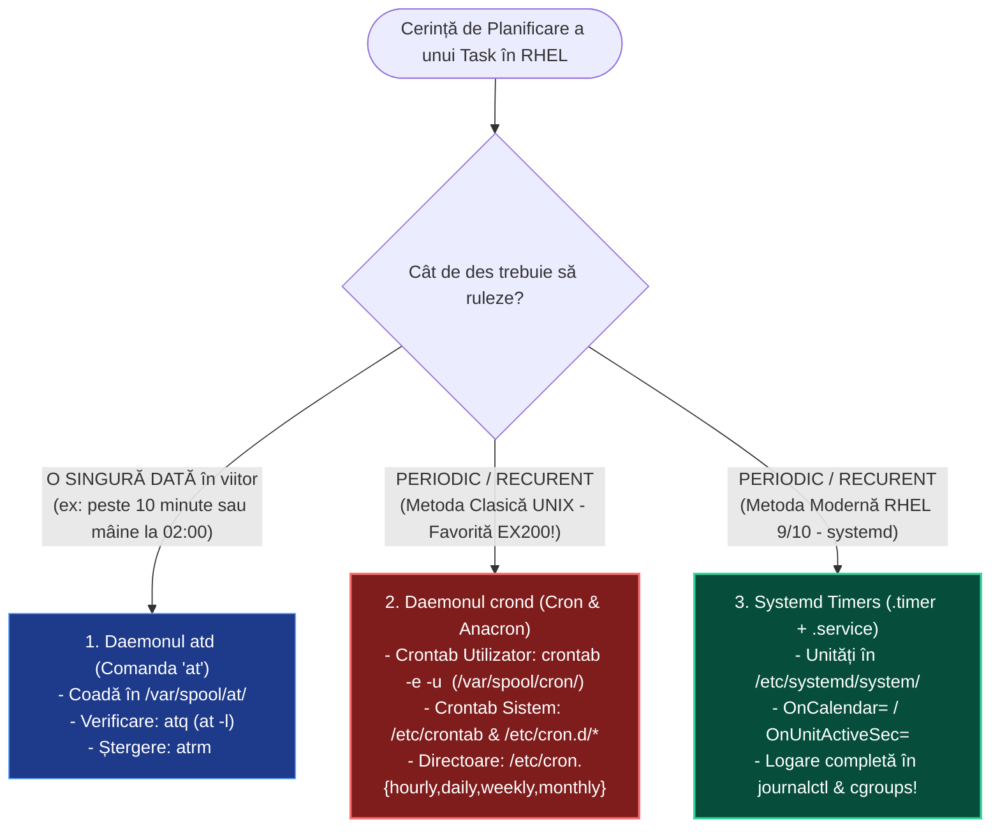

> ### Obiectivul Capitolului, Ponderea în Examenul EX200 & Regula de Aur a Persistenței
>
> * **Obiectivul Capitolului:** Înțelegerea completă a modului în care nucleul Linux creează, planifică și distruge procesele prin apelurile de sistem `fork()`, `execve()`, `wait4()` și `exit()`, diagnosticarea stărilor critice ale proceselor (**`R`**, **`S`**, **`D` — Uninterruptible Sleep**, **`Z` — Zombie**, **`T`**), controlul joburilor în sesiunea curentă (`&`, `bg`, `fg`, `nohup`), comunicarea asincronă prin **Semnale Kernel (`SIGTERM 15` vs. `SIGKILL 9` vs. `SIGHUP 1`)**, ajustarea priorităților de procesor prin **CFS Scheduler (`nice` și `renice` de la `-20` la `+19`)** și automatizarea execuției periodice sau viitoare a task-urilor prin **`at`**, **`cron` (`crontab -e`, `/etc/crontab`, `/etc/cron.d/`, `anacron`)** și arhitectura modernă **`systemd Timers` (`.timer` + `.service`)**.
>
> * **Ponderea în Examenul EX200:** **Ridicată și Garantată (10–15% din punctajul examenului).** În examenul RHCSA vei întâlni garantat:
>   1. **Un task de planificare periodică (`cron` sau `systemd timer`):** *„Configurați un job cron pentru utilizatorul `natasha` care să ruleze în fiecare zi la ora `14:23` (sau din 2 în 2 minute între orele 09:00 și 17:00) și să execute comanda `/bin/logger "EX200 check"`.”*
>   2. **Un task de identificare și manipulare a proceselor:** Identificarea procesului care consumă cel mai mult CPU, schimbarea priorității sale `nice` la o valoare exactă (ex. `-5` sau `+10`) sau oprirea tuturor proceselor unui utilizator cu `pkill`.
>
> * **Regula de Aur a Persistenței (EX200 Survival Rule):**
>   1. **Prioritățile `nice` / `renice` aplicate manual pe un PID activ NU sunt persistente la reboot!** (După reboot, procesul pornește cu alt PID și cu `nice 0`). Dacă un serviciu trebuie să pornească mereu cu o anumită prioritate la boot, aceasta se definește în unitatea sa `systemd` prin directiva `Nice=`.
>   2. Pentru ca un job **`cron`** sau **`at`** sau **`systemd.timer`** să supraviețuiască și să se execute după reboot-ul de evaluare, serviciul daemon aferent (**`crond.service`**, **`atd.service`** sau unitatea **`.timer`**) trebuie să fie obligatoriu activat la boot cu **`systemctl enable --now crond`**!

:::analogy
Ce este, de fapt, un **Proces** în Linux? Un program compilat pe disc (precum `/usr/sbin/sshd` sau `/usr/bin/bash`) este doar o colecție inertă de octeți stocată într-un Inode — ca o rețetă culinară tipărită într-o carte de bucate. În secunda în care îi ceri kernelului să ruleze acel program, kernelul îi alocă o structură de control în RAM numită **`task_struct`** (în codul sursă C al kernelului din `<linux/sched.h>`), îi atribuie un număr unic de înmatriculare numit **PID (*Process Identifier*)**, îi creează un spațiu de memorie virtuală izolat și îl pune în coada de execuție a procesorului. Rețeta de pe hârtie a prins viață și a devenit un **Proces**!

Dar pe un server enterprise RHEL cu 200 de procese active și doar 2 sau 4 nuclee fizice de procesor (vCPU), cum reușește sistemul să îți dea iluzia că toate cele 200 de programe rulează simultan? Și mai ales, de ce uneori dai `kill -9 <PID>` pe un proces blocat, dar procesul **refuză să moară** și rămâne agățat în `ps aux`?

### Analogia Vizuală: Bucătăria Restaurantului Michelin, Bucătarul-Șef (CFS Scheduler) și Procesele Zombie vs. Uninterruptible

Imaginează-ți procesorul (CPU-ul) serverului tău ca pe **Singurul Aragaz cu Foc Puternic** dintr-o bucătărie de restaurant de lux, iar procesele ca pe **Bucătarii** care vor să gătească la acel aragaz:

1. **Planificatorul Kernelului (`CFS — Completely Fair Scheduler`) și `nice` (`-20` .. `+19`):**
   * Fiecare bucătar (proces) primește câte câteva milisecunde (*Time Slice*) la aragaz, apoi este dat la o parte pentru următorul bucătar (*Context Switch*).
   * Valoarea **`nice` (Politețea procesului)** măsoară cât de „politicos” și „amabil” este bucătarul cu colegii săi:
     * Un bucătar cu **`nice +19`** este **extrem de politicos**: el se dă singur la o parte și spune *„Poftiți voi primii la aragaz, eu gătesc doar când nu mai are nimeni nevoie de foc!”* (**Prioritate Minimă**).
     * Un bucătar cu **`nice -20`** este **egoist și agresiv (VIP)**: el dă pe toată lumea la o parte și își ia cea mai mare cotă de timp la aragaz (**Prioritate Maximă** — de aceea doar `root` are voie să scadă politețea sub `0`!).
2. **Starea `D` (*Uninterruptible Sleep*) — De ce nu îl poți omorî cu `kill -9`?**
   * Bucătarul a trimis un ajutor în pivniță (la discul fizic sau la un server NFS din rețea) după un sac de făină și stă cu mâinile întinse în cadrul ușii așteptând Răspunsul Hardware I/O. Dacă tu strigi la el să plece acasă (`kill -9`), el **nu are voie să se miște** până nu se termină tranzacția hardware, altfel sacul de făină s-ar vărsa și ar corupe memoria kernelului!
3. **Starea `Z` (*Zombie / Defunct Process*) — De ce nu îl poți omorî cu `kill -9`?**
   * Bucătarul **este deja mort și a plecat acasă**! Nu mai consumă niciun gram de RAM și niciun strop de CPU!Tot ce a mai rămas din el este **Fișa lui de Pontaj (Exit Status-ul din tabela de procese)** agățată în cui, așteptând ca șeful lui direct (**Procesul Părinte — `PPID`**) să vină să o citească prin apelul `wait()`. Nu poți împușca cu `kill -9` un cadavru! Singurul mod de a curăța un Zombie este să îl atenționezi sau să îl oprești pe **Părintele lui (`PPID`)**!
:::

:::architecture
### 2.1. Ciclul de Viață al unui Proces: `fork()`, `execve()`, `wait4()` și `exit()`

În Linux, niciun proces nu apare din nimic. Cu excepția primului proces creat de kernel la boot — **`systemd` (care are întotdeauna `PID 1`)** și a thread-urilor interne ale kernelului (`kthreadd`, `PID 2`) — fiecare proces nou este creat prin clonarea unui proces părinte existent:



* **Ce se întâmplă dacă Procesul Părinte moare ÎNAINTEA Procesului Copil (*Orphan Process*)?**
  Dacă părintele moare în timp ce copilul încă rulează, copilul devine un **Proces Orfan**. Imediat, kernelul îl „adoptă” automat și îi schimbă părintele (`PPID`) la **`PID 1` (`systemd`)**, care apelează constant `wait()` și curăță orice proces adoptat când acesta se termină!

### 2.2. Cele 5 Stări ale Proceselor în Kernel (Vizibile în coloana `STAT` din `ps aux` și `top`)

| Cod în `ps` / `top` | Numele Stării în Engleză | Ce se întâmplă tehnic în Kernel (`task_struct->state`) | Cum acționezi ca SysAdmin / SRE? |
| :---: | :--- | :--- | :--- |
| **`R`** | **Running or Runnable** | Procesul fie execută instrucțiuni pe un nucleu CPU *chiar în această nanosecundă*, fie stă în coada de execuție (*Run Queue*) gata de start, așteptând un nucleu liber. | Normal. Dacă numărul de procese în starea `R` depășește numărul de vCPU-uri, apare *CPU Saturation* (crește *Load Average*). |
| **`S`** | **Interruptible Sleep** | Procesul doarme (consumă **0% CPU**!), așteptând un eveniment (de ex., `sshd` așteaptă pachete pe rețea, `bash` așteaptă să apeși o tastă). Poate fi trezit instantaneu de orice semnal kernel! | Stare normală pentru 98% din daemonii de pe un server. |
| **`D`** | **Uninterruptible Sleep** *(Disk / I/O Sleep)* | Procesul este blocat în *Kernel Space (Ring 0)* așteptând finalizarea unei operațiuni hardware sincrone (disc defect, SAN deconectat, server **NFS căzut**!). **Ignoră orice semnal (inclusiv `SIGKILL 9`) pentru a proteja integritatea stivei kernel!** | **ALERTĂ DE PRODUCȚIE!** Nu încerca `kill -9`. Verifică stocarea (`dmesg`, `iostat`) sau repornește/demontează cu `umount -lf` partajarea NFS blocată! |
| **`T`** *(sau `t`)* | **Stopped / Traced** | Procesul a fost înghețat în memorie prin apăsarea **`Ctrl+Z`** în terminal (`SIGTSTP`), prin semnalul `SIGSTOP (19)` sau este atașat unui debugger (`strace` / `gdb`). | Îl repornești în *background* cu **`bg`**, în *foreground* cu **`fg`** sau îi trimiți semnalul `kill -CONT <PID>`. |
| **`Z`** | **Zombie (`<defunct>`)** | Procesul și-a terminat execuția (`exit()`) și **nu mai consumă nici RAM, nici CPU**, dar intrarea lui din tabela de procese nu a fost încă citită (`reaped`) cu `wait()` de către procesul său părinte (`PPID`). | Găsește părintele cu `ps -o ppid= -p <PID_ZOMBIE>` și trimite semnalul `kill -CHLD <PPID>` sau repornește serviciul părinte! |

### 2.3. Semnalele Kernel (`kill`, `pkill`, `killall`) — `SIGTERM (15)` vs. `SIGKILL (9)`

Un **Semnal (*Signal*)** este o întrerupere software asincronă trimisă unui proces pentru a-l notifica de un eveniment. Putem vedea lista tuturor celor 64 de semnale rulând **`kill -l`**. În examenul EX200 și la interviuri, 5 semnale sunt fundamentale:

| Număr Semnal | Numele Oficial POSIX | Nume Scurt în `kill` | Tastă în Terminal | Cum reacționează procesul și când îl folosim? |
| :---: | :--- | :--- | :---: | :--- |
| **`1`** | **`SIGHUP`** *(Hangup)* | `kill -1` sau `kill -HUP` | *Închiderea terminalului* | Istoric, anunța că a căzut linia telefonică a modemului. Pentru daemonii moderni (`sshd`, `httpd`, `rsyslogd`), **`SIGHUP` înseamnă: „Recitește-ți fișierul de configurare din `/etc` fără a opri conexiunile active!”** (Echivalent cu `systemctl reload`). |
| **`2`** | **`SIGINT`** *(Interrupt)* | `kill -2` sau `kill -INT` | **`Ctrl + C`** | Cere oprirea procesului interactiv care rulează în *foreground* în terminal. |
| **`9`** | **`SIGKILL`** *(Kill — Forțat!)* | **`kill -9`** sau `kill -KILL` | *Nu are* | **EXECUȚIE SUMARĂ DIRECT DIN KERNEL!** Semnalul `9` **NU este livrat procesului** și **nu poate fi interceptat sau ignorat**! Kernelul taie instantaneu procesul din *Run Queue* și îi distruge spațiul de memorie, fără a-i lăsa timp să își salveze datele sau să își șteargă fișierele `.lock`/`.pid`! |
| **`15`** | **`SIGTERM`** *(Terminate — Politicos!)* | **`kill <PID>`** *(Implicit!)* | *Nu are* | **SEMNALUL IMPLICIT dacă nu specifici niciun număr (`kill 1234` == `kill -15 1234`)!** Îi cere politicos procesului să se închidă singur (*Graceful Shutdown*): procesul termină tranzacțiile în curs, scrie bufferele pe disc, închide conexiunile la baza de date și iese curat. |
| **`18` / `19` / `20`** | **`SIGCONT` / `SIGSTOP` / `SIGTSTP`** | `kill -CONT` / `kill -STOP` | **`Ctrl + Z`** (`20`) | `SIGSTOP (19)` îngheață forțat un proces din kernel; `SIGTSTP (20)` este `Ctrl+Z` din terminal; `SIGCONT (18)` dezgheață un proces oprit (`T`) și îl pune înapoi în `R`/`S`. |

#### Uneltele de Căutare și Trimitere a Semnalelor (`ps`, `pgrep`, `pkill`)

```bash
# 1. Afișarea tuturor proceselor din sistem cu detalii despre CPU/MEM/STAT (stil BSD vs stil POSIX):
ps aux
ps -ef

# 2. Sortarea proceselor direct din ps după consumul de CPU sau Memorie (Truc de Examen!):
ps aux --sort=-%cpu | head -n 10
ps aux --sort=-%mem | head -n 10

# 3. Căutarea PID-urilor după nume sau după utilizator cu pgrep (-l = afișează și numele procesului, -u = utilizator):
pgrep -l -u natasha
pgrep -l sshd

# 4. Oprirea tuturor proceselor unui utilizator sau ale unui program după nume cu pkill:
pkill -SIGTERM -u harry          # Trimite politicos SIGTERM (15) tuturor proceselor lui harry
pkill -9 -u harry                # Omoară forțat cu SIGKILL (9) toate procesele lui harry (inclusiv sesiunea lui SSH!)
```

### 2.4. Priorități CPU și Planificatorul CFS: `nice` vs. `renice` (`-20` la `+19`)

În nucleul Linux, planificatorul pentru procesele obișnuite se numește **CFS (*Completely Fair Scheduler*)**. În `top` sau `ps -l`, vei vedea două coloane legate de prioritate:
* **`PR` (Priority):** Prioritatea internă văzută de kernel (pentru procesele normale este calculată după formula matematică: $$\text{PR} = 20 + \text{NI}$$).
* **`NI` (Nice Value):** Valoarea de politețe configurabilă de noi, cuprinsă între **`-20`** și **`+19`**:

$$\underbrace{-20}_{\substack{\text{Prioritate MAXIMĂ}\\\text{(Cel mai puțin politicos / VIP)}\\\text{Doar root poate seta } < 0!}} \longleftarrow \cdots \longleftarrow \underbrace{0}_{\substack{\text{Prioritate IMPLICITĂ}\\\text{(Default la pornire)}}} \longrightarrow \cdots \longrightarrow \underbrace{+19}_{\substack{\text{Prioritate MINIMĂ}\\\text{(Cel mai politicos / Background)}\\\text{Oricine își poate crește nice-ul}}}$$

#### Cele Două Comenzi pentru Examen: `nice` (La Pornire) vs. `renice` (Pe un Proces Deja Pornit!)

**Atenție la diferența de sintaxă a flag-ului `-n` între `nice` și `renice`!**
1. **Pornirea unui proces NOU cu o anumită valoare `nice`:**
   Folosim comanda **`nice -n <valoare> <comanda>`**:
   ```bash
   # Pornim un proces sha1sum în background (&) cu valoarea nice -5 (prioritate ridicată):
   nice -n -5 sha1sum /dev/zero &

   # Pornim un proces cu valoarea nice +15 (prioritate scăzută):
   nice -n 15 tar -czf /tmp/bkp.tar.gz /usr &
   ```
2. **Modificarea priorității unui proces CARE RULEAZĂ DEJA (`renice`):**
   ```bash
   # Schimbăm valoarea nice la -10 pentru procesul cu PID-ul 4512:
   renice -n -10 -p 4512
   # (Sau direct: renice -n -10 4512)

   # Schimbăm valoarea nice la +19 pentru TOATE procesele deținute de utilizatorul 'natasha' (-u):
   renice -n 19 -u natasha
   ```

### 2.5. Planificarea Task-urilor în Viitor și Periodic: `at`, `cron` și `systemd Timers`

În examenul EX200 și în producție avem trei mecanisme pentru automatizarea execuției în funcție de timp:



#### 1. Execuția O Singură Dată în Viitor cu `at` (`atd.service`)

```bash
# 1. Ne asigurăm că serviciul atd este pornit și activat la boot:
systemctl enable --now atd

# 2. Planificăm o comandă să ruleze peste 5 minute (sau la '14:30', 'tomorrow', 'now + 2 hours'):
echo 'date >> /root/at_test.log' | at now + 5 minutes
# (Sau interactiv: rulăm 'at 16:00', tastăm comenzile și apăsăm Ctrl+D la final pentru <EOT>!)

# 3. Listăm joburile în așteptare (at queue) și inspectăm conținutul unui job (-c):
atq
at -c 1

# 4. Ștergem un job înainte să se execute (at remove):
atrm 1
```

#### 2. Execuția Periodică prin `cron` (`crond.service`) — Anatomia Celor 5 Stele!

Daemonul **`crond`** se trezește în fiecare minut, verifică fișierele din `/var/spool/cron/` (create cu `crontab -e`), `/etc/crontab` și `/etc/cron.d/` și execută comenzile al căror tipar de timp se potrivește cu minutul curent.

**Cum îți amintești sintaxa celor 5 câmpuri de timp în mijlocul examenului fără să o memorezi?**
Rulezi pur și simplu:
```bash
cat /etc/crontab
# sau:
man 5 crontab
```
Fișierul `/etc/crontab` conține deja desenată de Red Hat diagrama exactă:

```text
# Example of job definition:
# .---------------- minute (0 - 59)
# |  .------------- hour (0 - 23)
# |  |  .---------- day of month (1 - 31)
# |  |  |  .------- month (1 - 12) OR jan,feb,mar,apr ...
# |  |  |  |  .---- day of week (0 - 6) (Sunday=0 or 7) OR sun,mon,tue,wed,thu,fri,sat
# |  |  |  |  |
# *  *  *  *  * user-name  command to be executed
```

> **ATENȚIE LA DIFERENȚA CRITICĂ DINTRE `crontab -e` ȘI `/etc/cron.d/`:**
> * Când editezi crontab-ul unui utilizator cu **`crontab -e -u natasha`** (salvat în `/var/spool/cron/natasha`), linia are **6 câmpuri** (cele 5 câmpuri de timp + comanda direct, **FĂRĂ numele utilizatorului** la mijloc, deoarece se știe deja că fișierul îi aparține lui `natasha`!):
>   `23 14 * * * /usr/bin/logger "Salut de la Natasha"`
> * Când creezi un fișier de sistem în **`/etc/crontab`** sau **`/etc/cron.d/my_job`**, linia are **7 câmpuri** (după cele 5 stele, **al 6-lea câmp este OBLIGATORIU numele utilizatorului** sub care va rula comanda!):
>   `23 14 * * * natasha /usr/bin/logger "Salut de la Natasha"`

##### Tabelul Expresiilor de Timp Clasice în Examenul EX200 pentru `cron`

| Cerința din Enunțul Examenului EX200 | Expresia celor 5 Câmpuri în `crontab` | Explicația fiecărui câmp (`Min` `Ora` `ZiLună` `Lună` `ZiSăpt`) |
| :--- | :---: | :--- |
| *„În fiecare zi la ora **14:23**”* | **`23 14 * * *`** | Minutul `23`, Ora `14`, orice zi din lună, orice lună, orice zi a săptămânii. *(Atenție: Nu pune `14 23`, căci minutul este primul!)* |
| *„Din **2 în 2 minute** (la fiecare 2 minute)”* | **`*/2 * * * *`** | **`*/2`** în câmpul minutelor înseamnă pasul 2 (`0, 2, 4, 6...`). |
| *„Din 5 în 5 minute, **între orele 09:00 și 17:59**, doar de **Luni până Vineri**”* | **`*/5 9-17 * * 1-5`** | Pas de 5 min (`*/5`), intervalul orar `9-17`, zilele săptămânii `1-5` (sau `mon-fri`). |
| *„La minutul 30 al orelor **08:00 și 20:00**, în datele de **1 și 15 ale fiecărei luni**”* | **`30 8,20 1,15 * *`** | Virgula `,` specifică o listă de valori exacte (`8,20` și `1,15`). |
| *„În fiecare **Duminică la miezul nopții (00:00)**”* | **`0 0 * * 0`** *(sau `7` / `sun`)* | Minutul `0`, Ora `0`, Ziua săptămânii `0` (sau `7` = Duminică). |

##### Controlul Accesului la `cron` (`/etc/cron.allow` vs. `/etc/cron.deny`)
* Implicit în RHEL există doar fișierul `/etc/cron.deny` (gol), ceea ce înseamnă că **toți utilizatorii au voie să își creeze joburi `crontab`** cu excepția celor trecuți în `/etc/cron.deny`.
* Dacă însă administratorul creează fișierul **`/etc/cron.allow`**, acesta are prioritate absolută (*Whitelist*): din acel moment, **DOAR utilizatorii listați în `/etc/cron.allow` (și `root`) mai au voie să folosească `crontab`**, iar `/etc/cron.deny` este ignorat complet! (Aceeași logică se aplică și pentru `/etc/at.allow` și `/etc/at.deny`).

#### 3. Alternativa Modernă în RHEL 9 / RHEL 10: `systemd Timers` (`.timer` + `.service`)

De ce înlocuiește Red Hat treptat joburile `cron` de sistem cu **Systemd Timers**?
1. Un job `cron` nu are vizibilitate ușoară a erorilor dacă nu îi redirecționezi output-ul manual; în schimb, un `systemd timer` declanșează o unitate `.service` ale cărei loguri intră automat în **`journalctl -u <nume>.service`**!
2. Poți testa oricând jobul manual fără să aștepți ora din `cron` rulând `systemctl start <nume>.service`!
3. Poți limita resursele de CPU și RAM ale jobului cu directivele *cgroups* din `systemd` (`MemoryMax=`, `CPUQuota=`).

**Cum funcționează perechea `.timer` + `.service`:**
În `/etc/systemd/system/` avem două fișiere cu **exact același nume de bază** (de exemplu `backup_db.service` și `backup_db.timer`):
1. Fișierul **`backup_db.service`** (fără secțiune `[Install]`, de tip `Type=oneshot`) definește **CE comandă se execută** (`ExecStart=/usr/local/bin/backup.sh`).
2. Fișierul **`backup_db.timer`** definește **CÂND se execută**:
   * **Timer Monotonic (relativ la boot sau la ultima rulare):** `OnBootSec=5min` (la 5 minute după boot) și `OnUnitActiveSec=15min` (se repetă la fiecare 15 minute după ce a rulat ultima dată!).
   * **Timer Realtime (Calendaristic — echivalent cu `cron`):** `OnCalendar=*-*-* 14:23:00` (sau `OnCalendar=Mon..Fri *-*-* 09:00:00`).
     * *Trucul Suprem de Verificare pentru `OnCalendar`:* Înainte de a pune o expresie `OnCalendar` într-un fișier `.timer`, o poți valida și simula cu comanda:
       ```bash
       systemd-analyze calendar "*-*-* 14:23:00"
       ```
3. **ATENȚIE LA ACTIVARE:** Nu activăm niciodată cu `enable` fișierul `.service`, ci activăm și pornim **unitatea `.timer`**:
   ```bash
   systemctl daemon-reload
   systemctl enable --now backup_db.timer
   systemctl list-timers --all
   ```
:::

:::exam-alert
### 💀 Capcana Mortală #1: `crontab -r` este exact lângă `crontab -e` pe tastatură!
Pe o tastatură QWERTY, tasta **`r`** este lipită de tasta **`e`**!
* `crontab -e` = **Edit** (editează fișierul cron).
* `crontab -r` = **REMOVE FĂRĂ NICIO ÎNTREBARE DE CONFIRMARE!** Șterge instantaneu toate joburile cron ale utilizatorului!
* **Regula RHCA:** Înainte de a ieși de la subiectul de `cron` în examen, verifică **ÎNTOTDEAUNA** că jobul este salvat rulând:
  ```bash
  crontab -l -u natasha
  ```

### 💀 Capcana Mortală #2: Uitarea Căilor Absolute în Scripturile rulate din `cron`!
Când testezi o comandă interactiv ca `root`, variabila ta `$PATH` conține `/usr/local/sbin:/usr/local/bin:/usr/sbin:/usr/bin:/root/bin`.
Dar când `crond` execută un job pe fundal, el pornește cu un mediu minimal în care `$PATH` este doar `/usr/bin:/bin`! Dacă jobul tău `cron` apelează un utilitar din `/usr/sbin` (cum ar fi `lvcreate`, `ip`, `sysctl`, `useradd`) fără calea absolută, jobul va eșua silențios cu `command not found`!
* **Antidotul:** Folosește **MEREU calea absolută** a comenzilor în `crontab` (aflată cu `which logger` -> `/usr/bin/logger`)!

### 💀 Capcana Mortală #3: Semnul Procent `%` în `crontab` este caracter special (Newline)!
În fișierele `crontab`, caracterul **`%`** este interpretat de `crond` drept **sfârșit de linie (`\n`)**! Dacă în examen ți se cere să creezi un job cron care folosește `date +%F`, trebuie **obligatoriu să pui backslash `\` în fața procentului**: `date +\%F`, altfel `cron` va tăia comanda la semnul `%` și va da eroare!

### 🛠️ Man Page Hacks pentru Capitolul 1.3
1. Ai uitat ordinea câmpurilor de timp din `crontab` sau exemplele?
   ```bash
   man 5 crontab
   # sau citește direct șablonul de pe disc:
   cat /etc/crontab
   ```
2. Ai uitat cum se scriu expresiile `OnCalendar=` sau `OnUnitActiveSec=` la `systemd.timer`?
   ```bash
   man systemd.timer
   man systemd.time
   ```
:::

:::interview
### Întrebarea 1 (Nivel Mid -> Senior / SRE):
> **Intervievator:** *„Ești chemat într-un incident: un server RHEL 9 cu 4 vCPU are un `Load Average` de `45.00`, dar când te uiți în `top`, utilizarea procesorului este `98% Idle (%id)` și doar `2% System (%sy)`! Cum este posibil ca `Load Average` să fie 45 când CPU-ul stă degeaba la 98% Idle?”*

**Răspunsul Ideal:**
> „Aceasta este particularitatea unică a modului în care **Linux Kernel** calculează *Load Average*, spre deosebire de alte sisteme UNIX (precum Solaris sau FreeBSD):
> În Linux, *Load Average* nu măsoară doar procesele care cer CPU (starea **`R` — Runnable**), ci măsoară suma proceselor aflate în starea **`R` PLUS procesele blocate în starea `D` (*TASK_UNINTERRUPTIBLE — Uninterruptible I/O Sleep*)**!
>
> Dacă `Load Average` este `45.00`, dar CPU-ul este `98% Idle`, înseamnă că avem ~45 de procese/thread-uri blocate în starea **`D`**, așteptând după un subsistem I/O înghețat (de exemplu un mount **NFS** al cărui server nu mai răspunde, sau un disc cu latență uriașă). Procesorul nu are ce instrucțiuni să execute (de aceea e *Idle*), dar cele 45 de procese din starea `D` umflă artificial *Load Average*-ul!
> **Cum confirm în 2 secunde:** Rulez **`ps aux | awk '$8 ~ /D/ {print $0}'`** (sau `vmstat 1` și mă uit la coloana `b` — *blocked processes waiting for I/O*).”

### Întrebarea 2 (Nivel Junior -> Mid):
> **Intervievator:** *„Am găsit pe server 50 de procese în starea `Z (Zombie / <defunct>)`. Am rulat `kill -9 <PID>` pe fiecare dintre ele, dar nu dispar din `ps aux`. De ce nu funcționează `kill -9` pe un proces Zombie și cum le elimin?”*

**Răspunsul Ideal:**
> „Un proces în starea `Z (Zombie)` este un proces care **a murit deja** — a executat syscall-ul `exit()`, iar kernelul i-a eliberat deja toată memoria RAM, toate fișierele deschise și nu îl mai programează pe CPU. Deoarece nu mai există un proces viu care să primească semnale, `kill -9` nu are niciun efect asupra lui.
> Singurul lucru care a mai rămas în memoria kernelului este structura minimală cu PID-ul și *Exit Status*-ul său, păstrată până când **Procesul Părinte (`PPID`)** apelează syscall-ul `wait()` / `waitpid()`.
>
> **Cum elimin procesele Zombie:**
> 1. Aflu cine este părintele lor comun: `ps -o pid,ppid,stat,cmd -p <PID_ZOMBIE>`.
> 2. Trimit semnalul `SIGCHLD` către părinte (`kill -s SIGCHLD <PPID>`) pentru a-l forța să apeleze `wait()`.
> 3. Dacă părintele are un bug în cod și ignoră `SIGCHLD`, repornesc sau opresc **procesul părinte** (`kill -15 <PPID>`). În secunda în care părintele moare, toți cei 50 de copii Zombie sunt adoptați de `PID 1 (systemd)`, care apelează imediat `wait()` și îi șterge instantaneu din tabela de procese!”
:::

:::lab
Conectează-te pe **`node1.lab.example.com`** și execută pas cu pas laboratorul:
:::

:::exam
Pune-ți cronometrul pe **15 minute** și rezolvă pe **`node1.lab.example.com`**:

### Partea A: Cele 3 Task-uri Practice (Stil Oficial EX200)

1. **Task 1 (Planificare `crontab` pentru Utilizator):**
   Configurați un job `cron` pentru utilizatorul `alison` care să ruleze în fiecare zi de **Luni până Vineri** la ora **14:23** și să execute comanda `/usr/bin/echo "Backup check completed" >> /home/alison/cron_status.txt`. Asigurați-vă că serviciul `crond` este pornit și activat la boot, și că **doar** utilizatorii `root`, `alison` și `natasha` au permisiunea de a folosi comanda `crontab` pe acest server.
2. **Task 2 (Gestiunea Proceselor și Priorităților `nice` / `renice`):**
   Porniți în *background* sub contul utilizatorului `root` procesul `sleep 7200` având prioritatea `nice` setată la **`-12`**. Verificați că procesul rulează și salvați PID-ul și valoarea sa `NI` (extrase cu `ps -o pid=,ni= -C sleep`) în fișierul `/root/sleep_priority.txt`.
3. **Task 3 (Configurare `systemd Timer`):**
   Creați în `/etc/systemd/system/` o pereche de unități numite `disk-check.service` și `disk-check.timer`. Serviciul trebuie să ruleze comanda `/usr/bin/df -h > /var/tmp/disk_usage.txt` (folosind `/usr/bin/sh -c '...'`). Timerul trebuie să fie configurat să ruleze la fiecare **5 minute** după activarea anterioară (`OnUnitActiveSec=5min`), să pornească la **2 minute** după boot (`OnBootSec=2min`) și să fie **activat și pornit persistent la boot**. Rulați și serviciul o dată imediat pentru a popula `/var/tmp/disk_usage.txt`.
:::

:::solution
#### Rezolvarea Pas cu Pas a Task-urilor Practice:

##### Rezolvare Task 1 (`crontab` pentru `alison` + `/etc/cron.allow`):
```bash
# 1. Activăm crond:
systemctl enable --now crond

# 2. Configurăm jobul cron pentru alison (Min=23, Ora=14, ZiLună=*, Lună=*, ZiSăpt=1-5):
echo '23 14 * * 1-5 /usr/bin/echo "Backup check completed" >> /home/alison/cron_status.txt' | crontab -u alison -

# 3. Restricționăm accesul la crontab doar pentru root, alison și natasha prin /etc/cron.allow:
cat << 'EOF' > /etc/cron.allow
root
alison
natasha
EOF
```

##### Rezolvare Task 2 (`sleep 7200` în background cu `nice -12`):
```bash
# Oprim eventuale procese sleep vechi pentru curățenie:
pkill -9 -x sleep 2>/dev/null

# Pornim sleep 7200 cu nice -12 în background:
nice -n -12 sleep 7200 &

# Salvăm PID-ul și valoarea NI în /root/sleep_priority.txt:
ps -o pid=,ni= -C sleep > /root/sleep_priority.txt
cat /root/sleep_priority.txt
```

##### Rezolvare Task 3 (`disk-check.service` + `disk-check.timer`):
```bash
cat << 'EOF' > /etc/systemd/system/disk-check.service
[Unit]
Description=Disk Usage Check Service

[Service]
Type=oneshot
ExecStart=/usr/bin/sh -c '/usr/bin/df -h > /var/tmp/disk_usage.txt'
EOF

cat << 'EOF' > /etc/systemd/system/disk-check.timer
[Unit]
Description=Run Disk Usage Check every 5 minutes

[Timer]
OnBootSec=2min
OnUnitActiveSec=5min

[Install]
WantedBy=timers.target
EOF

systemctl daemon-reload
systemctl start disk-check.service
systemctl enable --now disk-check.timer
```

#### Scriptul de Verificare Automată (Grading Script pentru Capitolul 1.3)

```bash
#!/bin/bash
# ==============================================================================
# RHCSA (EX200) - Script Automat de Evaluare: Capitolul 1.3
# ==============================================================================
SCORE=0
TOTAL=30

echo "========================================================"
echo " Evaluare Obiective Capitolul 1.3 pe $(hostname)"
echo "========================================================"

# Verificare Task 1: Crontab alison + /etc/cron.allow
if systemctl is-enabled crond &>/dev/null && \
   crontab -l -u alison 2>/dev/null | grep -qE "^23[[:space:]]+14[[:space:]]+\*[[:space:]]+\*[[:space:]]+(1-5|mon-fri)" && \
   [[ -f /etc/cron.allow ]] && grep -qx "alison" /etc/cron.allow && grep -qx "natasha" /etc/cron.allow; then
    echo "[ PASS ] Task 1: Jobul cron pentru alison (14:23 Luni-Vineri) și /etc/cron.allow sunt corecte (+10p)"
    SCORE=$((SCORE + 10))
else
    echo "[ FAIL ] Task 1: Eroare la crontab-ul lui alison sau la /etc/cron.allow (0p)"
fi

# Verificare Task 2: Procesul sleep cu nice -12
if ps -o ni= -C sleep 2>/dev/null | grep -q -- "-12" && \
   [[ -s /root/sleep_priority.txt ]] && grep -q -- "-12" /root/sleep_priority.txt; then
    echo "[ PASS ] Task 2: Procesul sleep rulează în background cu nice -12 și este salvat în /root/sleep_priority.txt (+10p)"
    SCORE=$((SCORE + 10))
else
    echo "[ FAIL ] Task 2: Procesul sleep cu nice -12 nu rulează sau /root/sleep_priority.txt este incorect (0p)"
fi

# Verificare Task 3: disk-check.timer + disk-check.service
if systemctl is-enabled disk-check.timer &>/dev/null && \
   systemctl is-active disk-check.timer &>/dev/null && \
   [[ -s /var/tmp/disk_usage.txt ]]; then
    echo "[ PASS ] Task 3: Unitatea disk-check.timer este activă/enabled și /var/tmp/disk_usage.txt a fost generat (+10p)"
    SCORE=$((SCORE + 10))
else
    echo "[ FAIL ] Task 3: Timerul disk-check.timer nu este enabled/active sau /var/tmp/disk_usage.txt lipsește (0p)"
fi

echo "--------------------------------------------------------"
echo " PUNCTAJ FINAL CAPITOLUL 1.3: $SCORE / $TOTAL"
echo "========================================================"
```
:::

:::references
1. **Cursurile Oficiale Red Hat:**
   * **RH124 (*Red Hat System Administration I*):** Capitolul 8 (*Monitor and Manage Linux Processes* — `ps`, `top`, `kill`, `nice`, `renice`).
   * **RH134 (*Red Hat System Administration II*):** Capitolul 5 (*Schedule Future Tasks* — `at`, `cron`, `anacron`, `systemd Timers`).
2. **Pagini de Manual (`man`) Esențiale din Sistem:**
   * `man 1 ps`, `man 1 top`, `man 1 pgrep`, `man 1 pkill`, `man 7 signal`
   * `man 1 nice`, `man 1 renice`
   * `man 1 crontab`, `man 5 crontab`, `man 1 at`
   * `man 5 systemd.timer`, `man 5 systemd.service`, `man 7 systemd.time`
:::
