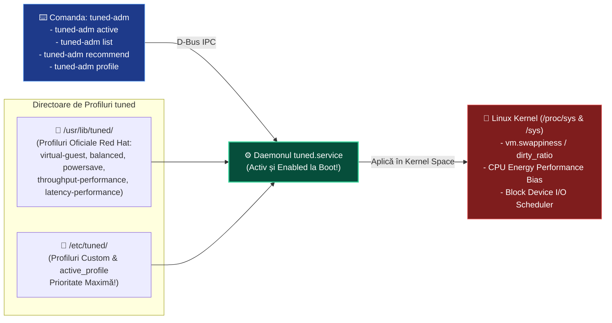

> ### Obiectivul Capitolului, Ponderea în Examenul EX200 & Regula de Aur a Persistenței
>
> * **Obiectivul Capitolului:** Stăpânirea completă a cerințelor de **Bash Scripting** din examenul RHCSA (EX200) și din interviurile de DevOps: anatomia liniei **Shebang (`#!/bin/bash`)**, variabilele poziționale și speciale (`$0`, `$1`, `$2`, `$@`, `$*`, `$#`, `$?`, `$$`), codurile de ieșire (**Exit Codes `0`–`255`**), operatorii de testare moderni **`[[ ... ]]`** (pentru fișiere `-f`, `-d`, `-e`, `-s`, șiruri de caractere `-z`, `-n`, `==`, `!=` și numere întregi `-eq`, `-ne`, `-lt`, `-gt`), structurile decizionale (`if / elif / else / fi` și `case / esac`), buclele (`for` și `while`), plus arhitectura daemonului de optimizare dinamică a sistemului **`tuned`** și utilitarul **`tuned-adm`**.
>
> * **Ponderea în Examenul EX200:** **10–15% GARANTAT (2 Task-uri Directe în Examen!).**
>
>   1. **Task-ul de Bash Scripting (pe `node1`):** Introducerea acestui obiectiv în EX200 (începând cu RHEL 8 și menținut în RHEL 9 / RHEL 10) sperie mulți candidați, dar cerința din examen este de fapt extrem de clară și scurtă (un script de 10–15 linii):
>
>      * *Exemplul Tip A (Argumente & `if/else`):* *„Creați un script `/usr/local/bin/myscript.sh`. Dacă este apelat cu argumentul `redhat`, trebuie să afișeze `fedora`. Dacă este apelat cu argumentul `fedora`, trebuie să afișeze `redhat`. Dacă nu i se dă niciun argument sau i se dă orice alt argument, trebuie să afișeze pe `stderr` mesajul exact `Usage: /usr/local/bin/myscript.sh redhat|fedora` și să iasă cu un cod de eroare diferit de zero.”*
>
>      * *Exemplul Tip B (Căutare & Procesare cu `for`):* *„Creați un script care caută toate fișierele din `/usr` mai mici de 2M care au bitul SGID setat și le copiază într-un director.”*
>
>   2. **Task-ul `tuned` (pe `node2`, rezolvabil în 30 de secunde!):** *„Instalați și activați serviciul `tuned`, determinați profilul de performanță recomandat pentru această mașină virtuală și setați sistemul să folosească acel profil recomandat.”*
>
> * **Regula de Aur a Persistenței (EX200 Survival Rule):**
>
>   1. **Cea mai frecventă greșeală din lume la scriptul de examen:** Candidații scriu un script impecabil în `/usr/local/bin/myscript.sh`, îl testează cu `bash /usr/local/bin/myscript.sh`, văd că merge și trec mai departe, **UITÂND să îi dea permisiunea de execuție (`chmod +x /usr/local/bin/myscript.sh`)**! Când scriptul de notare al lui Red Hat încearcă să îl ruleze direct (`/usr/local/bin/myscript.sh`), primește `Permission denied` -> **0 puncte**!
>
>   2. La **`tuned`**: Asigură-te că daemonul `tuned.service` este activat la boot cu **`systemctl enable --now tuned`** înainte de a seta profilul cu `tuned-adm profile <nume_profil>`!

:::analogy
De ce îți cere Red Hat să știi să scrii un script Bash în examenul EX200 și la orice interviu de Linux SysAdmin / DevOps? Pentru că **Regula de Aur a Ingineriei de Sistem** spune: *„Dacă trebuie să execuți o secvență de comenzi o singură dată, o tastezi în CLI. Dacă trebuie să o execuți de două ori, o transformi într-un script Bash. Dacă trebuie să o execuți pe 100 de servere, o pui într-un Playbook Ansible!”*

Dar cum știe nucleul Linux (**Kernel Space — Ring 0**), atunci când tu execuți `./scriptul_meu.sh`, că acel fișier text nu este un program compilat în C (format ELF), ci trebuie trimis către interpretul `/bin/bash` sau `/usr/bin/python3`?

### Analogia Vizuală: Scrisoarea de Însoțire (`#!` Shebang), Ștampila de Succes (`Exit Code $?`) și Modurile de Condus ale Mașinii (`tuned`)

1. **Linia `#!/bin/bash` (*Shebang / Hash-Bang*):**
   * Imaginează-ți că îi înmânezi unui funcționar de la ghișeul băncii (**Kernelul, prin syscall-ul `execve()`**) un document scris într-o limbă străină. Funcționarul se uită **exclusiv la primele 2 caractere din colțul din stânga-sus al primei pagini**. Dacă vede octeții magici **`#!`** (`0x23 0x21`), el înțelege: *„Acesta este un script! Pe restul primei linii scrie adresa exactă a traducătorului (`/bin/bash` sau `/usr/bin/python3`) pe care trebuie să îl chem ca să citească acest document!”*.
2. **Exit Code (`$?` — Codul de Retur `0` vs. `1..255`):**
   * În Linux, fiecare comandă care se termină îi predă părintelui său un **Raport de Misiune numeric (`0`–`255`)** păstrat în variabila **`$?`**.
   * Spre deosebire de logica booleană din alte limbaje (unde `1` = True și `0` = False), în UNIX/Linux **există un singur mod în care o misiune poate reuși (Codul `0` = SUCCES ABSOLUT!)**, dar există **255 de motive diferite pentru care o misiune poate eșua (`1`..`255` = EROARE!)**. Exact pe acest cod `$?` se bazează instrucțiunea `if` din Bash!
3. **Ce este daemonul `tuned`?**
   * Imaginează-ți butonul **Drive Mode (Eco / Comfort / Sport / Track / Off-Road)** dintr-o mașină modernă. Când apeși pe modul *Sport*, computerul mașinii nu schimbă o singură piesă, ci modifică simultan 20 de parametri: întărește suspensia, ține turația motorului sus, schimbă răspunsul accelerației.
   * Exact asta face **`tuned`** pe un server RHEL! În loc să modifici manual zeci de fișiere în `/proc/sys/vm/`, `/sys/block/vda/queue/scheduler` și guvernatorul CPU-ului, îi spui `tuned-adm profile virtual-guest` (sau `throughput-performance` / `powersave`), iar `tuned` reglează instantaneu și persistent toți parametrii kernelului pentru acel scenariu!
:::

:::architecture
### 2.1. Anatomia unui Script Bash: `Shebang`, Permisiuni și Variabilele Speciale (`$1`, `$@`, `$#`, `$?`)

Orice script Bash profesional începe obligatoriu pe **Linia 1, Coloana 1** cu:
```bash
#!/bin/bash
```
*(sau `#!/usr/bin/env bash`)*. Imediat după ce ai creat fișierul scriptului, fă-l executabil cu:
```bash
chmod +x /cale/catre/script.sh
```

#### Tabelul Variabilelor Poziționale și Speciale din Bash (Memorare Obligatorie pentru EX200!)

Să presupunem că apelăm scriptul nostru astfel:
`/usr/local/bin/backup.sh /etc /var/log "raport zilnic"`

| Variabilă în Script | Ce Valoare Conține în Exemplul Nostru? | Explicație Tehnică & Cum o folosești în Examenul EX200 |
| :---: | :--- | :--- |
| **`$0`** | `"/usr/local/bin/backup.sh"` | **Numele scriptului** însuși (exact așa cum a fost apelat în linia de comandă). |
| **`$1`** | `"/etc"` | **Primul argument** transmis scriptului. |
| **`$2`** | `"/var/log"` | **Al doilea argument** transmis scriptului (pentru argumente $\ge 10$, se folosește acolada: `${10}`). |
| **`$#`** | `3` | **Numărul TOTAL de argumente** transmise scriptului! *(Vital în EX200 când verifici dacă utilizatorul a dat cel puțin un argument: `if [[ $# -eq 0 ]]; then ...`)* |
| **`"$@"`** | `"/etc"` `"/var/log"` `"raport zilnic"` | **Toate argumentele ca elemente SEPARATE!** Când este pus între ghilimele duble (`"$@"`), păstrează intacte argumentele care conțin spații (`"raport zilnic"` rămâne un singur element în bucla `for arg in "$@"`!). |
| **`"$*"`** | `"/etc /var/log raport zilnic"` | Toate argumentele lipite într-un **singur șir de caractere** separat prin primul caracter din `$IFS` (spațiu). |
| **`$?`** | `0` *(dacă a reușit)* sau `1..255` *(eroare)* | **Exit Code-ul ultimei comenzi executate!** (`0` = Adevărat / Succes; $\ne 0$ = Fals / Eroare). |
| **`$$`** | Ex: `4812` | **PID-ul procesului `bash` curent** în care rulează scriptul (util pentru fișiere temporare unice: `/tmp/work_$$.tmp`). |

---

### 2.2. Operatorii de Testare în Bash (`[[ ... ]]`) și Structurile Condiționale (`if/elif/else`, `case`)

În Bash există două sintaxe pentru evaluarea condițiilor în `if`:
1. Sintaxa clasică POSIX cu o singură paranteză pătrată: `[ "$1" = "redhat" ]` (care este de fapt un sinonim pentru comanda `/usr/bin/test`).
2. **Sintaxa modernă extinsă Bash cu două paranteze pătrate: `[[ "$1" == "redhat" ]]` — RECOMANDAREA #1 PENTRU EXAMENUL EX200!**
   * *De ce folosim mereu `[[ ... ]]` în RHEL?* Pentru că `[[ ... ]]` este un cuvânt-cheie intern al lui `bash` care **nu se strică dacă o variabilă este goală sau conține spații**, suportă operatorii logici `&&` (*AND*) și `||` (*OR*) direct în interior și permite potrivire cu wildcard-uri/Regex!
   * **REGULA SPAȚIILOR ÎN BASH:** Trebuie să lași **OBLIGATORIU câte un spațiu liber** după `[[`, înainte de `]]` și în jurul operatorului (`==`, `-eq`):
     * Corect: `if [[ "$1" == "redhat" ]]; then`
     * Greșit: `if [["$1"=="redhat"]]; then` *(eroare de sintaxă!)*

#### Tabelul Operatorilor de Testare în `[[ ... ]]` (Fișiere, Șiruri Text și Numere)

| Categorie | Operator în `[[ ... ]]` | Când returnează ADEVĂRAT (`Exit Code 0`)? | Exemplu Practic de Examen EX200 |
| :--- | :---: | :--- | :--- |
| **1. Testare FIȘIERE și DIRECTOARE** | **`-e <cale>`** | Calea **există** pe disc (indiferent dacă e fișier, director sau symlink). | `if [[ -e /etc/fstab ]]; then` |
| | **`-f <cale>`** | Calea există și este un **Fișier Obișnuit (*Regular File*)**. | `if [[ -f /etc/chrony.conf ]]; then` |
| | **`-d <cale>`** | Calea există și este un **Director**. | `if [[ ! -d /backup ]]; then mkdir -p /backup; fi` |
| | **`-s <cale>`** | Fișierul există și are **dimensiunea $> 0$ bytes** (nu este gol). | `if [[ -s /var/log/errors.log ]]; then` |
| | **`-r` / `-w` / `-x`** | Fișierul poate fi **citit (`-r`)**, **scris (`-w`)** sau **executat (`-x`)** de userul curent. | `if [[ -x /usr/local/bin/app ]]; then` |
| **2. Testare ȘIRURI TEXT (*Strings*)** | **`-z "$VAR"`** | Șirul este **GOL** (*Zero length* — lungime 0 caractere). | `if [[ -z "$1" ]]; then echo "Lipsă arg!"; exit 1; fi` |
| | **`-n "$VAR"`** | Șirul **NU este gol** (*Non-zero length*). | `if [[ -n "$USER" ]]; then` |
| | **`"$A" == "$B"`** | Șirul `$A` este **egal** cu șirul `$B` (în `[ ]` se folosește un singur `=`). | `if [[ "$1" == "redhat" ]]; then` |
| | **`"$A" != "$B"`** | Șirul `$A` este **diferit** de șirul `$B`. | `if [[ "$1" != "root" ]]; then` |
| **3. Comparare NUMERE ÎNTREGI (*Integers*)** | **`$A -eq $B`** | Numărul `$A` este **Egal** (*Equal*) cu `$B`. | `if [[ $# -eq 0 ]]; then` |
| | **`$A -ne $B`** | Numărul `$A` este **Diferit** (*Not Equal*) de `$B`. | `if [[ $? -ne 0 ]]; then` |
| | **`$A -lt $B`** / **`-le`** | **Mai mic** (*Less Than* `<`) / **Mai mic sau egal** (*Less or Equal* $\le$). | `if [[ $UID -lt 1000 ]]; then` |
| | **`$A -gt $B`** / **`-ge`** | **Mai mare** (*Greater Than* `>`) / **Mai mare sau egal** (*Greater or Equal* $\ge$). | `if [[ $DISK_USAGE -ge 90 ]]; then` |
| **4. Operatori LOGICI** | **`!`**, **`&&`**, **`\|\|`** | **`!`** = Negare (*NOT*); **`&&`** = ȘI logic (*AND*); **`\|\|`** = SAU logic (*OR*). | `if [[ -f "$F" && -r "$F" ]]; then` |

> **Capcana Clasică de Examen: Compararea Numerelor cu `>` sau `==` în loc de `-gt` și `-eq`!**
> În interiorul `[[ ... ]]`, operatorii `==`, `!=`, `<`, `>` compară **alfabetic (lexicografic, ca text)**!
> Dacă compari alfabetic `"10" > "2"`, rezultatul este **FALS**, deoarece caracterul `'1'` vine înaintea caracterului `'2'` în tabelul ASCII!
> **Regulă:** Pentru **numere întregi**, folosește **ÎNTOTDEAUNA `-eq`, `-ne`, `-lt`, `-le`, `-gt`, `-ge`**! Pentru **text (cuvinte)**, folosește **`==` și `!=`**!

#### Șablonul Oficial de Examen EX200: Scriptul `if / elif / else / fi` vs. `case / esac`

Iată rezolvarea completă a celui mai cunoscut task de scripting din examenul RHCSA (schimbul `redhat` $\leftrightarrow$ `fedora` cu tratarea erorilor):

```bash
#!/bin/bash
# ==============================================================================
# Sablon Oficial EX200 - Varianta 1: Folosind if / elif / else / fi
# ==============================================================================
if [[ "$1" == "redhat" ]]; then
    echo "fedora"
elif [[ "$1" == "fedora" ]]; then
    echo "redhat"
else
    # Daca cerinta cere afisarea pe stderr, adaugam >&2 la finalul lui echo!
    echo "/usr/local/bin/myscript.sh redhat|fedora" >&2
    exit 1
fi
```

Și echivalentul său folosind structura **`case ... in ... esac`** (ideală când ai multe opțiuni):

```bash
#!/bin/bash
# ==============================================================================
# Sablon Oficial EX200 - Varianta 2: Folosind case / esac
# ==============================================================================
case "$1" in
    redhat)
        echo "fedora"
        ;;
    fedora)
        echo "redhat"
        ;;
    *)
        echo "/usr/local/bin/myscript.sh redhat|fedora" >&2
        exit 1
        ;;
esac
```

---

### 2.3. Bucle în Bash (`for` și `while`) și Procesarea Listelor în Examen

În examenul EX200 și în practica de zi cu zi ca SysAdmin, buclele `for` sunt folosite pentru a crea rapid o listă de utilizatori, a verifica starea mai multor servicii sau a procesa fișierele returnate de o comandă:

```bash
# 1. Iterarea peste o listă fixă de elemente (ex: crearea a 3 utilizatori):
for user in natasha harry sarah; do
    useradd "$user"
    echo "flectrag" | passwd --stdin "$user"
done

# 2. Iterarea peste o secvență numerică generată cu Brace Expansion {1..10}:
for i in {1..5}; do
    touch "/tmp/fisier_${i}.txt"
done

# 3. Iterarea peste rezultatul unei comenzi $(...) (Command Substitution):
for fisier in $(find /etc -maxdepth 1 -name "*.conf"); do
    cp -a "$fisier" /root/backup_conf/
done

# 4. Citirea unui fișier linie cu linie folosind bucla 'while read':
while IFS=: read -r username pass uid gid gecos homedir shell; do
    if [[ $uid -ge 1000 && $uid -le 60000 ]]; then
        echo "Utilizator uman: $username (UID: $uid, Shell: $shell)"
    fi
done < /etc/passwd
```

---

### 2.4. Optimizarea Performanței Sistemului cu `tuned` și `tuned-adm` (Subiect Garantat în EX200!)

Daemonul **`tuned`** monitorizează și adaptează dinamic setările componentelor hardware și ale kernelului (CPU governor, I/O elevator pentru discuri, `vm.swappiness`, `vm.dirty_ratio`, power management) pe baza unor **Profiluri de Tuning (*Tuning Profiles*)**.



#### Tabelul Profilurilor Principale `tuned` în RHEL 9 / RHEL 10

| Nume Profil `tuned` | Pentru ce tip de server este proiectat și ce modifică în Kernel? |
| :--- | :--- |
| **`virtual-guest`** | **PROFILUL RECOMANDAT IMPLICIT PE VM-URILE DIN EXAMENUL EX200!** Optimizat pentru mașini virtuale: scade `vm.swappiness` și ajustează `dirty_ratio` pentru a minimiza I/O-ul inutil pe discul virtual. |
| **`virtual-host`** | Optimizat pentru un hypervisor fizic KVM care găzduiește mașini virtuale. |
| **`balanced`** | Profilul implicit pentru sisteme generale: echilibru între performanță și consumul de energie. |
| **`throughput-performance`** | Pentru servere bare-metal fără cerințe de economisire a energiei: dezactivează *power saving*, blochează CPU-ul la frecvență ridicată și crește bufferele I/O de disc și rețea. |
| **`latency-performance`** | Pentru sisteme financiare (*High-Frequency Trading*) sau telecom care cer latență minimă: dezactivează stările *CPU C-states* de somn profund. |
| **`powersave`** | Maximizează economia de energie (reduce agresiv frecvența procesorului și consumul discurilor/plăcilor de rețea). |

#### Cele 5 Comenzi cu care Rezolvi Task-ul `tuned` în 30 de Secunde la Examenul EX200!

```bash
# Pasul 1: Ne asigurăm că pachetul tuned este instalat și că serviciul este PORNIT și ENABLED la boot!
dnf install -y tuned
systemctl enable --now tuned

# Pasul 2: Vedem ce profil este activ în acest moment:
tuned-adm active

# Pasul 3: Vedem toate profilurile disponibile pe sistem:
tuned-adm list

# Pasul 4: Întrebăm sistemul care este profilul RECOMANDAT pentru această mașină (va returna 'virtual-guest'):
tuned-adm recommend

# Pasul 5: Aplicăm profilul recomandat (sau cel cerut explicit în enunț) și verificăm!
tuned-adm profile $(tuned-adm recommend)
tuned-adm active
```
*(Sub capotă, comanda `tuned-adm profile virtual-guest` scrie numele profilului direct în fișierul persistent **`/etc/tuned/active_profile`**, deci setarea supraviețuiește 100% la reboot atâta timp cât `tuned.service` este `enabled`!)*
:::

:::exam-alert
### 💀 Capcana Mortală #1: Uitarea lui `chmod +x` pe Scriptul Creat în Examen!
O repetăm pentru că este cauza numărul 1 de pierdere a punctelor pe subiectul de scripting:
Ai scris scriptul în `/usr/local/bin/check.sh`. Înainte să treci la următorul task:
1. Rulează **`chmod +x /usr/local/bin/check.sh`** (sau `chmod 0755 /usr/local/bin/check.sh`)!
2. Testează-l apelându-l **direct prin calea lui absolută**, fără a pune cuvântul `bash` în față:
   ```bash
   /usr/local/bin/check.sh
   ```
   Dacă pornește și afișează exact ce cere enunțul, ai punctajul garantat!

### 💀 Capcana Mortală #2: Spațiile Lipsă în `[[ "$1" == "valoare" ]]`!
În Bash, `[[` nu este o simplă paranteză ca în C sau Python, ci este un **cuvânt (token) de comandă**! Dacă lipești variabila de paranteză (`[["$1" == "redhat"]]`), Bash va căuta o comandă numită `[[redhat` și va da eroarea `command not found`! Lasă mereu spațiu după `[[` și înainte de `]]`.

### 🛠️ Man Page Hacks pentru Capitolul 2.3
Ai uitat în timpul examenului dacă operatorul pentru fișier obișnuit este `-f` sau dacă „mai mic sau egal” este `-le`?
Nu ghici! Rulează în terminal:
```bash
man test
# sau built-in help-ul din bash:
help test
```
Îți afișează în 2 secunde lista completă și explicată a tuturor operatorilor `-f`, `-d`, `-s`, `-z`, `-n`, `-eq`, `-ne`, `-lt`, `-gt`!
:::

:::interview
### Întrebarea 1 (Nivel Mid -> Senior / DevOps Engineer):
> **Intervievator:** *„Când scrii scripturi Bash de automatizare pentru pipeline-uri CI/CD (GitLab CI, GitHub Actions, Jenkins) în producție, de ce este considerat Best Practice să pui la începutul scriptului linia `set -euo pipefail`? Ce face fiecare dintre aceste 3 opțiuni?”*

**Răspunsul Ideal:**
> „În mod implicit, Bash are un comportament periculos în automatizare: dacă o comandă de la linia 5 eșuează (de exemplu `cd /director_inexistent`), Bash afișează o eroare dar **continuă să execute liniile următoare** (de exemplu `rm -rf *` în directorul greșit!).
> Linia **`set -euo pipefail`** activează „Strict Mode” în Bash:
> 1. **`-e` (`errexit`):** Oprește instantaneu execuția întregului script în secunda în care orice comandă returnează un *Exit Code* diferit de zero (`$? != 0`).
> 2. **`-u` (`nounset`):** Tratează utilizarea oricărei variabile nedefinite (sau scrise greșit cu *typo*, de ex. `rm -rf /$DIR_GRESIT/`) drept o eroare fatală și oprește imediat scriptul, în loc să o înlocuiască silențios cu un șir gol!
> 3. **`-o pipefail`:** Implicit într-un *pipeline* (`cmd1 | cmd2 | cmd3`), Bash verifică doar codul de retur al **ultimei comenzi** (`cmd3`). Dacă `mysqldump` eșuează la începutul pipe-ului, dar `gzip` reușește să comprime un flux gol, `$?` ar fi `0` (succes fals)! Cu `-o pipefail`, întregul pipe returnează cod de eroare dacă **oricare** dintre comenzile din lanț a eșuat!”

### Întrebarea 2 (Nivel Junior -> Mid):
> **Intervievator:** *„Care este diferența dintre operatorii `&&` și `;` și `||` atunci când înlănțui două comenzi pe aceeași linie: `cmd1 ; cmd2` vs. `cmd1 && cmd2` vs. `cmd1 || cmd2`?”*

**Răspunsul Ideal:**
> „Diferența constă în evaluarea condiționată a codului de ieșire (`$?`) al primei comenzi (`cmd1`):
> * **`cmd1 ; cmd2` (Secvențial necondiționat):** Execută `cmd1`, așteaptă să se termine și apoi execută **întotdeauna** `cmd2`, indiferent dacă `cmd1` a reușit sau a dat eroare.
> * **`cmd1 && cmd2` (Logical AND — Short-circuit):** Execută `cmd2` **DOAR DACĂ `cmd1` a reușit (`Exit Code == 0`)**! (Exemplu: `mkdir /data/bkp && cp *.conf /data/bkp`).
> * **`cmd1 || cmd2` (Logical OR — Fallback):** Execută `cmd2` **DOAR DACĂ `cmd1` A EȘUAT (`Exit Code != 0`)**! (Exemplu: `ping -c 1 192.168.122.10 || echo "Serverul Bastion nu răspunde!"`).”
:::

:::lab
Conectează-te pe **`node1.lab.example.com`** și execută pas cu pas ambele scenarii oficiale de examen:
:::

:::exam
Pune-ți cronometrul pe **15 minute** și rezolvă pe **`node1.lab.example.com`**:

### Partea A: Cele 3 Task-uri Practice (Stil Oficial EX200)

1. **Task 1 (Script Condițional cu Argumente — Clasic EX200):**
   Creați un script executabil numit `/usr/local/bin/distro_switch.sh`:
   * Când scriptul este rulat cu argumentul `rhel`, trebuie să afișeze exact `centos`.
   * Când scriptul este rulat cu argumentul `centos`, trebuie să afișeze exact `rhel`.
   * Când scriptul este rulat fără niciun argument sau cu orice alt argument în afară de `rhel` sau `centos`, trebuie să afișeze pe ieșirea de eroare (`stderr`) mesajul exact: `Error: Usage /usr/local/bin/distro_switch.sh rhel|centos` și să se termine cu codul de ieșire `1`.
2. **Task 2 (Script de Căutare și Filtrare Automată):**
   Creați un script executabil numit `/usr/local/bin/find_sgid.sh` care, atunci când este executat, caută în întregul director `/usr` toate fișierele obișnuite (`-type f`) care au bitul **SGID (`-perm -2000`)** activat și au dimensiunea **mai mică de 5 Megabytes (`-size -5M`)**. Scriptul trebuie să copieze toate aceste fișiere (păstrându-le permisiunile!) în directorul `/root/sgid_files/` (directorul trebuie creat automat de script dacă nu există) și să salveze lista căilor lor originale în `/root/sgid_report.txt`. Rulați scriptul o dată pentru a genera rezultatele!
3. **Task 3 (Optimizarea Performanței cu `tuned`):**
   Asigurați-vă că serviciul `tuned` este instalat, pornit și activat la boot pe `node1`. Setați profilul activ `tuned` la profilul recomandat de sistem (`tuned-adm recommend`) și salvați numele profilului recomandat (doar numele simplu al profilului) în fișierul `/root/recommended_profile.txt`.
:::

:::solution
#### Rezolvarea Pas cu Pas a Task-urilor Practice:

##### Rezolvare Task 1 (`/usr/local/bin/distro_switch.sh`):
```bash
cat << 'EOF' > /usr/local/bin/distro_switch.sh
#!/bin/bash

if [[ "$1" == "rhel" ]]; then
    echo "centos"
elif [[ "$1" == "centos" ]]; then
    echo "rhel"
else
    echo "Error: Usage /usr/local/bin/distro_switch.sh rhel|centos" >&2
    exit 1
fi
EOF

chmod +x /usr/local/bin/distro_switch.sh
```

##### Rezolvare Task 2 (`/usr/local/bin/find_sgid.sh`):
```bash
cat << 'EOF' > /usr/local/bin/find_sgid.sh
#!/bin/bash

mkdir -p /root/sgid_files
find /usr -type f -perm -2000 -size -5M > /root/sgid_report.txt 2>/dev/null
find /usr -type f -perm -2000 -size -5M -exec cp -a {} /root/sgid_files/ \; 2>/dev/null
EOF

chmod +x /usr/local/bin/find_sgid.sh
/usr/local/bin/find_sgid.sh
```

##### Rezolvare Task 3 (`tuned` + `/root/recommended_profile.txt`):
```bash
dnf install -y tuned
systemctl enable --now tuned
REC_PROF=$(tuned-adm recommend)
tuned-adm profile "$REC_PROF"
echo "$REC_PROF" > /root/recommended_profile.txt
```

#### Scriptul de Verificare Automată (Grading Script pentru Capitolul 2.3)

```bash
#!/bin/bash
# ==============================================================================
# RHCSA (EX200) - Script Automat de Evaluare: Capitolul 2.3
# ==============================================================================
SCORE=0
TOTAL=30

echo "========================================================"
echo " Evaluare Obiective Capitolul 2.3 pe $(hostname)"
echo "========================================================"

# Verificare Task 1: /usr/local/bin/distro_switch.sh
if [[ -x /usr/local/bin/distro_switch.sh ]] && \
   [[ $(/usr/local/bin/distro_switch.sh rhel 2>/dev/null) == "centos" ]] && \
   [[ $(/usr/local/bin/distro_switch.sh centos 2>/dev/null) == "rhel" ]] && \
   /usr/local/bin/distro_switch.sh gresit 2>&1 | grep -q "Error: Usage /usr/local/bin/distro_switch.sh rhel|centos"; then
    echo "[ PASS ] Task 1: Scriptul /usr/local/bin/distro_switch.sh este executabil și tratează toate cazurile corect (+10p)"
    SCORE=$((SCORE + 10))
else
    echo "[ FAIL ] Task 1: Scriptul distro_switch.sh nu este executabil sau nu afișează output-ul exact cerut (0p)"
fi

# Verificare Task 2: /usr/local/bin/find_sgid.sh
if [[ -x /usr/local/bin/find_sgid.sh ]] && \
   [[ -d /root/sgid_files ]] && \
   [[ -s /root/sgid_report.txt ]]; then
    echo "[ PASS ] Task 2: Scriptul /usr/local/bin/find_sgid.sh a găsit și copiat fișierele SGID (+10p)"
    SCORE=$((SCORE + 10))
else
    echo "[ FAIL ] Task 2: Scriptul find_sgid.sh sau rezultatele din /root/sgid_files lipsesc (0p)"
fi

# Verificare Task 3: tuned activ + profil recomandat
EXPECTED_PROF=$(tuned-adm recommend 2>/dev/null)
if systemctl is-enabled tuned &>/dev/null && \
   tuned-adm active 2>/dev/null | grep -q ": $EXPECTED_PROF" && \
   [[ $(cat /root/recommended_profile.txt 2>/dev/null) == "$EXPECTED_PROF" ]]; then
    echo "[ PASS ] Task 3: Serviciul tuned este activ cu profilul recomandat ($EXPECTED_PROF) (+10p)"
    SCORE=$((SCORE + 10))
else
    echo "[ FAIL ] Task 3: Serviciul tuned nu folosește profilul recomandat sau /root/recommended_profile.txt lipsește (0p)"
fi

echo "--------------------------------------------------------"
echo " PUNCTAJ FINAL CAPITOLUL 2.3: $SCORE / $TOTAL"
echo "========================================================"
```
:::

:::references
1. **Cursul Oficial Red Hat RH134 (*Red Hat System Administration II*):**
   * Capitolul 1: *Improve Command-Line Productivity* (*Write Simple Bash Scripts* — Shebang, variabile, bucle `for`, condiții `if`, exit codes).
   * Capitolul 4: *Tune System Performance* (`tuned`, `tuned-adm`).
2. **Pagini de Manual (`man`) Esențiale din Sistem:**
   * `man 1 bash`, `man 1 test`
   * `man 8 tuned`, `man 8 tuned-adm`, `man 5 tuned.conf`
:::
