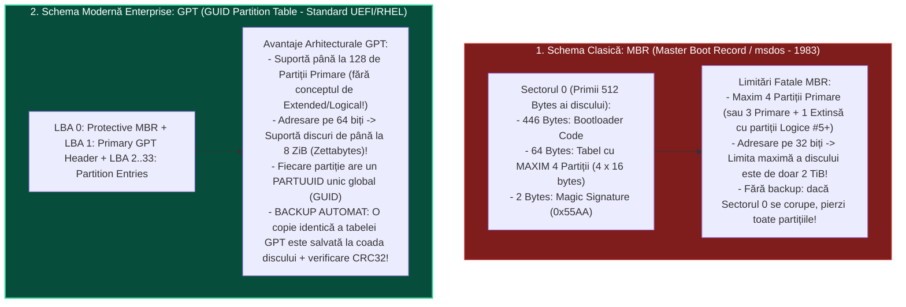
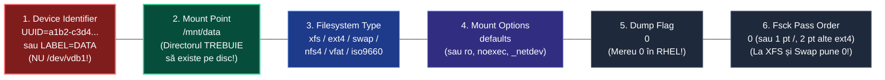

> ### Obiectivul Capitolului, Ponderea în Examenul EX200 & Regula de Aur a Persistenței
>
> * **Obiectivul Capitolului:** Stăpânirea arhitecturii de stocare la nivel de **Block Devices** în Red Hat Enterprise Linux (`/dev/vdX`, `/dev/sdX`, `/dev/nvmeXnY`), înțelegerea diferențelor structurale dintre schemele de partiționare **MBR (`msdos`)** și **GPT (*GUID Partition Table*)**, crearea partițiilor cu **`parted`**, **`gdisk`** și **`fdisk`**, sincronizarea tabelei de partiții cu kernelul (**`udevadm settle`** și **`partprobe`**), formatarea și administrarea sistemelor de fișiere **XFS vs. ext4** (`mkfs.xfs`, `mkfs.ext4`, `xfs_admin`, `tune2fs`), configurarea infailibilă a fișierului **`/etc/fstab`** folosind exclusiv **`UUID`** sau **`LABEL`** (`blkid`, `lsblk -fp`), gestionarea memoriei virtuale **Swap** (partiții și fișiere Swap cu `mkswap`, `swapon -a`, prioritatea `pri=`) și procedura de salvare a unui server căzut în **Emergency Mode** din cauza unui `/etc/fstab` corupt!
>
> * **Ponderea în Examenul EX200:** **MASIVĂ ȘI CRITICĂ (15–20% punctaj direct + Risc de Pierdere a 100% din Nod la Reboot!).**
>   Pilonul 3 (Capitolul 3.1 + 3.2 + 3.3) reprezintă împreună 35–40% din întregul examen RHCSA! În Capitolul 3.1 ai cel puțin două task-uri garantate pe `node2`:
>   1. **Crearea și montarea persistentă a unei partiții XFS sau ext4:** *„Creați o partiție de 2 GiB pe `/dev/vdb`, formatați-o cu sistemul de fișiere `xfs` (sau `ext4` cu eticheta `DATA`) și montați-o persistent în directorul `/mnt/data`.”*
>   2. **Adăugarea unei partiții Swap suplimentare:** *„Adăugați o partiție swap suplimentară de 512 MiB pe `/dev/vdb` fără a afecta partițiile swap existente. Partiția swap trebuie să se activeze automat la pornirea sistemului.”*
>
> * **Regula de Aur a Persistenței (EX200 Survival Rule — REGULA VIEȚII ȘI A MORȚII ÎN EX200!):**
>   1. **NU folosi NICIODATĂ nume de dispozitive (`/dev/vdb1` sau `/dev/sdb1`) în prima coloană din `/etc/fstab`!** Numele `/dev/sdX` pot își schimba ordinea la reboot dacă hypervisorul inițializează controllerele în altă ordine! În examenul EX200 montăm **EXCLUSIV prin `UUID=...` sau `LABEL=...`**!
>   2. **NICIODATĂ nu închide fișierul `/etc/fstab` fără a rula cele 3 comenzi sfinte de validare:**
>      ```bash
>      systemctl daemon-reload
>      mount -a
>      swapon -a
>      ```
>      Dacă `mount -a` returnează o eroare, repar-o PE LOC! Dacă lași o eroare în `/etc/fstab`, mașina ta virtuală va cădea în **Emergency Mode** la reboot-ul de notare și vei lua **0 puncte pe tot serverul**!

:::analogy
Înainte să atingem un disc nou cu `parted` sau `fdisk`, trebuie să înțelegem cum vede nucleul Linux un hard disk *raw* (brut) și ce facem de fapt atunci când îl „partiționăm”, îl „formatăm” și îl „montăm”.

Când atașezi un disc nou de 20 GB la mașina virtuală (`/dev/vdb`), acel disc este doar o bandă continuă de 41.943.040 de sectoare fizice (fiecare sector având 512 octeți sau 4096 octeți), plină cu zerouri. Kernelul nu poate salva direct un fișier pe un disc brut, pentru că nu există încă niciun tabel de Inode-uri și nicio structură de directoare!

### Analogia Vizuală: Terenul Viran (`/dev/vdb`), Cadastrul cu Garduri (Partiționarea GPT), Construirea Clădirii (`mkfs.xfs`) și Deschiderea Căii de Acces (`mount` & `/etc/fstab`)

Imaginează-ți întregul proces de stocare în Linux ca pe un proiect imobiliar în 4 pași:

1. **Block Device-ul Brut (`/dev/vdb`):** Este un **Teren Viran Împrejmuit de 20 de Hectare**. Nu are străzi, nu are clădiri, nu are numere poștale.
2. **Partiționarea (`parted` / `fdisk` / `gdisk` — MBR vs. GPT):** Este **Planul Cadastral și Tragerea Gardurilor**. Împărțim terenul de 20 de hectare în parcele delimitate precis: Parcela 1 (`/dev/vdb1` de 2 hectare), Parcela 2 (`/dev/vdb2` de 1 hectar). **Atenție:** Tragerea gardului NU construiește încă nicio clădire pe parcelă! Parcela `/dev/vdb1` este încă doar pământ gol!
3. **Crearea Sistemului de Fișiere (`mkfs.xfs` sau `mkfs.ext4`):** Este **Construirea Bibliotecii pe Parcelă**! Comanda `mkfs` toarnă fundația (**Superblock-ul**), montează dulapurile cu fișe de inventar (**Tabela de Inode-uri**), amenajează rafturile (**Data Blocks**) și deschide registrul de tranzacții (**Jurnalul**).
4. **Montarea (`mount` Runtime + `/etc/fstab` Persistent):** Biblioteca este construită pe parcela `/dev/vdb1`, dar nimeni din oraș (din arborele VFS `/`) nu poate ajunge la ea până nu construiești un **Pod Pietonal** dintr-un director existent pe server (de ex. `/mnt/data`) către intrarea bibliotecii!
   * Comanda `mount /dev/vdb1 /mnt/data` este un **Pod Ponton Temporar** — la prima furtună (`reboot`), podul este luat de apă!
   * Fișierul **`/etc/fstab`** este **Harta Oficială a Primăriei (`systemd`)**: în fiecare dimineață la deschiderea orașului (la boot), inginerii primăriei citesc `/etc/fstab` și reconstruiesc automat toate podurile! Dar dacă pe harta `/etc/fstab` ai trecut un pod către o parcelă inexistentă (ai scris greșit un UUID!), primăria blochează tot orașul în stare de asediu (**Emergency Mode**)!
:::

:::architecture
### 2.1. Convenția de Denumire a Discurilor (Block Devices) în `/dev`

Când kernelul detectează un controller de stocare la boot (sau la *hot-plug*), daemonul `systemd-udevd` creează nodul de dispozitiv în `/dev` conform tipului de driver:

| Nume în `/dev` | Tipul Hardware / Driverul din Kernel | Cum se numerotează Discurile și Partițiile? |
| :--- | :--- | :--- |
| **`/dev/vda`, `/dev/vdb`, `/dev/vdc`** | **VirtIO Block Device (`virtio_blk`):** Discuri paravirtualizate de mare viteză în hypervisorul KVM / QEMU (**Standardul în Examenul Oficial EX200!**). | Discurile primesc litere (`vda` = primul disc, `vdb` = al doilea disc), iar partițiile primesc cifre lipite direct de literă: `/dev/vdb1`, `/dev/vdb2`. |
| **`/dev/sda`, `/dev/sdb`, `/dev/sdc`** | **SCSI / SATA / SAS / USB (`sd_mod`):** Discuri fizice SATA/SAS sau virtuale în VMware / VirtualBox. | Discurile sunt `sda`, `sdb`, iar partițiile sunt `/dev/sda1`, `/dev/sda2`. |
| **`/dev/nvme0n1`, `/dev/nvme0n2`** | **NVMe (*Non-Volatile Memory Express*):** SSD-uri moderne conectate direct pe magistrala PCIe (și instanțe cloud moderne AWS/Azure). | `nvme0` (Controller 0), `n1` (Namespace 1). **ATENȚIE LA PARTIȚII:** Deoarece numele discului se termină deja într-o cifră (`n1`), partițiile sunt separate prin litera `p`: **`/dev/nvme0n1p1`**, **`/dev/nvme0n1p2`**! |

**Cum inspectăm instantaneu toate discurile și partițiile de pe server înainte de a lucra în examen?**
Cu comanda rege **`lsblk`** (*List Block Devices*):

```bash
# Comanda supremă în EX200 (-f = afișează FSTYPE, LABEL și UUID; -p = afișează căile complete cu /dev/...):
lsblk -fp
```

---

### 2.2. Arhitectura Tabelelor de Partiții: MBR (`msdos`) vs. GPT (*GUID Partition Table*)

Primul lucru pe care trebuie să îl scrii pe un disc nou (`/dev/vdb`) înainte de a crea prima partiție este **Tabela de Partiții (*Partition Table / Disklabel*)**. În istoria PC-urilor există două standarde:



#### Ce alegem în Examenul EX200 (MBR sau GPT)?

Dacă enunțul examenului nu îți cere explicit `msdos` / MBR, folosește **ÎNTOTDEAUNA `gpt`**! De ce? Pentru că în `gpt` nu mai riști să rămâi blocat la a 4-a partiție în timpul examenului (poți crea până la 128 de partiții direct, fără a mai face partiții extinse/logice)!

#### Uneltele de Partiționare în RHEL 9 / RHEL 10: `parted` vs. `gdisk` vs. `fdisk`

În RHEL ai la dispoziție 3 utilitare pentru partiționare:
* **`parted` (*Partition Editor*):** Suportă atât MBR (`mktable msdos`), cât și GPT (`mktable gpt`), și permite crearea partițiilor dintr-o singură linie de comandă non-interactivă (și scrie modificările pe disc instantaneu!).
* **`fdisk`:** Utilitarul clasic bazat pe meniu interactiv (`n` = new, `t` = type, `p` = print, `w` = write and exit). În RHEL 8/9/10, `fdisk` suportă impecabil și GPT (apăsând tasta `g` pentru a crea o tabelă GPT nouă!).
* **`gdisk` (*GPT fdisk*):** Dedicat exclusiv tabelelor GPT, cu aceeași interfață de taste (`n`, `t`, `p`, `w`) ca `fdisk`.

#### Sintaxa Completă de Partiționare cu `fdisk` / `gdisk` (Metoda Interactivă Sigură pentru EX200!)

De ce adoră mulți candidați `fdisk /dev/vdb` (sau `gdisk /dev/vdb`) în examen? Pentru că îți permite să introduci dimensiunea partiției direct ca **`+2G`** sau **`+512M`**, fără a calcula tu de la ce megabyte începe și la ce megabyte se termină!

```bash
# Exemplu: Crearea unei tabele GPT și a două partiții (una de 2 GiB Linux și una de 512 MiB Swap) pe /dev/vdb cu fdisk:
[root@node2 ~]# fdisk /dev/vdb
# În meniul fdisk tastăm pe rând:
# g       -> Creează o tabelă de partiții GPT nouă (sau 'o' dacă ni s-a cerut MBR/DOS)
# n       -> New partition (Partiția 1: apăsăm Enter pentru numărul 1, Enter pentru First sector implicit, apoi scriem +2G pentru Last sector!)
# n       -> New partition (Partiția 2: apăsăm Enter pentru numărul 2, Enter pentru First sector implicit, apoi scriem +512M pentru Last sector!)
# t       -> Change partition type (selectăm partiția 2, apoi apăsăm 'L' ca să vedem lista sau scriem 'swap' / '19' în GPT / '82' în MBR)
# p       -> Print: verificăm tabela înainte de salvare!
# w       -> Write table to disk and exit!
```

#### Sintaxa Completă cu `parted` (Metoda Intr-o Singură Linie / Scriptabilă)

```bash
# 1. Creăm tabela de partiții GPT pe /dev/vdb:
parted -s /dev/vdb mklabel gpt

# 2. Creăm prima partiție (/dev/vdb1) de 2 GiB (de la 1MiB la 2049MiB):
parted -s /dev/vdb mkpart primary xfs 1MiB 2049MiB

# 3. Creăm a doua partiție (/dev/vdb2) de 512 MiB pentru swap (de la 2049MiB la 2561MiB):
parted -s /dev/vdb mkpart primary linux-swap 2049MiB 2561MiB

# 4. Afișăm tabela de partiții:
parted -s /dev/vdb print
```

#### PASUL OBLIGATORIU DUPĂ ORICE PARTIȚIONARE: `udevadm settle` și `partprobe`!

După ce ai ieșit din `fdisk`/`gdisk`/`parted`, trebuie să aștepți ca nucleul Linux să își actualizeze tabela de partiții în RAM și daemonul `udevd` să creeze fișierele `/dev/vdb1` și `/dev/vdb2`. În examen și în scripturi, rulăm întotdeauna:

```bash
partprobe /dev/vdb
udevadm settle
```

**Ce face `udevadm settle`?** Urmărește coada de evenimente a daemonului `systemd-udevd` și blochează promptul câteva milisecunde până când toate nodurile `/dev/vdbX` și symlink-urile din `/dev/disk/by-uuid/` au fost create complet!

---

### 2.3. Sistemele de Fișiere XFS vs. ext4 (Formatare, Etichetare și Administrare)

Odată ce avem partiția `/dev/vdb1`, trebuie să o formatăm cu un sistem de fișiere:

| Caracteristică Tehnică | **XFS** (Sistemul de Fișiere Implicit în RHEL 7 / 8 / 9 / 10!) | **ext4** (*Fourth Extended Filesystem*) |
| :--- | :--- | :--- |
| **Origine & Arhitectură** | Creat de Silicon Graphics (SGI) în 1993 pentru supercomputere IRIX; bazat pe *Allocation Groups* și arbori *B+Trees* de înaltă performanță paralelă. | Evoluția familiei ext2/ext3 din Linux; bazat pe *Block Groups* și *Extents*. |
| **Dimensiune Maximă Suportată** | Până la 1 PiB (Petabyte) în RHEL 9/10 (8 EiB teoretic). | Până la 50 TiB (recomandat în RHEL; 1 EiB teoretic). |
| **Se poate MĂRI (*Grow / Extend*) online?** | **DA!** (Cu comanda `xfs_growfs /punct/montare`). | **DA!** (Cu comanda `resize2fs /dev/dispozitiv`). |
| **Se poate MICȘORA (*Shrink / Reduce*)?** | **NU! NICIODATĂ!** XFS NU suportă micșorarea nici online, nici offline! *(Întrebare garantată la interviu și examen!)* | **DA!** Poate fi micșorat doar offline (demontat mai întâi cu `umount`, verificat cu `e2fsck -f` și micșorat cu `resize2fs`). |
| **Comanda de Formatare** | `mkfs.xfs /dev/vdb1` *(Dacă avea deja o semnătură veche, adaugă `-f` pentru forțare!)* | `mkfs.ext4 /dev/vdb1` |
| **Setarea Etichetei (`LABEL`) la Formatare** | `mkfs.xfs -L "NUME_LABEL" /dev/vdb1` *(Maxim 12 caractere!)* | `mkfs.ext4 -L "NUME_LABEL" /dev/vdb1` *(Maxim 16 caractere!)* |
| **Schimbarea `LABEL`-ului Ulterior** | `xfs_admin -L "NOU_LABEL" /dev/vdb1` *(Doar cu partiția demontată!)* | `e2label /dev/vdb1 "NOU_LABEL"` *(sau `tune2fs -L "NOU_LABEL" /dev/vdb1`)* |
| **Utilitar de Verificare și Reparare (`fsck`)** | `xfs_repair /dev/vdb1` | `e2fsck -f /dev/vdb1` *(sau `fsck.ext4`)* |

---

### 2.4. Disecția Chirurgicală a Fișierului `/etc/fstab` (*File System Table*)

Pentru ca o partiție formatată să fie montată automat la fiecare pornire a serverului, trebuie adăugată o linie cu **6 câmpuri** separate prin spații sau tab-uri în fișierul **`/etc/fstab`** (`man 5 fstab`):



#### Explicația Celor 6 Câmpuri din `/etc/fstab` și Cum Evităm Orice Greșeală în Examen:

1. **Câmpul 1 (Identificatorul Dispozitivului):**
   * Folosește **MEREU `UUID=...`** (extras cu `blkid /dev/vdb1` sau `lsblk -fp /dev/vdb1`) sau **`LABEL=...`** (dacă enunțul îți cere explicit să montezi după etichetă).
   * **ATENȚIE:** În `/etc/fstab` **NU se pun ghilimele `"`** în jurul UUID-ului sau al Label-ului! Scrie curat: `UUID=3f8a9b12-44c1-4e99-8122-99aabbccddee` (fără `"`!).
   * *(Notă: Comanda `blkid` afișează atât `UUID="..."` — care aparține sistemului de fișiere XFS/ext4/swap, cât și `PARTUUID="..."` — care aparține tabelei GPT. În `/etc/fstab` folosim `UUID=...`!).*
2. **Câmpul 2 (Punctul de Montare / *Mount Point*):**
   Calea absolută a directorului unde va fi montată partiția (ex: `/mnt/data`). **ATENȚIE:** Trebuie să creezi mai întâi acel director cu `mkdir -p /mnt/data` înainte de a rula `mount -a`! *(Pentru partițiile swap, în câmpul 2 se scrie cuvântul `none` sau `swap`).*
3. **Câmpul 3 (Tipul Sistemului de Fișiere):**
   Scrie exact tipul cu care ai formatat partiția: `xfs`, `ext4` sau `swap`. *(Dacă ai formatat cu `mkfs.xfs`, dar în `/etc/fstab` scrii din greșeală `ext4`, serverul nu va mai porni la reboot!)*
4. **Câmpul 4 (Opțiunile de Montare):**
   Standardul este **`defaults`** (care include `rw,suid,dev,exec,auto,nouser,async`).
   Dacă cerința îți cere opțiuni suplimentare (de exemplu *„fără a permite execuția de fișiere binare”* sau *„doar citire”*), le separi prin virgulă fără spații: `defaults,noexec` sau `defaults,ro`.
5. **Câmpul 5 (Backup cu utilitarul istoric `dump`):** Pune întotdeauna **`0`**.
6. **Câmpul 6 (Ordinea de verificare `fsck` la boot):** Pune **`0`** (în special pentru `xfs`, `swap` și sisteme de rețea, care nu folosesc `fsck` tradițional la boot).

---

### 2.5. Memoria Virtuală Swap (Partiții Swap vs. Fișiere Swap)

**Ce este memoria Swap?** Este o partiție dedicată (sau un fișier special) pe disc pe care kernelul Linux o folosește în două scopuri:
1. Pentru a muta din memoria RAM paginile de memorie anonime (*Anonymous Pages* — heap/stack ale aplicațiilor) care sunt inactive de mult timp, eliberând astfel RAM fizic pentru *Page Cache* și aplicațiile active;
2. Ca plasă de siguranță atunci când memoria RAM se apropie de 100%, prevenind declanșarea imediată a lui **OOM Killer** (*Out-Of-Memory Killer*).

#### Receta Completă în 5 Pași pentru Adăugarea unei Partiții Swap în Examenul EX200

**Pasul 1 (Crearea partiției cu tipul swap):**
Creăm partiția (de ex. `/dev/vdb2` de 512M) în `fdisk`/`gdisk`/`parted` și îi setăm tipul de partiție la *Linux Swap* (codul `82` în MBR, `8200` în `gdisk`, sau `19` / `swap` în `fdisk` pe GPT), apoi rulăm `partprobe /dev/vdb && udevadm settle`.

**Pasul 2 (Formatarea cu semnătura Swap — `mkswap`):**
O partiție nu devine swap doar schimbându-i tipul în `fdisk`! Trebuie formatată cu comanda **`mkswap`**:

```bash
mkswap /dev/vdb2
# (Opțional, îi putem pune și un label: mkswap -L SWAP_EXTRA /dev/vdb2)
```

*(Comanda `mkswap` îți afișează direct pe ecran `UUID=...`-ul noii partiții swap!)*

**Pasul 3 (Adăugarea în `/etc/fstab`):**
Extragem UUID-ul cu `blkid /dev/vdb2` și adăugăm linia la finalul fișierului `/etc/fstab`:

```text
UUID=e4f12345-6789-4abc-def0-112233445566   none   swap   defaults   0 0
```

*(Dacă cerința din examen îți cere să setezi o anumită prioritate pentru această partiție swap — de exemplu prioritatea 10 — pui în coloana a 4-a: `defaults,pri=10`!)*

**Pasul 4 (Activarea tuturor partițiilor Swap din `/etc/fstab` cu `swapon -a`):**
Nu activa partiția manual cu `swapon /dev/vdb2`, ci activeaz-o prin **`swapon -a`**! De ce? Pentru că `swapon -a` citește `/etc/fstab`, testându-ți astfel pe loc că linia pe care ai scris-o în `/etc/fstab` este 100% corectă și va funcționa și la reboot!

```bash
systemctl daemon-reload
swapon -a
```

**Pasul 5 (Verificarea cu `swapon --show` și `free -m`):**

```bash
swapon --show
free -m
```

#### Cum creăm un FIȘIER Swap (în loc de o partiție) dacă ni se cere în examen sau în producție?

```bash
# 1. Alocăm un fișier plin cu zerouri de 1 GiB (1024 blocuri x 1M) cu dd:
dd if=/dev/zero of=/swapfile bs=1M count=1024 status=progress

# 2. OBLIGATORIU: Setăm permisiunile la 0600 (altfel swapon refuză din motive de securitate!):
chmod 0600 /swapfile

# 3. Îl formatăm cu mkswap:
mkswap /swapfile

# 4. Îl trecem în /etc/fstab (pentru un fișier swap, în coloana 1 se trece calea absolută /swapfile, NU UUID-ul!):
echo "/swapfile  none  swap  defaults  0 0" >> /etc/fstab
swapon -a
swapon --show
```

---

> **➕ Aprofundare.** De aici până la sfârșitul secțiunii, textul este o extindere adăugată de Claude la cererea lui Alex (nu face parte din capitolul original).

### 2.6. Opțiunile de Montare care Contează și Verificarea lui `/etc/fstab` Înainte de Reboot

Coloana a patra din `/etc/fstab` nu trebuie să fie mereu `defaults`. Câteva opțiuni schimbă securitatea, performanța sau comportamentul la boot:

| Opțiune | Efect | Unde o folosești |
| :--- | :--- | :--- |
| `ro` | Doar citire. | Date de referință, medii de instalare. |
| `noexec` | Nu se pot executa programe de pe acest sistem de fișiere. | `/tmp`, `/var/tmp`, partiții de date. |
| `nosuid` | Biții SUID și SGID sunt ignorați. | Partiții pe care scriu utilizatorii. |
| `nodev` | Fișierele de tip dispozitiv sunt ignorate. | Orice în afară de `/dev`. |
| `noatime` | Nu se mai actualizează timpul de acces la citire. | Volume cu multe citiri (mai puține scrieri pe disc). |
| `nofail` | Dacă dispozitivul lipsește la boot, sistemul pornește oricum. | Discuri externe, volume neesențiale. |
| `x-systemd.device-timeout=10s` | Cât așteaptă `systemd` apariția dispozitivului (implicit 90 de secunde). | Împreună cu `nofail`. |
| `_netdev` | Montarea așteaptă rețeaua. | NFS, iSCSI (Capitolul 3.3). |

`nofail` merită înțeles bine. Fără el, un dispozitiv lipsă trimite sistemul în *Emergency Mode*. Cu el, montarea respectivă este sărită și serverul rămâne accesibil prin SSH, de unde poți repara. Pentru volumele de care depinde o aplicație, lipsa montării trebuie totuși observată, deci nu pune `nofail` din reflex pe orice.

**Verificarea fără reboot.** Pe lângă `mount -a`, există o comandă care analizează `/etc/fstab` fără să monteze nimic:

```bash
findmnt --verify
```

Raportează dispozitive inexistente, tipuri de sisteme de fișiere care nu corespund cu ce este pe disc, puncte de montare lipsă și opțiuni necunoscute. Folosite împreună, `findmnt --verify`, `systemctl daemon-reload` și `mount -a` prind practic orice greșeală înainte să te coste un reboot ratat.

Alte forme utile:

```bash
findmnt /mnt/data            # ce este montat într-un punct: sursă, tip, opțiuni efective
findmnt -t xfs,ext4          # doar sistemele de fișiere de anumite tipuri
mount -o remount,noexec /mnt/data    # schimbă opțiunile unui sistem de fișiere deja montat
```

### 2.7. Demontarea și Eroarea „target is busy”

`umount /mnt/data` eșuează cu *target is busy* dacă un proces folosește sistemul de fișiere: are un fișier deschis acolo sau, foarte des, directorul lui curent este în interior (inclusiv shell-ul tău, dacă ai rămas cu `cd` în el).

```bash
# Cine ține ocupat punctul de montare:
lsof +f -- /mnt/data
fuser -vm /mnt/data          # din pachetul psmisc: utilizator, PID și tipul de acces

# Ieși din director și încearcă din nou:
cd / && umount /mnt/data

# Ultima soluție: demontare 'leneșă' (se detașează acum, se închide când nu mai e folosit):
umount -l /mnt/data
```

`umount -l` ascunde problema, nu o rezolvă: procesele continuă să scrie pe un sistem de fișiere pe care tu nu îl mai vezi. Nu îl folosi înainte de `mkfs`, `fsck` sau de scoaterea discului.

### 2.8. Întreținere: Informații, Verificare, Reparare și Ștergerea Semnăturilor

| Operație | XFS | ext4 |
| :--- | :--- | :--- |
| Informații despre sistemul de fișiere | `xfs_info /punct_de_montare` | `tune2fs -l /dev/vdb2` sau `dumpe2fs -h /dev/vdb2` |
| Verificare fără modificări | `xfs_repair -n /dev/vdb1` | `e2fsck -n /dev/vdb2` |
| Reparare | `xfs_repair /dev/vdb1` | `e2fsck -f -y /dev/vdb2` |
| Schimbarea etichetei | `xfs_admin -L NUME /dev/vdb1` | `e2label /dev/vdb2 NUME` |
| UUID nou | `xfs_admin -U generate /dev/vdb1` | `tune2fs -U random /dev/vdb2` |

Regula comună: **verificarea și repararea se fac doar pe un sistem de fișiere demontat.** Rulate pe unul montat, pot produce exact stricăciunile pe care voiai să le repari.

De ce nu există „`fsck` la boot” pentru XFS: XFS își reface singur consistența la montare, din jurnal. De aceea coloana a șasea din `/etc/fstab` este `0` pentru XFS, iar `fsck.xfs` este o comandă care nu face nimic. Dacă jurnalul însuși este deteriorat, `xfs_repair` îți va spune să încerci întâi o montare; abia dacă nici aceea nu reușește, se folosește `xfs_repair -L`, care șterge jurnalul și poate pierde ultimele scrieri.

**Semnături vechi.** Un disc refolosit poate purta urme ale vechii utilizări (LVM, RAID, alt sistem de fișiere), iar unele comenzi refuză să lucreze pe el.

```bash
wipefs /dev/vdc1          # doar AFIȘEAZĂ semnăturile găsite
wipefs -a /dev/vdc1       # le ȘTERGE pe toate (datele devin inaccesibile!)
```

`wipefs -a` este soluția curată când `pvcreate` sau `mkfs` se plâng că dispozitivul conține deja ceva. Verifică de două ori numele dispozitivului înainte.

**Sistemul de fișiere `vfat`.** Obiectivele examenului îl menționează alături de `xfs` și `ext4`. Se creează cu `mkfs.vfat /dev/vdb5` (pachetul `dosfstools`) și se montează cu tipul `vfat` în `/etc/fstab`. Nu are proprietari și permisiuni Linux: tot conținutul apare ca aparținând utilizatorului care l-a montat, lucru controlat prin opțiunile `uid=`, `gid=` și `umask=`.

### 2.9. Spațiul Liber Văzut Corect: `df`, Blocuri Rezervate și Spațiul Nealocat

```bash
df -hT                   # spațiu pe fiecare sistem de fișiere montat, cu tipul lui
df -i                    # inode-uri folosite și libere
lsblk -o NAME,SIZE,FSTYPE,FSAVAIL,FSUSE%,MOUNTPOINTS    # discuri, partiții și spațiu liber
parted -s /dev/vdb unit MiB print free                  # include zonele NEALOCATE ale discului
```

Ultima comandă răspunde la întrebarea pe care ți-o pui înainte de orice `mkpart`: de la ce megabyte până la ce megabyte mai este loc pe disc. Liniile marcate *Free Space* îți dau exact valorile de început și de sfârșit de care ai nevoie.

**De ce `df` arată mai puțin decât dimensiunea partiției.** O parte din spațiu este ocupată de structurile interne (jurnal, tabele de inode-uri). În plus, `ext4` rezervă implicit **5% din blocuri pentru `root`**, ca sistemul să mai poată funcționa când utilizatorii obișnuiți umplu discul. Pe un volum mare de date, 5% este mult și se poate reduce:

```bash
tune2fs -l /dev/vdb2 | grep -i "reserved block count"
tune2fs -m 1 /dev/vdb2       # reduce rezerva la 1%
```

XFS nu are această rezervă pentru `root`.

### 2.10. Swap: Cât, Cum Îl Scoți și Cum Îl Prioritizezi

Recomandarea orientativă Red Hat pentru dimensiunea spațiului swap:

| Memorie RAM | Swap recomandat |
| :--- | :--- |
| Sub 2 GB | De două ori memoria RAM |
| 2–8 GB | Egal cu memoria RAM |
| 8–64 GB | Cel puțin 4 GB |
| Peste 64 GB | Cel puțin 4 GB |

În examen folosești întotdeauna dimensiunea cerută în enunț, nu tabelul.

```bash
swapon --show                # dispozitivele swap active, dimensiune, cât e folosit, prioritate
free -h                      # totalul, pe scurt
swapoff /dev/vdb3            # dezactivează un swap (conținutul lui se mută înapoi în RAM)
swapoff -a                   # dezactivează tot swap-ul
```

`swapoff` reușește doar dacă există destulă memorie liberă pentru paginile aflate în swap. Ca să scoți definitiv un swap, ordinea este: `swapoff`, ștergerea liniei din `/etc/fstab`, apoi ștergerea partiției.

**Prioritatea.** Când există mai multe zone de swap, kernelul o umple întâi pe cea cu prioritatea cea mai mare (`pri=` mai mare). Două zone cu aceeași prioritate sunt folosite alternativ, ceea ce împarte scrierile între discuri. Fără `pri=`, fiecare zonă primește automat o prioritate negativă, în ordinea activării.

Cât de dispus este kernelul să folosească swap-ul hotărăște parametrul `vm.swappiness` (Capitolul 0.1). Un swap folosit nu este în sine o problemă; problema este un sistem care mută **continuu** pagini în și din swap, lucru vizibil în coloanele `si` și `so` din `vmstat 1`.

### 2.11. Mărirea unei Partiții Obișnuite, Fără LVM

Dacă discul virtual a fost mărit din hypervisor, sau dacă imediat după partiție a rămas spațiu nealocat, partiția poate fi extinsă pe loc. Sunt doi pași: întâi partiția, apoi sistemul de fișiere.

```bash
# 1. Unde se termină partiția și cât spațiu liber este după ea:
parted -s /dev/vdb unit MiB print free

# 2. Mută sfârșitul partiției 4 la 6000 MiB (sau la 100%, pentru tot spațiul rămas):
parted -s /dev/vdb resizepart 4 6000MiB
partprobe /dev/vdb && udevadm settle

# 3. Extinde sistemul de fișiere peste noul spațiu:
xfs_growfs /srv/xfs_exam          # XFS: primește punctul de montare, se face cu sistemul montat
resize2fs /dev/vdb5               # ext4: primește dispozitivul
```

Limitele metodei: se poate extinde doar spre **dreapta**, în spațiul liber aflat imediat după partiție. Dacă acolo începe altă partiție, nu ai unde crește. Începutul unei partiții nu se mută, iar micșorarea rămâne imposibilă pentru XFS. Tocmai aceste limite sunt motivul pentru care volumele care trebuie să crească se pun pe LVM (Capitolul 3.2).

Pe mașinile din cloud există și scurtătura `growpart /dev/vdb 4` (pachetul `cloud-utils-growpart`), care extinde partiția până la capătul discului într-un singur pas.
:::

:::exam-alert
### 💀 Capcana Mortală #1: Cum Repari în 60 de Secunde un Server Căzut în Emergency Mode din cauza `/etc/fstab`!
Să presupunem că în minutul 150 al examenului dai reboot la `node2` pentru verificare, dar `node2` nu mai răspunde la `ssh`! Deschizi VM Console și vezi mesajul îngrozitor:
`You are in emergency mode. After logging in, type "journalctl -xb" to view system logs... Give root password for maintenance:`

Nu intra în panică! Iată procedura de salvare în 4 pași:
1. Introdu parola de `root` și apasă `Enter`.
2. În RHEL 9/10, în Emergency Mode rădăcina `/` este adesea montată deja `rw`, dar pentru siguranță rulează:
   ```bash
   mount -o remount,rw /
   ```
3. Deschide `/etc/fstab` cu `vim /etc/fstab`, găsește linia cu UUID-ul greșit sau tipul de fișier greșit (îți poți da seama imediat care linie e greșită rulând `mount -a` în consola de urgență!) și repar-o (sau comenteaz-o temporar cu `#`).
4. Rulează `systemctl daemon-reload`, apoi `mount -a` (verifică să nu mai dea nicio eroare!) și apoi `systemctl reboot`. Serverul tău pornește normal și ți-ai salvat examenul!

### 💀 Capcana Mortală #2: Diferența dintre MB/GB (Baza 10: $1000^2$) și MiB/GiB (Baza 2: $1024^2$) în `parted` vs. `fdisk`!
* Când în `fdisk` scrii `+2G`, `fdisk` calculează în GiB (baza 2: $2 \times 1024 = 2048\text{ MiB}$).
* Când în `parted` scrii `2GB`, `parted` calculează în baza 10 ($2000\text{ MB} \approx 1.86\text{ GiB}$)! Dacă vrei $2\text{ GiB}$ în `parted`, scrie explicit unitatea cu `i`: **`2GiB`** sau **`2048MiB`**!

### 🛠️ Man Page Hacks pentru Capitolul 3.1
Cum inserezi UUID-ul unei partiții în `/etc/fstab` fără nicio șansă de *typo*?
Folosește fie comanda de adăugare cu `blkid -s UUID -o value /dev/vdb1`:
```bash
echo "UUID=$(blkid -s UUID -o value /dev/vdb1)  /mnt/data  xfs  defaults  0 0" >> /etc/fstab
```
fie trucul din `vim`: deschizi `vim /etc/fstab`, mergi pe ultima linie și tastezi **`:r !blkid /dev/vdb1`**!

---

> **➕ Aprofundare.** De aici până la sfârșitul secțiunii, textul este o extindere adăugată de Claude la cererea lui Alex (nu face parte din capitolul original).

### ⚠️ Capcană în plus: Kernelul nu vede partiția nou creată
După `fdisk` sau `parted` pe un disc care are deja partiții montate, tabela de pe disc este actualizată, dar kernelul poate lucra în continuare cu cea veche. Simptome: `lsblk` nu arată partiția nouă, sau `mkfs` răspunde *No such file or directory*. Rulează `partprobe /dev/vdb` urmat de `udevadm settle` și verifică din nou cu `lsblk`. Nu trece la `mkfs` până nu vezi partiția.

### ⚠️ Capcană în plus: `mkfs` pe dispozitivul greșit
`mkfs` nu cere confirmare (XFS refuză doar dacă găsește deja un sistem de fișiere, iar `-f` trece și peste asta). O cifră greșită, `/dev/vdb1` în loc de `/dev/vdb4`, distruge o partiție la care ai muncit la task-ul anterior. Înaintea fiecărui `mkfs`, rulează `lsblk -fp` și confirmă că dispozitivul țintă are coloana `FSTYPE` goală și nu este montat.
:::

:::interview
### Întrebarea 1 (Nivel Mid -> Senior):
> **Intervievator:** *„Ai un disc `/dev/sdb` de 10 TB pe care vrei să îl partiționezi. De ce nu poți folosi o tabelă de partiții MBR (`msdos`) și care este diferența la nivel de blocuri pe disc între MBR și GPT în ceea ce privește reziliența la corupție?”*

**Răspunsul Ideal:**
> „1. **Limita de 2 TiB a MBR:** În tabela MBR (stocată în primii 512 bytes ai discului, LBA 0), câmpurile care stochează sectorul de start și numărul total de sectoare ale unei partiții au doar 32 de biți ($2^{32}$ sectoare $\times 512\text{ bytes} = 2\text{ TiB}$). Orice spațiu de peste 2 TiB de pe acel disc de 10 TB nu poate fi adresat de MBR! În schimb, GPT folosește adresare LBA pe 64 de biți, suportând discuri de până la 8 ZiB.
> 2. **Reziliența la corupție:** MBR stochează tabela de partiții într-un singur loc (LBA 0) și fără nicio sumă de control (*checksum*). Dacă un `dd` greșit sau un sector defect suprascrie primii 512 bytes, tabela de partiții este pierdută. GPT stochează tabela primară la începutul discului (LBA 1–33) și păstrează automat o copie de siguranță identică (*Secondary/Backup GPT Header & Table*) în ultimele sectoare de la sfârșitul discului, protejată cu sume de control **CRC32**. Dacă antetul primar GPT se corupe, `gdisk` detectează eroarea de CRC32 și restaurează tabela din copia de la coada discului!”

---

> **➕ Aprofundare.** De aici până la sfârșitul secțiunii, textul este o extindere adăugată de Claude la cererea lui Alex (nu face parte din capitolul original).

### Întrebare în plus (Nivel Mid -> Senior):
> **Intervievator:** *„Ai clonat discul unui server (sau ai atașat un snapshot al aceluiași volum) pe aceeași mașină, ca să recuperezi câteva fișiere. Când încerci să montezi partiția XFS de pe clonă, primești `wrong fs type, bad option, bad superblock`. Partiția este sănătoasă. Ce se întâmplă?”*

**Răspunsul Ideal:**
> „Clona are **același UUID** de sistem de fișiere ca originalul, care este deja montat. XFS refuză să monteze două sisteme de fișiere cu același UUID, ca protecție împotriva montării aceluiași volum pe două căi. Mesajul din `mount` este generic, dar cauza reală apare în jurnalul kernelului: `dmesg | tail` arată *Filesystem has duplicate UUID - can't mount*.
>
> Am două soluții, în funcție de scop. Dacă vreau doar să citesc câteva fișiere, montez temporar ignorând verificarea: `mount -o nouuid,ro /dev/vdc1 /mnt/clona`. Dacă clona va rămâne atașată permanent, îi dau un UUID nou, cu ea demontată: `xfs_admin -U generate /dev/vdc1`.
>
> Aceeași situație provoacă o problemă mai subtilă cu `/etc/fstab`: dacă două dispozitive au același UUID, o linie `UUID=...` poate monta la boot dispozitivul greșit. De aceea, după orice clonare verific cu `lsblk -f` sau `blkid` că nu există UUID-uri duplicate. La LVM apare problema echivalentă, cu UUID-uri de PV și nume de VG identice, care se rezolvă cu `vgimportclone`.”
:::

:::lab
Conectează-te prin SSH pe **`node2.lab.example.com`** (unde avem discurile goale `/dev/vdb` și `/dev/vdc` de câte 20 GB pregătite încă din Capitolul 0.1!) și execută pas cu pas laboratorul:
:::

:::exam
Pune-ți cronometrul pe **15 minute** și rezolvă pe **`node2.lab.example.com`** (continuând pe discul `/dev/vdb` de la megabyte-ul `3585MiB` în sus):

### Partea A: Cele 3 Task-uri Practice (Stil Oficial EX200)

1. **Task 1 (Partiție XFS Montată Persistent prin UUID):**
   Creați pe discul `/dev/vdb` o nouă partiție (`/dev/vdb4`) având dimensiunea de **1 GiB** (1024 MiB, de ex. între `3585MiB` și `4609MiB`). Formatați această partiție cu sistemul de fișiere **`xfs`** și montați-o persistent (folosind UUID-ul ei în `/etc/fstab`) în directorul **`/srv/xfs_exam`**.
2. **Task 2 (Partiție ext4 Montată Persistent prin LABEL):**
   Creați pe discul `/dev/vdb` o nouă partiție (`/dev/vdb5`) având dimensiunea de **500 MiB** (de ex. între `4609MiB` și `5109MiB`). Formatați această partiție cu sistemul de fișiere **`ext4`**, setați-i eticheta (`LABEL`) la **`BACKUP_VOL`** și montați-o persistent în **`/srv/backup_exam`** folosind `LABEL`-ul în prima coloană din `/etc/fstab`.
3. **Task 3 (Partiție Swap Suplimentară):**
   Verificați că pe `/dev/vdb3` există o partiție swap de 512 MiB activată persistent în `/etc/fstab` cu prioritatea 10 (`pri=10`), fără a dezactiva partiția swap originală a sistemului de operare.
:::

:::solution
#### Rezolvarea Pas cu Pas a Task-urilor Practice (pe `node2`):

##### Rezolvare Task 1 (`/dev/vdb4` -> 1 GiB, `xfs`, montat prin UUID în `/srv/xfs_exam`):
```bash
parted -s /dev/vdb mkpart exam_xfs xfs 3585MiB 4609MiB
partprobe /dev/vdb && udevadm settle

mkfs.xfs -f /dev/vdb4
mkdir -p /srv/xfs_exam

echo "UUID=$(blkid -s UUID -o value /dev/vdb4)  /srv/xfs_exam  xfs  defaults  0 0" >> /etc/fstab
systemctl daemon-reload
mount -a
```

##### Rezolvare Task 2 (`/dev/vdb5` -> 500 MiB, `ext4`, `LABEL=BACKUP_VOL` în `/srv/backup_exam`):
```bash
parted -s /dev/vdb mkpart exam_ext4 ext4 4609MiB 5109MiB
partprobe /dev/vdb && udevadm settle

mkfs.ext4 -F -L "BACKUP_VOL" /dev/vdb5
mkdir -p /srv/backup_exam

echo "LABEL=BACKUP_VOL  /srv/backup_exam  ext4  defaults  0 0" >> /etc/fstab
systemctl daemon-reload
mount -a
```

##### Rezolvare Task 3 (Verificarea Swap-ului pe `/dev/vdb3`):
```bash
swapon -a
swapon --show
```

#### Scriptul de Verificare Automată (Grading Script pentru Capitolul 3.1 — rulat pe `node2`)

```bash
#!/bin/bash
# ==============================================================================
# RHCSA (EX200) - Script Automat de Evaluare: Capitolul 3.1 (pe node2)
# ==============================================================================
SCORE=0
TOTAL=30

echo "========================================================"
echo " Evaluare Obiective Capitolul 3.1 pe $(hostname)"
echo "========================================================"

# Verificare Task 1: /srv/xfs_exam montat cu XFS prin UUID în /etc/fstab
if findmnt -n -o FSTYPE /srv/xfs_exam 2>/dev/null | grep -qx "xfs" && \
   grep -qE "^UUID=.*[[:space:]]+/srv/xfs_exam[[:space:]]+xfs" /etc/fstab; then
    echo "[ PASS ] Task 1: /srv/xfs_exam este formatat XFS, montat activ și persistent prin UUID (+10p)"
    SCORE=$((SCORE + 10))
else
    echo "[ FAIL ] Task 1: /srv/xfs_exam nu este montat XFS sau nu folosește UUID în /etc/fstab (0p)"
fi

# Verificare Task 2: /srv/backup_exam montat cu ext4 prin LABEL=BACKUP_VOL
if findmnt -n -o FSTYPE /srv/backup_exam 2>/dev/null | grep -qx "ext4" && \
   grep -qE "^LABEL=BACKUP_VOL[[:space:]]+/srv/backup_exam[[:space:]]+ext4" /etc/fstab; then
    echo "[ PASS ] Task 2: /srv/backup_exam este formatat ext4 și montat persistent prin LABEL=BACKUP_VOL (+10p)"
    SCORE=$((SCORE + 10))
else
    echo "[ FAIL ] Task 2: /srv/backup_exam nu este montat ext4 sau nu folosește LABEL=BACKUP_VOL în /etc/fstab (0p)"
fi

# Verificare Task 3: Swap suplimentar activ și persistent în /etc/fstab
SWAP_COUNT=$(swapon --show --noheadings | wc -l)
if [[ "$SWAP_COUNT" -ge 2 ]] && grep -qE "[[:space:]]+swap[[:space:]]+" /etc/fstab; then
    echo "[ PASS ] Task 3: Partiția Swap suplimentară este activă și persistentă în /etc/fstab (+10p)"
    SCORE=$((SCORE + 10))
else
    echo "[ FAIL ] Task 3: Partiția Swap suplimentară nu este activă sau lipsește din /etc/fstab (0p)"
fi

echo "--------------------------------------------------------"
echo " PUNCTAJ FINAL CAPITOLUL 3.1: $SCORE / $TOTAL"
echo "========================================================"
```
:::

:::references
1. **Cursul Oficial Red Hat RH134 (*Red Hat System Administration II*):**
   * Capitolul 6: *Manage Basic Storage* (MBR vs. GPT, `parted`, `fdisk`, `gdisk`, `mkfs.xfs`, `mkfs.ext4`, `/etc/fstab`, UUID, LABEL, `mkswap`, `swapon`).
2. **Pagini de Manual (`man`) Esențiale din Sistem:**
   * `man 8 lsblk`, `man 8 blkid`, `man 8 findmnt`
   * `man 8 parted`, `man 8 fdisk`, `man 8 gdisk`, `man 8 udevadm`
   * `man 8 mkfs.xfs`, `man 8 xfs_admin`, `man 8 mkfs.ext4`, `man 8 tune2fs`
   * `man 5 fstab`, `man 8 mount`, `man 8 mkswap`, `man 8 swapon`
:::
