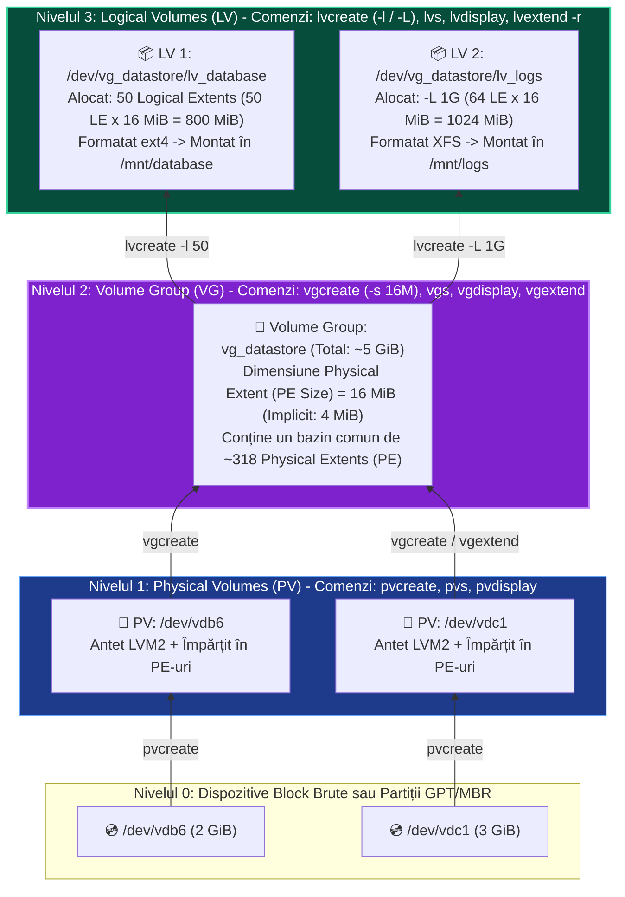

> ### Obiectivul Capitolului, Ponderea în Examenul EX200 & Regula de Aur a Persistenței
>
> * **Obiectivul Capitolului:** Stăpânirea arhitecturii **LVM2 (*Logical Volume Manager v2*)** bazată pe subsistemul de kernel **Device Mapper (`dm-mod`)** pe cele 3 niveluri fundamentale: **Physical Volumes (`PV`)**, **Volume Groups (`VG`)** și **Logical Volumes (`LV`)**. Înțelegerea matematică și practică a unităților de alocare **Physical Extents (`PE` — `vgcreate -s`)** și **Logical Extents (`LE` — `lvcreate -l` vs. `-L`)**, extinderea online fără pierdere de date și fără demontare (**`vgextend`** + **`lvextend -r`** vs. `xfs_growfs` / `resize2fs`), gestionarea **LVM Snapshots**, precum și arhitecturile moderne de stocare din RHEL 9 / RHEL 10: **Stratis** (*Pool-based Thin Provisioning Storage*) și **LVM-VDO** (*Virtual Data Optimizer* pentru deduplicare și compresie inline).
>
> * **Ponderea în Examenul EX200:** **REGINA ABSOLUTĂ A EXAMENULUI (20% din punctajul total EX200!).**
>   Pe mașina virtuală `node2`, vei întâlni garantat **2 sau 3 task-uri majore** din acest capitol:
>   1. **Crearea unui LVM după număr exact de Extents (`PE`/`LE`):** *„Creați un grup de volume numit `vg_datastore` în care dimensiunea unui Physical Extent (PE) să fie de **`16 MiB`**. În acest grup, creați un volum logic numit `lv_database` având dimensiunea exactă de **`50 de Extents`**, formatați-l cu sistemul de fișiere `ext4` (sau `xfs`) și montați-l persistent în `/mnt/database`.”*
>   2. **Redimensionarea (Extinderea) Online a unui Volum Logic și a Sistemului său de Fișiere fără pierdere de date:** *„Redimensionați volumul logic existent `/dev/vg_app/lv_web` (și sistemul său de fișiere montat în `/var/www`) astfel încât dimensiunea finală să fie cuprinsă între **`750 MiB` și `800 MiB`**, fără a pierde fișierele existente pe el.”*
>   3. *(Opțional / Alternativ în funcție de varianta de examen):* Configurarea unui pool și filesystem **Stratis** (montat cu `x-systemd.requires=stratisd.service`) sau a unui volum **LVM-VDO**.
>
> * **Regula de Aur a Persistenței (EX200 Survival Rule):**
>   1. Volumele logice LVM sunt activate automat la boot de către `lvm2-monitor.service` și `dracut`, dar **montarea sistemului de fișiere de pe LV trebuie trecută obligatoriu în `/etc/fstab`** (folosind calea `/dev/<vg_name>/<lv_name>`, `/dev/mapper/<vg_name>-<lv_name>` sau `UUID=...`), urmată de **`systemctl daemon-reload && mount -a`**!
>   2. **ATENȚIE LA STRATIS ÎN `/etc/fstab`:** Dacă ți se cere să montezi un sistem de fișiere **Stratis** în `/etc/fstab`, trebuie **OBLIGATORIU** să adaugi în coloana a 4-a de opțiuni din `/etc/fstab` directiva **`defaults,x-systemd.requires=stratisd.service`**! Dacă uiți `x-systemd.requires=stratisd.service`, `systemd` va încerca la boot să monteze volumul Stratis *înainte* ca daemonul `stratisd` să pornească și **va arunca serverul direct în `Emergency Mode`**!

:::analogy
De ce nu folosim în mediile Enterprise (bănci, cloud, telecom) partiții clasice fixe (`/dev/vdb1`, `/dev/vdb2` din Capitolul 3.1) pentru aplicațiile critice, ci folosim **LVM (*Logical Volume Manager*)** în 99.9% din serverele Red Hat?

Imaginează-ți următorul coșmar clasic cu partițiile standard:
Ai creat pe un disc de 100 GB trei partiții lipite una de alta: `/dev/vdb1` (20 GB pentru `/var`), `/dev/vdb2` (30 GB pentru `/opt`) și `/dev/vdb3` (50 GB pentru `/home`). Peste 6 luni, baza de date din `/var` (`/dev/vdb1`) ajunge la 100% capacitate și aplicația se oprește! Chiar dacă mai ai un al doilea disc gol `/dev/vdc` de 500 GB atașat serverului, **o partiție standard `/dev/vdb1` NU se poate întinde pe două discuri diferite** și **nu se poate extinde peste `/dev/vdb2`** deoarece sectoarele de pe disc trebuie să fie contigue (unul după altul)!

**LVM** rezolvă această limitare fizică prin virtualizarea stocării!

### Analogia Vizuală: Piesele de LEGO (`Physical Extents`), Cutia Uriașă la Comun (`Volume Group`) și Construcțiile Flexibile (`Logical Volumes`)

Imaginează-ți cele 3 straturi ale arhitecturii LVM astfel:

1. **Discurile și Partițiile Fizice (`Physical Volumes — PV`):**
   * Ai două terenuri diferite sau două cutii mici de piese (`/dev/vdb1` de 10 GB și `/dev/vdc1` de 20 GB). Când rulezi **`pvcreate`**, tu tai întregul spațiu al acestor discuri în **Cărămizi LEGO identice, numerotate, de câte `4 MiB` fiecare**, numite **PE (*Physical Extents*)**!
2. **Grupul de Volume (`Volume Group — VG`):**
   * Când rulezi **`vgcreate vg_data /dev/vdb1 /dev/vdc1`**, tu răstorni toate cărămizile LEGO de pe ambele discuri într-un **Singur Coș Uriaș la Comun (`vg_data`)** de 30 GB! Din acest moment, aplicațiilor nu le mai pasă pe care disc fizic se află o cărămidă LEGO. Dacă mâine se termină cărămizile din coș, cumperi un al treilea disc (`/dev/vdd`), îl tai în piese LEGO și le torni în același coș cu **`vgextend`**!
3. **Volumele Logice (`Logical Volumes — LV`):**
   * Când rulezi **`lvcreate`**, tu iei din coșul comun exact câte cărămizi LEGO ai nevoie (numite acum **LE — *Logical Extents***, unde $1\text{ LE} = 1\text{ PE}$) și construiești o partiție virtuală (`/dev/vg_data/lv_app`).
   * Dacă peste 6 luni `/dev/vg_data/lv_app` rămâne fără spațiu, nu oprești serverul și nu muți nimic! Doar mai iei 100 de cărămizi LEGO din coșul comun și le lipești din mers (*online*, în 1 secundă!) la construcția ta cu **`lvextend -r`**!
:::

:::architecture
### 2.1. Arhitectura LVM2 pe Cele 3 Niveluri și Matematica `PE` / `LE`

La nivel de **Linux Kernel (Ring 0)**, LVM este implementat de driverul **Device Mapper (`dm_mod`)**. Fiecare volum logic pe care îl creezi este, sub capotă, un dispozitiv virtual de tip bloc `/dev/dm-0`, `/dev/dm-1` etc., către care `udevd` creează două legături simbolice (*Symlinks*) prietenoase pe care le folosim noi:
1. **`/dev/<vg_name>/<lv_name>`** (ex: `/dev/vg_datastore/lv_database`);
2. **`/dev/mapper/<vg_name>-<lv_name>`** (ex: `/dev/mapper/vg_datastore-lv_database`).
*(Ambele pointează către exact același dispozitiv `/dev/dm-X` și ambele sunt 100% valide în `/etc/fstab`!)*



#### Matematica `PE` (*Physical Extent*) și `LE` (*Logical Extent*) — Subiect Favorit în EX200!

* **Ce este un `PE` (*Physical Extent*)?** Este cea mai mică unitate contiguă de spațiu pe care un **Volume Group (`VG`)** o poate aloca unui **Logical Volume (`LV`)**.
* **Cât este dimensiunea implicită a unui `PE` în RHEL?** Dacă nu specifici nimic la `vgcreate`, un `PE` are exact **`4 MiB`**.
* **Cum schimbi dimensiunea unui `PE` când creezi grupul de volume în examen?**
  Dacă enunțul îți cere: *„Grupul de volume `vg_datastore` trebuie să aibă extensiile fizice (PE) de **`16 MiB`** (sau `8 MiB` / `32 MiB`)”*, folosești flag-ul **`-s` (`--physicalextentsize`)** la comanda `vgcreate`:
  ```bash
  vgcreate -s 16M vg_datastore /dev/vdb6
  ```
* **DIFERENȚA VITALĂ DINTRE `-l` (l mic) ȘI `-L` (L MARE) LA `lvcreate` ȘI `lvextend`:**
  Aceasta este întrebarea care separă 300/300 de un calcul greșit în examen:
  * **`-l` (litera `l` mică — `--extents`):** Specifică dimensiunea în **NUMĂR DE EXTENTS (`LE`)**!
    * Exemplu: `lvcreate -l 50 -n lv_database vg_datastore` -> Creează un volum logic format din **exact 50 de Extents**! (Dacă 1 PE = $16\text{ MiB}$, volumul va avea automat $50 \times 16\text{ MiB} = 800\text{ MiB}$, fără ca tu să fii nevoit să înmulțești în minte!).
    * *(Truc Pro cu `-l`: Poți folosi și procente cu `-l`, de exemplu `lvcreate -l 100%FREE -n lv_rest vg_datastore` pentru a aloca tot spațiul rămas liber în VG!)*
  * **`-L` (litera `L` MARE — `--size`):** Specifică dimensiunea direct în **UNITĂȚI DE CAPACITATE (`M` = MiB, `G` = GiB, `T` = TiB)**!
    * Exemplu: `lvcreate -L 500M -n lv_app vg_datastore` -> Creează un volum de $500\text{ MiB}$! *(Notă: Dacă $500\text{ MiB}$ nu se împarte exact la dimensiunea unui PE de $16\text{ MiB}$, deoarece $500 / 16 = 31.25$, LVM **rotunjește întotdeauna ÎN SUS** la următorul multiplu întreg de PE, adică va aloca $32\text{ PE} \times 16\text{ MiB} = 512\text{ MiB}$!)*

---

### 2.2. Tabelul Complet al Comenzilor LVM pe Cele 3 Niveluri (Creare, Inspecție, Ștergere)

Observă cât de logic și simetric este proiectat LVM în Linux: aceleași sufixe (`create`, `s`, `display`, `extend`, `remove`) se aplică pe rând prefixelor **`pv`**, **`vg`** și **`lv`**!

| Acțiune | Nivelul 1: **Physical Volume (`pv...`)** | Nivelul 2: **Volume Group (`vg...`)** | Nivelul 3: **Logical Volume (`lv...`)** |
| :--- | :--- | :--- | :--- |
| **1. Creare** | **`pvcreate /dev/vdb6`** | **`vgcreate vg_data /dev/vdb6`** *(sau cu PE custom: **`vgcreate -s 16M vg_data /dev/vdb6`**)* | **`lvcreate -l 50 -n lv_db vg_data`** *(după extents)* sau **`lvcreate -L 1G -n lv_db vg_data`** *(după MiB/GiB)* |
| **2. Tabel Scurt (1 linie)** | **`pvs`** | **`vgs`** | **`lvs`** |
| **3. Detalii Complete (PE Size, LE Count)** | **`pvdisplay /dev/vdb6`** | **`vgdisplay vg_data`** *(Aici verifici linia **`PE Size`** în examen!)* | **`lvdisplay /dev/vg_data/lv_db`** *(Aici verifici linia **`Current LE`** în examen!)* |
| **4. Extindere Online** | `pvresize /dev/vdb6` | **`vgextend vg_data /dev/vdc1`** *(Adaugă un disc/partiție nouă în VG!)* | **`lvextend -r -L 800M /dev/vg_data/lv_db`** *(sau `-l +20` / `-L +300M`)* |
| **5. Ștergere (Ordinea inversă: LV -> VG -> PV)** | **`pvremove /dev/vdb6`** | **`vgremove vg_data`** | **`lvremove /dev/vg_data/lv_db`** *(După `umount` și ștergerea din `/etc/fstab`!)* |

---

### 2.3. Extinderea Online a unui Volum Logic (`lvextend -r`) — Fără Demontare și Fără Pierdere de Date!

În examenul EX200, unul dintre cele mai importante subiecte este extinderea unui volum logic deja montat (care conține deja fișiere de test puse de Red Hat!).

**Ce se întâmplă dacă rulezi doar `lvextend -L 800M /dev/vg_data/lv_app` FĂRĂ să redimensionezi și sistemul de fișiere (`XFS` sau `ext4`)?**
* Volumul logic (containerul de jos) crește la `800 MiB` (vizibil în `lvs`), **DAR sistemul de fișiere (`df -h`) rămâne la dimensiunea veche** (ex: `300 MiB`)! Iar scriptul de evaluare al examenului verifică dimensiunea cu `df -h` -> **0 puncte**!

Ai două metode pentru a extinde atât volumul logic, cât și sistemul de fișiere:

#### Metoda #1 (RECOMANDAREA SUPREMĂ RHCA PENTRU EX200): Flag-ul Magic `-r` (`--resizefs`)!

Dacă adaugi flag-ul **`-r` (`--resizefs`)** la comanda `lvextend`, LVM extinde mai întâi volumul logic și apoi **detectează automat dacă pe el este `XFS` sau `ext4` și apelează singur `xfs_growfs` sau `resize2fs` într-un singur pas**, online, fără a demonta nimic!

**Atenție maximă la diferența dintre `lvextend -L 800M` (FĂRĂ `+`) și `lvextend -L +300M` (CU `+`):**
* **`lvextend -r -L 800M /dev/vg_data/lv_app`** *(Fără semnul `+`!)*: Îi spune lui LVM: *„Fă dimensiunea **FINALĂ TOTALĂ** a volumului să fie de **800 MiB**!”*
  * **SFAT DE AUR PENTRU EXAMEN:** În EX200, enunțul îți spune mereu: *„Extindeți volumul astfel încât dimensiunea lui finală să fie între 750 MiB și 800 MiB”*. Folosește **MEREU varianta FĂRĂ `+` (`-L 780M`)**, ca să nu fii nevoit să calculezi cât avea înainte și cât trebuie să aduni!
* **`lvextend -r -L +300M /dev/vg_data/lv_app`** *(Cu semnul `+`!)*: Îi spune lui LVM: *„**Adaugă încă 300 MiB** peste dimensiunea pe care o are acum!”*

#### Metoda #2 (În Doi Pași Manuali — esențială pentru Interviuri și când ai extins deja LV-ul fără `-r`!):

Dacă un coleg (sau tu din greșeală) a rulat deja `lvextend -L 800M /dev/vg_data/lv_app` fără `-r`, cum mărești acum sistemul de fișiere la noua dimensiune a LV-ului?
* **Dacă sistemul de fișiere este `XFS`:** Folosim comanda **`xfs_growfs`** (care primește ca argument **PUNCTUL DE MONTARE** sau dispozitivul montat!):
  ```bash
  xfs_growfs /mnt/punct_de_montare
  ```
* **Dacă sistemul de fișiere este `ext4`:** Folosim comanda **`resize2fs`** (care primește ca argument **CALEA DISPOZITIVULUI BLOCK**!):
  ```bash
  resize2fs /dev/vg_data/lv_app
  ```

#### Ce faci în Examen dacă în `Volume Group (VG)` NU este suficient spațiu liber pentru `lvextend`?
În multe variante de examen EX200, cerința îți cere să mărești un volum logic la `800 MiB`, dar când verifici cu **`vgs`**, vezi că în grupul de volume mai sunt liberi doar `100 MiB` (`VFree = 100m`)!
Nu intra în panică! Exact asta testează examinatorul:
1. Verifici discurile cu `lsblk` și creezi o partiție nouă (de ex. `/dev/vdb7` de `1 GiB`) cu `parted` sau `fdisk` (+ `partprobe` & `udevadm settle`).
2. Extinzi mai întâi **Grupul de Volume (`VG`)** adăugând noua partiție în coșul comun:
   ```bash
   vgextend vg_data /dev/vdb7
   ```
3. Acum `vgs` îți arată peste `1 GiB` liber în `vg_data`, așa că poți rula liniștit:
   ```bash
   lvextend -r -L 780M /dev/vg_data/lv_app
   ```

---

### 2.4. Stocare Modernă în RHEL 9 / RHEL 10: `Stratis` și `LVM-VDO`

Pe lângă LVM-ul clasic, Red Hat a introdus două tehnologii avansate de *Storage Management* care fac parte din obiectivele oficiale RHCSA:

#### 1. `Stratis` (*Volume-Managing Filesystem: LVM + XFS automatizat*)

**Ce este Stratis?** Este răspunsul lui Red Hat la sistemele de fișiere de tip *ZFS* și *Btrfs*. În loc să construiești manual un motor nou în kernel, Stratis folosește un daemon inteligent în *User Space* (**`stratisd`**) și utilitarul CLI (**`stratis`**) care orchestrează automat sub capotă **Device Mapper (`dm-thin`)** și sistemul de fișiere **`XFS`**!
* Toate sistemele de fișiere create în Stratis sunt **Thin-Provisioned** (nu ocupă spațiu fizic în *Pool* decât pe măsură ce scrii date reale în ele și cresc automat fără `lvextend`!) și suportă **Snapshots** instantanee!

**Receta Completă în 6 Pași pentru `Stratis` în Examenul EX200:**

```bash
# Pasul 1: Instalăm pachetele stratisd și stratis-cli și activăm daemonul stratisd la boot!
dnf install -y stratisd stratis-cli
systemctl enable --now stratisd

# Pasul 2: Creăm un Stratis Storage Pool (de ex. 'pool_exam') pe un disc/partiție goală (minim 1 GiB!):
stratis pool create pool_exam /dev/vdc1
stratis pool list

# (Opțional: Dacă vrem să adăugăm încă un disc în pool-ul existent:)
# stratis pool add-data pool_exam /dev/vdc2

# Pasul 3: Creăm un sistem de fișiere Stratis (de ex. 'fs_exam') în interiorul pool-ului:
stratis filesystem create pool_exam fs_exam
stratis filesystem list

# Pasul 4: Aflăm UUID-ul sistemului de fișiere Stratis (localizat în /dev/stratis/<pool>/<fs>):
blkid /dev/stratis/pool_exam/fs_exam
# Sau direct din stratis filesystem list!

# Pasul 5: MONTAREA PERSISTENTĂ ÎN /etc/fstab (ATENȚIE LA OPȚIUNEA OBLIGATORIE x-systemd.requires!):
mkdir -p /mnt/stratis_data
echo "UUID=$(blkid -s UUID -o value /dev/stratis/pool_exam/fs_exam)  /mnt/stratis_data  xfs  defaults,x-systemd.requires=stratisd.service  0 0" >> /etc/fstab

# Pasul 6: Validăm cu daemon-reload și mount -a (și opțional creăm un snapshot!):
systemctl daemon-reload
mount -a
# Crearea unui snapshot Stratis:
stratis filesystem snapshot pool_exam fs_exam snap_exam
```

#### 2. `VDO` (*Virtual Data Optimizer*) prin `LVM-VDO` în RHEL 9 / RHEL 10

**Ce este VDO?** Este un strat de virtualizare a stocării (achiziționat de Red Hat de la Permabit) care oferă două funcții majore în timp real (*inline*) înainte ca blocurile de date să fie scrise pe disc:
1. **Zero-Block Elimination & Deduplicare (*UDS — Universal Deduplication Service*):** Dacă copiezi pe volumul VDO 50 de imagini de mașini virtuale de câte 10 GB care conțin 90% aceleași fișiere de sistem RHEL, VDO scrie blocurile identice de 4 KB **o singură dată pe discul fizic**, iar pentru celelalte 49 de copii păstrează doar pointeri!
2. **Compresie Inline (*LZ4*):** Comprimă blocurile unice la viteză extremă.

> **SCHIMBARE ARHITECTURALĂ MAJORĂ ÎN RHEL 9 / RHEL 10:**
> În RHEL 8 exista comanda veche `vdo create --name=...` (care a fost **eliminată complet** în RHEL 9!). În RHEL 9 și RHEL 10, **VDO este integrat direct în LVM (`LVM-VDO`)** și se creează folosind comanda standard **`lvcreate --type vdo`**!

**Receta Completă pentru crearea unui Volum `LVM-VDO` în RHEL 9 / RHEL 10:**

```bash
# Pasul 1: Instalăm pachetele vdo și kmod-kvdo (alături de lvm2):
dnf install -y lvm2 vdo kmod-kvdo

# Pasul 2: Creăm un Physical Volume și un Volume Group pe un disc (minim 5-10 GiB pentru indexul UDS!):
pvcreate /dev/vdc2
vgcreate vg_vdo /dev/vdc2

# Pasul 3: Creăm volumul LVM-VDO!
# - '-L 5G' (sau '-l 100%FREE') este dimensiunea FIZICĂ reală alocată de pe disc;
# - '-V 50G' (--virtualsize) este dimensiunea VIRTUALĂ (Logică) pe care o va vedea sistemul de fișiere (ex: 50 GiB)!
# - '--name lv_vdo' este numele volumului logic VDO:
lvcreate --type vdo -n lv_vdo -L 5G -V 50G vg_vdo

# Pasul 4: Formatăm volumul VDO FĂRĂ a trimite blocuri discard la formatare (-K pentru XFS sau -E nodiscard pentru ext4, ca să fie instantaneu!):
mkfs.xfs -K /dev/vg_vdo/lv_vdo

# Pasul 5: Montăm persistent în /etc/fstab (cu opțiunea 'defaults' — fiind integrat în LVM, nu mai cere unitate systemd specială!):
mkdir -p /mnt/vdo_storage
echo "UUID=$(blkid -s UUID -o value /dev/vg_vdo/lv_vdo)  /mnt/vdo_storage  xfs  defaults  0 0" >> /etc/fstab
systemctl daemon-reload
mount -a

# Verificăm statisticile de deduplicare și compresie cu vdostats:
vdostats --human-readable
```
:::

:::exam-alert
### 💀 Capcana Mortală #1: Uitarea lui `x-systemd.requires=stratisd.service` în `/etc/fstab` pentru Stratis!
Aceasta este capcana clasică pe `node2`: candidatul creează impecabil pool-ul și filesystem-ul Stratis, îi pune UUID-ul în `/etc/fstab` cu opțiunea simplă `defaults`, dă `mount -a` (care merge acum, pentru că `stratisd` este deja pornit!) și crede că a terminat.
Dar când scriptul de notare dă **`reboot`**, `systemd` citește `/etc/fstab` în faza timpurie (`local-fs.target`), **înainte** ca serviciul `stratisd.service` să fi asamblat pool-ul `/dev/stratis/...`! Rezultatul? `Timed out waiting for device` -> Serverul cade în `Emergency Mode` -> **0 puncte pe toate subiectele de pe `node2`**!
* **Cum nu uiți niciodată sintaxa în examen?** Nu trebuie să o memorezi! Deschide pagina de manual:
  ```bash
  man stratis
  ```
  sau caută în `/usr/share/doc/stratis-cli/` — opțiunea `x-systemd.requires=stratisd.service` este scrisă explicit acolo!

### 💀 Capcana Mortală #2: Confuzia între `-l` (Extents) și `-L` (Size in MiB/GiB) la `lvcreate`!
Citește enunțul examenului de 3 ori:
* Dacă scrie: *„Create a logical volume with a size of **50 extents**”* -> folosești **`-l 50`** (cu `l` mic!).
* Dacă scrie: *„Create a logical volume with a size of **500 MiB**”* -> folosești **`-L 500M`** (cu `L` mare!).

### 🛠️ Man Page Hacks pentru Capitolul 3.2
Ai uitat în timpul examenului sintaxa exactă pentru crearea unui volum `LVM-VDO` în RHEL 9 / RHEL 10?
Există o pagină de manual dedicată plină cu exemple gata scrise! Rulează:
```bash
man lvmvdo
```
și caută `/EXAMPLES`! Vei găsi comanda `lvcreate --type vdo -n vdo0 -L 10G -V 100G vg` mură-n gură!
:::

:::interview
### Întrebarea 1 (Nivel Mid -> Senior):
> **Intervievator:** *„Un coleg vrea să micșoreze un volum logic LVM de la 100 GB la 50 GB. Volumul este formatat cu `ext4`. El intenționează să ruleze mai întâi `lvreduce -L 50G /dev/vg/lv` și apoi `resize2fs /dev/vg/lv`. Ce se va întâmpla dacă face asta în această ordine și care este procedura corectă?”*

**Răspunsul Ideal:**
> „Dacă rulează mai întâi `lvreduce` înainte de a micșora sistemul de fișiere, **va tăia pe viu ultimele 50 GB de blocuri ale sistemului de fișiere `ext4` și va distruge iremediabil datele și Superblock-urile secundare de pe volum**!
>
> La **micșorare (*Shrinking*)**, ordinea operațiunilor este **inversă față de extindere** (mai întâi strângi mobila în jumătate de cameră, și abia apoi dărâmi peretele!):
> 1. Verific că sistemul de fișiere este `ext4` (deoarece **`XFS` nu poate fi micșorat niciodată**!).
> 2. **Demontez** volumul (`umount /mnt/data`), deoarece `ext4` nu suportă micșorare online.
> 3. Rulez obligatoriu verificarea de integritate: `e2fsck -f /dev/vg/lv`.
> 4. Micșorez **MAI ÎNTÂI sistemul de fișiere**: `resize2fs /dev/vg/lv 50G`.
> 5. Abia acum micșorez **volumul logic**: `lvreduce -L 50G /dev/vg/lv`.
> *(Sau, și mai sigur, folosesc direct comanda `lvreduce -r -L 50G /dev/vg/lv`, unde flag-ul `-r` execută automat demontarea, `fsck`, `resize2fs` și `lvreduce` în ordinea corectă fără risc de eroare umană!).*”
:::

:::lab
Conectează-te pe **`node2.lab.example.com`** și execută pas cu pas laboratorul complet de LVM și Stratis/VDO (folosind spațiul rămas pe `/dev/vdb` și discul `/dev/vdc`):
:::

:::exam
Pune-ți cronometrul pe **20 de minute** și rezolvă pe **`node2.lab.example.com`** (folosind al doilea disc de laborator `/dev/vdc`):

### Partea A: Cele 3 Task-uri Practice (Stil Oficial EX200)

1. **Task 1 (Creare LVM cu `PE = 8 MiB` și Extents exacte):**
   Pe discul `/dev/vdc`, creați o tabelă de partiții `gpt` și două partiții: `/dev/vdc1` de `1 GiB` și `/dev/vdc2` de `1 GiB`.
   * Creați un grup de volume numit `vg_rhcsa` pe `/dev/vdc1` având dimensiunea unui **Physical Extent (`PE`) de `8 MiB`**.
   * În interiorul `vg_rhcsa`, creați un volum logic numit `lv_app` cu o dimensiune exactă de **`60 de Extents`** (`480 MiB`).
   * Formatați `lv_app` cu sistemul de fișiere **`xfs`** și montați-l persistent în directorul `/srv/app_lvm`. Creați un fișier `/srv/app_lvm/keep_me.txt` cu textul `LVM_OK`.
2. **Task 2 (Extinderea Online a unui Volum Logic `XFS` peste un al doilea PV):**
   Fără a demonta `/srv/app_lvm` și fără a pierde fișierul `/srv/app_lvm/keep_me.txt`, extindeți grupul de volume `vg_rhcsa` cu partiția `/dev/vdc2` și apoi redimensionați volumul logic `/dev/vg_rhcsa/lv_app` (împreună cu sistemul său de fișiere `xfs`) astfel încât dimensiunea sa finală să fie de **`1200 MiB`** (sau `150 de Extents`).
3. **Task 3 (Configurare `Stratis` Pool & Filesystem Persistent):**
   Creați pe `/dev/vdc` o a treia partiție `/dev/vdc3` de `3 GiB`. Instalați și activați serviciul `stratisd`, creați un pool Stratis numit `stratis_pool1` pe `/dev/vdc3` și un sistem de fișiere numit `stratis_fs1` în acest pool. Montați persistent `stratis_fs1` în directorul `/srv/stratis_mount` (asigurându-vă că sistemul pornește corect la reboot cu dependența `systemd` necesară!).
:::

:::solution
#### Rezolvarea Pas cu Pas a Task-urilor Practice (pe `node2`):

##### Rezolvare Task 1 (`vg_rhcsa` cu `PE = 8M`, `lv_app` cu `60 Extents` -> `xfs` pe `/srv/app_lvm`):
```bash
# 1. Partiționăm /dev/vdc cu 3 partiții (1G, 1G și 3G):
parted -s /dev/vdc mklabel gpt
parted -s /dev/vdc mkpart p1 1MiB 1025MiB
parted -s /dev/vdc mkpart p2 1025MiB 2049MiB
parted -s /dev/vdc mkpart p3 2049MiB 5121MiB
partprobe /dev/vdc && udevadm settle

# 2. Creăm PV, VG (cu -s 8M) și LV (cu -l 60):
pvcreate /dev/vdc1
vgcreate -s 8M vg_rhcsa /dev/vdc1
lvcreate -l 60 -n lv_app vg_rhcsa

# 3. Formatăm XFS și montăm persistent în /srv/app_lvm:
mkfs.xfs /dev/vg_rhcsa/lv_app
mkdir -p /srv/app_lvm
echo "UUID=$(blkid -s UUID -o value /dev/vg_rhcsa/lv_app)  /srv/app_lvm  xfs  defaults  0 0" >> /etc/fstab
systemctl daemon-reload && mount -a
echo "LVM_OK" > /srv/app_lvm/keep_me.txt
```

##### Rezolvare Task 2 (`vgextend` + `lvextend -r` la `1200 MiB`):
```bash
# 1. Extindem grupul de volume vg_rhcsa cu /dev/vdc2:
pvcreate /dev/vdc2
vgextend vg_rhcsa /dev/vdc2

# 2. Extindem online volumul logic și sistemul XFS la 1200 MiB (150 extents x 8 MiB):
lvextend -r -L 1200M /dev/vg_rhcsa/lv_app
df -Th /srv/app_lvm
cat /srv/app_lvm/keep_me.txt
```

##### Rezolvare Task 3 (`Stratis` pe `/dev/vdc3` montat în `/srv/stratis_mount`):
```bash
dnf install -y stratisd stratis-cli
systemctl enable --now stratisd

stratis pool create stratis_pool1 /dev/vdc3
stratis filesystem create stratis_pool1 stratis_fs1
udevadm settle

mkdir -p /srv/stratis_mount
STRATIS_UUID=$(blkid -s UUID -o value /dev/stratis/stratis_pool1/stratis_fs1)
echo "UUID=$STRATIS_UUID  /srv/stratis_mount  xfs  defaults,x-systemd.requires=stratisd.service  0 0" >> /etc/fstab
systemctl daemon-reload && mount -a
```

#### Scriptul de Verificare Automată (Grading Script pentru Capitolul 3.2 — rulat pe `node2`)

```bash
#!/bin/bash
# ==============================================================================
# RHCSA (EX200) - Script Automat de Evaluare: Capitolul 3.2 (pe node2)
# ==============================================================================
SCORE=0
TOTAL=30

echo "========================================================"
echo " Evaluare Obiective Capitolul 3.2 pe $(hostname)"
echo "========================================================"

# Verificare Task 1 & 2: vg_rhcsa (PE=8M), lv_app (150 LE / 1200M), XFS montat în /srv/app_lvm + keep_me.txt
PE_SIZE=$(vgs --noheadings -o vg_extent_size --units m vg_rhcsa 2>/dev/null | tr -d ' m.00')
LE_COUNT=$(lvs --noheadings -o lv_attr,seg_pe_ranges,lv_size --units m /dev/vg_rhcsa/lv_app 2>/dev/null)
if [[ "$PE_SIZE" == "8" ]] && \
   [[ $(lvs --noheadings -o lv_size --units m /dev/vg_rhcsa/lv_app 2>/dev/null | tr -d ' m.00') == "1200" ]] && \
   findmnt -n -o FSTYPE /srv/app_lvm 2>/dev/null | grep -qx "xfs" && \
   [[ $(cat /srv/app_lvm/keep_me.txt 2>/dev/null) == "LVM_OK" ]]; then
    echo "[ PASS ] Task 1 & 2: Grupul vg_rhcsa (PE=8M) și volumul lv_app (extins la 1200M cu XFS și date intacte) sunt corecte (+20p)"
    SCORE=$((SCORE + 20))
else
    echo "[ FAIL ] Task 1 & 2: Eroare la PE Size (8M), dimensiunea extinsă (1200M) sau montarea /srv/app_lvm (0p)"
fi

# Verificare Task 3: Stratis pool + filesystem + /etc/fstab cu x-systemd.requires=stratisd.service
if systemctl is-enabled stratisd &>/dev/null && \
   findmnt -n /srv/stratis_mount &>/dev/null && \
   grep -q "x-systemd.requires=stratisd.service" /etc/fstab; then
    echo "[ PASS ] Task 3: Sistemul de fișiere Stratis este activ și montat persistent cu x-systemd.requires (+10p)"
    SCORE=$((SCORE + 10))
else
    echo "[ FAIL ] Task 3: Eroare la Stratis sau lipsește x-systemd.requires=stratisd.service din /etc/fstab (0p)"
fi

echo "--------------------------------------------------------"
echo " PUNCTAJ FINAL CAPITOLUL 3.2: $SCORE / $TOTAL"
echo "========================================================"
```
:::

:::references
1. **Cursul Oficial Red Hat RH134 (*Red Hat System Administration II*):**
   * Capitolul 7: *Manage Logical Volumes* (`pvcreate`, `vgcreate`, `lvcreate`, `vgextend`, `lvextend -r`, `xfs_growfs`, `resize2fs`).
   * Capitolul 8: *Implement Advanced Storage Features* (`Stratis` și `LVM-VDO`).
2. **Pagini de Manual (`man`) Esențiale din Sistem:**
   * `man 8 lvm`, `man 8 vgcreate`, `man 8 lvcreate`, `man 8 lvextend`
   * `man 8 xfs_growfs`, `man 8 resize2fs`
   * `man 8 stratis`, `man 8 lvmvdo`, `man 8 vdostats`
:::
