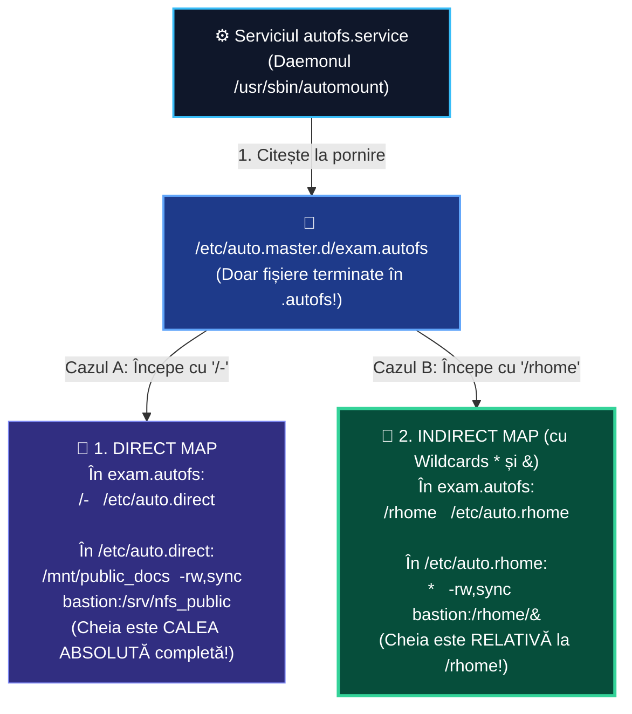

> ### Obiectivul Capitolului, Ponderea în Examenul EX200 & Regula de Aur a Persistenței
>
> * **Obiectivul Capitolului:** Înțelegerea completă a arhitecturii **NFSv4 (*Network File System v4*)**, configurarea unui server NFS (`/etc/exports`, `exportfs -rav`, opțiunile `rw`, `sync`, `root_squash` vs. `no_root_squash`), montarea statică în `/etc/fstab` cu opțiunea vitală **`_netdev`**, și stăpânirea absolută a daemonului **`autofs` (*Kernel Automounter*)**: arhitectura `/etc/auto.master.d/*.autofs`, diferența dintre **Direct Maps (`/-`)** și **Indirect Maps**, și configurarea **Indirect Maps cu Wildcards (`*` și `&`)** pentru montarea automată a directoarelor home (`/rhome/ldapuserX`) la autentificarea utilizatorilor!
>
> * **Ponderea în Examenul EX200:** **GARANTATĂ 100% (10–15% din punctajul examenului EX200!).**
>   În aproape fiecare examen RHCSA există un scenariu pe `node1` legat de `autofs` și `NFS`:
>   * **Scenariul Clasic EX200 (`autofs` Indirect Map cu Wildcards):** *„Serverul `bastion.lab.example.com` exportă prin NFS directorul `/rhome` care conține subdirectoarele personale pentru utilizatorii `remoteuser1`, `remoteuser2` etc. Configurați `autofs` pe `node1` astfel încât în momentul în care oricare dintre acești utilizatori se autentifică (sau când îi este accesat directorul `/rhome/<username>`), partajarea `bastion.lab.example.com:/rhome/<username>` să fie montată automat în `/rhome/<username>` cu drepturi de citire și scriere (`rw,sync`).”*
>   * **Scenariul Alternativ (`autofs` Direct Map):** *„Configurați `autofs` astfel încât partajarea `bastion.lab.example.com:/srv/nfs_public` să fie montată automat la cerere direct în calea `/mnt/public_docs`.”*
>
> * **Regula de Aur a Persistenței (EX200 Survival Rule):**
>   1. Pentru montarea prin **`autofs`**: Nu crea tu manual cu `mkdir` subdirectoarele finale din interiorul unui *Indirect Map* (`autofs` le creează și le montează singur în memorie la accesare!), și nu uita să activezi serviciul la boot cu **`systemctl enable --now autofs`**!
>   2. Pentru montarea clasică a unui NFS în **`/etc/fstab`**: Adaugă întotdeauna opțiunea **`defaults,_netdev`** în coloana a 4-a! Fără `_netdev`, `systemd` poate încerca să monteze partajarea NFS înainte ca placa de rețea să primească IP, blocând boot-ul!

:::analogy
De ce nu montăm pur și simplu toate partajările de rețea **NFS (*Network File System*)** direct în `/etc/fstab` și de ce a inventat lumea UNIX/Linux serviciul **`autofs` (*Automounter*)**?

Imaginează-ți o companie cu **500 de servere RHEL (`node1` .. `node500`)** și **1.000 de ingineri**. Fiecare inginer are propriul său director personal (`/rhome/inginer1` .. `/rhome/inginer1000`) stocat centralizat pe un server NFS central (`bastion`), astfel încât pe oricare dintre cele 500 de servere s-ar conecta prin SSH, să își găsească imediat fișierele și `.bashrc`-ul său!
Ce s-ar întâmpla dacă am pune toate cele 1.000 de directoare în `/etc/fstab` pe toate cele 500 de servere?
1. Fiecare server ar trebui să mențină permanent deschise 1.000 de conexiuni TCP/NFS ($500 \times 1.000 = 500.000$ de montări active simultan!), deși pe `node1` lucrează astăzi doar 2 ingineri!
2. Dacă serverul NFS intră în mentenanță timp de 3 minute, toate procesele care fac `df -h` pe cele 500 de servere ar îngheța în starea **`D` (*Uninterruptible Sleep*)** și niciun server nu ar mai putea porni la reboot!

### Analogia Vizuală: Podul Fix din Beton (`/etc/fstab`) vs. Liftul cu Senzor de Mișcare (`autofs`)

1. **Montarea prin `/etc/fstab`:** Este un **Pod Fix din Beton** construit la pornirea serverului și lăsat deschis 24/7, chiar dacă nu trece nimeni pe el săptămâni întregi. Dacă malul celălalt (serverul NFS) se prăbușește, podul rămâne suspendat în gol și blochează traficul.
2. **Montarea prin `autofs` (*On-Demand Automounter*):** Este o **Ușă Automată cu Senzor de Mișcare infraroșu (modulul de kernel `autofs4`)**:
   * Cât timp nimeni nu intră în `/rhome/natasha`, **nu există nicio conexiune NFS activă**!
   * În milisecunda în care `natasha` se loghează prin SSH sau rulează `cd /rhome/natasha`, senzorul din kernel (`VFS dentry trap`) îl trezește pe portarul **`automount` (`autofs.service`)**, care montează pe loc partajarea NFS în spate, fără ca `natasha` să simtă vreo întârziere!
   * După ce `natasha` iese din acel director și nu îl mai folosește timp de **5 minute (`timeout = 300` secunde)**, `autofs` demontează singur partajarea în liniște, eliberând resursele!
:::

:::architecture
### 2.1. Arhitectura Protocolului `NFSv4` (Server & Client în RHEL 9 / RHEL 10)

* **NFS (*Network File System*):**
  * *(1) Origine:* Creat de Sun Microsystems în 1984 (protocolul standard nativ UNIX/Linux pentru partajarea fișierelor în rețea).
  * *(2) Ce reprezintă:* Un sistem de fișiere distribuit prin care un server (**NFS Server**) își exportă unul sau mai multe directoare locale prin rețea, iar clienții (**NFS Clients**) le montează în propriul lor arbore VFS ca și cum ar fi discuri locale.
  * *(3) Evoluția tehnică majoră: `NFSv3` vs. `NFSv4` (Standardul în RHEL 8 / 9 / 10):*
    * Vechiul **`NFSv3`** era un protocol *stateless* care necesita o mulțime de servicii auxiliare (`rpcbind` pe portul 111, `rpc.mountd`, `rpc.lockd`, `rpc.statd`) pe porturi aleatorii greu de trecut prin firewall.
    * **`NFSv4` (`4.2` în RHEL 9/10)** este un protocol modern *stateful* care funcționează peste **un singur port TCP fix: portul `2049` (`nfs`)**, fără a mai avea nevoie de `rpcbind` pentru montare!

#### Cum configurăm un Server NFS în RHEL (`nfs-server.service` și `/etc/exports`)

Chiar dacă în examenul EX200 în 90% din cazuri vei configura **clientul** NFS (`autofs`), pentru laboratorul nostru (și pentru cele 10% cazuri în care ți se cere să exporți un director) trebuie să știi să configurezi și **serverul NFS**:

```bash
# 1. Instalăm pachetul nfs-utils și activăm serviciul nfs-server la boot:
dnf install -y nfs-utils
systemctl enable --now nfs-server

# 2. Deschidem serviciul 'nfs' (port 2049/tcp) în firewalld în mod persistent:
firewall-cmd --permanent --add-service=nfs
firewall-cmd --reload
```

Fișierul de configurare al serverului NFS este **`/etc/exports`** (`man 5 exports`). Sintaxa unei linii este:
```text
/cale/director_exportat    client_permis(optiuni_separate_prin_virgula_fara_spatii)
```
Exemplu în `/etc/exports`:
```text
/srv/nfs_public    192.168.122.0/24(rw,sync)
/rhome             *.lab.example.com(rw,sync,no_root_squash)
```

##### Disecția Opțiunilor din `/etc/exports` (și o Capcană de Spațiu Liber!):
* **`ro` vs. `rw`:** `ro` (*Read-Only* — implicit dacă nu specifici nimic!); **`rw`** (*Read-Write* — permite clienților să scrie, dacă și permisiunile Linux `rwx`/SELinux de pe directorul local al serverului o permit!).
* **`sync` vs. `async`:** **`sync`** (implicit și recomandat) forțează serverul NFS să scrie blocurile pe discul fizic înainte de a confirma clientului că scrierea a reușit.
* **`root_squash` (Implicit!) vs. `no_root_squash` (Întrebare Clasică de Interviu!):**
  * În mod implicit, din motive de securitate, NFS activează **`root_squash`**: dacă utilizatorul `root` (`UID 0`) de pe clientul `node1` încearcă să creeze sau să șteargă un fișier pe partajarea NFS, serverul NFS îi „strivește” (*squashes*) privilegiul de `root` și îl transformă automat în utilizatorul anonim fără drepturi **`nobody` (`UID 65534`)**!
  * **`no_root_squash`** dezactivează această protecție, permițându-i lui `root` de pe client să fie `root` (`UID 0`) și pe fișierele de pe serverul NFS!
* **⚠️ CAPCANA SPAȚIULUI LIBER ÎN `/etc/exports`:**
  * Corect (fără spațiu între IP și paranteză): `/srv/data 192.168.122.0/24(rw,sync)`
  * **GREȘIT (cu spațiu înainte de `(`!):** `/srv/data 192.168.122.0/24 (rw,sync)` -> Înseamnă: dă acces **Read-Only (`ro`)** la `192.168.122.0/24` și dă acces **`rw` la TOATĂ PLANETA (`*`)**!
* După orice modificare în `/etc/exports`, aplicăm modificarea fără a reporni serviciul rulând:
  ```bash
  exportfs -rav
  ```
  *(unde `-r` = reexport all, `-a` = all, `-v` = verbose)*.

---

### 2.2. Descoperirea și Montarea Clasică pe Client (`showmount`, `mount`, `/etc/fstab`)

Pe mașina client (`node1`), înainte de a configura `/etc/fstab` sau `autofs`, cum verificăm ce partajări ne oferă serverul NFS (`bastion` sau `node2`)?

```bash
# 1. Instalăm pachetul nfs-utils pe client (OBLIGATORIU pentru a avea binarul /sbin/mount.nfs4!):
dnf install -y nfs-utils

# 2. Interogăm lista de exporturi ale serverului NFS (dacă serverul permite rpcbind/mountd) sau testăm o montare temporară în /mnt:
showmount -e bastion.lab.example.com
# Sau testul infailibil în examen (chiar și când rpcbind e oprit pe NFSv4 pur):
mount -t nfs4 bastion.lab.example.com:/srv/nfs_public /mnt
ls -la /mnt
umount /mnt
```

#### Montarea Statică Persistentă în `/etc/fstab`
Dacă cerința din examen **NU** menționează `autofs`, ci îți cere doar *„Montați persistent partajarea NFS în `/mnt/nfs_share`”*, o adaugi în **`/etc/fstab`**:
```text
bastion.lab.example.com:/srv/nfs_public   /mnt/nfs_share   nfs4   defaults,_netdev   0 0
```
apoi rulezi **`systemctl daemon-reload && mount -a`**!

---

### 2.3. Arhitectura `autofs` (*Automounter*) — Direct Maps vs. Indirect Maps & Wildcards

Serviciul **`autofs`** (furnizat de pachetul RPM **`autofs`**) folosește o arhitectură pe două niveluri de fișiere de configurare în `/etc`:
1. **Fișierul Master (`/etc/auto.master` și directorul modular `/etc/auto.master.d/*.autofs`):**
   * Îi spune daemonului `automount` **CE director de bază să supravegheze** și **CARE este fișierul de mapare (*Map File*)** asociat acelui director.
   * **Regula de Examen:** În loc să editezi `/etc/auto.master`, creezi întotdeauna un fișier curat în **`/etc/auto.master.d/<nume>.autofs`** (**extensia `.autofs` este obligatorie!**).
2. **Fișierul de Mapare (`/etc/auto.<nume>`):**
   * Conține regulile efective: **Subdirectorul țintă**, **Opțiunile de montare (`-rw,sync`)** și **Sursa NFS (`server:/cale`)**.



#### Comparația Chirurgicală: Direct Map (`/-`) vs. Indirect Map vs. Indirect Wildcard (`*` și `&`)

Aceasta este secțiunea pe care trebuie să o stăpânești la perfecție pentru examenul EX200:

| Tipul Mapării `autofs` | Ce scrii în `/etc/auto.master.d/nume.autofs`? | Ce scrii în fișierul de mapare `/etc/auto.nume`? | Unde se montează efectiv partajarea pe disc și când îl folosești în EX200? |
| :--- | :--- | :--- | :--- |
| **1. Direct Map** *(Pentru un singur director fix, fără a bloca directorul părinte!)* | **`/-    /etc/auto.direct`** *(Simbolul **`/-`** indică întotdeauna o mapare directă!)* | **`/mnt/docs  -rw,sync  bastion:/srv/docs`** *(Primul câmp este **CALEA ABSOLUTĂ** cu `/` în față!)* | Se montează exact în **`/mnt/docs`**, fără ca `autofs` să preia controlul asupra întregului director `/mnt` (astfel încât celelalte directoare din `/mnt` rămân neafectate!). |
| **2. Indirect Map Simplu** *(Pentru un subdirector specificat sub un părinte dedicat)* | **`/shares  /etc/auto.shares`** *(Primul câmp este **DOAR directorul părinte** `/shares`!)* | **`proiect  -rw,sync  bastion:/srv/proiect`** *(Primul câmp este **DOAR numele subdirectorului FĂRĂ `/`**!)* | Se montează în **`/shares/proiect`**! **ATENȚIE:** `autofs` preia controlul complet asupra directorului părinte `/shares` (orice era înainte în `/shares` devine invizibil cât timp `autofs` rulează!). |
| **3. Indirect Map cu Wildcards (`*` și `&`)** *(REGELE EX200 pentru `/rhome/userX`!)* | **`/rhome  /etc/auto.rhome`** *(Directorul părinte comun al tuturor utilizatorilor)* | **`*  -rw,sync  bastion:/rhome/&`** *(Steluța **`*`** potrivește orice nume de subdirector, iar **`&`** îl înlocuiește pe partea serverului!)* | Când `remoteuser1` accesează **`/rhome/remoteuser1`**, `*` devine `remoteuser1`, iar `&` este înlocuit automat tot cu `remoteuser1`, montând **`bastion:/rhome/remoteuser1`** în **`/rhome/remoteuser1`**! |

> **De ce este regula `*   -rw,sync   server:/rhome/&` atât de genială?**
> Cu **o singură linie** în `/etc/auto.rhome`, ai rezolvat montarea automată pentru `remoteuser1`, `remoteuser2`, ..., `remoteuser1000`! Când `remoteuser5` dă `cd /rhome/remoteuser5`, `autofs` vede că `*` = `remoteuser5`, pune `remoteuser5` în locul simbolului `&` și montează instantaneu `server:/rhome/remoteuser5`!

---

> **➕ Aprofundare.** De aici până la sfârșitul secțiunii, textul este o extindere adăugată de Claude la cererea lui Alex (nu face parte din capitolul original).

### 2.4. Opțiunile de Montare NFS și Cum Vezi Ce S-a Negociat de Fapt

La montare, clientul și serverul NFS negociază versiunea protocolului și mai mulți parametri. Ce scrii în `/etc/fstab` sau într-o hartă `autofs` este cererea; ce s-a stabilit efectiv vezi după montare.

| Opțiune | Efect |
| :--- | :--- |
| `rw` / `ro` | Citire și scriere / doar citire. Dreptul efectiv este cel mai restrictiv dintre client și server. |
| `vers=4.2` (sau `nfsvers=4.2`) | Forțează o anumită versiune. Fără ea, clientul încearcă cea mai nouă versiune suportată de ambele părți. |
| `sync` / `async` | Scrierile sunt confirmate după ce ajung pe server / pot fi amânate în cache-ul clientului. |
| `hard` / `soft` | Reîncearcă la nesfârșit / renunță cu eroare (vezi întrebarea de interviu a capitolului). |
| `timeo=600` | Timpul de așteptare înainte de reîncercare, în zecimi de secundă. |
| `noexec`, `nosuid` | Ca la orice sistem de fișiere; recomandate pe partajări în care scriu mulți utilizatori. |
| `sec=sys` | Autentificare bazată pe UID-ul numeric (implicit). `sec=krb5`, `krb5i`, `krb5p` folosesc Kerberos. |
| `_netdev` | Montarea așteaptă rețeaua (doar în `/etc/fstab`). |

```bash
# Opțiunile EFECTIVE ale fiecărei montări NFS, inclusiv versiunea negociată și adresa serverului:
nfsstat -m

# Doar montările NFS, cu sursa și opțiunile:
findmnt -t nfs4

# Ce versiuni oferă serverul (rulat pe server):
cat /proc/fs/nfsd/versions
```

Dacă `nfsstat -m` arată `vers=3` când te așteptai la 4.2, serverul sau un firewall dintre voi nu permite NFSv4, iar clientul a coborât singur la versiunea 3, care are nevoie și de `rpcbind` și `mountd`.

### 2.5. Cine Ești pe Server: UID-uri, `root_squash` și Proprietarul `nobody`

Cu autentificarea implicită (`sec=sys`), serverul NFS **are încredere în UID-ul numeric** trimis de client. Nu verifică parole și nu compară nume. De aici vin cele mai multe probleme de permisiuni pe NFS.

| Situație | Ce vezi | Cauza |
| :--- | :--- | :--- |
| `natasha` are UID 1001 pe client și 1005 pe server | Nu își poate modifica propriile fișiere, sau le vede ca aparținând altcuiva. | Serverul aplică permisiunile pentru UID 1001, care acolo este alt utilizator. |
| `root` de pe client nu poate scrie, deși exportul este `rw` | `Permission denied` la `touch`. | `root_squash`: `root` devine `nobody` pe server. |
| Toate fișierele apar cu proprietarul `nobody` | `ls -l` arată `nobody nobody`. | La NFSv4, numele sunt trimise ca `utilizator@domeniu`; domeniul diferă între client și server. |

Pentru primul caz, soluția este ca utilizatorii să aibă **același UID** pe toate sistemele. De aceea laboratorul capitolului creează `remoteuser1` cu `-u 4001` pe ambele noduri; în companii, asta se rezolvă cu un director central de identități.

Pentru al treilea caz, verifici că domeniul NFSv4 este același pe client și pe server:

```bash
# Domeniul folosit pentru maparea numelor (implicit: domeniul DNS al mașinii):
grep -i "^Domain" /etc/idmapd.conf
nfsidmap -d
```

Pe lângă permisiuni, SELinux mai pune o condiție pe client, prin boolean-uri:

| Boolean | Ce permite |
| :--- | :--- |
| `use_nfs_home_dirs` | Directoare home aflate pe NFS (autentificare, citirea fișierelor de profil). |
| `httpd_use_nfs` | Serverul web poate servi conținut de pe o partajare NFS. |
| `virt_use_nfs` | Mașinile virtuale își pot ține discurile pe NFS. |

Iar pe server: `nfs_export_all_rw` și `nfs_export_all_ro` (active implicit) permit exportul oricărui director.

### 2.6. `autofs` în Detaliu: Timeout, Fișierul de Configurare și Depanare

**Timpul de demontare.** Cele 5 minute de inactivitate vin din `/etc/autofs.conf` (`timeout = 300`). Poți schimba valoarea global, acolo, sau doar pentru un punct de montare, în fișierul master:

```text
# /etc/auto.master.d/exam.autofs
/rhome   /etc/auto.rhome   --timeout=60
```

**Directoarele „fantomă”.** Implicit, `ls /rhome` arată gol până când cineva accesează un subdirector. Cu `browse_mode = yes` în `/etc/autofs.conf` (sau `--ghost` pe linia din master), `autofs` creează dinainte directoare goale pentru cheile cunoscute, ca utilizatorii să vadă ce există. Nu funcționează cu wildcard-ul `*`, pentru că acolo `autofs` nu are de unde ști numele.

**Ce cere repornire și ce nu:**

| Ai modificat | Ce trebuie făcut |
| :--- | :--- |
| Un fișier de mapare (`/etc/auto.rhome`, `/etc/auto.direct`), la o hartă **indirectă** | Nimic: harta este recitită la următoarea accesare. |
| Fișierul master (`/etc/auto.master.d/*.autofs`) | `systemctl reload autofs` |
| O hartă **directă** (ai adăugat sau ai scos o cale) | `systemctl reload autofs` |
| `/etc/autofs.conf` | `systemctl restart autofs` |

`reload` păstrează montările active. `restart` încearcă să le demonteze și poate eșua dacă sunt folosite.

**Depanare, în ordine:**

```bash
# 1. Ce hărți a înțeles autofs din fișierele tale (cea mai rapidă verificare):
automount -m

# 2. Serverul chiar exportă ce crezi? Montare manuală, fără autofs:
mount -t nfs4 192.168.122.102:/rhome/remoteuser1 /mnt && ls /mnt && umount /mnt

# 3. Ce spune autofs când accesezi directorul:
journalctl -u autofs -f        # într-un terminal
ls /rhome/remoteuser1          # în altul

# 4. Mod de depanare detaliat (oprește întâi serviciul):
systemctl stop autofs
automount -f -v
```

Pasul 2 este cel mai important: dacă montarea manuală nu merge, problema este la rețea, la firewall sau la export, nu la `autofs`.

**Alte forme de hărți**, pe care le vei întâlni în documentație:

```text
# Mai multe chei explicite într-o hartă indirectă:
proiecte   -rw,sync        server:/srv/proiecte
arhiva     -ro             server:/srv/arhiva

# Tipul sistemului de fișiere, precizat explicit:
date       -fstype=nfs4,rw server:/srv/date

# Harta specială -hosts: orice export al oricărui server, sub /net/<server>/<cale>
/net       -hosts
```

### 2.7. Alternativa fără `autofs`: Montare la Cerere prin `systemd`

`systemd` poate face singur montare la cerere, direct din `/etc/fstab`, cu două opțiuni:

```text
server:/srv/nfs_public  /mnt/public_docs  nfs4  _netdev,noauto,x-systemd.automount,x-systemd.idle-timeout=60  0 0
```

| Opțiune | Efect |
| :--- | :--- |
| `noauto` | Nu se montează la boot. |
| `x-systemd.automount` | `systemd` montează la prima accesare a directorului. |
| `x-systemd.idle-timeout=60` | Demontează după 60 de secunde de inactivitate. |

După editare: `systemctl daemon-reload` și `systemctl restart remote-fs.target`. Avantajul este că nu mai instalezi nimic. Limita este că nu există wildcard-uri: pentru directoare home ale unui număr necunoscut de utilizatori, `autofs` rămâne soluția. Dacă enunțul de examen cere explicit `autofs`, folosește `autofs`.

### 2.8. Partea de Server: Exporturi Modulare, Verificare și Firewall

```bash
exportfs -v                 # ce este exportat ACUM, cu toate opțiunile efective (inclusiv cele implicite)
exportfs -ra                # reaplică /etc/exports după o modificare
exportfs -u 192.168.122.0/24:/srv/nfs_public    # retrage temporar un export
exportfs -o rw,sync 192.168.122.101:/srv/test   # adaugă un export temporar, fără să editezi fișiere
```

`exportfs -v` este verificarea de încredere: arată și opțiunile pe care nu le-ai scris tu, de exemplu `root_squash` și `sec=sys`. Dacă un client primește `access denied by server`, compară adresa lui cu ce arată această comandă.

Pe lângă `/etc/exports`, serverul citește și fișierele `*.exports` din `/etc/exports.d/`, ceea ce permite ca fiecare aplicație să își aducă propriul fișier.

În `/etc/exports`, clientul se poate scrie în mai multe feluri:

| Formă | Exemplu |
| :--- | :--- |
| Un singur host | `node1.lab.example.com` sau `192.168.122.101` |
| O rețea | `192.168.122.0/24` |
| Un domeniu, cu wildcard | `*.lab.example.com` |
| Oricine | `*` |

Firewall-ul de pe server: pentru NFSv4 este suficient serviciul `nfs` (portul 2049/tcp). Serviciile `rpc-bind` și `mountd` sunt necesare doar pentru NFSv3 și pentru ca `showmount -e` să funcționeze de pe clienți. De aceea un `showmount -e` care eșuează nu înseamnă neapărat că NFSv4 nu merge: testul sigur rămâne montarea manuală.
:::

:::exam-alert
### 💀 Capcana Mortală #1: Punerea unui Slash `/` în primul câmp al unui Indirect Map!
Aceasta este greșeala clasică la examenul EX200:
Candidatul scrie corect în `/etc/auto.master.d/rhome.autofs`:
`/rhome   /etc/auto.rhome`
Dar apoi în `/etc/auto.rhome` scrie din greșeală cu `/` în față:
`/remoteuser1   -rw,sync   bastion:/rhome/remoteuser1` (**GREȘIT — are `/` în fața lui `remoteuser1`!**)
Într-un **Indirect Map**, primul câmp din `/etc/auto.rhome` este o cheie **RELATIVĂ** la `/rhome`, deci **NU are voie să înceapă cu `/`!** (Doar în *Direct Maps* începe cu `/`).
* Corect pentru un singur user: `remoteuser1   -rw,sync   bastion:/rhome/remoteuser1`
* Corect pentru toți userii (Wildcard): `*   -rw,sync   bastion:/rhome/&`

### 💀 Capcana Mortală #2: Uitarea Semnului Minus `-` în fața Opțiunilor de Montare în `autofs`!
În `/etc/fstab` scriem opțiunile fără minus (`rw,sync`).
Dar în fișierele de mapare **`autofs` (`/etc/auto.*`)**, opțiunile din coloana a 2-a **TREBUIE să înceapă cu semnul minus `-`**:
* Corect: `*   -rw,sync   bastion:/rhome/&`
* Greșit: `*   rw,sync   bastion:/rhome/&` *(Dacă uiți `-`, `autofs` va crede că `rw,sync` este numele serverului NFS și montarea va eșua!)*

### 💀 Capcana Mortală #3: Crearea Manuală a Subdirectorului Țintă cu `mkdir` într-un Indirect Map!
Dacă în examen configurezi `/rhome` în `autofs`, **NU crea tu manual cu `mkdir` directorul `/rhome` și mai ales `/rhome/remoteuser1`**! Serviciul `autofs` își creează singur atât directorul părinte `/rhome` la pornirea serviciului (`systemctl restart autofs`), cât și subdirectorul `/rhome/remoteuser1` în secunda în care faci `ls /rhome/remoteuser1` sau `cd /rhome/remoteuser1`!

### 🛠️ Man Page Hacks pentru Capitolul 3.3 (Cum nu memorezi nimic în examen!)
Ai uitat în timpul examenului cum se scrie regula cu `*` și `&` sau formatul din `auto.master`?
Ai două surse deja instalate pe server (după ce rulezi `dnf install -y autofs`):
1. **Fișierul `/etc/auto.misc`:** Deschide `/etc/auto.misc` cu `cat /etc/auto.misc` — conține deja exemple gata scrise de Red Hat cu `-fstype=...` și opțiuni!
2. **Pagina de manual `man 5 autofs`:**
   ```bash
   man 5 autofs
   ```
   Caută `/WILDCARD` sau `/EXAMPLE` și vei vedea exact linia `*   server:/export/home/&`!

---

> **➕ Aprofundare.** De aici până la sfârșitul secțiunii, textul este o extindere adăugată de Claude la cererea lui Alex (nu face parte din capitolul original).

### ⚠️ Capcană în plus: Ai testat ca `root`, dar enunțul vorbește despre utilizator
`ls /rhome/remoteuser1` rulat ca `root` poate reuși sau eșua din motive care nu au legătură cu ce verifică examenul (`root_squash`, permisiunile directorului). Testează întotdeauna **ca utilizatorul din enunț**: `su - remoteuser1`, apoi `pwd` (trebuie să fie directorul lui home, fără mesajul *could not chdir to home directory*) și `touch test && rm test`, ca să confirmi că poate scrie.

### ⚠️ Capcană în plus: Directorul părinte al unei hărți indirecte avea deja conținut
Când `autofs` preia `/rhome`, tot ce exista local în acel director devine invizibil cât timp serviciul rulează. Dacă un enunț îți cere o hartă indirectă pe un director care conține deja date locale (de exemplu `/home`), utilizatorii locali își pierd accesul la directoarele home. În acest caz se folosește fie alt director părinte, fie o hartă directă pentru căile individuale.
:::

:::interview
### Întrebarea 1 (Nivel Mid -> Senior / SRE):
> **Intervievator:** *„Care este diferența dintre opțiunile de montare NFS `hard` (implicit) și `soft` pe un client Linux? Ce se întâmplă cu aplicațiile dacă serverul NFS pică în ambele cazuri?”*

**Răspunsul Ideal:**
> „1. **`hard` (Opțiunea Implicită și Recomandată pentru Integritatea Datelor):** Dacă serverul NFS devine inaccesibil pe rețea, kernelul clientului nu dă eroare aplicației, ci blochează apelul de sistem I/O (`read()`/`write()`) în starea **`D` (*Uninterruptible Sleep*)** și reîncearcă la infinit în fundal până când serverul NFS revine online. Avantajul major este **zero corupție de date**: imediat ce serverul NFS revine, aplicația își continuă scrierea exact de unde rămăsese. Dezavantajul este că procesele rămân blocate pe durata penei.
> 2. **`soft` (Nerecomandat pentru partajări Read-Write):** Dacă serverul NFS nu răspunde după expirarea `timeo` și `retrans`, kernelul renunță și întoarce eroarea `EIO (I/O Error)` către aplicație. Deși previne blocarea proceselor în starea `D`, majoritatea aplicațiilor nu știu să trateze un `write()` eșuat pe disc și pot corupe silențios fișierele!
> **Soluția modernă în RHEL:** Păstrăm montarea `hard` (sau folosim `autofs` pentru a demonta partajările nefolosite), iar dacă un server NFS a dispărut definitiv și vrem să eliberăm un mount blocat, folosim **`umount -lf /cale/nfs`** (*Lazy + Force Unmount*).”

---

> **➕ Aprofundare.** De aici până la sfârșitul secțiunii, textul este o extindere adăugată de Claude la cererea lui Alex (nu face parte din capitolul original).

### Întrebare în plus (Nivel Mid -> Senior):
> **Intervievator:** *„După ce echipa de stocare a făcut o mentenanță pe serverul NFS, pe mai mulți clienți comenzile `ls` și `df` pe partajare răspund cu `Stale file handle`. Rețeaua merge, serverul răspunde. Ce înseamnă eroarea și cum o rezolvi?”*

**Răspunsul Ideal:**
> „Clientul NFS nu lucrează cu nume de fișiere, ci cu **file handle-uri**: identificatori opaci primiți de la server, care indică un anumit obiect de pe un anumit sistem de fișiere exportat. `Stale file handle` (`ESTALE`) înseamnă că handle-ul pe care clientul îl ține în memorie nu mai corespunde cu nimic pe server.
>
> Cauzele tipice după o mentenanță: directorul exportat a fost șters și recreat (același nume, alt inode), sistemul de fișiere a fost restaurat sau reformatat, exportul a fost mutat pe alt volum, ori a fost schimbat identificatorul exportului (`fsid`). Din punctul de vedere al clientului, obiectul pe care îl avea montat a dispărut, chiar dacă la aceeași cale există acum altceva.
>
> Rezolvarea este să obțin handle-uri noi, adică să demontez și să montez din nou. Întâi ies cu toate procesele din partajare, apoi `umount /mnt/share`. Dacă demontarea refuză, folosesc `umount -f` sau, în ultimă instanță, `umount -l`, și remontez cu `mount -a`. La montările prin `autofs` este suficient ca partajarea să fie demontată, după care se reface singură la următoarea accesare. Procesele care au rămas cu directorul curent în vechea montare trebuie repornite.
>
> Ca prevenție, pe server exporturile primesc un `fsid=` fix în `/etc/exports`, ca identificatorul să nu depindă de numărul dispozitivului, care se poate schimba la reboot sau la mutarea pe alt disc. Iar operațiile de pe server care recreează directoare exportate se anunță clienților, pentru că le cer o remontare.”
:::

:::lab
În laboratorul nostru complet, vom transforma **`node2.lab.example.com` (`192.168.122.102`)** în **Server NFS** (care exportă atât un director public `/srv/nfs_public`, cât și directoarele home `/rhome/remoteuser1` și `/rhome/remoteuser2`), și vom configura **`node1.lab.example.com` (`192.168.122.101`)** ca **Client `autofs`** (exact ca în examenul EX200)!
:::

:::exam
Pune-ți cronometrul pe **15 minute** și rezolvă pe **`node1.lab.example.com`**:

### Partea A: Cele 3 Task-uri Practice (Stil Oficial EX200)

1. **Task 1 (Configurare `autofs` Indirect Map cu Wildcards pentru `/rhome`):**
   Asigurați-vă că pe `node1` serviciul `autofs` este instalat, activat la boot și configurat (prin `/etc/auto.master.d/exam.autofs` și `/etc/auto.rhome`) astfel încât orice subdirector `/rhome/<user>` accesat pe `node1` să monteze automat partajarea `192.168.122.102:/rhome/<user>` cu opțiunile `rw,sync`.
2. **Task 2 (Configurare `autofs` Direct Map pentru `/mnt/public_docs`):**
   Configurați o mapare directă în `autofs` (`/etc/auto.direct`) astfel încât accesarea directorului `/mnt/public_docs` pe `node1` să monteze automat partajarea `192.168.122.102:/srv/nfs_public` cu opțiunile `rw,sync`.
3. **Task 3 (Testarea Scrierii prin NFS & SELinux Home Dir Support):**
   Activați boolean-ul SELinux care permite utilizarea directoarelor home montate prin NFS (`setsebool -P use_nfs_home_dirs on`) și apoi, sub identitatea utilizatorului `remoteuser1` (`su - remoteuser1`), creați un fișier `/rhome/remoteuser1/ex200_verified.txt` care să conțină textul `AUTOFS_SUCCESS`.
:::

:::solution
#### Rezolvarea Pas cu Pas a Task-urilor Practice (pe `node1`):

##### Rezolvare Task 1, 2 & 3:
```bash
# 1. Ne asigurăm că boolean-ul SELinux pentru directoare home pe NFS este activat persistent (-P):
setsebool -P use_nfs_home_dirs on

# 2. Verificăm fișierele autofs create la Pasul 2 din laborator și repornim autofs:
systemctl enable --now autofs

# 3. Creăm fișierul cerut sub contul utilizatorului remoteuser1:
su - remoteuser1 -c 'echo "AUTOFS_SUCCESS" > /rhome/remoteuser1/ex200_verified.txt'

# 4. Accesăm și /mnt/public_docs pentru a declanșa montarea directă:
ls -la /mnt/public_docs/
```

#### Scriptul de Verificare Automată (Grading Script pentru Capitolul 3.3 — rulat pe `node1`)

```bash
#!/bin/bash
# ==============================================================================
# RHCSA (EX200) - Script Automat de Evaluare: Capitolul 3.3 (pe node1)
# ==============================================================================
SCORE=0
TOTAL=30

echo "========================================================"
echo " Evaluare Obiective Capitolul 3.3 pe $(hostname)"
echo "========================================================"

# Verificare Task 1: autofs Indirect Wildcard Map (/rhome/remoteuser1)
if systemctl is-enabled autofs &>/dev/null && \
   su - remoteuser1 -c "cat /rhome/remoteuser1/welcome.txt" &>/dev/null && \
   findmnt -n -o FSTYPE /rhome/remoteuser1 2>/dev/null | grep -q "nfs"; then
    echo "[ PASS ] Task 1: Maparea indirectă cu wildcard pentru /rhome funcționează și montează automat la cerere (+10p)"
    SCORE=$((SCORE + 10))
else
    echo "[ FAIL ] Task 1: Directorul /rhome/remoteuser1 nu se montează automat prin autofs (0p)"
fi

# Verificare Task 2: autofs Direct Map (/mnt/public_docs)
if [[ -f /mnt/public_docs/manual.txt ]] && \
   findmnt -n -o FSTYPE /mnt/public_docs 2>/dev/null | grep -q "nfs"; then
    echo "[ PASS ] Task 2: Maparea directă (/-) pentru /mnt/public_docs funcționează impecabil (+10p)"
    SCORE=$((SCORE + 10))
else
    echo "[ FAIL ] Task 2: Directorul /mnt/public_docs nu se montează automat prin autofs Direct Map (0p)"
fi

# Verificare Task 3: Scrierea prin NFS + use_nfs_home_dirs
if getsebool use_nfs_home_dirs 2>/dev/null | grep -q "on$" && \
   [[ $(cat /rhome/remoteuser1/ex200_verified.txt 2>/dev/null) == "AUTOFS_SUCCESS" ]]; then
    echo "[ PASS ] Task 3: Boolean-ul SELinux use_nfs_home_dirs este activ și scrierea în /rhome/remoteuser1 a reușit (+10p)"
    SCORE=$((SCORE + 10))
else
    echo "[ FAIL ] Task 3: use_nfs_home_dirs este off sau /rhome/remoteuser1/ex200_verified.txt lipsește (0p)"
fi

echo "--------------------------------------------------------"
echo " PUNCTAJ FINAL CAPITOLUL 3.3: $SCORE / $TOTAL"
echo "========================================================"
```
:::

:::references
1. **Cursul Oficial Red Hat RH134 (*Red Hat System Administration II*):**
   * Capitolul 10: *Access Network-Attached Storage* (`NFSv4`, `mount`, `/etc/fstab` cu `_netdev`, `autofs` Direct Maps, Indirect Maps și Wildcards `*` / `&`).
2. **Pagini de Manual (`man`) Esențiale din Sistem:**
   * `man 5 autofs`, `man 5 auto.master`, `man 8 automount`
   * `man 5 nfs`, `man 5 exports`, `man 8 exportfs`, `man 8 showmount`
:::
