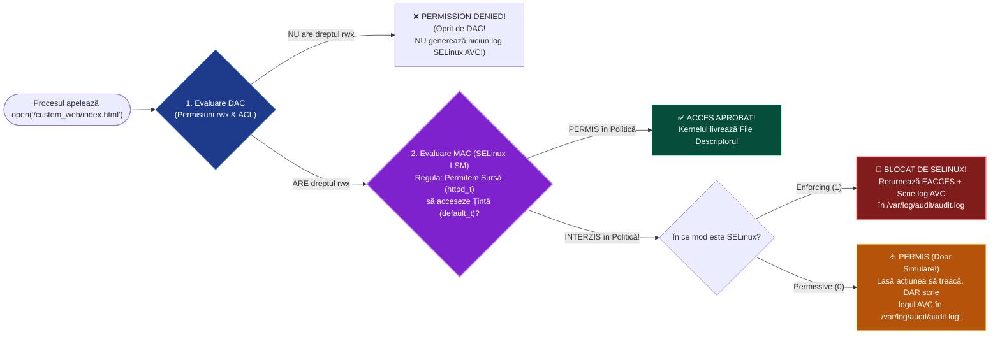
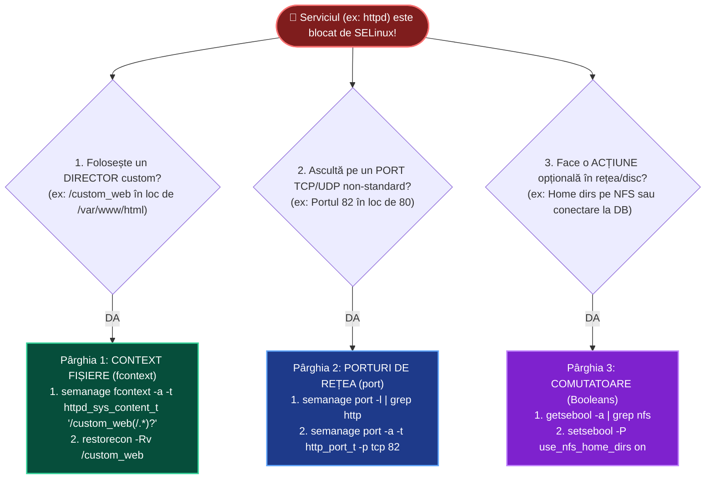
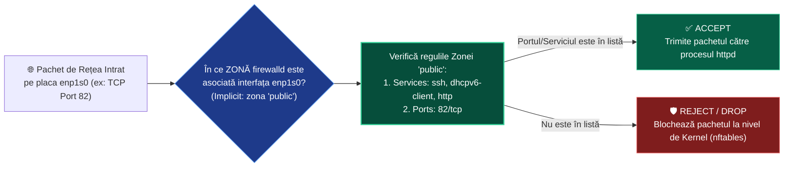

> ### Obiectivul Capitolului, Ponderea în Examenul EX200 & Regula de Aur a Persistenței
>
> * **Obiectivul Capitolului:** Înțelegerea completă a arhitecturii **MAC (*Mandatory Access Control*)** implementate în nucleul Linux prin **SELinux (*Security-Enhanced Linux*)** în comparație cu permisiunile clasice **DAC (*Discretionary Access Control*)**; gestionarea modurilor de operare (`Enforcing`, `Permissive`, `Disabled`); disecția contextului SELinux (`user:role:type:level`) și a regulilor de **Type Enforcement**; comportamentul contextului la copiere (`cp`) vs. mutare (`mv`); definirea persistentă a contextului pe directoare non-standard (**`semanage fcontext`** + **`restorecon -Rv`** vs. capcana `chcon`); autorizarea porturilor de rețea non-standard (**`semanage port -a -t ... -p tcp <port>`**); comutatoarele dinamice de politică (**SELinux Booleans:** `getsebool`, **`setsebool -P`**); diagnosticarea blocajelor AVC cu `ausearch -m AVC` și `sealert`; și stăpânirea firewall-ului dinamic **`firewalld`** (arhitectura `nftables`, Zone, Servicii, Porturi, `--permanent` și `firewall-cmd --reload`).
>
> * **Ponderea în Examenul EX200:** **DECISIVĂ ȘI GARANTATĂ 100% (15–20% din punctajul examenului EX200!).**
>   În examenul RHCSA există întotdeauna un scenariu complex de troubleshooting sau configurare pe `node1` care combină **SELinux + `firewalld`** (și care valorează adesea 25–30 de puncte!):
>   * **Scenariul Clasic EX200 („Serverul Web care nu pornește pe portul 82”):** *„Pe `node1` este instalat un server web `httpd` configurat să servească fișierele din directorul non-standard `/custom_web` și să asculte pe portul TCP **`82`**, dar serviciul nu poate porni și nu poate fi accesat din exterior. Rezolvați toate problemele astfel încât serviciul `httpd` să pornească automat la boot și să fie accesibil pe portul `82` de pe celelalte sisteme.”*
>   * **ATENȚIE MAXIMĂ LAREGULA OFICIALĂ RED HAT:** La începutul examenului EX200 scrie cu litere mari: **„Toate mașinile virtuale trebuie să aibă SELinux activat în modul `Enforcing` și firewall-ul activ la finalul examenului!”** Dacă dezactivezi SELinux (`Permissive` / `Disabled`) sau oprești `firewalld` (`systemctl stop firewalld`) ca să „îți meargă” un serviciu, scriptul de notare îți anulează punctajul!
>
> * **Regula de Aur a Persistenței (EX200 Survival Rule):**
>   1. **La Modul SELinux:** Comanda `setenforce 1` schimbă modul doar în RAM! Pentru persistență la reboot, verifică întotdeauna că în **`/etc/selinux/config`** este setat **`SELINUX=enforcing`**!
>   2. **La Contextul Fișierelor:** Nu folosi `chcon` în examen (se șterge la `restorecon` sau `/.autorelabel`!). Folosește perechea sfântă: **`semanage fcontext -a -t <tip_t> "/cale(/.*)?"`** urmată obligatoriu de **`restorecon -Rv /cale`**!
>   3. **La Booleans SELinux:** Pune **MEREU flag-ul `-P` (*Persistent*)** la `setsebool`: **`setsebool -P <nume_boolean> on`**! Fără `-P`, setarea se pierde la reboot!
>   4. **La `firewalld`:** Orice regulă adăugată fără `--permanent` dispare la reboot! Folosește **MEREU `--permanent`** urmat imediat de **`firewall-cmd --reload`**!

:::analogy
Care este primul lucru pe care îl fac administratorii nepregătiți când un serviciu (`httpd`, `nginx`, `mariadb`, `nfs`) dă eroarea `Permission denied`, deși permisiunile pe disc sunt `0777`? Caută pe forumuri și rulează `setenforce 0` și `systemctl stop firewalld`!
Într-un examen Red Hat (și într-un interviu pentru o bancă, o instituție financiară sau o infrastructură cloud de producție), această abordare echivalează cu **respingerea imediată**.

De ce a fost creat **SELinux** de către **NSA (*National Security Agency*)** împreună cu **Red Hat** și integrat direct în nucleul Linux prin arhitectura **LSM (*Linux Security Modules*)**?
Deoarece permisiunile tradiționale UNIX (**DAC — *Discretionary Access Control***: `rwx` și `root`) au o vulnerabilitate arhitecturală fatală: dacă un atacator descoperă o vulnerabilitate într-un serviciu public (de exemplu în serverul web Apache `httpd` sau într-o aplicație PHP/Node.js), codul atacatorului preia identitatea procesului compromis și poate citi orice fișier din sistem care are permisiuni `r--` pentru *Others* (cum ar fi `/etc/passwd`, fișiere din `/tmp`, `/home` sau chei SSH prost configurate) și poate deschide conexiuni către baza de date internă!

### Analogia Vizuală: Paznicul cu Lista de Proprietari (DAC), Ofițerul NSA cu Zgarda de Tip (SELinux MAC) și Portarul Cetății (`firewalld`)

Imaginează-ți securitatea serverului tău RHEL ca pe un **Complex Guvernamental cu 3 Filtre de Control**:

1. **Filtrul 1 — Portarul de la Intrarea în Cetate (`firewalld` / `nftables` în Kernel):**
   * Când un pachet TCP/UDP vine din rețea pe placa `enp1s0` către portul `82`, primul care îl oprește este **Portarul Cetății (`firewalld`)**. El verifică în ce **Zonă** se află placa de rețea (ex. zona `public`) și dacă portul `82/tcp` este pe lista porturilor deschise. Dacă nu este, aruncă pachetul înainte ca vreo aplicație de pe server să știe că cineva a bătut la ușă!
2. **Filtrul 2 — Controlul Discreționar al Accesului (`DAC` — Permisiunile `rwx` & `ACL`):**
   * Pachetul a trecut de firewall și a ajuns la procesul `httpd` (care rulează sub utilizatorul `apache`). Acum `httpd` vrea să citească fișierul `/custom_web/index.html`. Paznicul DAC se uită doar la proprietar și la biții `rwx`: *„Are utilizatorul `apache` dreptul `r` pe `/custom_web/index.html`? Da! Din partea mea, poți trece!”*.
3. **Filtrul 3 — Controlul Obligatoriu al Accesului (`MAC` — `SELinux` în Kernel):**
   * Chiar dacă paznicul DAC (și chiar `root`!) a spus „DA”, înainte ca discul să fie atins, intervine **Ofițerul SELinux**.
   * Ofițerul SELinux nu dă doi bani pe faptul că ești `root` sau că fișierul are `chmod 777`! El se uită doar la **Ecusonul de Tip (*Domain Type*) de la gâtul procesului** și la **Eticheta de Tip (*File/Port Type*) lipită pe fișier sau pe port**:
     * Procesul `httpd` poartă ecusonul **`httpd_t`**.
     * În regulamentul SELinux scrie negru pe alb: *„Un proces cu ecusonul **`httpd_t`** are voie să citească **DOAR** fișiere care au lipită eticheta **`httpd_sys_content_t`** și are voie să asculte în rețea **DOAR** pe porturi care au eticheta **`http_port_t`**!”*.
     * Dacă tu ai creat directorul `/custom_web`, el a primit eticheta generică **`default_t`**. Când `httpd_t` vrea să citească un fișier `default_t`, ofițerul SELinux trântește ușa în nas procesului (**AVC Denial**), chiar dacă fișierul avea `chmod 777`!
:::

:::architecture
### 2.1. Ordinea de Evaluare în Kernel: `DAC` vs. `MAC (SELinux)`

Un detaliu tehnic esențial pentru interviuri și depanare: atunci când un proces apelează `open()` sau `bind()` în *Kernel Space*, **în ce ordine sunt verificate DAC și SELinux?**



> **De ce este această ordine (`1. DAC` -> `2. SELinux`) un truc uriaș de Troubleshooting în Examen?**
> Dacă un serviciu primește `Permission denied`, dar când cauți în logurile SELinux (`ausearch -m AVC`) **nu apare nicio eroare SELinux**, înseamnă 100% că cererea a fost oprită la **Pasul 1 (permisiuni Linux clasice `rwx` / `chmod` / `chown`)**, înainte să ajungă măcar la SELinux!

---

### 2.2. Cele 3 Moduri SELinux și Configurarea Persistentă (`/etc/selinux/config`)

SELinux poate funcționa în 3 moduri:
1. **`Enforcing` (`1`):** Modul standard obligatoriu în producție și în examenul EX200. SELinux **aplică activ politica** (blochează accesul neautorizat) și **înregistrează erorile AVC** (*Access Vector Cache*) în `/var/log/audit/audit.log`.
2. **`Permissive` (`0`):** Modul de diagnosticare. SELinux **nu blochează nimic** (se comportă ca și cum ar fi oprit), dar **înregistrează toate încălcările AVC în loguri**! *(Truc de Aur în Examen: Dacă un serviciu nu merge și nu știi dacă e din cauza SELinux sau a configurației serviciului, poți da temporar `setenforce 0`, testezi serviciul timp de 5 secunde, și dacă acum merge, știi 100% că problema e SELinux! Apoi pui imediat înapoi **`setenforce 1`** și repari eticheta/portul/boolean-ul!).*
3. **`Disabled`:** SELinux este complet dezactivat în kernel (nu blochează și nici nu pune etichete pe fișierele noi).

#### Comenzile pentru Modurile SELinux (Runtime vs. Persistent la Reboot!)

```bash
# 1. Verificăm modul curent (Runtime) și starea completă a politicii:
getenforce
sestatus

# 2. Comutăm la Runtime (fără reboot) între Enforcing (1) și Permissive (0):
setenforce 0    # Trece instantaneu în Permissive
setenforce 1    # Trece instantaneu în Enforcing

# 3. CONFIGURAREA PERSISTENTĂ LA REBOOT (în /etc/selinux/config):
# Dacă pe o mașină din examen SELinux este în Permissive sau Disabled la început,
# deschidem /etc/selinux/config și setăm:
SELINUX=enforcing
SELINUXTYPE=targeted
```
> **Schimbare Tehnică în RHEL 9 / RHEL 10:** În RHEL 9 și RHEL 10, dezactivarea completă a SELinux-ului nu se mai face doar din `/etc/selinux/config`, ci prin parametrul de kernel `selinux=0` în GRUB2 (`grubby --update-kernel=ALL --args="selinux=0"`). Iar dacă treci un sistem din `Disabled` înapoi în `Enforcing`, la următorul boot sistemul va face automat o reetichetare completă a discului (`/.autorelabel`)!

---

### 2.3. Anatomia Contextului SELinux (`-Z`) și Moștenirea la `cp` vs. `mv`

Orice obiect din Linux (proces, fișier, director, port TCP/UDP) are o etichetă SELinux numită **SELinux Context** (stocată în atributul extins `security.selinux` al Inode-ului).
Pentru a vedea contextul SELinux pe **orice** comandă Linux, adăugăm flag-ul universal **`-Z` (Z MARE)**:
* **`ls -lZ /var/www/html`** (contextul fișierelor și directoarelor);
* **`ps auxZ`** (contextul proceselor active);
* **`ss -tulpnZ`** (contextul porturilor de rețea);
* **`id -Z`** (contextul utilizatorului curent).

Să disecăm cele 4 câmpuri separate prin două puncte (`:`) ale unui context SELinux:

$$\underbrace{\text{system\_u}}_{\text{1. SELinux User}} : \underbrace{\text{object\_r}}_{\text{2. SELinux Role}} : \underbrace{\mathbf{httpd\_sys\_content\_t}}_{\substack{\text{3. SELinux TYPE (Domain/Type)}\\\textbf{REGELE ABSOLUT ÎN EX200!}}} : \underbrace{\text{s0}}_{\text{4. Sensitivity Level (MLS/MCS)}}$$

* În politica implicită din RHEL (**`targeted` policy**), 99.9% din reguli se bazează exclusiv pe **Câmpul 3: `type`** (care se termină aproape întotdeauna în sufixul **`_t`**, de exemplu `httpd_sys_content_t`, `ssh_port_t`, `samba_share_t`, `container_file_t`)!

#### Regula de Moștenire a Contextului SELinux: De ce `cp` funcționează, dar `mv` strică serverul web!

Aceasta este capcana clasică în examen și în producție:
Ai creat un fișier `/root/index.html` în directorul lui `root` (deci fișierul a primit contextul părintelui `/root`, adică **`admin_home_t`**). Apoi îl pui în `/var/www/html/` (care are contextul **`httpd_sys_content_t`**):
1. **Dacă folosești `cp /root/index.html /var/www/html/` (COPIERE):**
   Comanda `cp` creează un **Inode NOU** în `/var/www/html/`, iar în SELinux un fișier nou creat **moștenește automat contextul directorului destinație (`/var/www/html/`)** -> deci primește corect **`httpd_sys_content_t`** și site-ul web funcționează!
2. **Dacă folosești `mv /root/index.html /var/www/html/` (MUTARE — sau `cp -a`):**
   Comanda `mv` pe aceeași partiție mută **Inode-ul existent cu tot cu eticheta lui veche (`admin_home_t`)** în `/var/www/html/`! Când Apache (`httpd_t`) încearcă să citească `/var/www/html/index.html` (etichetat `admin_home_t`), SELinux îl blochează cu eroarea **`403 Forbidden`**!

---

### 2.4. Cele 3 Pârghii SELinux din Examenul EX200: `fcontext`, `port` și `booleans`

În examenul EX200, 100% din problemele SELinux se rezolvă prin una (sau toate trei!) dintre următoarele acțiuni:



*(Notă: Comanda `semanage` este oferită de pachetul **`policycoreutils-python-utils`**, pe care îl instalăm cu `dnf install -y policycoreutils-python-utils`!)*

#### Pârghia 1: Configurarea Persistentă a Contextului pe Directoare Custom (`semanage fcontext` + `restorecon`)

* **De ce NU folosim `chcon -R -t httpd_sys_content_t /custom_web` în examen?**
  Comanda `chcon` schimbă eticheta direct pe Inode, dar **NU o înregistrează în baza de date centrală de politici SELinux (`/etc/selinux/targeted/contexts/files/file_contexts.local`)**! Dacă cineva rulează `restorecon` sau sistemul trece printr-un `/.autorelabel`, modificarea făcută cu `chcon` este ștearsă!
* **Metoda Oficială în 2 Pași (Persistenta 100%):**
  1. Înregistrăm regula (folosind expresia regulată **`"(/.*)?"`** care înseamnă: *„atât directorul însuși, cât și orice subdirector sau fișier prezent ori viitor din interiorul lui”*) în baza de date `semanage`:
     ```bash
     semanage fcontext -a -t httpd_sys_content_t "/custom_web(/.*)?"
     ```
     *(Cum știi că trebuie să pui `httpd_sys_content_t` fără să îl memorezi? Te uiți cu **`ls -ldZ /var/www/html`** la directorul standard al lui Apache și copiezi tipul de acolo!)*
  2. Aplicăm efectiv eticheta din baza de date pe fișierele de pe disc cu **`restorecon`** (`-R` = recursiv, `-v` = verbose):
     ```bash
     restorecon -Rv /custom_web
     ```
  *(Iar dacă ai mutat cu `mv` un fișier în directorul standard `/var/www/html`, nu ai nevoie de `semanage fcontext`, ci rulezi direct **`restorecon -Rv /var/www/html`**, pentru că `/var/www/html` este deja în baza de date SELinux!)*

#### Pârghia 2: Autorizarea unui Port Non-Standard în SELinux (`semanage port`)

Să presupunem că în `/etc/httpd/conf/httpd.conf` este configurat `Listen 82` (sau în `/etc/ssh/sshd_config` este pus `Port 2022`). Când dai `systemctl restart httpd`, serviciul moare pe loc cu eroarea `Permission denied: AH00072: make_sock: could not bind to address 0.0.0.0:82`!
De ce? Pentru că portul `82` nu are eticheta `http_port_t`!

```bash
# 1. Verificăm ce porturi sunt autorizate în prezent pentru http (și vedem cum se numește tipul exact: http_port_t!):
semanage port -l | grep -w http_port_t
# Output: http_port_t    tcp    80, 81, 443, 488, 8008, 8009, 8443, 9000

# 2. Autorizăm portul 82/tcp în SELinux cu flag-ul -a (add), -t (type), -p (protocol):
semanage port -a -t http_port_t -p tcp 82
# (Notă: Dacă portul 82 era deja alocat altui serviciu în SELinux și '-a' dă eroare că există deja, înlocuiește '-a' cu '-m' de la modify: semanage port -m -t http_port_t -p tcp 82!)

# 3. Acum repornim serviciul httpd și pornește într-o secundă!
systemctl restart httpd
```

#### Pârghia 3: Comutatoarele Politicii SELinux (`SELinux Booleans`: `getsebool` & `setsebool -P`)

Un **SELinux Boolean** este un întrerupător `on`/`off` încorporat în politica SELinux care îți permite să activezi sau să dezactivezi anumite capabilități ale unui serviciu fără a rescrie politica:

```bash
# 1. Listăm toate boolean-urile (și filtrăm după serviciu, ex: httpd sau nfs):
getsebool -a | grep httpd
# Sau cu descrierea completă a fiecărui boolean prin semanage:
semanage boolean -l | grep httpd

# 2. Activăm PERSISTENT (-P = scrie în politica de pe disc!) un boolean:
setsebool -P httpd_enable_homedirs on
setsebool -P httpd_can_network_connect on
```

---

### 2.5. Arhitectura Firewall-ului Dinamic: `firewalld` și `firewall-cmd`

În RHEL 9 / RHEL 10, firewall-ul din *Kernel Space* este subsistemul modern **`nftables`** (care a înlocuit vechiul `iptables`), iar daemonul din *User Space* care îl controlează dinamic este **`firewalld.service`**, administrat prin comanda **`firewall-cmd`**.



#### Conceptele Cheie `firewalld` și Comenzile Obligatorii pentru Examenul EX200

* **Zonele (`Zones`):** Niveluri predefinite de încredere (`trusted` = acceptă tot, **`public`** = zona implicită în RHEL, `internal`, `dmz`, `block`, `drop` = aruncă tot).
* **Runtime vs. `--permanent`:**
  * Dacă rulezi `firewall-cmd --add-port=82/tcp` (**fără `--permanent`**), portul se deschide acum, dar **se închide la reboot sau la `firewall-cmd --reload`**!
  * Dacă rulezi **`firewall-cmd --permanent --add-port=82/tcp`**, regula este scrisă în XML-ul din `/etc/firewalld/zones/public.xml`, dar **NU este activă acum în RAM până nu rulezi `firewall-cmd --reload`**!
  * **REGULA DE AUR ÎN EX200:** Rulează **ÎNTOTDEAUNA** comanda cu `--permanent`, urmată imediat în secunda următoare de **`firewall-cmd --reload`**, și verifică la final cu **`firewall-cmd --list-all`**!

```bash
# 1. Ne asigurăm că firewalld este pornit și activat la boot:
systemctl enable --now firewalld

# 2. Afișăm zona implicită și toate regulile active acum în ea:
firewall-cmd --get-default-zone
firewall-cmd --list-all

# 3. Vedem lista tuturor numelor de servicii predefinite cunoscute de firewalld:
firewall-cmd --get-services

# 4. Permitem un SERVICIU predefinit (ex: http, https, nfs, ntp) în mod persistent + aplicare imediată:
firewall-cmd --permanent --add-service=http
firewall-cmd --permanent --add-service=https
firewall-cmd --reload

# 5. Permitem un PORT non-standard (ex: 82/tcp sau 8080/tcp) în mod persistent + aplicare imediată:
firewall-cmd --permanent --add-port=82/tcp
firewall-cmd --reload

# 6. Eliminarea unui serviciu sau port:
firewall-cmd --permanent --remove-port=82/tcp
firewall-cmd --reload

# 7. Verificarea finală (fără --permanent, ca să vedem ce este activ efectiv în Kernel!):
firewall-cmd --list-all
```

---

> **➕ Aprofundare.** De aici până la sfârșitul secțiunii, textul este o extindere adăugată de Claude la cererea lui Alex (nu face parte din capitolul original).

### 2.6. Unelte SELinux pentru Diagnostic și Întreținere

Cele trei pârghii din secțiunea 2.4 rezolvă problemele. Uneltele de mai jos te ajută să afli **care** pârghie este cea potrivită și să vezi ce ai modificat.

| Vrei să afli | Comandă |
| :--- | :--- |
| Ce context **ar trebui** să aibă o cale, după regulile din politică | `matchpathcon /custom_web/index.html` |
| Ce ar schimba `restorecon`, fără să schimbe nimic | `restorecon -Rnv /custom_web` |
| Ce reguli de context ai adăugat **tu** (nu cele livrate cu sistemul) | `semanage fcontext -l -C` |
| Ce porturi ai adăugat tu | `semanage port -l -C` |
| Ce boolean-uri ai schimbat față de valorile implicite | `semanage boolean -l -C` |
| De ce a fost refuzată o acțiune, în cuvinte | `ausearch -m AVC -ts recent \| audit2why` |
| Ce face un boolean | `semanage boolean -l \| grep httpd_can_network` |

Opțiunea `-C` (*customized*) este foarte utilă înainte de a încheia un task: îți arată exact ce ai lăsat tu în politică, deci și greșelile de tastare.

**Ștergerea unei reguli greșite.** `semanage` nu are „undo”; scoți regula cu `-d`, scriind calea sau portul exact ca la adăugare, apoi refaci etichetele:

```bash
semanage fcontext -d "/custom_wbe(/.*)?"       # regula adăugată cu o greșeală de tastare
semanage port -d -t http_port_t -p tcp 8282
restorecon -Rv /custom_web
```

**Regula de echivalență.** Când muți un serviciu întreg într-un director nou și vrei ca tot arborele să fie etichetat **exact ca originalul**, cu toate subdirectoarele lui speciale, nu scrii zece reguli, ci una singură:

```bash
# Tot ce este sub /srv/site primește aceleași contexte ca echivalentul din /var/www:
semanage fcontext -a -e /var/www /srv/site
restorecon -Rv /srv/site
```

Astfel `/srv/site/html` primește `httpd_sys_content_t`, iar `/srv/site/cgi-bin` primește `httpd_sys_script_exec_t`, la fel ca în `/var/www`.

**Modul permisiv pentru un singur domeniu.** În loc de `setenforce 0`, care oprește protecția pentru tot sistemul, poți face permisiv un singur tip de proces cât timp investighezi:

```bash
semanage permissive -a httpd_t       # doar procesele httpd nu mai sunt blocate (dar refuzurile se jurnalizează)
semanage permissive -l               # ce domenii sunt permisive
semanage permissive -d httpd_t       # revenire; obligatoriu înainte de a încheia
```

**`audit2allow`, ultima soluție.** Poate genera un modul de politică din refuzurile jurnalizate (`ausearch -m AVC -ts recent | audit2allow -M modulul_meu`, apoi `semodule -i modulul_meu.pp`). Permite exact ce a fost refuzat, inclusiv lucruri pe care nu ar trebui să le permiți. Aproape întotdeauna, soluția corectă este o etichetă, un port sau un boolean, iar în examen nu vei avea nevoie de module proprii.

### 2.7. Tipurile și Boolean-urile pe care le Întâlnești Cel Mai Des

Nu trebuie memorate, dar e bine să le recunoști când apar într-un mesaj AVC.

| Tip SELinux | La ce folosește |
| :--- | :--- |
| `httpd_sys_content_t` | Conținut web pe care serverul îl poate doar **citi**. |
| `httpd_sys_rw_content_t` | Conținut în care serverul web poate și **scrie** (încărcări, cache). |
| `httpd_sys_script_exec_t` | Scripturi CGI pe care serverul web le poate executa. |
| `public_content_t` | Fișiere partajate doar pentru citire de mai multe servicii (web, FTP, NFS, Samba). |
| `samba_share_t` | Directoare partajate prin Samba. |
| `container_file_t` | Fișiere accesibile containerelor (Capitolul 5.1). |
| `ssh_home_t` | Conținutul directorului `~/.ssh`. |
| `user_home_t`, `admin_home_t` | Fișiere din directoarele home, respectiv din `/root`. |
| `var_log_t`, `tmp_t`, `etc_t` | Jurnale, fișiere temporare, configurări. |
| `default_t` | Un director creat într-un loc pentru care politica nu are nicio regulă. Semn că lipsește `semanage fcontext`. |
| `unlabeled_t` | Fișier fără nicio etichetă (creat cu SELinux dezactivat). Semn că trebuie o reetichetare. |

| Tip de port | Porturi implicite | Comandă pentru un port nou |
| :--- | :--- | :--- |
| `http_port_t` | 80, 81, 443, 488, 8008, 8009, 8443, 9000 | `semanage port -a -t http_port_t -p tcp 82` |
| `ssh_port_t` | 22 | `semanage port -a -t ssh_port_t -p tcp 2222` |
| `mysqld_port_t` | 3306 | `semanage port -a -t mysqld_port_t -p tcp 3307` |
| `postgresql_port_t` | 5432 | `semanage port -a -t postgresql_port_t -p tcp 5433` |

Mutarea SSH pe alt port urmează exact tiparul serverului web din capitol: `Port 2222` într-un fișier din `/etc/ssh/sshd_config.d/`, `semanage port` pentru `ssh_port_t`, `firewall-cmd --permanent --add-port=2222/tcp`, apoi `systemctl restart sshd` și un test dintr-o a doua fereastră.

| Boolean | Ce permite când este `on` |
| :--- | :--- |
| `httpd_can_network_connect` | Serverul web poate iniția conexiuni către orice port (necesar pentru *reverse proxy*). |
| `httpd_can_network_connect_db` | Serverul web se poate conecta la o bază de date aflată pe alt server. |
| `httpd_enable_homedirs` | Serverul web poate citi din directoarele home (`~/public_html`). |
| `httpd_use_nfs` | Serverul web poate servi conținut de pe NFS. |
| `use_nfs_home_dirs` | Directoare home aflate pe NFS. |
| `container_manage_cgroup` | Un container poate rula `systemd` în interior. |

### 2.8. `firewalld` Dincolo de Servicii și Porturi: Zone, Surse și Reguli Bogate

**Cum alege `firewalld` zona pentru un pachet.** În ordine: întâi se uită dacă **adresa sursă** a pachetului este asociată unei zone; apoi la zona **interfeței** pe care a intrat; dacă niciuna nu se potrivește, folosește zona implicită.

```bash
firewall-cmd --get-active-zones                 # zonele folosite acum, cu interfețele și sursele lor
firewall-cmd --get-zones                        # toate zonele existente
firewall-cmd --list-all --zone=internal         # regulile unei anumite zone
firewall-cmd --set-default-zone=internal        # schimbă zona implicită (efect imediat ȘI permanent)

# Mută o interfață în altă zonă:
firewall-cmd --permanent --zone=internal --change-interface=enp7s0

# Tot ce vine din rețeaua de administrare este tratat după regulile zonei 'trusted':
firewall-cmd --permanent --zone=trusted --add-source=192.168.122.0/24
firewall-cmd --reload
```

Opțiunea `--zone=` se poate adăuga la orice comandă; fără ea, comanda acționează pe zona implicită.

**Reguli bogate (*rich rules*).** Când „serviciul X este permis” nu ajunge și trebuie să spui **cui**:

```bash
# SSH permis doar din rețeaua laboratorului:
firewall-cmd --permanent --add-rich-rule='rule family="ipv4" source address="192.168.122.0/24" service name="ssh" accept'

# Respinge tot ce vine de la o anumită adresă:
firewall-cmd --permanent --add-rich-rule='rule family="ipv4" source address="192.168.122.200" reject'

# Permite un port doar unei adrese, cu jurnalizare:
firewall-cmd --permanent --add-rich-rule='rule family="ipv4" source address="192.168.122.102" port port="5432" protocol="tcp" log prefix="PG " accept'

firewall-cmd --reload
firewall-cmd --list-rich-rules
```

Pentru ca prima regulă să aibă efect, serviciul `ssh` nu trebuie să fie permis și la modul general în aceeași zonă (`--remove-service=ssh`), altfel accesul rămâne deschis pentru toată lumea.

**Redirecționarea porturilor și mascarea:**

```bash
# Ce sosește pe portul 8080 este trimis la portul 80 al aceleiași mașini:
firewall-cmd --permanent --add-forward-port=port=8080:proto=tcp:toport=80

# Mașina devine gateway pentru rețeaua din spatele ei (traducere de adrese):
firewall-cmd --permanent --add-masquerade
firewall-cmd --reload
```

**Alte comenzi utile:**

| Comandă | Ce face |
| :--- | :--- |
| `firewall-cmd --info-service=nfs` | Ce porturi și protocoale deschide un serviciu predefinit. |
| `firewall-cmd --runtime-to-permanent` | Salvează ca permanentă configurația activă acum. Util când ai testat reguli fără `--permanent` și funcționează. |
| `firewall-cmd --permanent --list-all` | Ce este salvat pe disc, pentru comparație cu ce este activ. |
| `firewall-cmd --add-service=http --timeout=5m` | Regulă temporară, care dispare singură după 5 minute. |
| `firewall-cmd --panic-on` / `--panic-off` | Blochează imediat tot traficul. Rulată prin SSH, îți taie și propria sesiune! |

Varianta cu `--timeout` este plasa de siguranță când modifici de la distanță reguli care îți pot tăia accesul: dacă greșești, regula dispare singură.

### 2.9. Contextul Proceselor și Tranzițiile de Domeniu

Până acum ai urmărit eticheta **fișierelor**. Cealaltă jumătate a ecuației este eticheta **procesului**:

```bash
ps -eZ | grep -E 'httpd|sshd'      # contextul proceselor
id -Z                              # contextul sesiunii tale
```

```text
system_u:system_r:httpd_t:s0                      1234 ?  00:00:01 httpd
system_u:system_r:sshd_t:s0-s0:c0.c1023           987 ?  00:00:00 sshd
unconfined_u:unconfined_r:unconfined_t:s0-s0:c0.c1023   root (sesiunea ta)
```

Două lucruri de reținut din această ieșire:

**Sesiunea ta de `root` rulează în `unconfined_t`.** Politica `targeted` restricționează serviciile, nu utilizatorii conectați. De aceea un test făcut de tine din terminal reușește, iar aceeași operație făcută de serviciu eșuează. Un serviciu trebuie testat **prin serviciu** (`curl` către server, nu `cat` pe fișier).

**Un proces își primește domeniul la pornire, printr-o tranziție.** Când `systemd` execută `/usr/sbin/httpd`, care are eticheta `httpd_exec_t`, politica spune că procesul rezultat intră în domeniul `httpd_t`. Consecința practică: dacă pornești manual un daemon din terminal, el rulează în `unconfined_t` și totul pare să meargă; pornit de `systemd`, intră în domeniul lui restrâns și este blocat. Tot de aici vine regula că un executabil mutat sau recompilat își poate pierde eticheta `_exec_t` și trebuie reparat cu `restorecon`.
:::

:::exam-alert
### 💀 Capcana Mortală #1: Uitarea lui `restorecon -Rv` după `semanage fcontext`!
Comanda `semanage fcontext -a -t httpd_sys_content_t "/custom_web(/.*)?"` **NU atinge și NU modifică niciun fișier de pe disc**! Ea doar adaugă o linie de text în fișierul de reguli `/etc/selinux/targeted/contexts/files/file_contexts.local`!
Dacă uiți să rulezi imediat după aceea **`restorecon -Rv /custom_web`**, directorul `/custom_web` rămâne cu vechiul context `default_t` și serviciul tău rămâne blocat (**0 puncte**)!
* **Verificarea obligatorie:** După `restorecon`, rulează **`ls -ldZ /custom_web`** și verifică cu ochii tăi că vezi `httpd_sys_content_t`!

### 💀 Capcana Mortală #2: Uitarea lui `firewall-cmd --reload` după `firewall-cmd --permanent`!
În `firewalld`, flag-ul `--permanent` scrie doar pe disc, fără a încărca regula în kernel (`nftables`). Dacă testezi serviciul cu `curl http://node1:82` imediat după `firewall-cmd --permanent --add-port=82/tcp` fără să fi dat `firewall-cmd --reload`, conexiunea va fi respinsă cu `Connection refused / No route to host`!

### 🛠️ Man Page Hacks pentru Capitolul 4.2 (Cum găsești exemplele `semanage` în 3 secunde în examen!)
Nu memora niciodată expresia regulată `"/web(/.*)?"`! Ea este deja scrisă în pagina de manual a lui `semanage fcontext`!
În timpul examenului, rulează:
```bash
man semanage-fcontext
# sau:
man semanage-port
```
și caută `/EXAMPLES`! În `man semanage-fcontext` vei găsi exact liniile:
```bash
# semanage fcontext -a -t httpd_sys_content_t "/web(/.*)?"
# restorecon -R -v /web
```
Doar le dai Copy-Paste în terminal, înlocuiești `/web` cu directorul cerut în examen și ești 100% sigur de punctaj maxim!

---

> **➕ Aprofundare.** De aici până la sfârșitul secțiunii, textul este o extindere adăugată de Claude la cererea lui Alex (nu face parte din capitolul original).

### ⚠️ Capcană în plus: Calea din `semanage fcontext` scrisă relativ sau cu slash la sfârșit
Expresia trebuie să fie o cale **absolută**, fără slash final și între ghilimele: `"/custom_web(/.*)?"`. Variantele `"custom_web(/.*)?"`, `"/custom_web/(/.*)?"` și cea fără ghilimele (unde shell-ul încearcă să interpreteze parantezele și steluța) fie dau eroare, fie creează o regulă care nu se potrivește cu nimic. După comandă, verifică în ordine: `semanage fcontext -l -C` (regula există și arată corect), `restorecon -Rv` (trebuie să afișeze linii *Relabeled*), `ls -ldZ` (tipul este cel dorit).

### ⚠️ Capcană în plus: `restorecon` nu afișează nimic
Dacă `restorecon -Rv /cale` nu tipărește nicio linie, înseamnă că nu a schimbat nimic: fie etichetele erau deja corecte, fie regula ta nu se potrivește cu acea cale și `restorecon` a „restaurat” vechiul context implicit. Nu presupune că a mers; uită-te cu `ls -ldZ`.
:::

:::interview
### Întrebarea 1 (Nivel Mid -> Senior / Security Engineer):
> **Intervievator:** *„Cum diagnostichezi metodic o problemă SELinux pe un server de producție fără a ghici? Unde sunt scrise logurile SELinux și ce unelte îți traduc mesajul criptic din log într-o comandă concretă de rezolvare?”*

**Răspunsul Ideal:**
> „1. **Unde sunt scrise logurile:** Toate blocajele SELinux (numite **AVC — *Access Vector Cache* denials**) sunt trimise de kernel către daemonul `auditd` și salvate în **`/var/log/audit/audit.log`**.
> 2. **Cum caut erorile recente:** Rulez comanda **`ausearch -m AVC -ts recent`** (sau `ausearch -m AVC,USER_AVC -ts today`). În logul AVC văd exact:
>    * `comm="httpd"` (procesul blocat);
>    * `scontext=...:httpd_t:...` (contextul sursă al procesului);
>    * `tcontext=...:default_t:...` (contextul țintă al fișierului/portului care a cauzat blocajul);
>    * `tclass=file` sau `tcp_socket`.
> 3. **Traducerea automată cu `sealert` (`setroubleshoot-server`):** Dacă am instalat pachetul `setroubleshoot-server`, daemonul `sedispatch` analizează fiecare AVC și scrie în `/var/log/messages` (și în `journalctl`) un rezumat uman cu comanda exactă `sealert -l <UUID>`, sau pot rula direct:
>    ```bash
>    sealert -a /var/log/audit/audit.log
>    ```
>    care îmi afișează nivelul de încredere și comenzile exacte `semanage fcontext` / `setsebool` pentru remediere!”

---

> **➕ Aprofundare.** De aici până la sfârșitul secțiunii, textul este o extindere adăugată de Claude la cererea lui Alex (nu face parte din capitolul original).

### Întrebare în plus (Nivel Mid -> Senior):
> **Intervievator:** *„Un server a rulat ani de zile cu SELinux dezactivat. Auditul de securitate cere trecerea în `Enforcing`. Cum faci tranziția pe un sistem de producție fără să oprești aplicațiile?”*

**Răspunsul Ideal:**
> „Nu trec direct în `Enforcing`. Cât timp SELinux a fost dezactivat, fișierele noi au fost create fără etichete, deci la prima pornire în `Enforcing` multe servicii ar fi blocate, posibil chiar autentificarea. Fac tranziția în trei etape.
>
> **Etapa 1, `Permissive` și reetichetare.** Setez `SELINUX=permissive` în `/etc/selinux/config`, mă asigur că parametrul `selinux=0` nu este prezent pe linia de comandă a kernelului și programez o reetichetare completă cu `touch /.autorelabel` (sau `fixfiles onboot`). Repornesc într-o fereastră de mentenanță: reetichetarea parcurge tot discul și poate dura de la câteva minute la mai mult de o oră pe volume mari. În `Permissive` nimic nu este blocat, dar orice ar fi fost blocat ajunge în jurnal.
>
> **Etapa 2, observare.** Las sistemul în `Permissive` cel puțin un ciclu complet de activitate, care să includă joburile de noapte, backup-urile și raportările lunare. Analizez periodic `ausearch -m AVC -ts today` și `sealert -a /var/log/audit/audit.log`. Pentru fiecare refuz aleg soluția corectă: `semanage fcontext` pentru directoare nestandard, `semanage port` pentru porturi, boolean-uri pentru funcții opționale. Modulele făcute cu `audit2allow` le folosesc doar pentru aplicații proprii, după ce am înțeles ce permit.
>
> **Etapa 3, `Enforcing`.** Când jurnalul rămâne curat, trec la runtime cu `setenforce 1`, lucru reversibil instantaneu dacă apare ceva neprevăzut. După câteva zile fără incidente, fac schimbarea persistentă în `/etc/selinux/config`.
>
> Dacă o singură aplicație rămâne problematică, nu țin tot sistemul în `Permissive`: pun doar domeniul ei în mod permisiv cu `semanage permissive -a`, până îi rezolv politica.”
:::

:::lab
Vom reproduce și rezolva acum pe **`node1.lab.example.com`** exact **Scenariul Rege din Examenul EX200**: un server web Apache (`httpd`) configurat să asculte pe portul non-standard **`82`** și să servească conținutul din directorul custom **`/custom_web`**!
:::

:::exam
Pune-ți cronometrul pe **15 minute** și rezolvă pe **`node1.lab.example.com`**:

### Partea A: Cele 3 Task-uri Practice (Stil Oficial EX200)

1. **Task 1 (Depanare Server Web pe Portul `82` și Director Custom `/custom_web`):**
   Asigurați-vă că pe `node1` SELinux este în modul **`Enforcing`** (atât runtime, cât și persistent în `/etc/selinux/config`). Serviciul `httpd` trebuie să fie activat la boot, să asculte pe portul TCP **`82`** și să servească fișierul `/custom_web/index.html` (având contextul SELinux corect `httpd_sys_content_t` înregistrat persistent în politica SELinux).
2. **Task 2 (Configurare SELinux Booleans Persistente):**
   Configurați politica SELinux pe `node1` astfel încât:
   * Serverul web `httpd` să aibă permisiunea de a accesa directoarele home ale utilizatorilor (`httpd_enable_homedirs` setat pe `on` în mod persistent);
   * Sistemul să permită partajarea directoarelor home prin NFS (`use_nfs_home_dirs` setat pe `on` în mod persistent).
3. **Task 3 (Configurare `firewalld` Persistentă):**
   Asigurați-vă că serviciul `firewalld` este activ și pornit la boot. În zona implicită (`public`), permiteți în mod persistent și activ imediat atât serviciul standard **`http`** (port 80) și **`https`** (port 443), cât și portul non-standard **`82/tcp`**.
:::

:::solution
#### Rezolvarea Pas cu Pas a Task-urilor Practice (pe `node1`):

##### Rezolvare Task 1 (`Enforcing` + `semanage port 82` + `semanage fcontext /custom_web`):
```bash
setenforce 1
sed -i 's/^SELINUX=.*/SELINUX=enforcing/' /etc/selinux/config

semanage port -a -t http_port_t -p tcp 82 2>/dev/null || semanage port -m -t http_port_t -p tcp 82
semanage fcontext -a -t httpd_sys_content_t "/custom_web(/.*)?" 2>/dev/null || semanage fcontext -m -t httpd_sys_content_t "/custom_web(/.*)?"
restorecon -Rv /custom_web

systemctl enable --now httpd
systemctl restart httpd
```

##### Rezolvare Task 2 (`setsebool -P`):
```bash
setsebool -P httpd_enable_homedirs on
setsebool -P use_nfs_home_dirs on
```

##### Rezolvare Task 3 (`firewalld` servicii + port 82/tcp):
```bash
systemctl enable --now firewalld
firewall-cmd --permanent --add-service={http,https}
firewall-cmd --permanent --add-port=82/tcp
firewall-cmd --reload
firewall-cmd --list-all
```

#### Scriptul de Verificare Automată (Grading Script pentru Capitolul 4.2 — rulat pe `node1`)

```bash
#!/bin/bash
# ==============================================================================
# RHCSA (EX200) - Script Automat de Evaluare: Capitolul 4.2 (pe node1)
# ==============================================================================
SCORE=0
TOTAL=30

echo "========================================================"
echo " Evaluare Obiective Capitolul 4.2 pe $(hostname)"
echo "========================================================"

# Verificare Task 1: SELinux Enforcing + httpd pe portul 82 + /custom_web cu httpd_sys_content_t
if [[ $(getenforce) == "Enforcing" ]] && \
   grep -qE "^SELINUX=enforcing" /etc/selinux/config && \
   systemctl is-enabled httpd &>/dev/null && \
   ls -ldZ /custom_web 2>/dev/null | grep -q "httpd_sys_content_t" && \
   curl -s http://localhost:82/index.html | grep -q "RHCSA"; then
    echo "[ PASS ] Task 1: SELinux este Enforcing, portul 82 și /custom_web sunt etichetate corect și httpd răspunde (+10p)"
    SCORE=$((SCORE + 10))
else
    echo "[ FAIL ] Task 1: Eroare la SELinux Enforcing, eticheta /custom_web sau httpd pe portul 82 (0p)"
fi

# Verificare Task 2: Booleans persistente (semanage boolean -l verifică și valoarea Default/Persistentă!)
if getsebool httpd_enable_homedirs | grep -q "on$" && \
   getsebool use_nfs_home_dirs | grep -q "on$" && \
   semanage boolean -l | grep "^httpd_enable_homedirs" | grep -q "(on   ,   on)"; then
    echo "[ PASS ] Task 2: Boolean-urile SELinux httpd_enable_homedirs și use_nfs_home_dirs sunt active și persistente (-P) (+10p)"
    SCORE=$((SCORE + 10))
else
    echo "[ FAIL ] Task 2: Boolean-urile nu sunt activate sau ai uitat flag-ul -P pentru persistență (0p)"
fi

# Verificare Task 3: firewalld activ + http, https și 82/tcp tant runtime cât și permanent
if systemctl is-enabled firewalld &>/dev/null && \
   firewall-cmd --list-services | grep -qw "http" && \
   firewall-cmd --list-services | grep -qw "https" && \
   firewall-cmd --list-ports | grep -qw "82/tcp" && \
   firewall-cmd --permanent --list-ports | grep -qw "82/tcp"; then
    echo "[ PASS ] Task 3: Firewalld permite http, https și 82/tcp atât runtime cât și permanent (+10p)"
    SCORE=$((SCORE + 10))
else
    echo "[ FAIL ] Task 3: Regulile firewalld lipsesc sau ai uitat --permanent / --reload (0p)"
fi

echo "--------------------------------------------------------"
echo " PUNCTAJ FINAL CAPITOLUL 4.2: $SCORE / $TOTAL"
echo "========================================================"
```
:::

:::references
1. **Cursul Oficial Red Hat RH134 (*Red Hat System Administration II*):**
   * Capitolul 3 (și RH124 Cap. 12): *Manage Network Security* (`firewalld`, `firewall-cmd`, zone, servicii, porturi).
   * Capitolul 4: *Manage SELinux Security* (`getenforce`, `setenforce`, `/etc/selinux/config`, `semanage fcontext`, `restorecon`, `semanage port`, `getsebool`, `setsebool -P`, `ausearch`, `sealert`).
2. **Pagini de Manual (`man`) Esențiale din Sistem:**
   * `man 8 selinux`, `man 8 semanage-fcontext`, `man 8 semanage-port`, `man 8 semanage-boolean`
   * `man 8 restorecon`, `man 8 setsebool`, `man 8 getsebool`
   * `man 1 firewall-cmd`, `man 5 firewalld.zones`
:::
