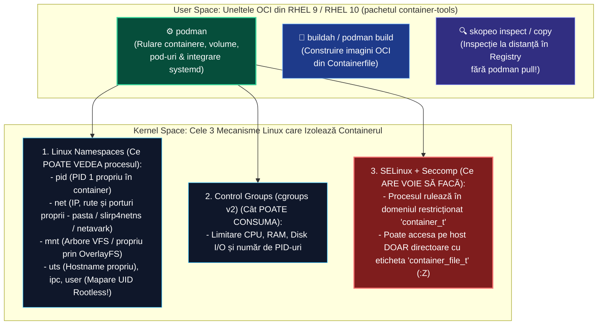
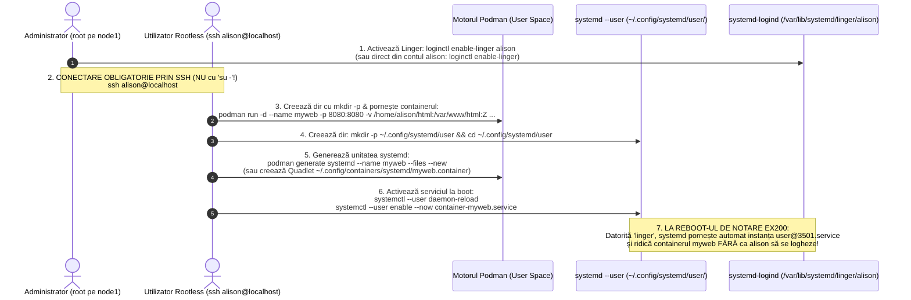

> ### Obiectivul Capitolului, Ponderea în Examenul EX200 & Regula de Aur a Persistenței
>
> * **Obiectivul Capitolului:** Înțelegerea profundă a arhitecturii containerelor Linux la nivel de Kernel (**Namespaces**, **Control Groups — `cgroups v2`** și **SELinux Multi-Category Security `sVirt`**); de ce Red Hat a înlocuit arhitectura cu daemon (`dockerd`) cu motorul *daemonless* **`Podman` (*Pod Manager*)** alături de **`Buildah`** și **`Skopeo`**; diferența critică dintre **Rootfull Containers** și **Rootless Containers** (*User Namespaces* `/etc/subuid`, `/etc/subgid` și `podman unshare`); configurarea registrelor în `/etc/containers/registries.conf`; construirea imaginilor cu **`Containerfile` (`podman build`)**; montarea volumelor persistente pe disc cu flag-ul obligatoriu SELinux **`:Z`** (`container_file_t`); și **Subiectul Rege al Examenului EX200**: configurarea unui container *rootless* să pornească automat ca serviciu **`systemd --user`** la boot fără ca utilizatorul să se autentifice (**`loginctl enable-linger`**, `~/.config/systemd/user/`, `podman generate systemd --new` și noua arhitectură declarativă **Podman Quadlets** `.container` din RHEL 9.2+ / RHEL 10!).
>
> * **Ponderea în Examenul EX200:** **URIAȘĂ — 20% până la 25% DIN PUNCTAJUL TOTAL AL EXAMENULUI!**
>   În examenul RHCSA pe `node1`, ultimele 2 sau 3 task-uri sunt dedicate exclusiv containerelor `Podman` și valorează împreună 50–70 de puncte:
>   1. **Construirea unei imagini din `Containerfile`:** *„Ca utilizator `alison` (sau `root`), descărcați un `Containerfile` și construiți o imagine numită `my_logger:v1`.”*
>   2. **Rularea unui Container Rootless cu Stocare Persistentă (`-v ...:Z`) și Variabile/Porturi:** *„Ca utilizator `alison` (container rootless!), porniți un container numit `log_server` din imaginea `registry.lab.example.com/ubi9/httpd-24`, mapați portul gazdă `8080` la portul `8080` al containerului și montați directorul gazdă `/home/alison/container_files` la calea `/var/www/html` în interiorul containerului, astfel încât SELinux să permită accesul.”*
>   3. **Container-as-a-Service în `systemd` (`systemctl --user` + `enable-linger`):** *„Configurați containerul `log_server` să fie gestionat ca un serviciu `systemd` al utilizatorului `alison` (numit `container-log_server.service`), astfel încât să pornească automat la pornirea sistemului (`reboot`), fără intervenție manuală și fără ca utilizatorul `alison` să fie nevoit să se logheze!”*
>
> * **Regula de Aur a Persistenței (EX200 Survival Rule — CELE 3 REGULI DE SUPRAVIEȚUIRE PODMAN!):**
>   1. **NICIODATĂ nu folosi `su - alison` când lucrezi cu `podman` și `systemctl --user`!** Comanda `su -` nu creează o sesiune completă `systemd-logind` (nu setează variabila `$XDG_RUNTIME_DIR=/run/user/<UID>` și D-Bus-ul de utilizator), iar `systemctl --user` va da eroarea fatală `Failed to connect to bus: No medium found`! Conectează-te **EXCLUSIV prin SSH direct ca acel utilizator**: **`ssh alison@localhost`** (sau `ssh alison@node1`)!
>   2. **Dacă uiți `:Z` la montarea volumului (`-v /dir_host:/dir_container:Z`)**, SELinux va bloca containerul să scrie sau să citească din acel director și containerul va muri la pornire!
>   3. **Dacă uiți `loginctl enable-linger alison`**, serviciul `systemd --user` al lui `alison` **NU va porni la reboot-ul de evaluare** (deoarece procesele de utilizator pornesc implicit doar când utilizatorul face login interactiv), și vei lua **0 puncte pe tot subiectul Podman**!

:::analogy
Prima întrebare pe care o pun la orice interviu de DevOps / Cloud Engineer este: *„Ce este un container la nivel de Linux Kernel? Există în codul sursă al kernelului Linux un obiect numit «container»?”*
Răspunsul este **NU!** Pentru nucleul Linux, un container este pur și simplu **un proces Linux normal (ca oricare altul, vizibil în `ps aux` de pe host!)**, dar căruia kernelul i-a pus „ochelari de cal” (**Namespaces**), „cotă de hrană” (**cgroups**) și „zgardă de securitate” (**SELinux `container_t`**)!

### Analogia Vizuală: Iluzia Matrix (Namespaces), Contorul Electric (`cgroups`) și De Ce Red Hat a Înlocuit Docker cu `Podman`

1. **Mașină Virtuală (KVM) vs. Container (Podman):**
   * O **Mașină Virtuală (`node1`)** este o **Casă Individuală cu Propria Fundație (propriul Kernel `vmlinuz`), Propria Centrală Termică și Propriul Acoperiș**. Izolarea este totală, dar consumă GB întregi de RAM și pornește în 30 de secunde.
   * Un **Container** este un **Apartament într-un Zgârie-Nori**: toate apartamentele împart **aceeași fundație și aceeași coloană de apă caldă (același Kernel Linux al hostului!)**, dar fiecare apartament are:
     * **Pereți opaci și numere de uși proprii (`Kernel Namespaces`):** Procesul din container crede că are `PID 1`, că are propria placă de rețea și propriul său sistem de fișiere `/`, fără să își vadă vecinii de palier!
     * **Contor de curent și siguranțe automate (`Control Groups — cgroups v2`):** Niciun apartament nu poate consuma toată apa caldă sau tot curentul clădirii (limitare de CPU și RAM).
     * **Cheie care nu se potrivește la ușa vecinului (`SELinux sVirt / MCS`):** Chiar dacă un chiriaș sparge peretele de rigips, ofițerul SELinux îl blochează deoarece poartă categoria unică `s0:c123,c456`!

2. **De ce a renunțat Red Hat la `Docker` în favoarea lui `Podman` (`Fork/Exec` vs. `Client/Server Daemon`)?**
   * **Arhitectura `Docker`:** Folosește un **Daemon monolitic gigant (`dockerd`) care rulează permanent ca `root` (`UID 0`)**. Toate containerele sunt copii ai lui `dockerd`. Dacă `dockerd` crapă, **toate containerele de pe server mor simultan**! Mai grav, când `systemd` vrea să supravegheze un container Docker, el vorbește doar cu clientul `docker`, nu vede procesul real al containerului!
   * **Arhitectura `Podman` (*Daemonless*):** **NU există niciun daemon în fundal!** Când rulezi `podman run`, Podman folosește modelul clasic UNIX `fork()/exec()` (cu un mic proces monitor per container numit **`conmon`**). Fiecare container poate rula direct sub contul unui utilizator neprivilegiat (**Rootless Container**), iar **`systemd` poate controla și reporni fiecare container exact ca pe un serviciu nativ Linux!**
:::

:::architecture
### 2.1. Cele 3Tehnologii din Kernel care Construiesc un Container și Triada `Podman` / `Buildah` / `Skopeo`

În RHEL 9 / RHEL 10, suita de unelte pentru containere respectă standardul **OCI (*Open Container Initiative*)** și se instalează prin metapachetul **`container-tools`**:
```bash
dnf install -y container-tools
```
Această suită conține 3 unelte specializate (și 100% compatibile la nivel de CLI cu Docker — poți face chiar `alias docker=podman`!):
1. **`podman` (*Pod Manager*):** Rulează și gestionează containere, pod-uri (grupuri de containere care împart același *Network Namespace*, exact ca în Kubernetes!), imagini și volume.
2. **`buildah`:** Construiește imagini OCI din `Containerfile` / `Dockerfile` sau direct din comenzi Bash (este apelat automat sub capotă când rulezi `podman build`!).
3. **`skopeo`:** Inspectează, copiază și sincronizează imagini între registre remote **FĂRĂ a fi nevoie să descarci (`pull`) imaginea pe discul local**!



---

### 2.2. Rootfull vs. Rootless Containers și Arhitectura `User Namespaces` (`/etc/subuid` & `podman unshare`)

În examenul EX200, aproape toate cerințele de containere îți vor cere să rulezi containerul **sub contul unui utilizator obișnuit (de exemplu `alison` sau `natasha` — adică un Container Rootless!)**.

| Caracteristică | **Rootfull Container** (Rulat de `root`) | **Rootless Container** (Rulat de un utilizator normal, ex: `alison` — **FAVORIT EX200!**) |
| :--- | :--- | :--- |
| **Unde sunt stocate imaginile și containerele pe disc?** | În **`/var/lib/containers/storage/`** | În directorul home al utilizatorului: **`~/.local/share/containers/storage/`** |
| **Unde se pun unitățile `systemd` pentru pornire la boot?** | În **`/etc/systemd/system/`** *(administrate cu `systemctl enable --now ...`)* | În **`~/.config/systemd/user/`** *(administrate cu **`systemctl --user enable --now ...`** + **`loginctl enable-linger`**!)* |
| **Ce porturi poate deschide pe host (`-p host:container`)?** | Orice port (`1`–`65535`, inclusiv portul `80` sau `443`). | Doar **porturi neprivilegiate $\ge 1024$** (ex: `-p 8080:80` sau `-p 8080:8080`), conform `/proc/sys/net/ipv4/ip_unprivileged_port_start`! |
| **Cum funcționează maparea UID-urilor (*User Namespace*)?** | `UID 0` din container este chiar `UID 0` (`root`) de pe host! | Folosește `/etc/subuid` și `/etc/subgid` (ex: `alison:100000:65536`):<br/>- **`UID 0` (`root`) din container** este mapat la **`UID 1000` (`alison`) pe host**!<br/>- **`UID 27` (`mysql`) din container** este mapat la **`UID 100026` pe host**! |

> **Subtilitate Tehnică de Examen & Interviu: Cum acordăm permisiuni pe un director de pe Host pentru un proces care nu rulează ca `UID 0` în interiorul unui Container Rootless (`podman unshare chown`)?**
> Să presupunem că utilizatorul `alison` (`UID 1000` pe host) pornește un container *rootless* de `mariadb` sau `httpd`. În interiorul containerului, procesul bazei de date nu rulează ca `UID 0` (care s-ar mapa la `alison`), ci rulează sub utilizatorul intern `mysql` (**`UID 27` în container**, care pe host este văzut ca `UID 100026`!).
> Dacă `alison` creează pe host directorul `/home/alison/db_data` (deținut de `alison:alison`), procesul `UID 27` din container poate primi `Permission denied` la scriere!
> Cum schimbă `alison` proprietarul directorului `/home/alison/db_data` în `27:27` văzut din interiorul *User Namespace*-ului containerului, fără a avea drepturi de `sudo` pe host?
> Folosind comanda magică **`podman unshare`**:
> ```bash
> podman unshare chown -R 27:27 /home/alison/db_data
> ```
> *(Sau, în majoritatea imaginilor Red Hat UBI din examen, fie procesul din container rulează în grupul `0 (root)` — deci un simplu `chmod 0775` sau `0777` pe directorul de pe host înainte de montare rezolvă orice problemă DAC, fie rulează direct mapat pe utilizatorul curent!)*

---

### 2.3. Configurarea Registrelor (`/etc/containers/registries.conf`), Căutare, Autentificare și `skopeo`

Când rulezi `podman pull ubi9/httpd-24` fără a scrie numele serverului în față, de unde știe `podman` pe ce servere din rețea să caute imaginea?
El citește fișierul **`/etc/containers/registries.conf`** (sau `~/.config/containers/registries.conf`):

```ini
# Lista registrelor în care podman caută automat când nu specifici domeniul complet:
unqualified-search-registries = ["registry.lab.example.com", "registry.access.redhat.com", "registry.redhat.io", "docker.io"]
```
*(Dacă în examenul EX200 ți se dă un registru local fără certificat SSL/TLS valid — pe HTTP simplu — se configurează în `/etc/containers/registries.conf.d/local.conf` cu `insecure = true`, însă în examen registrele au de obicei certificatul CA deja instalat pe mașini!).*

#### Comenzile Esențiale pentru Imagini și Registre (`podman` & `skopeo`)

```bash
# 1. Autentificarea la un registru de containere (salvează tokenul în $XDG_RUNTIME_DIR/containers/auth.json,
# sau cu --authfile ~/.config/containers/auth.json pentru persistență la reboot!):
podman login registry.lab.example.com

# 2. Căutarea unei imagini în registre:
podman search httpd

# 3. Inspectarea unei imagini direct în registrul remote FĂRĂ a o descărca pe disc (cu skopeo!):
skopeo inspect docker://registry.lab.example.com/ubi9/httpd-24

# 4. Descărcarea (pull), listarea imaginilor locale și inspectarea detaliilor (Porturi expuse, Variabile ENV!):
podman pull registry.lab.example.com/ubi9/httpd-24
podman images
podman inspect registry.lab.example.com/ubi9/httpd-24

# 5. Etichetarea (tag), trimiterea (push) în registru și ștergerea (rmi) unei imagini:
podman tag localhost/my_app:v1 registry.lab.example.com/devops/my_app:v1
podman push registry.lab.example.com/devops/my_app:v1
podman rmi localhost/my_app:v1
```

---

### 2.4. Construirea Imaginilor cu `Containerfile` (`podman build`) și Rularea cu Stocare Persistentă SELinux (`:Z`)

#### 1. Construirea unei Imagini din `Containerfile` / `Dockerfile` (`podman build -t`)
În examen ți se poate cere să descarci un `Containerfile` (sau să scrii unul scurt de 4 linii) și să construiești o imagine cu un nume și un tag exact:

```dockerfile
FROM registry.access.redhat.com/ubi9/ubi:latest
LABEL maintainer="student@lab.example.com"
RUN dnf install -y httpd && dnf clean all
ENV APP_ENV="PRODUCTION"
EXPOSE 80
CMD ["/usr/sbin/httpd", "-D", "FOREGROUND"]
```
Comanda de construire (**nu uita punctul `.` de la final**, care reprezintă directorul curent de context unde se află `Containerfile`!):
```bash
podman build -t my_custom_web:1.0 .
```

#### 2. Rularea Containerelor cu `podman run` — Disecția Tuturor Flag-urilor de Examen!

Să disecăm comanda completă `podman run` pe care o vei scrie în examenul EX200:

```bash
podman run -d \
    --name log_server \
    -p 8080:80 \
    -e MYSQL_ROOT_PASSWORD="secret" \
    -v /home/alison/web_data:/var/www/html:Z \
    registry.lab.example.com/ubi9/httpd-24
```

* **`-d` (`--detach`):** Pornește containerul în *background* (fără `-d`, terminalul tău rămâne blocat în container!).
* **`--name log_server`:** Setează numele exact cerut în enunțul examenului!
* **`-p 8080:80` (`--publish <Port_Host>:<Port_Container>`):** Mapează portul `8080` de pe mașina virtuală `node1` către portul `80` din interiorul containerului! *(Dacă uiți pe ce port intern ascultă imaginea — `80` sau `8080` — verifică ÎNTOTDEAUNA cu `podman inspect <imagine> | grep -i -A 5 exposedports`!)*
* **`-e VAR="valoare"` (`--env`):** Transmite o variabilă de mediu în interiorul containerului.
* **`-v /cale_host:/cale_container:Z` (`--volume` cu SELinux Relabeling!):**
  * **DE CE ESTE `:Z` (sau `:z`) OBLIGATORIU ÎN EXAMENUL EX200?**
    Când utilizatorul `alison` creează directorul `/home/alison/web_data` cu `mkdir -p`, acel director primește contextul SELinux **`user_home_t`**.
    Procesul din interiorul containerului rulează cu contextul SELinux **`container_t`**. Conform politicii SELinux din RHEL, un proces `container_t` **NU are voie să atingă fișiere `user_home_t`**!
    Când adaugi sufixul **`:Z`** la finalul volumului (`-v /home/alison/web_data:/var/www/html:Z`), Podman schimbă automat contextul SELinux al directorului `/home/alison/web_data` în **`container_file_t`** (cu categoria MCS privată a acelui container, iar cu `:z` mic îi pune o etichetă `container_file_t` partajabilă între mai multe containere)!

---

### 2.5. SUBIECTUL REGE ÎN EX200: Transformarea unui Container Rootless într-un Serviciu `systemd` care Pornește Automat la Boot!

În examenul RHCSA ți se cere ca un container (de obicei *rootless*, rulând sub un utilizator precum `alison` sau `natasha`) să fie gestionat prin `systemd` și să pornească automat la `reboot`, fără ca utilizatorul să se autentifice.



Ai la dispoziție **două metode oficiale** în RHEL 9 / RHEL 10 (ambele sunt 100% acceptate în examenul EX200, pentru că ambele produc un serviciu `systemd --user` activ la boot!):

#### Metoda #1 (Metoda Clasică și Universală în RHEL 8 / RHEL 9): `podman generate systemd --new`

Execută acești **7 Pași Exacți în Ordine** (nu sări niciunul!):

1. **Pasul 1 (Logarea corectă prin SSH ca utilizatorul cerut!):**
   Din terminalul lui `root`, conectează-te prin **`ssh`** pe `localhost` ca utilizatorul `alison`:
   ```bash
   ssh alison@localhost
   ```
2. **Pasul 2 (Pregătirea directorului de pe host și pornirea containerului):**
   ```bash
   mkdir -p /home/alison/web_data
   chmod 0777 /home/alison/web_data
   echo "Container Rootless EX200 OK" > /home/alison/web_data/index.html

   podman run -d --name log_server -p 8080:8080 \
       -v /home/alison/web_data:/var/www/html:Z \
       registry.lab.example.com/ubi9/httpd-24
   ```
   *(Verifică cu `podman ps` că rulează și cu `curl http://localhost:8080` că răspunde!)*
3. **Pasul 3 (Crearea directorului `~/.config/systemd/user/` și intrarea în el):**
   **Atenție:** Acest director nu există implicit! Trebuie să îl creezi tu:
   ```bash
   mkdir -p ~/.config/systemd/user
   cd ~/.config/systemd/user
   ```
4. **Pasul 4 (Generarea fișierului `.service` cu `podman generate systemd`):**
   ```bash
   podman generate systemd --name log_server --files --new
   ```
   * **Disecția celor 3 flag-uri vitale:**
     * `--name log_server`: Numele containerului pe care l-ai pornit la Pasul 2.
     * `--files`: Îi spune lui Podman să scrie direct pe disc fișierul **`container-log_server.service`** în directorul curent (`~/.config/systemd/user/`) în loc să îl afișeze pe ecran!
     * **`--new`:** **CEL MAI IMPORTANT FLAG!** Fără `--new`, unitatea generată face doar `podman start/stop` pe un container deja existent. Cu **`--new`**, la fiecare pornire a serviciului `systemd`, acesta șterge orice rămășiță veche și **recreează un container proaspăt de la zero** cu `podman run ...`, garantând că va porni impecabil după un `reboot` forțat!
5. **Pasul 5 (Oprirea și ștergerea containerului manual înainte de a lăsa `systemd` să îl preia!):**
   Deoarece am folosit `--new`, oprim și ștergem containerul pornit manual la Pasul 2, ca să nu intre în conflict de nume cu cel pe care îl va porni `systemd`:
   ```bash
   podman stop log_server
   podman rm log_server
   ```
6. **Pasul 6 (Reîncărcarea și activarea serviciului cu `systemctl --user`):**
   ```bash
   systemctl --user daemon-reload
   systemctl --user enable --now container-log_server.service
   systemctl --user status container-log_server.service
   podman ps
   ```
7. **Pasul 7 (PASUL VITAL PENTRU REBOOT — Activarea `Linger` cu `loginctl`!):**
   În mod implicit în Linux, când utilizatorul `alison` dă `logout` din SSH (sau când serverul repornește și `alison` nu s-a logat încă), `systemd` oprește toate procesele utilizatorului `alison`!
   Pentru ca serviciile `systemctl --user` ale lui `alison` să **pornească automat la boot-ul serverului și să rămână vii după logout**, rulăm:
   ```bash
   loginctl enable-linger
   # (Sau de pe contul root: loginctl enable-linger alison)
   ```
   Verificăm că `Linger=yes` este activ rulând:
   ```bash
   loginctl show-user alison | grep Linger
   # Output obligatoriu: Linger=yes
   ```

---

#### Metoda #2 (Noua Arhitectură din RHEL 9.2+ / RHEL 10): `Podman Quadlets` (`~/.config/containers/systemd/*.container`)

Începând cu Podman 4.4+ (RHEL 9.2+ și RHEL 10), Red Hat a introdus **Podman Quadlets** (`man podman-systemd.unit`) ca succesor declarativ pentru `podman generate systemd`.
Cum funcționează un **Quadlet**?
În loc să pornești containerul și să generezi un fișier `.service` stufos de 60 de linii, scrii un fișier simplu de 8 linii cu extensia **`.container`** în directorul **`~/.config/containers/systemd/`** (pentru rootless) sau **`/etc/containers/systemd/`** (pentru root):

```ini
# Fișier: ~/.config/containers/systemd/log_server.container
[Unit]
Description=Quadlet Container Log Server

[Container]
ContainerName=log_server
Image=registry.lab.example.com/ubi9/httpd-24
PublishPort=8080:8080
Volume=/home/alison/web_data:/var/www/html:Z

[Install]
WantedBy=default.target
```
Când rulezi **`systemctl --user daemon-reload`**, generatorul Quadlet traduce automat acest fișier `.container` într-un serviciu `systemd` pe care îl pornești cu **`systemctl --user start log_server.service`** (la Quadlets, pornirea la boot este activată automat prin simpla prezență a secțiunii `[Install] WantedBy=default.target` + `loginctl enable-linger`!).
*(Sfat RHCA pentru EX200 pe RHEL 9: Dacă cerința îți cere explicit ca fișierul unității să se numească `container-<nume>.service` în `~/.config/systemd/user/`, folosește **Metoda #1 (`podman generate systemd --name <nume> --files --new`)**, care creează fizic fișierul exact cu acel nume în `~/.config/systemd/user/`!)*

---

> **➕ Aprofundare.** De aici până la sfârșitul secțiunii, textul este o extindere adăugată de Claude la cererea lui Alex (nu face parte din capitolul original).

### 2.6. Ciclul de Viață al unui Container: Comenzile de Zi cu Zi

`podman run` creează **și** pornește un container. După aceea, lucrezi cu el prin nume.

| Vrei să | Comandă |
| :--- | :--- |
| Vezi containerele pornite / toate, inclusiv cele oprite | `podman ps` / `podman ps -a` |
| Citești ce a afișat procesul din container | `podman logs web_portal` (cu `-f` urmărești în timp real) |
| Rulezi o comandă într-un container pornit | `podman exec web_portal cat /etc/os-release` |
| Deschizi un shell în container | `podman exec -it web_portal /bin/bash` |
| Oprești / pornești / repornești | `podman stop`, `podman start`, `podman restart` |
| Ștergi un container (cu `-f` și dacă rulează) | `podman rm -f web_portal` |
| Copiezi un fișier în sau din container | `podman cp index.html web_portal:/var/www/html/` |
| Vezi procesele din container | `podman top web_portal` |
| Vezi consumul de resurse | `podman stats --no-stream` |
| Vezi ce porturi sunt publicate | `podman port web_portal` |

Opțiunile `-it` înseamnă terminal interactiv; ai nevoie de ele ori de câte ori vrei să tastezi în container.

`podman inspect` întoarce tot ce se știe despre un container sau o imagine, în format JSON. Cu `--format` extragi un singur câmp:

```bash
# Adresa IP a containerului, comanda lui și volumele montate:
podman inspect web_portal --format '{{.NetworkSettings.IPAddress}}'
podman inspect web_portal --format '{{.Config.Cmd}}'
podman inspect web_portal --format '{{range .Mounts}}{{.Source}} -> {{.Destination}}{{"\n"}}{{end}}'

# Ce porturi și ce utilizator declară o IMAGINE (util înainte de podman run):
podman inspect registry.access.redhat.com/ubi9/httpd-24 --format '{{.Config.ExposedPorts}} {{.Config.User}}'
```

Pentru încercări rapide, un container de unică folosință: `podman run --rm -it registry.access.redhat.com/ubi9/ubi /bin/bash`. Opțiunea `--rm` îl șterge automat la ieșire, deci nu rămân containere oprite în urmă.

Curățenie:

```bash
podman container prune     # șterge toate containerele oprite
podman image prune         # șterge imaginile fără etichetă, rămase de la construiri
podman system df           # cât spațiu ocupă imaginile, containerele și volumele
```

### 2.7. Volume Numite față de Directoare Montate

Capitolul folosește un director de pe gazdă montat în container (*bind mount*). Podman are și **volume numite**, pe care le administrează el însuși.

| | Director de pe gazdă | Volum numit |
| :--- | :--- | :--- |
| Sintaxă | `-v /home/alison/date:/var/lib/app:Z` | `-v date_app:/var/lib/app` |
| Unde stau datele | Unde alegi tu. | `~/.local/share/containers/storage/volumes/` (rootless). |
| SELinux | Ai nevoie de `:Z` sau `:z`. | Etichetat corect din oficiu. |
| Proprietar și permisiuni | Trebuie potrivite cu utilizatorul din container. | Rezolvate de Podman. |
| Când îl alegi | Vrei să editezi fișierele de pe gazdă; enunțul cere un anumit director. | Date ale aplicației (baze de date), fără acces direct de pe gazdă. |

```bash
podman volume create date_app
podman volume ls
podman volume inspect date_app --format '{{.Mountpoint}}'
podman run -d --name db -v date_app:/var/lib/mysql registry.redhat.io/rhel9/mariadb-105
podman volume rm date_app          # refuză dacă un container îl mai folosește
```

Opțiuni care se pot adăuga la un volum, separate prin virgulă: `:ro` (containerul doar citește), `:Z` și `:z` (etichete SELinux), `:U` (Podman schimbă proprietarul directorului de pe gazdă astfel încât să corespundă utilizatorului din container, alternativa comodă la `podman unshare chown`).

Datele scrise în container în afara unui volum dispar odată cu containerul. Regula de proiectare: containerul este de unică folosință, iar tot ce trebuie păstrat stă într-un volum.

### 2.8. Rețeaua Containerelor și Pod-urile

Un container rootless nu primește o adresă accesibilă din rețea. Ajungi la el doar prin **porturile publicate** cu `-p`.

| Formă | Efect |
| :--- | :--- |
| `-p 8080:80` | Portul 8080 de pe toate adresele gazdei duce la portul 80 din container. |
| `-p 127.0.0.1:8080:80` | La fel, dar accesibil doar de pe gazdă. |
| `-p 8080:80/udp` | Pentru UDP. |
| `-P` | Publică toate porturile declarate de imagine, pe porturi alese aleator. |

Pentru ca alte mașini să ajungă la serviciu, portul de pe gazdă trebuie deschis și în `firewalld`.

**Containere care vorbesc între ele.** Pe rețeaua implicită, containerele nu se găsesc după nume. Pe o rețea creată de tine, Podman oferă rezolvare de nume între containere:

```bash
podman network create retea_app
podman run -d --name db  --network retea_app -e MYSQL_ROOT_PASSWORD=secret registry.redhat.io/rhel9/mariadb-105
podman run -d --name web --network retea_app -p 8080:8080 registry.access.redhat.com/ubi9/httpd-24
# Din containerul 'web', baza de date este acum accesibilă la numele 'db', pe portul 3306.
podman network ls
podman network inspect retea_app
```

**Pod-urile.** Un *pod* este un grup de containere care împart aceeași rețea: se văd între ele pe `localhost`, iar porturile se publică la nivelul pod-ului. Este același concept ca în Kubernetes.

```bash
podman pod create --name app_pod -p 8080:8080
podman run -d --pod app_pod --name db  -e MYSQL_ROOT_PASSWORD=secret registry.redhat.io/rhel9/mariadb-105
podman run -d --pod app_pod --name web registry.access.redhat.com/ubi9/httpd-24
podman pod ps
podman pod stop app_pod && podman pod rm app_pod
```

### 2.9. Imagini: Etichete, Straturi, Transfer fără Registru și Instrucțiunile din `Containerfile`

Numele complet al unei imagini are patru părți: `registru/spațiu/nume:etichetă`, de exemplu `registry.access.redhat.com/ubi9/httpd-24:latest`. Dacă lipsește eticheta, se folosește `latest`, care este doar un nume convențional și **nu** garantează cea mai nouă versiune. Pentru reproductibilitate se folosește o etichetă de versiune.

```bash
podman images                              # imaginile locale
podman history localhost/portal_img:v1     # straturile imaginii și instrucțiunea care a creat fiecare strat
podman rmi localhost/portal_img:v1         # șterge imaginea (refuză dacă un container o folosește)
podman pull --tls-verify=false registru.local:5000/app:1.0    # registru de laborator, fără certificat valid
```

**Mutarea unei imagini fără registru.** Util când mașina țintă nu are acces la rețea:

```bash
podman save -o /tmp/portal_img.tar localhost/portal_img:v1    # imaginea, într-o arhivă
scp /tmp/portal_img.tar alison@node2:/tmp/
podman load -i /tmp/portal_img.tar                            # pe mașina țintă
```

În modul rootless, fiecare utilizator are propriul depozit de imagini. O imagine construită de `root` nu este vizibilă lui `alison` și invers. Perechea `save` și `load` este și metoda de a trece o imagine de la un utilizator la altul.

**Instrucțiunile unui `Containerfile`:**

| Instrucțiune | Rol |
| :--- | :--- |
| `FROM` | Imaginea de bază. Prima instrucțiune. |
| `RUN` | Rulează o comandă **la construire** și salvează rezultatul ca strat nou. |
| `COPY` | Copiază fișiere din directorul de construire în imagine. |
| `ADD` | Ca `COPY`, dar poate dezarhiva un `.tar` și poate aduce de la o adresă web. Preferă `COPY` când nu ai nevoie de asta. |
| `ENV` | Variabilă de mediu, valabilă și la construire, și la rulare. |
| `WORKDIR` | Directorul curent pentru instrucțiunile următoare și pentru procesul containerului. |
| `USER` | Utilizatorul sub care rulează instrucțiunile următoare și containerul. |
| `EXPOSE` | Documentează portul pe care ascultă aplicația. **Nu** publică nimic; publicarea se face cu `-p`. |
| `VOLUME` | Declară o cale destinată datelor persistente. |
| `CMD` | Comanda implicită la pornire; poate fi înlocuită la `podman run imagine altă_comandă`. |
| `ENTRYPOINT` | Programul fix al containerului; argumentele din `CMD` sau din linia de comandă i se adaugă. |
| `LABEL` | Metadate (autor, versiune). |

Fiecare `RUN`, `COPY` și `ADD` creează un **strat**. La o nouă construire, straturile neschimbate sunt refolosite din cache. De aceea instrucțiunile care se schimbă rar (instalarea pachetelor) se pun primele, iar copierea codului la sfârșit, și tot de aceea instalarea și curățenia se scriu în același `RUN` (`dnf install -y httpd && dnf clean all`): altfel fișierele șterse rămân în stratul anterior și imaginea nu se micșorează.

`podman build` caută implicit un fișier numit `Containerfile` (sau `Dockerfile`) în directorul dat. Dacă fișierul are alt nume, îl indici cu `-f`: `podman build -t app:1.0 -f /cale/Fișier.build /cale/context`.

### 2.10. Quadlet în Detaliu și Depanarea Serviciilor de Container

Fișierul `.container` din secțiunea 2.5 acceptă în secțiunea `[Container]` echivalentul opțiunilor din `podman run`:

| Cheie Quadlet | Echivalentul din `podman run` |
| :--- | :--- |
| `Image=` | Numele imaginii. |
| `ContainerName=` | `--name` |
| `PublishPort=8080:8080` | `-p` |
| `Volume=/cale:/cale:Z` | `-v` |
| `Environment=CHEIE=valoare` | `-e` |
| `Network=retea_app` | `--network` |
| `Exec=` | Comanda de după numele imaginii. |
| `AutoUpdate=registry` | Permite actualizarea automată a imaginii cu `podman auto-update`. |

În secțiunea `[Service]` pui directive `systemd` obișnuite, de exemplu `Restart=always`.

Două diferențe față de un serviciu obișnuit. Numele serviciului vine din numele fișierului: `log_server.container` produce `log_server.service`, nu `container-log_server.service`. Iar unitatea este **generată**, deci nu se activează cu `systemctl --user enable`: pornirea la boot vine din secțiunea `[Install]` a fișierului, împreună cu `loginctl enable-linger`.

```bash
systemctl --user daemon-reload                 # regenerează serviciile din fișierele .container
systemctl --user start log_server.service
systemctl --user status log_server.service

# Dacă serviciul nu apare după daemon-reload, generatorul îți spune ce nu îi place în fișier:
/usr/libexec/podman/quadlet --dryrun --user
```

Pe versiunile noi de Podman, `podman generate systemd` este marcat ca depreciat în favoarea Quadlet, dar există și funcționează în continuare. Dacă enunțul cere explicit un fișier `container-<nume>.service`, folosești `podman generate systemd`.

**Depanarea unui serviciu de container, în ordine:**

```bash
systemctl --user status container-web_portal.service        # starea și ultimele linii din jurnal
journalctl --user -u container-web_portal.service -n 50     # jurnalul serviciului
podman ps -a                                                # există containerul? cu ce cod a ieșit?
podman logs web_portal                                      # ce a spus aplicația din container
loginctl show-user alison -p Linger                         # va porni la boot?
```
:::

:::exam-alert
### 💀 Capcana Mortală #1: Folosirea `su - alison` în loc de `ssh alison@localhost`!
Aceasta este eroarea pe care o fac 80% dintre candidații care nu s-au antrenat:
Din terminalul lui `root`, ei tastează `su - alison`, apoi încearcă să ruleze `systemctl --user daemon-reload` și primesc eroarea:
`Failed to connect to bus: No medium found`!
De ce? Pentru că `su -` schimbă doar UID-ul, nu înregistrează o sesiune completă în `pam_systemd` / `systemd-logind`!
* **Regula de Aur:** Conectează-te **MEREU cu `ssh alison@localhost`**!

### 💀 Capcana Mortală #2: Pierderea Autentificării la Registru după Reboot (`auth.json` în `/run` vs. `~/.config`)!
Când rulezi `podman login registry.lab.example.com`, unde salvează Podman parola/token-ul?
Implicit, îl salvează în **`/run/user/<UID>/containers/auth.json`** — iar `/run` este în **memoria RAM (`tmpfs`)** și se șterge la reboot!
Dacă la reboot-ul de evaluare serviciul `systemd` încearcă să verifice sau să tragă imaginea dintr-un registru care cere autentificare, va eșua!
* **Trucul Secret RHCA:** După ce te-ai logat cu `podman login`, copiază fișierul de autentificare în locația **persistentă pe disc** (`~/.config/containers/auth.json`), sau loghează-te direct cu:
  ```bash
  mkdir -p ~/.config/containers
  podman login --authfile ~/.config/containers/auth.json registry.lab.example.com
  ```

### 🛠️ Man Page Hacks pentru Capitolul 5.1
Ai uitat în timpul examenului sintaxa pentru `podman generate systemd` sau pentru `Quadlets`?
Rulează:
```bash
man podman-generate-systemd
# sau pentru Quadlets:
man podman-systemd.unit
```
Ambele pagini au exemple complete gata de Copy-Paste!

---

> **➕ Aprofundare.** De aici până la sfârșitul secțiunii, textul este o extindere adăugată de Claude la cererea lui Alex (nu face parte din capitolul original).

### ⚠️ Capcană în plus: `:Z` pus pe un director prea mare
`:Z` reetichetează **recursiv** tot directorul de pe gazdă cu `container_file_t`. Dacă montezi din grabă `-v /home/alison:/date:Z`, întregul director home își schimbă eticheta: cheile din `~/.ssh` nu mai sunt acceptate de `sshd`, iar autentificarea utilizatorului se strică. Montează întotdeauna un **subdirector dedicat** (`/home/alison/site_content`). Dacă ai făcut greșeala, repari cu `restorecon -Rv /home/alison`.

### ⚠️ Capcană în plus: Numele containerului este deja folosit
La a doua încercare, `podman run --name web_portal ...` eșuează cu *the container name "web_portal" is already in use*, pentru că prima încercare a lăsat în urmă un container, chiar dacă oprit. `podman ps` nu îl arată; `podman ps -a` da. Îl ștergi cu `podman rm -f web_portal` înainte să încerci din nou. Aceeași situație face ca serviciul `systemd` generat cu `--new` să nu pornească dacă ai uitat să ștergi containerul creat manual.
:::

:::interview
### Întrebarea 1 (Nivel Mid -> Senior / DevOps & Kubernetes Engineer):
> **Intervievator:** *„Care este diferența exactă dintre flag-urile `:z` (z mic) și `:Z` (Z mare) atunci când montezi un volum de pe un host RHEL cu SELinux Enforcing într-un container Podman (`-v /host:/container:Z`)?”*

**Răspunsul Ideal:**
> „Când Podman pornește un container, îi alocă nu doar tipul SELinux `container_t`, ci și o pereche unică aleatoare de categorii **MCS (*Multi-Category Security*)**, de exemplu `s0:c124,c589`. Aceasta izolează containerele unele de altele: Containerul A (`s0:c124,c589`) nu poate citi volumele Containerului B (`s0:c300,c400`), chiar dacă ambele au tipul `container_file_t`!
> * **`:Z` (Z MARE — Private Unshared Label):** Reetichetează directorul de pe host cu tipul `container_file_t` **ȘI cu categoriile MCS exacte (`s0:c124,c589`) ale acelui singur container**! Doar acel container specific are voie să acceseze directorul.
> * **`:z` (z mic — Shared Label):** Reetichetează directorul de pe host cu tipul `container_file_t` și nivelul generic **`s0` (fără categorii MCS restrictive)**, permițând ca **mai multe containere diferite** să partajeze și să scrie simultan în același director de pe host!”

---

> **➕ Aprofundare.** De aici până la sfârșitul secțiunii, textul este o extindere adăugată de Claude la cererea lui Alex (nu face parte din capitolul original).

### Întrebare în plus (Nivel Mid):
> **Intervievator:** *„Pornești un container cu `podman run -d imaginea_mea`. Comanda afișează un identificator, dar `podman ps` nu arată nimic: containerul s-a oprit imediat. Cum afli de ce și care sunt cauzele obișnuite?”*

**Răspunsul Ideal:**
> „Un container trăiește exact cât trăiește **procesul lui principal**, cel pornit de `CMD` sau `ENTRYPOINT`. Când procesul se termină, containerul se oprește. Nu există un «sistem» care să rămână pornit în fundal, ca la o mașină virtuală.
>
> Întâi mă uit la urme: `podman ps -a` îmi arată containerul oprit și codul de ieșire în coloana `STATUS`, de exemplu `Exited (1)`. Apoi `podman logs <nume>` îmi arată ce a scris procesul înainte să moară, iar acolo este de obicei și răspunsul.
>
> Cauzele obișnuite, după codul de ieșire. **Cod 0:** procesul și-a terminat treaba cu succes. Se întâmplă când comanda implicită este un shell (`/bin/bash`) pornit fără terminal, care iese imediat, sau când serviciul se mută singur în fundal, ca un daemon clasic, și procesul inițial se încheie. Soluția este ca aplicația să ruleze în prim-plan, de exemplu `httpd -D FOREGROUND`. **Cod 1 sau alt cod de eroare:** aplicația a pornit și a eșuat; jurnalul arată de obicei o variabilă de mediu obligatorie lipsă (imaginile de baze de date cer parola de administrator), un fișier de configurare greșit sau un `Permission denied` pe un volum, adică lipsește `:Z` ori proprietarul directorului nu corespunde utilizatorului din container. **Cod 125, 126 sau 127:** Podman nu a putut porni containerul, comanda nu este executabilă, respectiv comanda nu există în imagine. **Cod 137:** procesul a fost omorât cu `SIGKILL`, de obicei din cauza limitei de memorie.
>
> Dacă jurnalul nu este suficient, pornesc aceeași imagine interactiv, cu un shell în locul comenzii implicite: `podman run --rm -it --entrypoint /bin/bash imaginea_mea`. Din interior rulez manual comanda de pornire și văd eroarea direct.”
:::

:::lab
Conectează-te pe **`node1.lab.example.com`** și hai să parcurgem de la cap la coadă scenariul complet de examen EX200 pentru containere rootless cu utilizatorul `alison` (creat în Capitolul 1.1 cu parola `RedHatPass99!`):
:::

:::exam
Pune-ți cronometrul pe **20 de minute** și rezolvă pe **`node1.lab.example.com`**:

### Partea A: Cele 3 Task-uri Practice (Stil Oficial EX200)

1. **Task 1 (Construirea unei Imagini din `Containerfile`):**
   Sub contul utilizatorului **`alison`**, creați în `/home/alison/build_dir/Containerfile` un fișier care pornește de la imaginea `registry.access.redhat.com/ubi9/httpd-24`, setează variabila de mediu `PORTAL_ENV=EXAM_READY` și adaugă un fișier `/var/www/html/info.txt` (sau folosește imaginea de bază). Construiți din acest `Containerfile` o imagine numită **`portal_img:v1`**.
2. **Task 2 (Container Rootless cu Stocare Persistentă SELinux `:Z` și Port Mapping):**
   Sub contul utilizatorului **`alison`**, porniți un container numit **`web_portal`** folosind imaginea `portal_img:v1` (sau `registry.access.redhat.com/ubi9/httpd-24`):
   * Mapați portul **`8088`** de pe host la portul **`8080`** al containerului;
   * Montați directorul de pe host `/home/alison/site_content` la calea `/var/www/html` în interiorul containerului, configurat corespunzător pentru SELinux (`:Z`);
   * În `/home/alison/site_content/index.html` trebuie să se afle textul `PODMAN_ROOTLESS_SYSTEMD_OK`.
3. **Task 3 (Integrarea Containerului în `systemd` pentru Pornire Automată la Boot):**
   Configurați containerul `web_portal` să ruleze ca un serviciu `systemd` al utilizatorului `alison` numit **`container-web_portal.service`** (în `/home/alison/.config/systemd/user/`). Serviciul trebuie să pornească automat la repornirea sistemului (`reboot`) fără ca utilizatorul `alison` să se autentifice. Deschideți și portul `8088/tcp` în `firewalld` pe `node1`.
:::

:::solution
#### Rezolvarea Pas cu Pas a Task-urilor Practice (pe `node1`):

```bash
# 1. Ca root: deschidem portul 8088/tcp în firewalld și activăm linger pentru alison:
firewall-cmd --permanent --add-port=8088/tcp
firewall-cmd --reload
loginctl enable-linger alison

# 2. Ne conectăm prin SSH ca alison:
ssh alison@localhost

# În sesiunea lui alison:
mkdir -p /home/alison/build_dir /home/alison/site_content ~/.config/systemd/user
chmod 0777 /home/alison/site_content
echo "PODMAN_ROOTLESS_SYSTEMD_OK" > /home/alison/site_content/index.html

cat << 'EOF' > /home/alison/build_dir/Containerfile
FROM registry.access.redhat.com/ubi9/httpd-24
ENV PORTAL_ENV=EXAM_READY
EOF

podman build -t portal_img:v1 /home/alison/build_dir

podman run -d --name web_portal -p 8088:8080 -v /home/alison/site_content:/var/www/html:Z localhost/portal_img:v1

cd ~/.config/systemd/user
podman generate systemd --name web_portal --files --new
podman stop web_portal && podman rm web_portal

systemctl --user daemon-reload
systemctl --user enable --now container-web_portal.service
```

#### Scriptul de Verificare Automată (Grading Script pentru Capitolul 5.1 — rulat ca `root` pe `node1`)

```bash
#!/bin/bash
# ==============================================================================
# RHCSA (EX200) - Script Automat de Evaluare: Capitolul 5.1 (pe node1)
# ==============================================================================
SCORE=0
TOTAL=30

echo "========================================================"
echo " Evaluare Obiective Capitolul 5.1 (Podman) pe $(hostname)"
echo "========================================================"

# Verificare Task 1: Imaginea portal_img:v1 construită în contul lui alison
if su - alison -c "podman images" 2>/dev/null | grep -q "portal_img"; then
    echo "[ PASS ] Task 1: Imaginea portal_img:v1 a fost construită cu succes de utilizatorul alison (+10p)"
    SCORE=$((SCORE + 10))
else
    echo "[ FAIL ] Task 1: Imaginea portal_img:v1 nu există în depozitul rootless al lui alison (0p)"
fi

# Verificare Task 2: Containerul web_portal răspunde pe 8088 și /home/alison/site_content are container_file_t
if ls -ldZ /home/alison/site_content 2>/dev/null | grep -q "container_file_t" && \
   curl -s http://localhost:8088/index.html | grep -q "PODMAN_ROOTLESS_SYSTEMD_OK"; then
    echo "[ PASS ] Task 2: Containerul web_portal rulează cu volum SELinux (:Z) și răspunde pe portul 8088 (+10p)"
    SCORE=$((SCORE + 10))
else
    echo "[ FAIL ] Task 2: Containerul nu răspunde pe portul 8088 sau ai uitat flag-ul :Z pe volum (0p)"
fi

# Verificare Task 3: Serviciul container-web_portal.service + Linger=yes
if [[ -f /home/alison/.config/systemd/user/container-web_portal.service ]] && \
   loginctl show-user alison 2>/dev/null | grep -qx "Linger=yes"; then
    echo "[ PASS ] Task 3: Unitatea systemd ~/.config/systemd/user/container-web_portal.service și Linger=yes sunt active (+10p)"
    SCORE=$((SCORE + 10))
else
    echo "[ FAIL ] Task 3: Unitatea systemd lipsește sau ai uitat loginctl enable-linger alison (0p)"
fi

echo "--------------------------------------------------------"
echo " PUNCTAJ FINAL CAPITOLUL 5.1: $SCORE / $TOTAL"
echo "========================================================"
```
:::

:::references
1. **Cursul Oficial Red Hat RH134 (*Red Hat System Administration II*):**
   * Capitolul 13: *Run Containers* (Arhitectura OCI, `podman`, `skopeo`, `Containerfile`, Rootless Containers, volume persistente cu `:Z`, `podman generate systemd`, `Quadlets` și `loginctl enable-linger`).
2. **Documentația Oficială RHEL 9 / RHEL 10:**
   * *Building, running, and managing containers in Red Hat Enterprise Linux* (`docs.redhat.com`).
3. **Pagini de Manual (`man`) Esențiale din Sistem:**
   * `man 1 podman`, `man 1 podman-run`, `man 1 podman-build`, `man 5 Containerfile`
   * `man 1 podman-generate-systemd`, `man 5 podman-systemd.unit` (Quadlets)
   * `man 1 loginctl`, `man 1 skopeo`
:::
