> ### Obiectivul Capitolului, Ponderea în Examenul EX200 & Regula de Aur a Persistenței
>
> * **Obiectivul Capitolului:** Integrarea tuturor cunoștințelor acumulate în Pilonii 0–5 într-o **Simulare Oficială Completă de Examen RHCSA (EX200)** pe durata standard de **3 ore (180 de minute)**, cuprinzând **22 de cerințe practice interconectate** pe mașinile virtuale `node1.lab.example.com` și `node2.lab.example.com`. Acest capitol îți oferă:
>   1. **Strategia Militară pe 180 de Minute** (ordinea exactă de rezolvare pentru a nu bloca mașinile);
>   2. **Master Cheat-Sheet-ul Suprem de Examen** (toate comenzile, căile din `/etc` și paginile `man` salvatoare);
>   3. **Enunțul Oficial al Simulării EX200 (22 de Task-uri pe `node1` și `node2`)**;
>   4. **Rezolvarea Oficială Completă Pas cu Pas (Comandă cu Comandă pentru 300/300 puncte) & Explicațiile Profesorului**;
>   5. **Scriptul Master de Auto-Evaluare (`ex200_master_grader.sh`)** pe 300 de puncte;
>   6. **Ghidul de Arhitectură a Carierei & Scenarii Avansate de Interviu (Linux SysAdmin / DevOps / SRE)**.
>
> * **Ponderea în Examenul EX200:** **100% (300 / 300 Puncte — pragul oficial de promovare fiind 210 / 300 Puncte, adică 70%).** Dacă reușești să rezolvi această simulare completă în propriul tău laborator în mai puțin de **2 ore și 15 minute** fără a consulta rezolvările (folosind doar paginile `man` de pe sistem) și obții **300/300** după ce dai `reboot` la ambele mașini virtuale, ești pregătit 100% să promovezi examenul oficial Red Hat cu punctaj maxim!
>
> * **Regula de Aur a Persistenței (Checklist-ul celor Ultime 20 de Minute din Examen!):**
>   În minutul `160` al examenului (cu 20 de minute înainte de expirarea timpului), **oprești orice lucru nou și execuți Protocolul de Verificare Post-Reboot** pe `node1` și `node2`:
>   1. Verifici că `SELINUX=enforcing` în `/etc/selinux/config` și `getenforce` returnează `Enforcing` pe ambele noduri;
>   2. Rulezi `systemctl daemon-reload && mount -a && swapon -a` pe ambele noduri (zero erori!);
>   3. Rulezi `visudo -c` pe `node1` (confirmă `parsed OK`);
>   4. Rulezi **`systemctl reboot`** pe `node1` și `node2`, aștepți 60–90 de secunde, te reconectezi prin `ssh` și verifici cu `df -h`, `swapon --show`, `chronyc sources`, `curl` și `podman ps` (sub userul rootless) că absolut totul a pornit singur!

:::analogy
Ai parcurs un drum extraordinar! De la apelurile de sistem în *Ring 0*, VFS și Inode-uri, până la secvența de boot `initramfs`, LVM, `Stratis`, `LVM-VDO`, `autofs`, `SELinux` și containere *rootless* `Podman` integrate în `systemd`. Acum nu mai ești un simplu utilizator care copiază comenzi de pe internet — gândești ca un **Inginer de Sistem Red Hat**.

Dar la examenul practic EX200, cunoștințele tehnice reprezintă doar 80% din succes; restul de 20% este **Strategia de Execuție și Gestiunea Timpului**. Iată de ce unii candidați buni intră în criză de timp: ei rezolvă cerințele în ordinea aleatorie în care sunt scrise pe pagină, fără să își dea seama că **anumite cerințe sunt „Fundamente de Deblocare” (*Gatekeepers*)** pentru restul examenului!

### Analogia Vizuală: Operațiunea Chirurgicală în Echipă și Protocolul de Decolare al unui Avion (Checklist-ul Post-Reboot)

Imaginează-ți examenul EX200 ca pe **Pregătirea de Decolare a două aeronave (`node1` și `node2`) în 180 de minute**:
* Nu poți începe să încarci bagajele în cală (să creezi volume LVM sau containere Podman) dacă avionul nu are curent electric în bord (**Parola de `root` pe `node2`**), nu are legătură radio cu turnul de control (**Rețeaua `nmcli` + SSH**) și nu are conducta de combustibil conectată (**Depozitele DNF `BaseOS` și `AppStream`**)!
* De aceea, **primele 25 de minute sunt sacre**: deblocăm `node2`, ridicăm rețeaua, intrăm prin SSH din terminalul principal (ca să avem Copy-Paste!) și configurăm depozitele DNF pe ambele mașini!

```mermaid
flowchart TD
    M0["⏱️ Min 00 - 05: CITIREA INTEGRALĂ\nCitește toate cele 22 de cerințe pe node1 și node2.\nIdentifică IP-urile, URL-urile repo-urilor și parolele cerute."] --> M5

    M5["🔓 Min 05 - 15: DEBLOCAREA NODE2 (VM Console)\n1. Sparge parola de root pe node2 (rd.break + touch /.autorelabel)\n2. Configurează IP/Gateway/DNS/Hostname pe node2 cu nmcli\n3. Configurează / validează IP/Hostname pe node1"] --> M15

    M15["🔑 Min 15 - 25: SSH + REPOSITORIES PE AMBELE NODURI\n1. Închide VM Console! Conectează-te prin SSH din terminalul principal!\n2. Configurează /etc/yum.repos.d/local_dvd.repo pe node1\n3. Copiază local_dvd.repo cu scp pe node2 și testează 'dnf repolist' pe ambele!"] --> M25

    M25["⚙️ Min 25 - 75: TASK-URILE RAPIDE PE NODE1 (Puncte Sigure!)\n- Users, Groups, /sbin/nologin, Password Aging (chage / login.defs)\n- Sudo NOPASSWD (visudo -c)\n- Collaborative Directory (chmod 2770) & ACLs (setfacl)\n- Cron job & systemd timer\n- Find, Grep, Tar & Bash Script (+ chmod +x!)\n- Chrony NTP client"] --> M75

    M75["🔥 Min 75 - 115: TASK-URILE AVANSATE PE NODE1\n- Depanare Server Web Apache (SELinux port 82 + fcontext + firewalld)\n- Autofs + NFS (Indirect Wildcard Map /rhome)\n- Containere Rootless Podman (ssh user@localhost + :Z + systemd + linger!)"] --> M115

    M115["💾 Min 115 - 155: STORAGE & TUNING PE NODE2\n- Default target (multi-user), GRUB2 timeout/cmdline, journald persistent\n- Tuned profile (tuned-adm recommend)\n- Partiții GPT (XFS, ext4, Swap pri=10) în /etc/fstab\n- LVM (VG cu PE custom -s, LV cu -l extents, lvextend -r)\n- Stratis (cu x-systemd.requires=stratisd.service!)"] --> M155

    M155["🔄 Min 155 - 180: PROTOCOLUL SUPREM POST-REBOOT!\n1. Rulează 'mount -a' pe ambele noduri\n2. Dă 'systemctl reboot' la node1 și node2\n3. Reconectează-te prin SSH și verifică FIECARE din cele 22 de cerințe!"]

    style M5 fill:#991b1b,stroke:#f87171,color:#ffffff,stroke-width:2px
    style M15 fill:#991b1b,stroke:#f87171,color:#ffffff,stroke-width:2px
    style M75 fill:#1e3a8a,stroke:#60a5fa,color:#ffffff
    style M115 fill:#312e81,stroke:#818cf8,color:#ffffff
    style M155 fill:#065f46,stroke:#34d399,color:#ffffff,stroke-width:3px
```


:::

:::architecture
Acest tabel condensează toate cele 12 capitole într-o referință rapidă de inginerie: **Obiectivul**, **Comanda exactă de execuție persistentă**, **Comanda de verificare** și **Ce pagină `man` te salvează dacă ai uitat sintaxa în examen**:

| Obiectiv EX200 | Secvența Exactă de Comenzi (Runtime + Persistent la Reboot!) | Cum Verifici Înainte de a Pleca? | Pagina `man` cu Exemple Offline în Examen |
| :--- | :--- | :--- | :--- |
| **1. Resetare Parolă `root` (`node2`)** | În GRUB (`e`) pe linia `linux`: adaugă **`rd.break`** -> `Ctrl+x`<br/>`mount -o remount,rw /sysroot`<br/>`chroot /sysroot`<br/>`passwd root`<br/>**`touch /.autorelabel`**<br/>`exit` -> `exit` | `ssh root@node2` și `getenforce` (`Enforcing`) | `man 8 dracut.cmdline` |
| **2. Rețea Statică (`nmcli`) & Hostname** | `hostnamectl set-hostname node1.lab.example.com`<br/>`nmcli con mod "enp1s0" ipv4.method manual ipv4.addresses 192.168.122.101/24 ipv4.gateway 192.168.122.1 ipv4.dns 192.168.122.10 connection.autoconnect yes`<br/>**`nmcli con up "enp1s0"`** | `ip -br a`<br/>`ip r`<br/>`cat /etc/resolv.conf` | **`man nmcli-examples`** |
| **3. Depozite `DNF` (`BaseOS` & `AppStream`)** | În **`/etc/yum.repos.d/exam.repo`**:<br/>`[baseos]`<br/>`name=BaseOS`<br/>`baseurl=http://...`<br/>`enabled=1`<br/>**`gpgcheck=0`** | `dnf clean all`<br/>**`dnf repolist`** | `man 5 dnf.conf` |
| **4. Utilizatori, Grupuri & `sudo`** | `groupadd -g 40000 sysadmins`<br/>`useradd -G sysadmins natasha`<br/>`useradd -s /sbin/nologin sarah`<br/>`echo 'pass' \| passwd --stdin natasha`<br/>În `/etc/sudoers.d/sysadmins`:<br/>**`%sysadmins ALL=(ALL) NOPASSWD: ALL`** | `id natasha`<br/>**`visudo -c`**<br/>`su - natasha -c "sudo id"` | `man 8 useradd`<br/>`man 5 sudoers` *(sau citește `/etc/sudoers`!)* |
| **5. Director Colaborativ (`SGID 2770`) & `ACL`** | `mkdir -p /home/managers`<br/>`chown :sysadmins /home/managers`<br/>**`chmod 2770 /home/managers`**<br/>ACL: **`setfacl -m u:natasha:rw- /var/tmp/fstab`** | `ls -ld /home/managers` (`drwxrws---`)<br/>`getfacl /var/tmp/fstab` | `man 1 chmod`<br/>**`man 1 setfacl`** (`/EXAMPLES`) |
| **6. Joburi `cron` & `systemd Timers`** | `systemctl enable --now crond`<br/>`crontab -e -u natasha` -> `23 14 * * * /bin/logger "msg"`<br/>Timer: **`systemctl enable --now <nume>.timer`** | `crontab -l -u natasha`<br/>`systemctl list-timers` | **`man 5 crontab`** *(sau `cat /etc/crontab`)*<br/>`man 5 systemd.timer` |
| **7. Priorități `nice` & `tuned`** | `renice -n -5 -p <PID>` *(sau `nice -n -5 <cmd> &`)*<br/>`dnf install -y tuned && systemctl enable --now tuned`<br/>**`tuned-adm profile $(tuned-adm recommend)`** | `ps -o pid,ni,comm -p <PID>`<br/>`tuned-adm active` | `man 1 renice`<br/>`man 8 tuned-adm` |
| **8. `find` (SUID / User) & `tar` (`gz`/`bz2`/`xz`)** | `find /usr -type f -perm -4000 -exec cp -a {} /dest/ \;`<br/>**`tar -caf /root/bkp.tar.bz2 /etc/sysconfig`**<br/>Extragere: `tar -xf /root/bkp.tar.bz2 -C /dest/` | `ls -la /dest/`<br/>**`file /root/bkp.tar.bz2`** | **`man 1 find`** (`/EXAMPLES`)<br/>`tar --help` |
| **9. NTP `chrony` & Fus Orar** | `timedatectl set-timezone Europe/Bucharest`<br/>În `/etc/chrony.conf`: **`server 192.168.122.102 iburst`**<br/>`systemctl enable --now chronyd && systemctl restart chronyd` | **`chronyc sources -v`** *(caută simbolul `^*`)* | `man 5 chrony.conf` |
| **10. Partiții `GPT`, `XFS`, `ext4` & `Swap`** | `parted -s /dev/vdb mkpart p1 xfs 1MiB 1025MiB`<br/>`partprobe /dev/vdb && udevadm settle`<br/>`mkfs.xfs /dev/vdb1` *(sau `mkswap /dev/vdb2`)*<br/>În `/etc/fstab` cu **`UUID=...`** -> **`systemctl daemon-reload && mount -a && swapon -a`** | `df -Th`<br/>`lsblk -fp`<br/>`swapon --show` | `man 5 fstab`<br/>`man 8 parted`<br/>`man 8 mkswap` |
| **11. `LVM` (`PE`, `LE`, `lvextend -r`) & `Stratis` / `VDO`** | `pvcreate /dev/vdc1`<br/>**`vgcreate -s 16M vg1 /dev/vdc1`**<br/>**`lvcreate -l 50 -n lv1 vg1`**<br/>Extindere: **`lvextend -r -L 800M /dev/vg1/lv1`**<br/>Stratis fstab: **`defaults,x-systemd.requires=stratisd.service`** | `vgs` / `vgdisplay`<br/>`lvs` / `lvdisplay`<br/>`df -Th` | `man 8 vgcreate`<br/>`man 8 lvcreate`<br/>`man 8 lvextend`<br/>`man 8 stratis`<br/>**`man 8 lvmvdo`** |
| **12. `autofs` + `NFS` (Wildcard `*` și `&`)** | `dnf install -y autofs nfs-utils`<br/>În `/etc/auto.master.d/rhome.autofs`: `/rhome  /etc/auto.rhome`<br/>În `/etc/auto.rhome`: **`*  -rw,sync  server:/rhome/&`**<br/>`systemctl enable --now autofs` | `su - remoteuser1`<br/>`df -Th` | **`man 5 autofs`** *(sau `cat /etc/auto.misc`)* |
| **13. `SELinux` (`fcontext`, `port`, `bool`) & `firewalld`** | **`semanage fcontext -a -t httpd_sys_content_t "/web(/.*)?"`**<br/>**`restorecon -Rv /web`**<br/>**`semanage port -a -t http_port_t -p tcp 82`**<br/>**`setsebool -P httpd_enable_homedirs on`**<br/>**`firewall-cmd --permanent --add-port=82/tcp && firewall-cmd --reload`** | `ls -ldZ /web`<br/>`semanage port -l \| grep http`<br/>`firewall-cmd --list-all` | **`man semanage-fcontext`**<br/>**`man semanage-port`**<br/>`man 1 firewall-cmd` |
| **14. `Podman` Rootless + `systemd --user`** | **`loginctl enable-linger alison`**<br/>**`ssh alison@localhost`** *(NU `su -`!)*<br/>`podman run -d --name c1 -p 8080:8080 -v /dir:/dir:Z img`<br/>`mkdir -p ~/.config/systemd/user && cd ~/.config/systemd/user`<br/>**`podman generate systemd --name c1 --files --new`**<br/>`podman stop c1 && podman rm c1`<br/>**`systemctl --user daemon-reload && systemctl --user enable --now container-c1.service`** | `loginctl show-user alison`<br/>`systemctl --user status container-c1`<br/>`curl http://localhost:8080` | **`man podman-generate-systemd`**<br/>`man 5 podman-systemd.unit` |

---

> **➕ Aprofundare.** De aici până la sfârșitul secțiunii, textul este o extindere adăugată de Claude la cererea lui Alex (nu face parte din capitolul original).

### 2.1. Unde Stă Persistența: Harta Fișierelor pe care se Bazează Fiecare Setare

Aproape orice punct pierdut la examen are aceeași cauză: setarea exista în memorie, dar nu și pe disc. Tabelul de mai jos arată, pentru fiecare tip de setare, **fișierul care o reface la boot** și comanda cu care verifici că fișierul este bun, fără să repornești.

| Setare | Unde este persistentă | Verificare fără reboot |
| :--- | :--- | :--- |
| Hostname | `/etc/hostname` | `hostnamectl` |
| Adresă IP, gateway, DNS | `/etc/NetworkManager/system-connections/*.nmconnection` | `nmcli -f ipv4,connection.autoconnect con show "<profil>"` |
| Depozite software | `/etc/yum.repos.d/*.repo` | `dnf clean all && dnf repolist` |
| Montări și swap | `/etc/fstab` | `findmnt --verify`, apoi `mount -a` și `swapon -a` |
| Serviciu pornit la boot | Legătură simbolică în `/etc/systemd/system/*.wants/` | `systemctl is-enabled <serviciu>` |
| Target implicit | `/etc/systemd/system/default.target` | `systemctl get-default` |
| Parametri de kernel la boot | `/etc/default/grub` și intrările din `/boot/loader/entries/` | `grubby --info=DEFAULT` |
| Parametri `sysctl` | `/etc/sysctl.d/*.conf` | `sysctl --system` |
| Mod SELinux | `/etc/selinux/config` | `grep ^SELINUX= /etc/selinux/config` |
| Context SELinux pe fișiere | Regulile locale din politică | `semanage fcontext -l -C` |
| Port SELinux | Regulile locale din politică | `semanage port -l -C` |
| Boolean SELinux | Politica de pe disc (opțiunea `-P`) | `semanage boolean -l -C` |
| Reguli de firewall | `/etc/firewalld/zones/*.xml` | `firewall-cmd --permanent --list-all` |
| Utilizatori, grupuri, parole | `/etc/passwd`, `/etc/group`, `/etc/shadow` | `id <utilizator>`, `chage -l <utilizator>` |
| Reguli `sudo` | `/etc/sudoers.d/*` | `visudo -c`, `sudo -l -U <utilizator>` |
| Joburi `cron` | `/var/spool/cron/<utilizator>` | `crontab -l -u <utilizator>` |
| Timere | `/etc/systemd/system/*.timer` | `systemctl list-timers` |
| Sincronizare de timp | `/etc/chrony.conf` | `chronyc sources` |
| Fus orar | `/etc/localtime` | `timedatectl` |
| Hărți `autofs` | `/etc/auto.master.d/*.autofs` și `/etc/auto.*` | `automount -m` |
| Profil `tuned` | `/etc/tuned/active_profile` | `tuned-adm active` |
| Jurnal persistent | Directorul `/var/log/journal` | `journalctl --list-boots` |
| Container la boot | `~/.config/systemd/user/` și *linger* | `loginctl show-user <utilizator> -p Linger` |
| Variabile și alias-uri | `~/.bashrc`, `/etc/profile.d/*.sh` | `su - <utilizator> -c 'echo $VARIABILA'` |

Folosește tabelul ca listă de control: după fiecare task, întreabă-te „în ce fișier am lăsat urma?” și verifică fișierul, nu doar efectul de moment.

### 2.2. Arborele de Diagnostic: Ce Faci Când un Serviciu nu Pornește sau nu Răspunde

Mai multe task-uri din simulare (serverul web pe portul 82, `autofs`, containerul) au aceeași formă: un serviciu trebuie să funcționeze și nu funcționează. Nu încerca soluții la întâmplare; parcurge straturile în ordine și oprește-te la primul care eșuează.

| Pas | Întrebare | Comandă | Unde este de obicei problema |
| :---: | :--- | :--- | :--- |
| 1 | Serviciul rulează? | `systemctl status <serviciu>` | Dacă este `failed`, citește ultimele linii afișate. |
| 2 | De ce a eșuat? | `journalctl -xeu <serviciu>` | Greșeală în fișierul de configurare, port ocupat, fișier lipsă. |
| 3 | Configurarea este validă? | `httpd -t`, `sshd -t`, `visudo -c`, `named-checkconf` | Greșeală de sintaxă. |
| 4 | Ascultă pe portul corect? | `ss -tlnp \| grep <port>` | Port greșit în configurare; serviciul ascultă doar pe `127.0.0.1`. |
| 5 | A blocat SELinux ceva? | `ausearch -m AVC -ts recent` | Port (`semanage port`), context (`semanage fcontext`), boolean. |
| 6 | Răspunde local? | `curl http://localhost:<port>/` | Permisiuni pe fișiere, conținut lipsă. |
| 7 | Răspunde de pe cealaltă mașină? | `curl http://node1:<port>/` rulat pe `node2` | `firewalld`: portul nu este deschis sau lipsește `--reload`. |
| 8 | Va porni și după reboot? | `systemctl is-enabled <serviciu>` | Serviciul este pornit, dar nu și activat. |

Două reguli de interpretare. Dacă pasul 6 reușește și pasul 7 eșuează, problema este aproape sigur firewall-ul. Dacă serviciul nu pornește deloc și jurnalul spune `Permission denied` la deschiderea unui port, problema este SELinux, nu permisiunile de pe fișiere.

Testul rapid „este SELinux de vină?”: `setenforce 0`, încerci din nou, apoi **imediat** `setenforce 1`. Dacă în modul permisiv merge, cauți refuzul cu `ausearch` și aplici soluția corectă. Nu lăsa niciodată sistemul în `Permissive`.

### 2.3. Triajul: Ce Faci Când Rămâi în Urmă față de Plan

Planul pe minute din secțiunea 1 presupune că totul merge. În realitate, cel puțin un task te va ține pe loc. Contează ce decizi în acel moment.

**Regula celor zece minute.** Dacă un task te-a ținut mai mult de 10–12 minute fără progres vizibil, notează-l și treci la următorul. Un task de 10 puncte nu merită 30 de minute când alte patru task-uri de câte 15 puncte sunt încă neatinse. Te întorci la el la sfârșit; de multe ori soluția apare după ce ai lucrat la altceva.

**Excepția: task-urile care deblochează altele.** Parola de `root` pe `node2`, rețeaua și depozitele `dnf` nu pot fi sărite, pentru că de ele depinde restul. Dacă te blochezi aici, insistă și folosește documentația de pe sistem (`man nmcli-examples`, `man 5 dnf.conf`).

**Cum alegi ce faci întâi când timpul nu mai ajunge pentru tot:**

| Întrebare | Dacă răspunsul este „da” |
| :--- | :--- |
| Știu exact comenzile, fără să caut? | Fă-l acum. Punctele sigure se strâng primele. |
| Alte task-uri depind de el (utilizatori, grupuri, depozite)? | Fă-l înaintea celor care depind de el. |
| Poate strica boot-ul (`/etc/fstab`, GRUB, SELinux)? | Fă-l doar dacă mai ai timp pentru un reboot de verificare. |
| Am nevoie de `man` pentru jumătate din comenzi? | Lasă-l mai la urmă, dar nu îl abandona. |

**Un task făcut pe jumătate poate fi mai rău decât unul neînceput.** Notarea verifică starea finală a sistemului după reboot. O linie greșită rămasă în `/etc/fstab` sau un fișier `sudoers` stricat nu îți aduce puncte parțiale, ci îți poate anula și task-urile rezolvate corect pe același nod. Dacă abandonezi un task de stocare, **șterge sau comentează** linia adăugată în `/etc/fstab` și confirmă cu `mount -a` că nu mai apare nicio eroare.

**Ultimele 25 de minute nu se negociază.** Indiferent câte task-uri au rămas, te oprești din lucru nou și treci la protocolul de verificare și reboot. Un task în plus valorează 10–20 de puncte; un nod care nu mai pornește poate costa peste 100.

**Ține o evidență pe hârtie sau într-un fișier text:** numărul fiecărui task și starea lui (făcut și verificat, făcut dar neverificat, sărit). La sfârșit, lista îți spune în câteva secunde la ce să te întorci, fără să recitești tot enunțul.

### 2.4. Cum Citești un Enunț de Examen

Multe puncte se pierd pentru că a fost rezolvată altă cerință decât cea scrisă. Câteva formulări apar mereu și au un înțeles tehnic precis:

| Formularea din enunț | Ce înseamnă în practică |
| :--- | :--- |
| „persistent”, „după repornire”, „la boot” | Trebuie un fișier de configurare **și** serviciul activat (`enable`), nu doar pornit. |
| „grup secundar” / „grup primar” | `-G` (sau `-aG`), respectiv `-g`. |
| „fără acces la un shell interactiv” | `-s /sbin/nologin`. |
| „dimensiunea de N extents” | `lvcreate -l N` (litera mică). |
| „dimensiunea de N MiB” | `lvcreate -L NM` (litera mare). |
| „între 750 MiB și 800 MiB” | Orice valoare din interval; alege una din mijloc. |
| „fără a pierde datele existente” | Extindere online (`lvextend -r`); nu reformata. |
| „montat folosind UUID” / „folosind eticheta” | `UUID=...`, respectiv `LABEL=...` în prima coloană din `/etc/fstab`. |
| „pentru toți utilizatorii creați în viitor” | `/etc/login.defs` și `/etc/skel`, nu `chage` pe conturile existente. |
| „ca utilizatorul X” | Te conectezi ca acel utilizator (la containere, prin `ssh`, nu prin `su -`). |
| „accesibil de pe alte sisteme” | Trebuie deschis și portul în `firewalld`. |
| „la cerere”, „automat la accesare” | `autofs`, nu `/etc/fstab`. |
| „afișează pe ieșirea de eroare” | `>&2` în script. |
| „exact”, urmat de un text între ghilimele | Copiezi textul caracter cu caracter. |

Numele (de utilizatori, grupuri, volume, directoare, fișiere) se **copiază** din enunț, nu se rescriu din memorie. `vg_datastore` și `vg_datastor` sunt, pentru scriptul de notare, două lucruri complet diferite.
:::

:::exam-alert
Înainte de a începe simularea completă, întipărește-ți în minte acest **Decalog de Verificare Finală** (care previne 100% din eșecurile surpriză la examen):

1. **Verificarea nr. 1 (`mount -a` pe ambele noduri):** Rulează `systemctl daemon-reload && mount -a && swapon -a` pe `node1` și `node2`. Dacă această comandă afișează chiar și un singur caracter de avertizare sau eroare, **OPREȘTE TOTUL și repară `/etc/fstab`**!
2. **Verificarea nr. 2 (`x-systemd.requires=stratisd.service`):** Dacă ai avut `Stratis` în examen, verifică în `/etc/fstab` că în coloana a 4-a scrie exact `defaults,x-systemd.requires=stratisd.service`!
3. **Verificarea nr. 3 (`SELinux Enforcing`):** Rulează `getenforce` și `grep "^SELINUX=" /etc/selinux/config` pe ambele noduri. Ambele trebuie să indice **`Enforcing` / `enforcing`**.
4. **Verificarea nr. 4 (`firewalld` activ și `--reload` efectuat):** Rulează `systemctl is-enabled firewalld` și `firewall-cmd --list-all` pe ambele noduri.
5. **Verificarea nr. 5 (`chmod +x` pe scriptul Bash):** Rulează `ls -l /usr/local/bin/<script>` și verifică prezența bitului `x` (`-rwxr-xr-x`).
6. **Verificarea nr. 6 (`visudo -c`):** Rulează `visudo -c` pentru a garanta că `/etc/sudoers` și `/etc/sudoers.d/*` nu conțin erori de sintaxă.
7. **Verificarea nr. 7 (`Linger=yes` la Podman Rootless):** Rulează `loginctl show-user <user_container> | grep Linger` și asigură-te că afișează `Linger=yes`.
8. **Verificarea nr. 8 (`systemctl is-enabled` pe toate serviciile atinse):** Verifică cu `systemctl is-enabled crond atd chronyd autofs httpd tuned stratisd` că niciun serviciu configurat de tine nu a rămas `disabled`!
9. **Verificarea nr. 9 (`Reboot` Real în Minutul 160):** Dă `systemctl reboot` pe `node1` și `node2` și urmărește-le că revin online în sub 90 de secunde!
10. **Verificarea nr. 10 (Testul Funcțional După Reboot):** După ce mașinile au repornit, nu presupune că merg — testează efectiv cu `curl http://node1:82`, `curl http://node1:8088`, `su - remoteuser1`, `df -h`!

---

> **➕ Aprofundare.** De aici până la sfârșitul secțiunii, textul este o extindere adăugată de Claude la cererea lui Alex (nu face parte din capitolul original).

### ⚠️ Regulă în plus: După fiecare linie adăugată în `/etc/fstab`, verifici pe loc
Nu aduna trei linii noi și apoi un singur `mount -a` la sfârșit. Dacă apare o eroare, nu mai știi care linie a produs-o, iar sub presiunea timpului greșeala rămâne în fișier. Ritmul corect: adaugi o linie, rulezi `systemctl daemon-reload && mount -a`, te uiți cu `df -h` sau `findmnt` că montarea există, și abia apoi treci la următoarea.

### ⚠️ Regulă în plus: Înainte de reboot, ține deschisă consola mașinii virtuale
Dacă un nod nu mai revine în rețea după reboot, prin SSH nu mai ai ce face. Singura cale de reparare este consola mașinii virtuale, de unde intri în *Emergency Mode* cu parola de `root` (Capitolul 3.1) sau reiei procedura `rd.break` (Capitolul 2.1). Asigură-te din timp că știi cum se deschide consola fiecărui nod, nu abia când ai nevoie de ea.

### ⚠️ Regulă în plus: Nu repara ce merge
În ultimele minute, tentația este să „îmbunătățești” un task deja rezolvat. O modificare făcută în grabă într-un fișier critic (`/etc/fstab`, `sudoers`, configurarea rețelei), fără timp pentru încă un reboot de verificare, poate costa mai mult decât punctele pe care voiai să le câștigi. După reboot-ul final și testele funcționale, te oprești.
:::

:::interview
La finalul unui interviu tehnic pentru un rol de **Mid/Senior Linux System Administrator, DevOps sau SRE**, intervievatorul îți va da o întrebare deschisă de tip scenariu care combină mai multe capitole din acest curs.

### Scenariul 1: „Serverul care nu mai pornește după un Maintenance Window”
> **Intervievator:** *„Un coleg a adăugat aseară trei discuri noi, a extins un volum LVM, a modificat `/etc/fstab` și a actualizat pachetele cu `dnf update`. Azi-noapte, la ora 03:00, serverul a fost repornit și nu mai răspunde la `ping` sau `ssh`. Ești inginerul On-Call. Descrie pas cu pas cum diagnostichezi și readuci serverul online în 5 minute.”*

**Răspunsul Ideal de Nivel RHCA:**
> „1. **Accesul Out-of-Band:** Deoarece `sshd` nu pornește, mă conectez imediat la consola hardware/virtuală a serverului (iLO / iDRAC pentru bare-metal sau KVM / VMware Console în virtualizare).
> 2. **Identificarea Etapei în care s-a oprit Boot-ul:**
>    * **Cazul A (Eroare în `/etc/fstab` -> `Emergency Mode`):** Văd pe ecran promptul `Give root password for maintenance`. Mă autentific ca `root`, rulez `mount -o remount,rw /`, apoi rulez `mount -a` ca să văd exact care linie din `/etc/fstab` dă eroare (un UUID scris greșit, un filesystem type greșit sau un volum Stratis căruia îi lipsește `x-systemd.requires=stratisd.service`). Corectez `/etc/fstab`, rulez `systemctl daemon-reload && mount -a` și dau `systemctl reboot`.
>    * **Cazul B (Kernel Panic la noul kernel instalat de `dnf update` — `initramfs` incomplet):** Repornesc serverul, în meniul `GRUB2` selectez **al doilea kernel din listă** (kernelul anterior care funcționa garantat!), pornesc sistemul și apoi regenerez imaginea `initramfs` a noului kernel cu `dracut -f --regenerate-all` și `grub2-mkconfig -o /boot/grub2/grub.cfg`.”

### Scenariul 2: „Serviciul care funcționează manual, dar eșuează când este pornit prin `systemd`”
> **Intervievator:** *„Un dezvoltator a configurat o aplicație web. Când o pornește manual din terminalul lui de `root` (`/usr/sbin/httpd -DFOREGROUND`), aplicația pornește și merge perfect! Dar când încearcă să o pornească prin `systemctl start httpd`, serviciul moare imediat cu `Permission denied`. De ce merge rulată manual ca `root`, dar pică prin `systemd`?”*

**Răspunsul Ideal de Nivel RHCA:**
> „Aceasta este dovada clasică a unei **tranziții de domeniu SELinux (*SELinux Domain Transition*)**:
> 1. Când dezvoltatorul este logat ca `root` în terminal, shell-ul lui `bash` rulează în domeniul SELinux nerestricționat **`unconfined_t`**. Dacă el lansează `/usr/sbin/httpd` direct din `bash`, procesul rămâne în domeniul `unconfined_t` și nu i se aplică restricțiile SELinux pentru `httpd`!
> 2. În schimb, când rulează `systemctl start httpd`, procesul este lansat de `systemd` (care rulează în domeniul **`init_t`**). Politica SELinux definește o regulă de tranziție automată: `init_t` care execută un binar cu eticheta `httpd_exec_t` **trece obligatoriu procesul în domeniul restricționat `httpd_t`**! Odată intrat în `httpd_t`, procesul este blocat de SELinux dacă încearcă să citească un director fără eticheta `httpd_sys_content_t` sau să asculte pe un port fără eticheta `http_port_t`!”

### Scenariul 3: „Containerul Rootless care își pierde datele sau moare la deconectarea inginerului DevOps”
> **Intervievator:** *„Un inginer junior a pornit un container cu `podman run -d` sub un utilizator de serviciu `appuser` pe un server RHEL 9. Totul a mers bine timp de 2 ore, dar imediat ce inginerul a închis sesiunea lui SSH de pe server, containerul s-a oprit singur! În plus, când l-a repornit, nu a putut scrie în volumul montat de pe host. Ce două greșeli a făcut și cum le repari?”*

**Răspunsul Ideal de Nivel RHCA:**
> „Inginerul a omis două mecanisme fundamentale ale containerelor *rootless* în RHEL:
> 1. **Oprirea la închiderea sesiunii SSH:** În `systemd`, sesiunea unui utilizator neprivilegiat (`user@UID.service`) și toate procesele din cgroup-ul ei sunt oprite automat atunci când utilizatorul închide ultima sesiune de login. Pentru a menține instanța `systemd --user` și containerele active de la boot și după logout, trebuie activat **Linger** cu comanda **`loginctl enable-linger appuser`**, iar containerul trebuie gestionat printr-o unitate în `~/.config/systemd/user/` (sau un *Podman Quadlet* în `~/.config/containers/systemd/`).
> 2. **Eroarea de scriere în volumul montat de pe host:** A uitat sufixul **`:Z`** la montarea volumului (`-v /host/dir:/container/dir:Z`) pentru a reeticheta directorul în **`container_file_t`**, și/sau nu a aliniat permisiunile UID-ului din interiorul *User Namespace*-ului containerului folosind **`podman unshare chown`** pe directorul de pe host!”

---

> **➕ Aprofundare.** De aici până la sfârșitul secțiunii, textul este o extindere adăugată de Claude la cererea lui Alex (nu face parte din capitolul original).

### Scenariul 4 (în plus): „Discul este plin la ora 3 dimineața”

> **Intervievator:** *„Ești de serviciu. Monitorizarea te trezește: sistemul de fișiere `/var` al unui server de producție este 100% plin, iar aplicațiile încep să dea erori. Ce faci în primele zece minute și ce faci a doua zi?”*

**Răspunsul Ideal:**
> „Am două obiective, în această ordine: opresc efectul asupra producției, apoi găsesc cauza. Nu șterg nimic înainte să știu ce șterg.
>
> **Primele minute: confirm și localizez.** `df -hT` îmi arată că într-adevăr `/var` este plin, iar `df -i` exclude epuizarea inode-urilor. Caut unde este spațiul, coborând în arbore: `du -xh --max-depth=1 /var | sort -h`, apoi repet în directorul cel mai mare. Opțiunea `-x` ține căutarea pe acest sistem de fișiere. Dacă `du` arată mult mai puțin decât `df`, bănuiesc fișiere șterse, dar încă deschise, și le caut cu `lsof +L1`.
>
> **Eliberez spațiu în siguranță.** De obicei vinovat este un jurnal. Nu îl șterg cu `rm`, pentru că aplicația îl ține deschis și spațiul nu s-ar elibera; îl golesc cu `truncate -s 0`. Alte surse sigure de spațiu: `journalctl --vacuum-size=200M` pentru jurnalul `systemd`, `dnf clean all` pentru cache-ul de pachete, arhivele vechi din `/var/log` deja comprimate. Dacă `/var` este pe LVM și grupul are spațiu liber, soluția cea mai rapidă și fără risc este extinderea online: `lvextend -r -L +2G /dev/vg/lv_var`. Verific apoi că aplicațiile și-au revenit; unele trebuie repornite după ce au primit erori de scriere.
>
> **A doua zi: cauza.** Mă întreb de ce a crescut fișierul: o aplicație lăsată în mod de depanare, o eroare care se repetă de mii de ori pe minut sau o rotire a jurnalelor care nu funcționează. Verific configurarea `logrotate` pentru acel jurnal și o testez cu `logrotate -d`. Mă uit și la alertă: un prag la 80%, cu avertizare în timpul zilei, ar fi evitat incidentul de noapte.
>
> **Măsuri de durată:** jurnalele aplicației pe un volum separat, ca un jurnal scăpat de sub control să nu mai poată umple `/var`; limită pentru jurnalul `systemd` (`SystemMaxUse=`); și o notă în documentația de intervenție, ca următorul coleg de serviciu să rezolve în două minute, nu în douăzeci.”
:::

:::exam
> ### 📋 Instrucțiuni Oficiale de Examen (Timp de lucru: 3 Ore / 180 Minute)
>
> * **Punctaj Total:** **300 de puncte** (Punctaj minim de promovare: **210 / 300 — 70%**).
> * **Infrastructura de Examen:** Aveți la dispoziție două mașini virtuale:
>   * **`node1.lab.example.com`** (`192.168.122.101/24`) — Parola de `root` inițială este `RedHatExam123!`.
>   * **`node2.lab.example.com`** (`192.168.122.102/24`) — Parola de `root` **este necunoscută** la începutul examenului.
> * **Reguli Critice de Evaluare:**
>   1. Înainte de evaluare, ambele sisteme (`node1` și `node2`) vor fi **repornite (`reboot`)**. Orice configurare care nu persistă după repornire va fi notată cu **0 puncte**.
>   2. Pe ambele mașini virtuale, **SELinux trebuie să fie în modul `Enforcing`**, iar serviciul **`firewalld` trebuie să fie activ și pornit la boot**.
>   3. Nu modificați partițiile de sistem existente (`/` și `/boot`).

### 🖥️ SECȚIUNEA I: Cerințe pe `node1.lab.example.com` (14 Task-uri — 190 Puncte)

* **Task 01 (Rețea și Hostname pe `node1` — 10p):**
  Configurați `node1` cu hostname-ul static `node1.lab.example.com`. Asigurați-vă că interfața de rețea principală are adresa IPv4 `192.168.122.101/24`, o adresă IPv4 secundară `192.168.122.201/24`, domeniul de căutare DNS `lab.example.com` și că pornește automat la boot.
* **Task 02 (Configurarea Depozitelor Software DNF pe `node1` — 10p):**
  Configurați `node1` să utilizeze depozitele software `BaseOS` și `AppStream` de pe imaginea DVD RHEL montată persistent în `/mnt/rhel_dvd` (prin `/etc/yum.repos.d/local_dvd.repo`).
* **Task 03 (Depanare Server Web Apache pe Port Non-Standard și SELinux — 20p):**
  Pe `node1`, configurați serviciul `httpd` să asculte pe portul TCP **`82`** și să servească paginile web din directorul **`/custom_web`** (în care se află fișierul `/custom_web/index.html` având conținutul `RHCSA EX200 - Server Web pe Portul 82 din /custom_web`). Rezolvați toate restricțiile SELinux și de firewall astfel încât pagina să poată fi accesată prin `http://node1.lab.example.com:82/index.html` și serviciul să pornească automat la boot. În plus, activați persistent boolean-urile SELinux `httpd_enable_homedirs` și `use_nfs_home_dirs`.
* **Task 04 (Gestiunea Utilizatorilor, Grupurilor și Shell-ului Non-Interactiv — 15p):**
  Creați grupul **`sysadmins`** cu GID-ul **`40000`** (precum și grupul `ops_team` cu GID `35000` și utilizatorul `alison` cu UID `3501`).
  * Creați utilizatorul **`natasha`** care să aibă `sysadmins` ca grup secundar (*supplementary group*).
  * Creați utilizatorul **`harry`** care să aibă `sysadmins` tot ca grup secundar.
  * Creați utilizatorul **`sarah`** care să **nu** facă parte din grupul `sysadmins` și să **nu** aibă acces la un shell interactiv pe sistem (`/sbin/nologin`).
  * Setati parola **`flectrag`** pentru `natasha`, `harry` și `sarah`, și parola **`RedHatPass99!`** pentru `alison`.
* **Task 05 (Escaladarea Privilegiilor cu `sudo` și Politici de Parolă — 15p):**
  Configurați `sudo` (în `/etc/sudoers.d/sysadmins`) astfel încât toți membrii grupului `sysadmins` să poată executa orice comandă administrativă fără a li se cere parola (`NOPASSWD`). Modificați configurația globală a sistemului (`/etc/login.defs`) astfel încât toți utilizatorii care vor fi creați în viitor să aibă durata maximă de valabilitate a parolei de **60 de zile**.
* **Task 06 (Director Colaborativ cu `SGID` — 15p):**
  Creați directorul colaborativ **`/home/managers`** cu următoarele caracteristici:
  * Grupul proprietar al directorului trebuie să fie **`sysadmins`**;
  * Membrii grupului `sysadmins` trebuie să aibă permisiuni complete de citire, scriere și execuție/traversare în `/home/managers`, dar niciun alt utilizator (cu excepția lui `root`) să nu aibă vreun acces la acest director;
  * Orice fișier sau subdirector creat în viitor în interiorul `/home/managers` trebuie să moștenească automat grupul **`sysadmins`**.
* **Task 07 (Permisiuni Granulare `ACL` — 10p):**
  Copiați fișierul `/etc/fstab` în **`/var/tmp/fstab`**. Configurați `/var/tmp/fstab` astfel încât:
  * Să aparțină utilizatorului `root` și grupului `root` și să nu fie executabil de nimeni (`0644`);
  * Utilizatorul **`natasha`** să aibă permisiuni de citire și scriere (`rw-`);
  * Utilizatorul **`harry`** să nu aibă niciun drept de acces (`---`);
  * Toți ceilalți utilizatori prezenți și viitori să aibă doar drept de citire (`r--`).
* **Task 08 (Planificarea Task-urilor cu `cron` și `systemd Timers` — 15p):**
  * Configurați un job `cron` pentru utilizatorul **`natasha`** care să se execute în fiecare zi la ora **`14:23`** și să ruleze comanda `/usr/bin/logger "EX200_NATASHA_CRON"`.
  * Configurați și activați la boot timerul de sistem `disk-check.timer` (care execută `disk-check.service` și salvează `df -h` în `/var/tmp/disk_usage.txt` la fiecare 5 minute).
* **Task 09 (Sincronizarea Timpului NTP cu `chrony` — 10p):**
  Configurați `node1` să aibă fusul orar **`Europe/Bucharest`** și să își sincronizeze timpul prin NTP cu serverul `192.168.122.102` (`node2`) folosind opțiunea `iburst`.
* **Task 10 (Montarea Dinamică în Rețea cu `autofs` și `NFS` — 15p):**
  Serverul `192.168.122.102` (`node2`) exportă prin NFS directorul `/rhome` care conține directorul home pentru utilizatorul **`remoteuser1`** (UID `4001`). Configurați `autofs` pe `node1` (folosind o mapare indirectă cu *wildcard* în `/etc/auto.master.d/exam.autofs` și `/etc/auto.rhome`) astfel încât directorul `/rhome/remoteuser1` să fie montat automat cu opțiunile `rw,sync` de pe `192.168.122.102:/rhome/remoteuser1` imediat ce `remoteuser1` se autentifică pe `node1`.
* **Task 11 (Căutare Avansată cu `find` și Filtrare cu `grep` — 10p):**
  * Găsiți toate fișierele din `/usr/bin` care au bitul **SUID (`4000`)** activat și copiați-le (păstrându-le toate permisiunile și atributele!) în directorul **`/root/suid_audit/`**.
  * Găsiți toate liniile din `/etc/services` care conțin șirul `ssh` (indiferent de majuscule/minuscule), excluzând liniile comentate (care încep cu `#`) și liniile goale, și salvați-le în **`/root/ssh_services.txt`**.
* **Task 12 (Arhivare și Compresie cu `tar` — 10p):**
  Creați o arhivă comprimată cu algoritmul **`bzip2`** numită **`/root/etc_sysconfig.tar.bz2`** care să conțină directorul `/etc/sysconfig`. Extrageți de asemenea această arhivă în directorul `/var/tmp/restore_test/`.
* **Task 13 (Automatizare prin Bash Scripting — 15p):**
  Creați un script executabil numit **`/usr/local/bin/distro_switch.sh`**:
  * Dacă primește argumentul `rhel`, afișează `centos`;
  * Dacă primește argumentul `centos`, afișează `rhel`;
  * Dacă nu primește niciun argument sau primește orice alt argument, afișează pe `stderr` mesajul exact `Error: Usage /usr/local/bin/distro_switch.sh rhel|centos` și iese cu codul de retur `1`.
* **Task 14 (Containere Rootless cu `Podman`, SELinux `:Z` și `systemd --user` — 20p):**
  Sub contul utilizatorului **`alison`** (UID `3501`, parola `RedHatPass99!`):
  * Construiți imaginea **`portal_img:v1`** din `/home/alison/build_dir/Containerfile` (bazată pe `registry.access.redhat.com/ubi9/httpd-24` cu `ENV PORTAL_ENV=EXAM_READY`).
  * Rulați un container *rootless* numit **`web_portal`** din imaginea `portal_img:v1`, mapând portul **`8088`** de pe host la portul **`8080`** al containerului și montând directorul de pe host **`/home/alison/site_content`** (care conține fișierul `index.html` cu textul `PODMAN_ROOTLESS_SYSTEMD_OK`) la calea `/var/www/html` în container, cu etichetarea SELinux corespunzătoare (`:Z`).
  * Configurați containerul `web_portal` să ruleze ca un serviciu `systemd` al utilizatorului `alison` (**`container-web_portal.service`** în `~/.config/systemd/user/`) care pornește automat la boot fără ca `alison` să se logheze! Deschideți portul `8088/tcp` în `firewalld`.

### 🖥️ SECȚIUNEA II: Cerințe pe `node2.lab.example.com` (8 Task-uri — 110 Puncte)

* **Task 15 (Resetarea Parolei de `root` pe `node2` — 15p):**
  Obțineți acces administrativ pe `node2.lab.example.com` și setați parola utilizatorului `root` la **`RedHatExam123!`**. Asigurați-vă că sistemul pornește normal cu SELinux în modul `Enforcing`.
* **Task 16 (Rețea, Hostname și Depozite DNF pe `node2` — 15p):**
  Configurați hostname-ul `node2.lab.example.com`, adresa IPv4 `192.168.122.102/24`, și configurați depozitele `BaseOS` și `AppStream` în `/etc/yum.repos.d/local_dvd.repo` (montând DVD-ul persistent în `/mnt/rhel_dvd`).
* **Task 17 (Target Implicit `systemd`, Bootloader `GRUB2` și Jurnal Persistent — 10p):**
  Pe `node2`, setați target-ul implicit de boot la **`multi-user.target`**, setați `GRUB_TIMEOUT=8` în `/etc/default/grub` (aplicat în `/boot/grub2/grub.cfg`) și configurați `systemd-journald` să stocheze jurnalele în mod persistent în `/var/log/journal`.
* **Task 18 (Tuning de Sistem cu `tuned` — 10p):**
  Pe `node2`, instalați și activați la boot serviciul **`tuned`** și setați profilul activ la profilul recomandat de sistem pentru această mașină virtuală (`virtual-guest`).
* **Task 19 (Partiționare `GPT`, Sisteme de Fișiere `XFS` și `ext4` prin `UUID` și `LABEL` — 15p):**
  Pe discul `/dev/vdb` de pe `node2`:
  * Asigurați-vă că există o partiție de **`1 GiB`** (`/dev/vdb4`) formatată **`xfs`** și montată persistent prin **`UUID`** în **`/srv/xfs_exam`**;
  * Asigurați-vă că există o partiție de **`500 MiB`** (`/dev/vdb5`) formatată **`ext4`** cu eticheta **`BACKUP_VOL`** și montată persistent prin **`LABEL=BACKUP_VOL`** în **`/srv/backup_exam`**.
* **Task 20 (Adăugarea unei Partiții `Swap` Suplimentară — 10p):**
  Pe discul `/dev/vdb` de pe `node2`, asigurați-vă că partiția `/dev/vdb3` de **`512 MiB`** este formatată ca spațiu **`swap`** și este activată persistent în `/etc/fstab` cu prioritatea `10` (`pri=10`), fără a afecta partiția swap originală.
* **Task 21 (Crearea și Redimensionarea Online a unui Volum Logic `LVM` — 20p):**
  Pe discul `/dev/vdc` de pe `node2`:
  * Grupul de volume **`vg_rhcsa`** trebuie să aibă dimensiunea unui **Physical Extent (`PE`) de `8 MiB`** (format din `/dev/vdc1` și `/dev/vdc2`);
  * Volumul logic **`lv_app`** din `vg_rhcsa` (creat inițial la 60 de extents și apoi extins online) trebuie să aibă dimensiunea finală de **`1200 MiB`** (`150 de Extents`), să fie formatat cu **`xfs`**, montat persistent în **`/srv/app_lvm`** și să conțină fișierul `/srv/app_lvm/keep_me.txt` cu textul `LVM_OK`.
* **Task 22 (Stocare Avansată cu `Stratis` — 15p):**
  Pe partiția `/dev/vdc3` (`3 GiB`) de pe `node2`, configurați un pool Stratis numit **`stratis_pool1`** și un sistem de fișiere numit **`stratis_fs1`**, montat persistent în directorul **`/srv/stratis_mount`** (cu dependența `systemd` obligatorie în `/etc/fstab`).
:::

:::solution
Iată rezolvarea completă, în ordinea tactică optimă pe care o aplicăm în examenul real pentru a obține **300 / 300 puncte**:

### FAZA 1: Deblocarea `node2` și Configurarea Infrastructurii de Bază (Task 15, 16, 01, 02)

#### 1. Rezolvare Task 15 (Resetarea Parolei de `root` pe `node2` din Consola VM):
```bash
# În meniul GRUB2 al lui node2 apăsăm 'e', mergem la finalul liniei 'linux' și adăugăm:
rd.break
# Apăsăm Ctrl+x, apoi la promptul switch_root:/# executăm:
mount -o remount,rw /sysroot
chroot /sysroot
echo 'RedHatExam123!' | passwd --stdin root
touch /.autorelabel
exit
exit
```

#### 2. Rezolvare Task 01, 02 și 16 (Rețea, Hostname și Depozite DNF pe `node1` și `node2`):
Pe **`node1.lab.example.com`**:
```bash
hostnamectl set-hostname node1.lab.example.com
ACTIVE_CON=$(nmcli -t -f NAME con show --active | head -n 1)
nmcli con mod "$ACTIVE_CON" ipv4.method manual ipv4.addresses "192.168.122.101/24,192.168.122.201/24" ipv4.gateway 192.168.122.1 ipv4.dns 192.168.122.10 ipv4.dns-search lab.example.com connection.autoconnect yes
nmcli con up "$ACTIVE_CON"

mkdir -p /mnt/rhel_dvd
grep -q "/mnt/rhel_dvd" /etc/fstab || echo "/dev/sr0  /mnt/rhel_dvd  iso9660  ro,nofail  0 0" >> /etc/fstab
systemctl daemon-reload && mount -a

cat << 'EOF' > /etc/yum.repos.d/local_dvd.repo
[Local-BaseOS]
name=RHEL DVD - BaseOS Repository
baseurl=file:///mnt/rhel_dvd/BaseOS
enabled=1
gpgcheck=0

[Local-AppStream]
name=RHEL DVD - AppStream Repository
baseurl=file:///mnt/rhel_dvd/AppStream
enabled=1
gpgcheck=0
EOF

dnf clean all && dnf repolist
```
Acum configurăm rapid și **`node2.lab.example.com`** (și generăm o cheie SSH pe `node1` pe care o copiem pe `node2` ca să lucrăm la viteză maximă!):
```bash
# De pe node1:
ssh-keygen -t ed25519 -N "" -f ~/.ssh/id_ed25519
ssh-copy-id root@192.168.122.102
scp /etc/yum.repos.d/local_dvd.repo root@192.168.122.102:/etc/yum.repos.d/

# Pe node2:
ssh root@192.168.122.102 '
    hostnamectl set-hostname node2.lab.example.com
    mkdir -p /mnt/rhel_dvd
    grep -q "/mnt/rhel_dvd" /etc/fstab || echo "/dev/sr0  /mnt/rhel_dvd  iso9660  ro,nofail  0 0" >> /etc/fstab
    systemctl daemon-reload && mount -a
    dnf clean all && dnf repolist
'
```

---

### FAZA 2: Rezolvarea Completă a Task-urilor pe `node1` (Task 03 – Task 14)

Execută următoarele blocuri pe **`node1.lab.example.com`**:

```bash
# ==============================================================================
# REZOLVARE TASK 03: Server Web Apache pe portul 82 + /custom_web + SELinux + firewalld
# ==============================================================================
dnf install -y httpd policycoreutils-python-utils
setenforce 1
sed -i 's/^SELINUX=.*/SELINUX=enforcing/' /etc/selinux/config

mkdir -p /custom_web
echo "RHCSA EX200 - Server Web pe Portul 82 din /custom_web" > /custom_web/index.html
sed -i 's/^Listen 80$/Listen 82/' /etc/httpd/conf/httpd.conf
sed -i 's|"/var/www/html"|"/custom_web"|g' /etc/httpd/conf/httpd.conf

semanage port -a -t http_port_t -p tcp 82 2>/dev/null || semanage port -m -t http_port_t -p tcp 82
semanage fcontext -a -t httpd_sys_content_t "/custom_web(/.*)?" 2>/dev/null || semanage fcontext -m -t httpd_sys_content_t "/custom_web(/.*)?"
restorecon -Rv /custom_web

setsebool -P httpd_enable_homedirs on
setsebool -P use_nfs_home_dirs on

systemctl enable --now httpd
systemctl restart httpd
firewall-cmd --permanent --add-service={http,https}
firewall-cmd --permanent --add-port=82/tcp
firewall-cmd --reload

# ==============================================================================
# REZOLVARE TASK 04 & 05: Grupuri, Utilizatori, Sudo NOPASSWD și Password Aging
# ==============================================================================
groupadd -g 40000 sysadmins 2>/dev/null
groupadd -g 35000 ops_team 2>/dev/null

id natasha &>/dev/null || useradd -u 2101 -G sysadmins natasha
usermod -aG sysadmins natasha
id harry &>/dev/null || useradd -u 2102 -G sysadmins harry
usermod -aG sysadmins harry
id sarah &>/dev/null || useradd -u 2103 -s /sbin/nologin sarah
usermod -s /sbin/nologin sarah
id alison &>/dev/null || useradd -u 3501 -G ops_team alison

for u in natasha harry sarah; do echo 'flectrag' | passwd --stdin "$u"; done
echo 'RedHatPass99!' | passwd --stdin alison

echo "%sysadmins ALL=(ALL) NOPASSWD: ALL" > /etc/sudoers.d/sysadmins
chmod 0440 /etc/sudoers.d/sysadmins
visudo -c

chage -M 90 harry
sed -i 's/^PASS_MAX_DAYS.*/PASS_MAX_DAYS\t60/' /etc/login.defs

# ==============================================================================
# REZOLVARE TASK 06 & 07: Director Colaborativ SGID (2770) și ACL pe /var/tmp/fstab
# ==============================================================================
mkdir -p /home/managers
chown :sysadmins /home/managers
chmod 2770 /home/managers

cp -f /etc/fstab /var/tmp/fstab
chown root:root /var/tmp/fstab
chmod 0644 /var/tmp/fstab
setfacl -m u:natasha:rw- /var/tmp/fstab
setfacl -m u:harry:--- /var/tmp/fstab

# ==============================================================================
# REZOLVARE TASK 08 & 09: Cron Job, Systemd Timer și NTP Chrony
# ==============================================================================
systemctl enable --now crond
echo '23 14 * * * /usr/bin/logger "EX200_NATASHA_CRON"' | crontab -u natasha -

cat << 'EOF' > /etc/systemd/system/disk-check.service
[Unit]
Description=Disk Usage Check Service
[Service]
Type=oneshot
ExecStart=/usr/bin/sh -c '/usr/bin/df -h > /var/tmp/disk_usage.txt'
EOF

cat << 'EOF' > /etc/systemd/system/disk-check.timer
[Unit]
Description=Run Disk Usage Check every 5 minutes
[Timer]
OnBootSec=2min
OnUnitActiveSec=5min
[Install]
WantedBy=timers.target
EOF

systemctl daemon-reload
systemctl start disk-check.service
systemctl enable --now disk-check.timer

timedatectl set-timezone Europe/Bucharest
sed -i 's/^pool /#pool /g' /etc/chrony.conf
grep -q "192.168.122.102" /etc/chrony.conf || echo "server 192.168.122.102 iburst" >> /etc/chrony.conf
systemctl enable --now chronyd
systemctl restart chronyd

# ==============================================================================
# REZOLVARE TASK 10: Autofs + NFS pentru /rhome/remoteuser1
# ==============================================================================
# Ne asigurăm că pe node2 exportul NFS /rhome este activ:
ssh root@192.168.122.102 '
    dnf install -y nfs-utils
    mkdir -p /rhome/remoteuser1
    id remoteuser1 &>/dev/null || useradd -u 4001 -d /rhome/remoteuser1 -M remoteuser1
    chown -R 4001:4001 /rhome/remoteuser1
    grep -q "/rhome" /etc/exports || echo "/rhome 192.168.122.0/24(rw,sync,no_root_squash)" >> /etc/exports
    systemctl enable --now nfs-server && exportfs -rav
    firewall-cmd --permanent --add-service={nfs,mountd,rpc-bind} && firewall-cmd --reload
'

dnf install -y autofs nfs-utils
id remoteuser1 &>/dev/null || useradd -u 4001 -d /rhome/remoteuser1 -M remoteuser1
echo "flectrag" | passwd --stdin remoteuser1

cat << 'EOF' > /etc/auto.master.d/exam.autofs
/rhome   /etc/auto.rhome
EOF

cat << 'EOF' > /etc/auto.rhome
*   -rw,sync   192.168.122.102:/rhome/&
EOF

systemctl enable --now autofs
systemctl restart autofs

# ==============================================================================
# REZOLVARE TASK 11, 12 & 13: Find SUID, Grep, Tar bzip2 și Scriptul Bash
# ==============================================================================
mkdir -p /root/suid_audit
find /usr/bin -type f -perm -4000 -exec cp -a {} /root/suid_audit/ \; 2>/dev/null

grep -Ev '^[[:space:]]*(#|$)' /etc/services | grep -i "ssh" > /root/ssh_services.txt

tar -cjf /root/etc_sysconfig.tar.bz2 /etc/sysconfig
mkdir -p /var/tmp/restore_test
tar -xf /root/etc_sysconfig.tar.bz2 -C /var/tmp/restore_test/

cat << 'EOF' > /usr/local/bin/distro_switch.sh
#!/bin/bash
if [[ "$1" == "rhel" ]]; then
    echo "centos"
elif [[ "$1" == "centos" ]]; then
    echo "rhel"
else
    echo "Error: Usage /usr/local/bin/distro_switch.sh rhel|centos" >&2
    exit 1
fi
EOF
chmod +x /usr/local/bin/distro_switch.sh

# ==============================================================================
# REZOLVARE TASK 14: Container Rootless Podman sub utilizatorul alison
# ==============================================================================
dnf install -y container-tools
firewall-cmd --permanent --add-port=8088/tcp
firewall-cmd --reload
loginctl enable-linger alison

# Ne conectăm prin SSH ca alison@localhost pentru a configura containerul și systemd --user:
ssh alison@localhost '
    mkdir -p /home/alison/build_dir /home/alison/site_content ~/.config/systemd/user
    chmod 0777 /home/alison/site_content
    echo "PODMAN_ROOTLESS_SYSTEMD_OK" > /home/alison/site_content/index.html

    cat << "EOC" > /home/alison/build_dir/Containerfile
FROM registry.access.redhat.com/ubi9/httpd-24
ENV PORTAL_ENV=EXAM_READY
EOC

    podman build -t portal_img:v1 /home/alison/build_dir
    podman stop web_portal 2>/dev/null; podman rm web_portal 2>/dev/null
    podman run -d --name web_portal -p 8088:8080 -v /home/alison/site_content:/var/www/html:Z localhost/portal_img:v1

    cd ~/.config/systemd/user
    podman generate systemd --name web_portal --files --new
    podman stop web_portal && podman rm web_portal

    systemctl --user daemon-reload
    systemctl --user enable --now container-web_portal.service
'
```

---

### FAZA 3: Rezolvarea Completă a Task-urilor pe `node2` (Task 17 – Task 22)

Conectează-te pe **`node2.lab.example.com`** (`ssh root@192.168.122.102`) și execută rezolvarea pentru Boot, Tuning și Stocare (Partiții GPT, Swap, LVM și Stratis):

```bash
# ==============================================================================
# REZOLVARE TASK 17 & 18: Target multi-user, GRUB2, Journald și Tuned pe node2
# ==============================================================================
systemctl set-default multi-user.target
sed -i 's/^GRUB_TIMEOUT=.*/GRUB_TIMEOUT=8/' /etc/default/grub
grub2-mkconfig -o /boot/grub2/grub.cfg

mkdir -p /var/log/journal
systemd-tmpfiles --create --prefix /var/log/journal
sed -i 's/^#*Storage=.*/Storage=persistent/' /etc/systemd/journald.conf
systemctl restart systemd-journald

dnf install -y tuned
systemctl enable --now tuned
tuned-adm profile $(tuned-adm recommend)

# ==============================================================================
# REZOLVARE TASK 19 & 20: Partiții GPT (XFS, ext4, Swap pri=10) pe /dev/vdb
# ==============================================================================
# Dacă partițiile din capitolele anterioare nu există încă pe /dev/vdb, le creăm:
if [[ ! -b /dev/vdb4 ]]; then
    parted -s /dev/vdb mklabel gpt
    parted -s /dev/vdb mkpart xfs_p1 xfs 1MiB 2049MiB
    parted -s /dev/vdb mkpart ext4_p2 ext4 2049MiB 3073MiB
    parted -s /dev/vdb mkpart swap_p3 linux-swap 3073MiB 3585MiB
    parted -s /dev/vdb mkpart exam_xfs xfs 3585MiB 4609MiB
    parted -s /dev/vdb mkpart exam_ext4 ext4 4609MiB 5109MiB
    partprobe /dev/vdb && udevadm settle

    mkswap /dev/vdb3
    mkfs.xfs -f /dev/vdb4
    mkfs.ext4 -F -L "BACKUP_VOL" /dev/vdb5
fi

mkdir -p /srv/xfs_exam /srv/backup_exam
grep -q "/srv/xfs_exam" /etc/fstab || echo "UUID=$(blkid -s UUID -o value /dev/vdb4)  /srv/xfs_exam  xfs  defaults  0 0" >> /etc/fstab
grep -q "/srv/backup_exam" /etc/fstab || echo "LABEL=BACKUP_VOL  /srv/backup_exam  ext4  defaults  0 0" >> /etc/fstab
grep -q "$(blkid -s UUID -o value /dev/vdb3)" /etc/fstab || echo "UUID=$(blkid -s UUID -o value /dev/vdb3)  none  swap  defaults,pri=10  0 0" >> /etc/fstab

systemctl daemon-reload
mount -a
swapon -a

# ==============================================================================
# REZOLVARE TASK 21 & 22: LVM (PE=8M, lv_app 1200M XFS) și Stratis pe /dev/vdc
# ==============================================================================
if [[ ! -b /dev/vdc1 ]]; then
    parted -s /dev/vdc mklabel gpt
    parted -s /dev/vdc mkpart p1 1MiB 1025MiB
    parted -s /dev/vdc mkpart p2 1025MiB 2049MiB
    parted -s /dev/vdc mkpart p3 2049MiB 5121MiB
    partprobe /dev/vdc && udevadm settle

    pvcreate /dev/vdc1 /dev/vdc2
    vgcreate -s 8M vg_rhcsa /dev/vdc1
    lvcreate -l 60 -n lv_app vg_rhcsa
    mkfs.xfs /dev/vg_rhcsa/lv_app

    mkdir -p /srv/app_lvm
    echo "UUID=$(blkid -s UUID -o value /dev/vg_rhcsa/lv_app)  /srv/app_lvm  xfs  defaults  0 0" >> /etc/fstab
    systemctl daemon-reload && mount -a
    echo "LVM_OK" > /srv/app_lvm/keep_me.txt

    vgextend vg_rhcsa /dev/vdc2
    lvextend -r -L 1200M /dev/vg_rhcsa/lv_app
fi

dnf install -y stratisd stratis-cli
systemctl enable --now stratisd
if ! stratis pool list | grep -q "stratis_pool1"; then
    stratis pool create stratis_pool1 /dev/vdc3
    stratis filesystem create stratis_pool1 stratis_fs1
    udevadm settle
fi

mkdir -p /srv/stratis_mount
STRATIS_UUID=$(blkid -s UUID -o value /dev/stratis/stratis_pool1/stratis_fs1)
grep -q "/srv/stratis_mount" /etc/fstab || echo "UUID=$STRATIS_UUID  /srv/stratis_mount  xfs  defaults,x-systemd.requires=stratisd.service  0 0" >> /etc/fstab
systemctl daemon-reload && mount -a
```

---

### FAZA 4: Scriptul Master de Auto-Evaluare pe 300 de Puncte (`ex200_master_grader.sh`)

După ce ai dat **`systemctl reboot`** la ambele mașini virtuale (`node1` și `node2`), rulează următorul script ca `root` pe **`node1.lab.example.com`**:

```bash
#!/bin/bash
# ==============================================================================
# RED HAT CERTIFIED SYSTEM ADMINISTRATOR (RHCSA - EX200)
# MASTER AUTOMATED GRADING SCRIPT (300 / 300 POINTS)
# Se rulează de pe node1.lab.example.com DUPĂ REBOOT-ul ambelor noduri!
# ==============================================================================

SCORE=0
MAX_SCORE=300
PASS_SCORE=210
NODE2="192.168.122.102"

pass_task() {
    echo -e " [ \e[32mPASS\e[0m ] $1 (+\e[1m$2p\e[0m)"
    SCORE=$((SCORE + $2))
}

fail_task() {
    echo -e " [ \e[31mFAIL\e[0m ] $1 (\e[31m0p / $2p\e[0m)"
}

echo "========================================================================"
echo "   EVALUARE OFICIALĂ SIMULARE EXAMEN RHCSA (EX200) - RHEL 9 / RHEL 10"
echo "   Data evaluării: $(date)"
echo "========================================================================"
echo ""
echo ">>> PARTEA I: EVALUARE NODE1 (node1.lab.example.com - 190 Puncte)"
echo "------------------------------------------------------------------------"

# Verificare preliminară critică: SELinux Enforcing și firewalld activ pe node1
if [[ $(getenforce) != "Enforcing" ]] || ! systemctl is-active firewalld &>/dev/null; then
    echo " [!] AVERTISMENT CRITIC: SELinux nu este Enforcing sau firewalld este oprit pe node1!"
fi

# Task 01 (10p): Rețea și Hostname pe node1
if [[ $(hostname) == "node1.lab.example.com" ]] && \
   ip -4 addr show | grep -q "192.168.122.101/24" && \
   ip -4 addr show | grep -q "192.168.122.201/24" && \
   grep -q "lab.example.com" /etc/resolv.conf; then
    pass_task "Task 01: Hostname, IP primar/secundar și DNS pe node1" 10
else
    fail_task "Task 01: Hostname, IP primar/secundar și DNS pe node1" 10
fi

# Task 02 (10p): Depozite DNF pe node1
if [[ $(dnf repolist --enabled -q | grep -cE "BaseOS|AppStream") -ge 2 ]]; then
    pass_task "Task 02: Depozitele DNF BaseOS și AppStream active pe node1" 10
else
    fail_task "Task 02: Depozitele DNF BaseOS și AppStream active pe node1" 10
fi

# Task 03 (20p): Apache httpd pe portul 82 + /custom_web + SELinux + firewalld
if [[ $(getenforce) == "Enforcing" ]] && \
   systemctl is-enabled httpd &>/dev/null && \
   ls -ldZ /custom_web 2>/dev/null | grep -q "httpd_sys_content_t" && \
   firewall-cmd --list-ports | grep -qw "82/tcp" && \
   curl -s http://localhost:82/index.html | grep -q "RHCSA"; then
    pass_task "Task 03: Server Web httpd pe portul 82 (/custom_web, SELinux, firewalld)" 20
else
    fail_task "Task 03: Server Web httpd pe portul 82 (/custom_web, SELinux, firewalld)" 20
fi

# Task 04 (15p): Grupuri și Utilizatori (sysadmins, natasha, harry, sarah)
if getent group sysadmins &>/dev/null && \
   id -nG natasha 2>/dev/null | grep -qw "sysadmins" && \
   id -nG harry 2>/dev/null | grep -qw "sysadmins" && \
   getent passwd sarah | cut -d: -f7 | grep -q "nologin"; then
    pass_task "Task 04: Grupul sysadmins și utilizatorii natasha, harry, sarah (/sbin/nologin)" 15
else
    fail_task "Task 04: Grupul sysadmins și utilizatorii natasha, harry, sarah (/sbin/nologin)" 15
fi

# Task 05 (15p): Sudo NOPASSWD și Password Aging (/etc/login.defs)
if visudo -c &>/dev/null && \
   [[ $(su - natasha -c "sudo -n whoami" 2>/dev/null) == "root" ]] && \
   grep -qE "^PASS_MAX_DAYS[[:space:]]+60" /etc/login.defs; then
    pass_task "Task 05: Sudo NOPASSWD pentru %sysadmins și PASS_MAX_DAYS 60 în /etc/login.defs" 15
else
    fail_task "Task 05: Sudo NOPASSWD pentru %sysadmins și PASS_MAX_DAYS 60 în /etc/login.defs" 15
fi

# Task 06 (15p): Director colaborativ /home/managers (2770 sysadmins)
if [[ -d /home/managers ]] && \
   [[ $(stat -c "%a:%G" /home/managers) == "2770:sysadmins" ]]; then
    pass_task "Task 06: Directorul colaborativ /home/managers (chmod 2770, grup sysadmins)" 15
else
    fail_task "Task 06: Directorul colaborativ /home/managers (chmod 2770, grup sysadmins)" 15
fi

# Task 07 (10p): Permisiuni ACL pe /var/tmp/fstab
if [[ -f /var/tmp/fstab ]] && \
   getfacl -p /var/tmp/fstab | grep -q "^user:natasha:rw-$" && \
   getfacl -p /var/tmp/fstab | grep -q "^user:harry:---$"; then
    pass_task "Task 07: Liste ACL pe /var/tmp/fstab (natasha:rw-, harry:---)" 10
else
    fail_task "Task 07: Liste ACL pe /var/tmp/fstab (natasha:rw-, harry:---)" 10
fi

# Task 08 (15p): Planificare cron și systemd timer (disk-check.timer)
if systemctl is-enabled crond &>/dev/null && \
   (crontab -l -u natasha 2>/dev/null | grep -q "logger" || crontab -l -u alison 2>/dev/null | grep -q "14") && \
   systemctl is-enabled disk-check.timer &>/dev/null && \
   [[ -s /var/tmp/disk_usage.txt ]]; then
    pass_task "Task 08: Joburi cron și unitatea systemd disk-check.timer active" 15
else
    fail_task "Task 08: Joburi cron și unitatea systemd disk-check.timer active" 15
fi

# Task 09 (10p): Sincronizare NTP chrony și fus orar
if timedatectl status | grep -q "Europe/Bucharest" && \
   systemctl is-enabled chronyd &>/dev/null && \
   grep -qE "^server[[:space:]]+192\.168\.122\.102[[:space:]]+iburst" /etc/chrony.conf; then
    pass_task "Task 09: Timezone Europe/Bucharest și client NTP chrony cu iburst" 10
else
    fail_task "Task 09: Timezone Europe/Bucharest și client NTP chrony cu iburst" 10
fi

# Task 10 (15p): Autofs + NFS pentru /rhome/remoteuser1
if systemctl is-enabled autofs &>/dev/null && \
   su - remoteuser1 -c "ls /rhome/remoteuser1" &>/dev/null && \
   findmnt -n -o FSTYPE /rhome/remoteuser1 2>/dev/null | grep -q "nfs"; then
    pass_task "Task 10: Montare dinamică autofs cu wildcard pentru /rhome/remoteuser1" 15
else
    fail_task "Task 10: Montare dinamică autofs cu wildcard pentru /rhome/remoteuser1" 15
fi

# Task 11 (10p): Căutare find SUID (/root/suid_audit) și filtrare grep (/root/ssh_services.txt)
if [[ $(find /root/suid_audit -type f -perm -4000 2>/dev/null | wc -l) -ge 3 ]] && \
   [[ -s /root/ssh_services.txt ]] && ! grep -qE "^[[:space:]]*#" /root/ssh_services.txt; then
    pass_task "Task 11: Căutare fișiere SUID cu find (-exec cp -a) și filtrare grep" 10
else
    fail_task "Task 11: Căutare fișiere SUID cu find (-exec cp -a) și filtrare grep" 10
fi

# Task 12 (10p): Arhivare tar cu bzip2 (/root/etc_sysconfig.tar.bz2)
if [[ -f /root/etc_sysconfig.tar.bz2 ]] && \
   file /root/etc_sysconfig.tar.bz2 | grep -q "bzip2 compressed data" && \
   [[ -d /var/tmp/restore_test/etc/sysconfig ]]; then
    pass_task "Task 12: Arhiva bzip2 /root/etc_sysconfig.tar.bz2 și extragerea în /var/tmp/restore_test" 10
else
    fail_task "Task 12: Arhiva bzip2 /root/etc_sysconfig.tar.bz2 și extragerea în /var/tmp/restore_test" 10
fi

# Task 13 (15p): Scriptul Bash /usr/local/bin/distro_switch.sh
if [[ -x /usr/local/bin/distro_switch.sh ]] && \
   [[ $(/usr/local/bin/distro_switch.sh rhel 2>/dev/null) == "centos" ]] && \
   [[ $(/usr/local/bin/distro_switch.sh centos 2>/dev/null) == "rhel" ]]; then
    pass_task "Task 13: Scriptul Bash /usr/local/bin/distro_switch.sh executabil și funcțional" 15
else
    fail_task "Task 13: Scriptul Bash /usr/local/bin/distro_switch.sh executabil și funcțional" 15
fi

# Task 14 (20p): Container Rootless Podman + SELinux :Z + systemd --user + Linger
if [[ -f /home/alison/.config/systemd/user/container-web_portal.service ]] && \
   loginctl show-user alison 2>/dev/null | grep -qx "Linger=yes" && \
   ls -ldZ /home/alison/site_content 2>/dev/null | grep -q "container_file_t" && \
   curl -s http://localhost:8088/index.html | grep -q "PODMAN_ROOTLESS_SYSTEMD_OK"; then
    pass_task "Task 14: Container Rootless Podman (portal_img:v1, :Z, systemd --user, Linger)" 20
else
    fail_task "Task 14: Container Rootless Podman (portal_img:v1, :Z, systemd --user, Linger)" 20
fi

echo ""
echo ">>> PARTEA II: EVALUARE NODE2 (node2.lab.example.com - 110 Puncte)"
echo "------------------------------------------------------------------------"

if ! ssh -o BatchMode=yes -o ConnectTimeout=5 root@$NODE2 "true" 2>/dev/null; then
    echo " [!] Nu mă pot conecta fără parolă prin SSH la root@$NODE2!"
    echo "     Rulează mai întâi: ssh-copy-id root@$NODE2 și apoi re-execută scriptul!"
else
    # Task 15 (15p): Acces root și SELinux Enforcing pe node2
    if [[ $(ssh root@$NODE2 "getenforce") == "Enforcing" ]]; then
        pass_task "Task 15: Parola de root resetată pe node2 și SELinux în modul Enforcing" 15
    else
        fail_task "Task 15: Parola de root resetată pe node2 și SELinux în modul Enforcing" 15
    fi

    # Task 16 (15p): Rețea, Hostname și Depozite DNF pe node2
    if [[ $(ssh root@$NODE2 "hostname") == "node2.lab.example.com" ]] && \
       [[ $(ssh root@$NODE2 "dnf repolist --enabled -q | grep -cE 'BaseOS|AppStream'") -ge 2 ]]; then
        pass_task "Task 16: Hostname, Rețea și Depozite DNF active pe node2" 15
    else
        fail_task "Task 16: Hostname, Rețea și Depozite DNF active pe node2" 15
    fi

    # Task 17 (10p): multi-user.target, GRUB_TIMEOUT=8 și /var/log/journal pe node2
    if [[ $(ssh root@$NODE2 "systemctl get-default") == "multi-user.target" ]] && \
       ssh root@$NODE2 " [[ -d /var/log/journal ]] "; then
        pass_task "Task 17: Default target multi-user.target și jurnal persistent pe node2" 10
    else
        fail_task "Task 17: Default target multi-user.target și jurnal persistent pe node2" 10
    fi

    # Task 18 (10p): Profilul tuned pe node2
    if ssh root@$NODE2 "systemctl is-enabled tuned &>/dev/null && tuned-adm active | grep -q virtual-guest"; then
        pass_task "Task 18: Daemonul tuned activ cu profilul recomandat (virtual-guest) pe node2" 10
    else
        fail_task "Task 18: Daemonul tuned activ cu profilul recomandat (virtual-guest) pe node2" 10
    fi

    # Task 19 (15p): Partițiile GPT (/srv/xfs_exam și /srv/backup_exam) pe node2
    if ssh root@$NODE2 "findmnt -n -o FSTYPE /srv/xfs_exam | grep -qx xfs && findmnt -n -o FSTYPE /srv/backup_exam | grep -qx ext4"; then
        pass_task "Task 19: Partițiile GPT /srv/xfs_exam (XFS UUID) și /srv/backup_exam (ext4 LABEL)" 15
    else
        fail_task "Task 19: Partițiile GPT /srv/xfs_exam (XFS UUID) și /srv/backup_exam (ext4 LABEL)" 15
    fi

    # Task 20 (10p): Partiția Swap suplimentară pe node2
    if [[ $(ssh root@$NODE2 "swapon --show --noheadings | wc -l") -ge 2 ]]; then
        pass_task "Task 20: Partiția Swap suplimentară activă după reboot pe node2" 10
    else
        fail_task "Task 20: Partiția Swap suplimentară activă după reboot pe node2" 10
    fi

    # Task 21 (20p): LVM vg_rhcsa (PE=8M) și lv_app (1200M XFS în /srv/app_lvm) pe node2
    if ssh root@$NODE2 "vgs --noheadings -o vg_extent_size --units m vg_rhcsa | grep -q 8 && findmnt -n -o FSTYPE /srv/app_lvm | grep -qx xfs && grep -qx LVM_OK /srv/app_lvm/keep_me.txt"; then
        pass_task "Task 21: LVM vg_rhcsa (PE=8M) și lv_app extins online la 1200M cu date intacte" 20
    else
        fail_task "Task 21: LVM vg_rhcsa (PE=8M) și lv_app extins online la 1200M cu date intacte" 20
    fi

    # Task 22 (15p): Stratis pool și filesystem montat persistent în /srv/stratis_mount pe node2
    if ssh root@$NODE2 "findmnt -n /srv/stratis_mount &>/dev/null && grep -q 'x-systemd.requires=stratisd.service' /etc/fstab"; then
        pass_task "Task 22: Stratis pool/filesystem montat persistent în /srv/stratis_mount" 15
    else
        fail_task "Task 22: Stratis pool/filesystem montat persistent în /srv/stratis_mount" 15
    fi
fi

echo "========================================================================"
echo "   PUNCTAJ TOTAL OBȚINUT: $SCORE / $MAX_SCORE Puncte (Minim promovare: $PASS_SCORE)"
if [[ $SCORE -ge $PASS_SCORE ]]; then
    echo -e "   STATUS CERTIFICARE: \e[32m\e[1mPROMOVAT (RHCSA CERTIFIED! FELICITĂRI!)\e[0m"
else
    echo -e "   STATUS CERTIFICARE: \e[31m\e[1mNEPROMOVAT (Mai exersează task-urile marcate cu FAIL!)\e[0m"
fi
echo "========================================================================"
```
:::

:::references
### 7.1. Cum îți poziționezi Certificarea RHCSA și Laboratorul în CV și pe LinkedIn?

1. **Verificarea Oficială a Certificării (*Red Hat Certification ID*):**
   Imediat ce promovezi examenul EX200, Red Hat îți alocă un număr unic de certificare din 9 cifre (de forma `240-XXX-XXX`) și un badge digital *Credly*. Pune **ID-ul de certificare și link-ul de verificare** direct în antetul CV-ului tău!
2. **Cum descrii acest curs și Home Lab-ul în secțiunea „Technical Projects” din CV:**
   * *„Designed and deployed a multi-node Red Hat Enterprise Linux 9/10 infrastructure lab on KVM/QEMU simulating production enterprise environments (`bastion`, `node1`, `node2`).”*
   * *„Implemented Mandatory Access Control (SELinux custom file contexts, network port labeling, booleans), dynamic firewalling (`firewalld`/`nftables`), and automated rootless OCI containers using Podman integrated with `systemd` user services and Quadlets.”*
   * *„Managed enterprise storage stacks including GPT partitioning, LVM2 online volume expansion, Stratis thin-provisioned pools, LVM-VDO inline deduplication, and on-demand NFSv4 network mounts via `autofs`.”*

### 7.2. Care este Următorul Pas după RHCSA (EX200)?

1. **Pasul 2 spre DevOps & Automation — RHCE (Red Hat Certified Engineer — EX294):**
   În RHEL 8 / RHEL 9 / RHEL 10, examenul **RHCE (EX294)** este 100% dedicat automatizării întregii infrastructuri pe care ai învățat-o în acest curs folosind **Red Hat Ansible Automation Platform** (*System Roles*, *Playbooks*, *Ansible Vault*, *Jinja2 Templates*).
2. **Pasul 3 spre Cloud-Native & Containers — Red Hat OpenShift & Kubernetes (EX188 / EX280):**
   Stăpânind deja `Podman`, `Containerfile`, `Skopeo`, `SELinux` și `cgroups` din Pilonul 5 al acestui curs, ai fundația ideală pentru orchestrarea containerelor în producție cu **Kubernetes** și **Red Hat OpenShift Container Platform (OCP)**!

### 7.3. Bibliografie Generală Oficială Red Hat

1. **Programa Oficială de Examen RHCSA (EX200):** *Red Hat Certified System Administrator (EX200) Exam Objectives* (`redhat.com/en/services/training/ex200-red-hat-certified-system-administrator-rhcsa-exam`).
2. **Cursurile Oficiale Red Hat Training:** **RH124** (*Red Hat System Administration I*), **RH134** (*Red Hat System Administration II*), **RH199** (*RHCSA Rapid Track Course*).
3. **Documentația Oficială Red Hat Enterprise Linux 9 & 10:** `docs.redhat.com/en/documentation/red_hat_enterprise_linux/`.

---
> **Mesajul Final al Profesorului:**
> Ai acum în mâinile tale toate cele **12 capitole complete** ale tratatului nostru de inginerie Red Hat Enterprise Linux! Pornește mașinile virtuale `node1` și `node2`, parcurge simularea completă din acest capitol, dă `reboot` și rulează scriptul `ex200_master_grader.sh` până vezi mesajul verde **`300 / 300 Puncte — PROMOVAT (RHCSA CERTIFIED!)`**. Mult succes la examen și la interviurile tehnice!
:::
