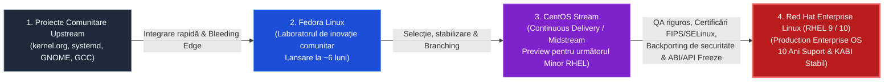
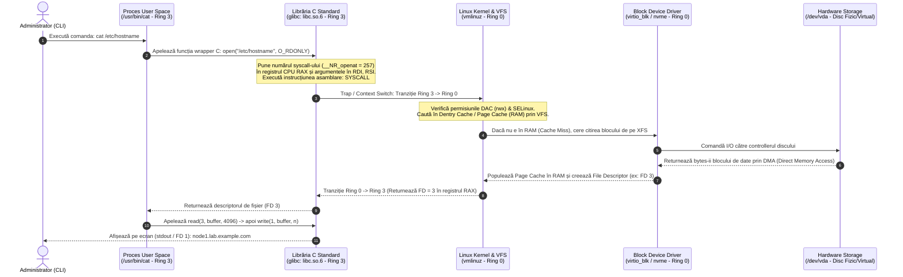
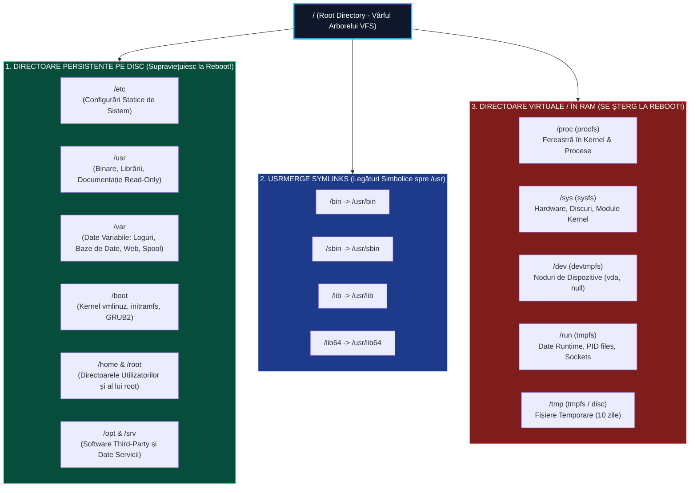
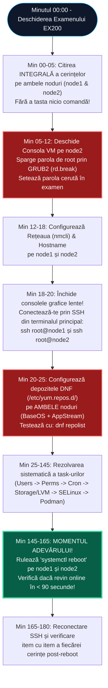
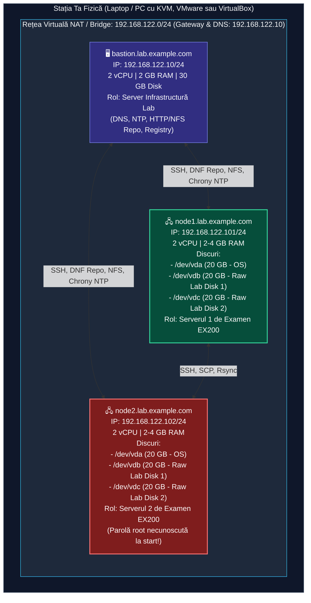

# Capitolul 0.1: Arhitectura Internă Red Hat Enterprise Linux & Construirea Lab-ului EX200

> ### Obiectivul Capitolului, Ponderea în Examenul EX200 & Regula de Aur a Persistenței
> * **Obiectivul Capitolului:** Înțelegerea profundă, la nivel de inginerie de sistem, a modului în care funcționează nucleul Linux (*Kernel Space* vs. *User Space*), cum comunică aplicațiile cu hardware-ul prin apeluri de sistem (*System Calls*) și *Virtual File System (VFS)*, care este anatomia exactă a ierarhiei de directoare în RHEL 9 / RHEL 10 (*Filesystem Hierarchy Standard - FHS*) și cum ne construim de la zero propriul laborator de antrenament (*Home Lab*) identic cu mediul oficial de examen Red Hat.
> * **Ponderea în Examenul EX200:** **Fundație Critică (100% impact transversal).** Deși examenul nu îți va pune întrebări teoretice de tip grilă despre *Ring 0* sau *glibc*, înțelegerea arhitecturii FHS (`/etc`, `/var`, `/run`, `/proc`, `/sys`), a consolei de examen și a strategiei primelor 15 minute face diferența dintre un candidat care pică cu 180/300 din cauza unei mașini virtuale care nu mai pornește la *reboot* și un inginer care obține **300/300** având o oră liberă la dispoziție pentru verificări.
> * **Regula de Aur a Persistenței (EX200 Survival Rule):** În examenul RHCSA (EX200), munca ta **NU** este evaluată în starea în care lași serverul la expirarea timpului! Scriptul automat de notare (*Grading Script*) execută mai întâi un ciclu forțat de oprire și repornire (`reboot` / *power cycle*) asupra mașinilor virtuale `node1` și `node2`. Orice modificare făcută exclusiv în memorie (în `/run`, în `/proc` scris direct, sau prin comenzi runtime fără echivalent în `/etc`) **se pierde ireversibil la reboot și valorează 0 puncte**. În acest capitol învățăm exact care directoare supraviețuiesc repornirii și cum validăm starea mașinilor noastre prin `ssh` și consola KVM.

---

## 1. Introducerea Profesorului & Analogia Vizuală

Bun venit în liga profesioniștilor Red Hat! Ca **RHCA (Red Hat Certified Architect)** și **Instructor (RHCI)** care a pregătit mii de ingineri și a analizat nenumărate eșecuri în examenul EX200 și în producție, îți spun un adevăr fundamental încă din prima zi: **Administratorii de sistem amatori memorează comenzi; Inginerii de top înțeleg arhitectura.**

Când ești în fața consolei de examen EX200 — fără acces la internet, fără Google, fără ChatGPT, cu cronometrul scurgându-se nemilos de la `03:00:00` — sau când ești la ora 03:00 dimineața într-un *incident de producție Severity-1* la o bancă ori într-un cluster cloud, comenzile memorate mecanic te vor trăda la primul parametru schimbat. Ceea ce te salvează este să știi **cum gândește sistemul de operare Linux**. Dacă știi unde își ține kernelul starea în timp real (`/proc` și `/sys`), unde își caută daemonii configurările persistente la pornire (`/etc`), unde sunt păstrate datele temporare de sesiune (`/run`) și cum găsești documentația deja instalată pe disc (`/usr/share/doc` și `man`), ești de neînvins.

### Analogia Vizuală: Sistemul de Operare Linux ca o Bancă Centrală de Înaltă Securitate

Pentru a înțelege arhitectura internă a unui server **RHEL (Red Hat Enterprise Linux)**, imaginează-ți o **Bancă Centrală** blindată:

1. **Hardware-ul Fizic (CPU, RAM, Discuri NVMe, Plăci de Rețea):** Reprezintă **Seiful Subteran plin cu lingouri de aur și bani gheață**. Nimeni din exterior nu are voie să intre direct în seif și să ia bani cu mâna, altfel ar fi haos și faliment instantaneu (echivalentul unui *Kernel Panic* sau al coruperii memoriei).
2. **User Space (Spațiul Utilizatorului — Ring 3):** Este **Sala Publică cu Ghișee** de la parterul băncii. Aici stau clienții băncii: aplicațiile tale (`bash`, serverul web `httpd`, baza de date `postgresql`, editorul `vim`). Clienții nu au cheile de la seif și nu pot atinge direct niciun lingou de aur (nu pot accesa direct memoria fizică sau discurile).
3. **System Calls & Librăria `glibc` (Apelurile de Sistem):** Sunt **Formularele Oficiale Standardizate și Ghișeele cu Geam Antiglonț**. Dacă un client (`vim`) vrea să salveze un fișier pe disc, el nu se duce în subsol la hard disk. El completează un formular standardizat (`open()`, `write()`, `close()`) prin intermediul funcționarului de la ghișeu (`glibc` — *GNU C Library*) și îl împinge pe sub geamul antiglonț.
4. **Kernel Space (Spațiul Nucleului — Ring 0):** Este **Zona Blindată din spatele ghișeelor**, unde lucrează doar Ofițerii de Securitate ai Băncii (**Linux Kernel**). Kernelul preia formularul clientului, verifică dacă acesta are dreptul să facă operațiunea (permisiuni DAC și politici **SELinux**), coboară în seif (prin driverele hardware), scrie datele pe disc și îi întoarce clientului o chitanță (un cod de retur: `0` pentru succes sau un cod de eroare `errno`).
5. **Ierarhia de Fișiere (FHS):** Reprezintă **Arhiva Băncii**:
   * `/etc` este **Dulapul cu Regulamentele Oficiale tipărite pe hârtie** (ce rămâne scris aici se aplică și mâine dimineață când banca se redeschide — **Persistent la Reboot**).
   * `/run` și `/proc` sunt **Tabelele Electronice cu LED-uri de pe perete** care arată cursul valutar și ce ghișee sunt deschise *chiar acum* (când se taie curentul seara la închiderea băncii, tabelele se sting — **Volatil / Runtime**).

---

## 2. Arhitectură Internă, Teorie & Mecanică Linux

În această secțiune disecăm anatomia sistemului Red Hat Enterprise Linux folosind regula noastră **Zero-Assumptions**: fiecare acronim și concept este explicat etimologic, conceptual și arhitectural.

### 2.1. Ce este Red Hat Enterprise Linux (RHEL) și Modelul Open Source Enterprise?

* **RHEL (Red Hat Enterprise Linux):**
  * *(1) Origine:* Lansat inițial în anul 2000 (ca *Red Hat Linux Advanced Server*) și redenumit în 2003 în **RHEL**, este distribuția Linux comercială standard în industria globală (folosită de peste 90% din companiile Fortune 500: bănci, telecomunicații, aviație, guverne, cloud providers).
  * *(2) Ce reprezintă:* Un sistem de operare bazat pe nucleul Linux și unelte GNU (*GNU's Not Unix*), stabilizat, testat riguros, certificat hardware/software și susținut pe o perioadă de **10 ani** (*Life Cycle*) pentru fiecare versiune majoră (ex. RHEL 9 sau RHEL 10).
  * *(3)Cum funcționează tehnic fluxul de dezvoltare (*Upstream to Downstream*):* În lumea Linux, codul nu apare direct în RHEL. El urmează o cascadă de stabilizare pe 4 niveluri:



> **Concept Tehnic Crucial pentru Interviu — Ce înseamnă *Backporting* și *KABI Stability* în RHEL?**
> Când instalezi RHEL 9, vei vedea că versiunea kernelului este, de exemplu, `5.14.0-xxx.el9.x86_64`. Un începător ar putea întreba: *„De ce folosește RHEL 9 kernelul 5.14 când pe kernel.org există deja 6.x?”*
> Răspunsul de arhitect: Red Hat practică **ABI/KABI Freeze (Application / Kernel Binary Interface Stability)** și **Backporting**. Red Hat îngheață interfața versiunii `5.14` (sau `6.12` în RHEL 10) pentru ca aplicațiile bancare și driverele să nu se strice timp de 10 ani, dar **ia bucățile de cod nou (drivere moderne, patch-uri de securitate CVE, optimizări de performanță) din kernelele noi 6.x și le transplantează chirurgical (*backport*) în kernelul de RHEL**, păstrând numărul de bază neschimbat, dar crescând numărul de *release* Red Hat (`-427.el9`, `-503.el9` etc.).

---

### 2.2. Kernel Space vs. User Space, CPU Rings și System Calls (`syscall`)

Procesorul fizic al unui server modern (arhitectura **x86_64** / **AMD64** sau **ARM64 / aarch64**) implementează direct în siliciu un mecanism de protecție numit **Privilege Rings (Inele de Privilegiu)**. Deși arhitectura x86 definește 4 inele (Ring 0, 1, 2, 3), Linux folosește în mod practic două dintre ele:

1. **Ring 0 — Kernel Mode (*Kernel Space*):**
   * *(1) Nume:* *Supervisor Mode* / *Kernel Space*.
   * *(2) Ce reprezintă:* Nivelul suprem de execuție pe procesor, unde rulează exclusiv nucleul sistemului de operare (**Linux Kernel** — încărcat din fișierul `/boot/vmlinuz-...`) și modulele sale (`.ko` — *Kernel Objects*).
   * *(3) Cum funcționează sub capotă:* Codul care rulează în *Ring 0* are acces nerestricționat la toate instrucțiunile procesorului, la întreaga memorie fizică RAM și la toate porturile I/O (*Input/Output*) ale perifericelor (discuri, plăci de rețea). Dacă apare o eroare necontrolată în Ring 0 (de exemplu, referință la un pointer invalid într-un driver), sistemul declanșează un **Kernel Oops** sau **Kernel Panic** și îngheață complet pentru a preveni coruperea datelor de pe disc.
2. **Ring 3 — User Mode (*User Space*):**
   * *(1) Nume:* *Unprivileged Mode* / *User Space*.
   * *(2) Ce reprezintă:* Spațiul izolat și restricționat în care rulează **absolut toate** procesele pornite de sistem sau de utilizatori — chiar și cele rulate de utilizatorul `root`! (De exemplu, `systemd`, `sshd`, `bash`, `nginx`, `podman` rulează toate în *User Space*).
   * *(3) Cum funcționează sub capotă:* Fiecare proces din *User Space* primește propriul său **Virtual Address Space (Spațiu de Adresare Virtuală)**, gestionat de **MMU (Memory Management Unit — Unitatea de Gestiune a Memoriei)** din procesor și de tabelele de paginare (*Page Tables*) ale kernelului. Un proces din Ring 3 crede că este singur pe lume și nu poate citi sau scrie în memoria altui proces. Dacă încearcă să acceseze o zonă de memorie nealocată lui, procesorul generează o excepție hardware, iar kernelul omoară doar acel proces cu celebrul semnal **`SIGSEGV` (Segmentation Fault)**, fără ca restul serverului să fie afectat!

#### Cum comunică User Space cu Kernel Space? Anatomia unui `System Call` (`syscall`)

Dacă un proces din *User Space* (de exemplu, comanda `ls` sau `cat /etc/passwd`) nu are voie să atingă discul, cum reușește totuși să citească un fișier? Răspunsul este: prin **System Calls (Apeluri de Sistem)** intermediate de biblioteca standard C (**`glibc` — GNU C Library**, aflată în `/lib64/libc.so.6`).

Iată diagrama exactă de secvență a ceea ce se întâmplă în milisecunda în care tu rulezi `cat /etc/hostname` în terminal:



> **Cum vezi acest proces cu ochii tăi în RHEL?**
> Folosind utilitarul **`strace` (System Call Tracer)**. Dacă rulezi în terminal comanda `strace cat /etc/hostname`, vei vedea exact lista fiecărui apel `openat()`, `read()`, `write()` și `close()` pe care procesul îl trimite către kernel!

---

### 2.3. Virtual File System (VFS) și Filozofia „Everything is a File”

În UNIX și Linux există o axiomă fundamentală: **„Everything is a file” (Totul este un fișier)** — sau, mai exact în Linux-ul modern, *„Totul este un flux de octeți (stream of bytes) reprezentat printr-un File Descriptor în arborele de fișiere”*.

Cum poate programul `cat` sau `cp` să citească la fel de ușor un fișier de pe un disc local **XFS**, un fișier de pe o partajare de rețea **NFS**, un stick USB formatat **FAT32**, sau informațiile despre procesor din **`/proc/cpuinfo`** (care nici măcar nu există pe disc, ci sunt generate din RAM)?

Secretul este **VFS (Virtual File System / Virtual Filesystem Switch)**:
* **Ce este VFS:** Este un strat de abstractizare software în interiorul kernelului Linux (în *Ring 0*) care oferă o interfață unică și uniformă tuturor aplicațiilor din *User Space*.
* **Cum funcționează:** Aplicația ta apelează mereu aceleași funcții generice (`open()`, `read()`, `write()`, `stat()`). VFS-ul interceptează apelul, se uită în ce director se află fișierul cerut și traduce cererea către driverul specific acelui sistem de fișiere (`xfs`, `ext4`, `nfs4`, `procfs`, `sysfs`, `tmpfs`, `devtmpfs`).

#### Cele 7 Tipuri de Fișiere în Linux (Identificate prin primul caracter din `ls -l`)

Când rulezi `ls -l`, primul caracter de pe linie (înaintea permisiunilor `rwxr-xr-x`) îți spune exact ce tip de obiect VFS privești:

| Simbol în `ls -l` | Nume în Engleză | Ce reprezintă în Română & Cum funcționează sub capotă | Exemplu în RHEL 9 / 10 |
| :--- | :--- | :--- | :--- |
| **`-`** | **Regular File** | Fișier obișnuit (text ASCII/UTF-8, binar compilat ELF, imagine, arhivă). Conține date stocate în blocuri pe disc. | `/etc/fstab`, `/usr/bin/bash` |
| **`d`** | **Directory** | Director (dosar). La nivel de kernel și inode, un director este doar un tabel special care mapează **Numele Fișierelor (Dentries)** la **Numerele lor de Inode**. | `/etc`, `/home/student` |
| **`l`** | **Symbolic Link (Soft Link)** | Legătură simbolică (scurtătură). Un fișier special al cărui conținut este doar șirul de caractere reprezentând calea către un alt fișier/director. | `/etc/localtime`, `/bin -> usr/bin` |
| **`b`** | **Block Device** | Dispozitiv de tip bloc. Reprezintă hardware de stocare (discuri, partiții, volume LVM) care citește/scrie date în blocuri de dimensiune fixă (ex. 512 bytes sau 4 KB) și suportă *random access* (salt la orice adresă) și *buffering/caching* în RAM. | `/dev/vda`, `/dev/vda1`, `/dev/dm-0` |
| **`c`** | **Character Device** | Dispozitiv de tip caracter. Reprezintă dispozitive care transmit datele caracter cu caracter (flux continuu / *stream*), fără memorie cache intermediară (terminale, tastaturi, plăci de sunet, generatoare de numere aleatoare). | `/dev/tty1`, `/dev/pts/0`, `/dev/null`, `/dev/zero`, `/dev/urandom` |
| **`s`** | **Local Domain Socket** | Socket IPC (*Inter-Process Communication*). Permite două procese care rulează pe același server să schimbe date la viteză extremă direct prin memoria kernelului, fără a trece prin stiva de rețea TCP/IP. | `/run/systemd/journal/socket`, `/run/podman/podman.sock` |
| **`p`** | **Named Pipe (FIFO)** | *First-In, First-Out Pipe*. Un canal unidirecțional persistent pe sistemul de fișiere prin care un proces scrie date la un capăt, iar alt proces le citește în ordinea exactă în care au intrat. | Creat cu comanda `mkfifo /tmp/my_pipe` |

---

### 2.4. Anatomia Completă a Ierarhiei de Directoare în RHEL 9 / 10 (FHS — Filesystem Hierarchy Standard)

În Linux nu există litere de unitate ca în Windows (`C:\`, `D:\`). Întregul sistem pornește dintr-un singur punct de origine numit **Root Directory (`/`)**, iar toate celelalte partiții, discuri sau sisteme de fișiere virtuale sunt „agățate” (*mounted*) ca ramuri în acest arbore unic. Standardul este definit în documentația oficială a sistemului, pe care o poți citi oricând (chiar și în examen!) rulând comanda:
```bash
man file-hierarchy
# sau
man hier
```

Pentru examenul **EX200**, trebuie să împărțim această ierarhie în două categorii vitale: **Directoare Persistente pe Disc** și **Directoare Virtuale / Volatile în RAM**.



#### Disecția Directoarelor din RHEL 9 / 10 (Cu Impact Direct în EX200):

1. **`/` (Root Directory — Rădăcina Sistemului):**
   * Punctul de pornire al întregului arbore VFS. Atenție la confuzia clasică a începătorilor: `/` este *Root Directory* (rădăcina întregului sistem), în timp ce `/root` este *Home Directory-ul* contului de superutilizator `root`!
2. **`/etc` (*Editable Text Configuration* / istoric *Et Cetera*):**
   * **REGELE EXAMENULUI EX200!** Conține toate fișierele de configurare locale și statice ale sistemului și ale serviciilor instalate (`/etc/fstab`, `/etc/passwd`, `/etc/ssh/sshd_config`, `/etc/chrony.conf`).
   * **Regula de Aur:** Dacă vrei ca o setare să supraviețuiască la `reboot`, ea **TREBUIE** să fie scrisă (direct sau printr-un utilitar precum `nmcli`, `systemctl enable`, `firewall-cmd --permanent`) într-un fișier din `/etc`! Nu conține niciodată programe executabile binare.
3. **`/usr` (*Unix System Resources* — și NU „User”!) & Arhitectura `UsrMerge`:**
   * Conține tot software-ul instalat prin pachete `.rpm`: executabilele, librăriile, documentația și configurațiile implicite (*vendor defaults*) livrate de Red Hat.
   * **Ce este `UsrMerge` (începând cu RHEL 7/8/9/10)?** În UNIX-ul anilor '70, discurile erau minuscule (ex. 1.5 MB), așa că `/bin` și `/sbin` stăteau pe primul disc pentru a porni sistemul, iar `/usr/bin` pe al doilea disc. Astăzi, pentru că avem `initramfs` (un mini-sistem în RAM la boot), Red Hat a unificat totul în `/usr`:
     * `/bin` este doar un *Symbolic Link* (`l`) către **`/usr/bin`** (comenzi uzuale: `ls`, `cp`, `bash`).
     * `/sbin` este un *Symbolic Link* către **`/usr/sbin`** (comenzi de administrare a sistemului: `lvm`, `fsck`, `sshd`, `iptables`).
     * `/lib` și `/lib64` sunt *Symbolic Links* către **`/usr/lib`** și **`/usr/lib64`** (librării partajate `.so` — *Shared Objects*, echivalentul fișierelor `.dll` din Windows, plus unitățile implicite `systemd` în `/usr/lib/systemd/system/`).
   * **`/usr/share/doc` (Mina de Aur în Examenul EX200!):** Conține documentație și **exemple de fișiere de configurare** pentru pachetele instalate. Dacă în examen ți se cere să configurezi un serviciu și ai uitat sintaxa, în `/usr/share/doc/<nume_pachet>/` găsești adesea fișierele gata scrise!
4. **`/var` (*Variable Data Files*):**
   * Spre deosebire de `/usr` (care este static și s-ar putea monta chiar și *Read-Only*), `/var` conține date care își modifică dimensiunea continuu în timpul funcționării serverului:
     * **`/var/log`:** Toate jurnalele (logurile) persistente ale sistemului (`/var/log/messages`, `/var/log/secure` pentru autentificări și `sudo`, `/var/log/audit/audit.log` pentru SELinux, `/var/log/journal` pentru `systemd-journald`).
     * **`/var/www/html`:** Directorul implicit (*DocumentRoot*) pentru serverul web Apache (`httpd`).
     * **`/var/lib`:** Datele de stare și bazele de date ale aplicațiilor și containerelor (ex. `/var/lib/containers` pentru containerele *rootfull* Podman, `/var/lib/mysql`, `/var/lib/nfs`).
     * **`/var/spool`:** Cozi de așteptare (*queues*) pentru task-uri care urmează să fie procesate (`/var/spool/cron` pentru joburile `crontab` ale utilizatorilor, `/var/spool/mail`).
5. **`/boot` (Fișierele Critice ale Secvenței de Boot):**
   * De obicei o partiție separată (XFS, ~1 GB) necriptată și în afara LVM-ului complex, astfel încât *bootloader-ul* să o poată citi imediat după pornirea serverului. Conține:
     * **`vmlinuz-<versiune>`:** Nucleul Linux (*Virtual Memory Linux Gzip/Zstd*) — imaginea comprimată și executabilă a kernelului.
     * **`initramfs-<versiune>.img`:** *Initial RAM Filesystem* — o arhivă comprimată care conține driverele esențiale (pentru discuri, LVM, XFS) pe care bootloader-ul o încarcă în RAM pentru a ajuta kernelul să monteze rădăcina reală `/`.
     * **`/boot/grub2/` și `/boot/efi/`:** Configurațiile și binarele *bootloader-ului* **GRUB2** (*GRand Unified Bootloader v2*).
6. **`/home` și `/root`:**
   * `/home/<username>` conține directoarele personale ale utilizatorilor obișnuiți (și, în Capitolul 5.1, aici vor trăi containerele *rootless* Podman în `~/.local/share/containers` și unitățile `systemd` ale utilizatorului în `~/.config/systemd/user/`!).
   * `/root` este directorul personal al administratorului suprem (`UID 0`).
7. **`/proc` (Sistemul de Fișiere Virtual `procfs` — *Process Information Pseudo-Filesystem*):**
   * **Atenție:** `/proc` ocupă **0 bytes pe hard disk**! El există exclusiv în memoria RAM și este generat în timp real de către kernel.
   * Conține câte un subdirector numerotat pentru **fiecare PID (*Process ID*)** care rulează în acel moment pe server (ex. `/proc/1/` pentru `systemd`), plus fișiere care expun starea hardware și a kernelului:
     * `/proc/cpuinfo` (detalii despre procesor);
     * `/proc/meminfo` (starea detaliată a memoriei RAM și Swap);
     * `/proc/cmdline` (**CRITIC ÎN EXAMEN:** îți arată exact parametrii cu care a pornit kernelul curent din GRUB2!);
     * `/proc/mounts` (ce sisteme de fișiere sunt montate efectiv *chiar acum* în kernel);
     * `/proc/sys/` (parametrii dinamici ai kernelului, pe care îi putem modifica la runtime cu comanda `sysctl` și îi facem persistenți în `/etc/sysctl.d/*.conf`).
8. **`/sys` (Sistemul de Fișiere Virtual `sysfs`):**
   * La fel ca `/proc`, există doar în RAM. A fost creat pentru a scoate informațiile despre **hardware, drivere și topologia dispozitivelor** din `/proc` și a le organiza structurat în `/sys/block` (discuri), `/sys/class/net` (interfețe de rețea), `/sys/fs/selinux` (starea SELinux), `/sys/module` (modulele de kernel încărcate).
9. **`/dev` (*Device Nodes* — Sistemul de Fișiere `devtmpfs`):**
   * Populat dinamic în RAM la boot de către kernel și gestionat în *User Space* de daemonul **`systemd-udevd` (`udev`)**. De fiecare dată când atașezi un disc nou sau o placă de rețea, kernelul trimite un eveniment (*uevent*), iar `udevd` creează automat fișierul de tip *Block* sau *Character* în `/dev` (ex. `/dev/vda`, `/dev/vdb`, `/dev/sda`).
   * **Dispozitive pseudo-speciale din `/dev` pe care le vei folosi constant în examen:**
     * `/dev/null` (*Bit Bucket* / „Gaura Neagră”): Orice scrii sau redirecționezi aici (`2> /dev/null`) dispare instantaneu, raportând succes, iar dacă citești din el primești imediat `EOF` (*End of File*).
     * `/dev/zero`: Generează un flux infinit de octeți zero (`0x00`) — ideal când vrem să creăm un fișier gol de dimensiune fixă cu `dd` sau să ștergem tabela de partiții a unui disc.
     * `/dev/urandom`: Generator de octeți pseudo-aleatori criptografic siguri.
10. **`/run` (Volatile Runtime Data — `tmpfs` în RAM):**
    * Înlocuitorul modern al vechiului `/var/run` (care astăzi este doar un symlink `/var/run -> ../run`). Este montat în memoria RAM (`tmpfs`). Aici își țin serviciile active fișierele `.pid` (cu ID-ul procesului lor), *socket-urile* IPC și starea conexiunilor curente. **Orice fișier creat manual în `/run` dispare complet la `reboot`!**
11. **`/tmp` și `/var/tmp` (Directoarele pentru Fișiere Temporare — Diferență Clasică de Examen!):**
    * Ambele au permisiuni speciale `1777` (`drwxrwxrwt` — cu *Sticky Bit* activat, astfel încât oricine poate crea fișiere, dar doar proprietarul le poate șterge pe ale sale).
    * **Diferența de persistență (gestionată de `systemd-tmpfiles-clean.timer`):**
      * **`/tmp`:** Pentru fișiere temporare de scurtă durată. În RHEL 9/10, fișierele neaccesate din `/tmp` sunt curățate automat după **10 zile** (și, în funcție de activarea unității `tmp.mount`, `/tmp` poate fi chiar în RAM și golit la fiecare reboot).
      * **`/var/tmp`:** Aflat garantat pe disc fizic, destinat fișierelor temporare care **trebuie să supraviețuiască la reboot**; sunt curățate automat doar dacă nu au fost accesate timp de **30 de zile**.
12. **`/mnt` și `/media`:**
    * `/mnt` este punctul de montare temporar standard folosit de administratori când testează manual o partiție sau un ISO (`mount /dev/vdb1 /mnt`), în timp ce `/media` (sau `/run/media/<user>`) este folosit de mediul grafic pentru montarea automată a mediilor amovibile.

---

### 2.5. Anatomia Examenului RHCSA (EX200): Cum Funcționează, Cum Se Notează și Strategia Primelor 15 Minute

Înainte de a instala laboratorul nostru, trebuie să știi exact cum arată „câmpul de luptă” la examenul real **Red Hat Certified System Administrator (EX200)**:

* **Formatul:** Examen **100% practic (*Hands-On Performance-Based*)**. Nu există nicio întrebare grilă! Primești o listă de ~18–22 de cerințe (task-uri) într-un browser local pe stația ta de lucru.
* **Durata și Punctajul:**
  * Durata: **3 ore (180 de minute)**.
  * Punctaj maxim: **300 de puncte**.
  * Punctaj minim de promovare (*Passing Score*): **210 / 300 (70%)**.
* **Arhitectura Mediului de Examen:**
  * Ești așezat în fața unei stații de lucru (sau a propriului laptop dacă dai examenul *Remote* de pe un stick USB bootabil Red Hat Live Environment) din care ai acces la o aplicație de control a mașinilor virtuale și la un terminal local.
  * Ai de configurat **două mașini virtuale (VM-uri)** independente:
    * **`node1` (sau `servera`):** Are parola de `root` cunoscută (scrisă în instrucțiunile examenului) și are adesea o conexiune de rețea parțială sau ce trebuie reconfigurată conform cerințelor. Pe `node1` vei rezolva de obicei task-urile de rețea, depozite `dnf`, utilizatori, permisiuni, `autofs`, `SELinux`, server web și **containere Podman**.
    * **`node2` (sau `serverb`):** **NU îi cunoști parola de `root`!** De asemenea, adesea nu are rețeaua configurată la început. Pe `node2` vei sparge parola de `root` din `GRUB2`, vei configura rețeaua și depozitele `dnf`, și vei rezolva task-urile grele de **Storage (LVM, Swap, Partiții, Stratis/VDO)** și **`tuned`**.
* **Din consola stației tale gazdă (*Exam Workstation*), ai butoane vitale de control al VM-urilor:**
  * **Open Console:** Îți deschide ecranul direct (fizic/KVM) al mașinii virtuale `node1` sau `node2` (singurul mod în care poți vedea meniul `GRUB2` la boot sau poți intra pe un server fără rețea!).
  * **Reset / Reboot VM:**echivalentul apăsării butonului fizic de Reset de pe carcasa serverului.
  * **Reset to Initial State (Reinstalare completă a VM-ului):** **Butonul de Salvare Extremă!** Dacă ai distrus iremediabil tabela de partiții sau ai șters `/etc` pe `node2`, acest buton șterge mașina virtuală și o recreează de la zero, exact cum era în minutul 1 al examenului (durează ~3–5 minute, dar pierzi tot ce ai lucrat pe acel nod până în acel moment).



> **De ce este ordinea din primele 25 de minute nenegociabilă?**
> 1. Dacă nu resetezi parola de `root` pe `node2`, pierzi automat **100% din punctele de pe `node2`** (~40-50% din examen), pentru că nu te poți autentifica să faci nimic pe el!
> 2. Dacă nu configurezi rețeaua și depozitele `dnf` (`BaseOS` și `AppStream`), nu vei putea instala pachetele necesare pentru celelalte subiecte (`autofs`, `stratisd`, `vdo`, `container-tools`, `httpd`), blocându-ți jumătate din examen!
> 3. **De ce lucrăm prin `ssh` din terminalul stației de examen și NU în fereastra *VM Console*?** În fereastra *VM Console* (consola grafică emulată KVM/VNC), **Copy-Paste-ul NU funcționează** (sau funcționează greoi), tastatura poate avea latență și nu poți da scroll înapoi ușor. Odată ce ai reparat parola de `root` și ai pus IP-ul pe `node1` și `node2`, te conectezi prin `ssh root@node1` direct din terminalul stației tale: acum poți da **Copy-Paste direct cu mouse-ul din browserul cu cerințele examenului** (nume de utilizatori, URL-uri de repo-uri, căi de fișiere, parole complexe), eliminând 100% riscul greșelilor de tastare (*typos*)!

---

## 3. Cutia cu Secrete RHCA & Capcane Mortale de Examen (Exam Killers & Man Page Hacks)

Aceasta este secțiunea care îți salvează punctajul în situații limită.

### 💀 Capcana Mortală #1: Confuzia între Runtime și Persistență (Sindromul „La mine mergea înainte de Reboot!”)
Mulți candidați ies din sala de examen convinși că iau 300/300, iar a doua zi primesc pe email un scor de **140/300 (FAILED)**. De ce?
* Au montat o partiție manual cu `mount /dev/vdb1 /mnt/data`, dar au uitat să o treacă în `/etc/fstab` (sau au trecut-o greșit). La reboot-ul dat de scriptul de notare, `/mnt/data` este gol -> **0 puncte** (plus pierderea punctelor pentru orice task care depindea de datele din `/mnt/data`!).
* Au pornit un serviciu cu `systemctl start httpd` sau `systemctl start chronyd`, dar au uitat flag-ul `enable` (`systemctl enable --now httpd`). La reboot, serviciul este oprit -> **0 puncte**.
* Au deschis un port în firewall cu `firewall-cmd --add-service=http`, dar au uitat `--permanent` și `firewall-cmd --reload`. La reboot, portul este blocat -> **0 puncte**.

### 💀 Capcana Mortală #2: Un `/etc/fstab` greșit aruncă serverul în `Emergency Mode` la Reboot!
Dacă faci o greșeală de o singură literă în `/etc/fstab` (de exemplu, scrii greșit un UUID, uiți tipul sistemului de fișiere `xfs`, sau ștergi o partiție LVM dar îi lași linia în `/etc/fstab`), atunci când scriptul de notare dă `reboot`, serverul tău **se va opri din procesul de boot**, va intra în `Emergency Mode` și va cere parola de `root` pe consolă. Deoarece serviciul `sshd` și scripturile de evaluare nu pornesc în `Emergency Mode`, **vei primi 0 puncte pe ABSOLUT TOATE cerințele de pe acea mașină virtuală!**
* **Antidotul Obligatoriu:** Nu părăsi niciodată examenul fără să dai tu însuți `systemctl reboot` pe ambele mașini cu 20 de minute înainte de final și să verifici că te poți reconecta prin `ssh`!

### 💀 Capcana Mortală #3: Typos în Numele Cerute de Cerință
Evaluarea examenului EX200 este făcută de un program (un script automat în Python/Bash/Ansible), **nu de un om**.
* Dacă cerința îți spune: *„Creați grupul `sysadmins` și directorul `/home/managers`”*, iar tu creezi grupul `sysadmin` (fără `s` la final) sau directorul `/home/manager`, scriptul de notare va rula `getent group sysadmins`, va primi eroare și îți va acorda **0 puncte**, chiar dacă toată logica ta de permisiuni SGID era perfectă!
* **Truc de Viteză CLI:** Folosește întotdeauna **Copy (`Ctrl+Shift+C`) și Paste (`Ctrl+Shift+V`)** din fereastra cu enunțul examenului în terminalul SSH pentru orice nume de utilizator, parolă, URL de repository, nume de volum LVM sau nume de container!

### 🛠️ Man Page Hacks (Cum găsești răspunsul când ai un lapsus în examen)
În timpul examenului nu ai internet, dar ai instalată toată documentația Red Hat pe disc. Iată ce pagini `man` acoperă subiectele din acest capitol:
1. Ai uitat rolul unui director din sistem sau unde își pune `systemd` fișierele?
   ```bash
   man file-hierarchy
   ```
2. Vrei să vezi ce versiune exactă de RHEL și ce kernel rulezi?
   ```bash
   cat /etc/redhat-release
   cat /etc/os-release
   uname -r
   hostnamectl
   ```
3. Vrei să cauți în interiorul unei pagini `man` direct secțiunea de exemple practice?
   Deschide orice pagină de manual (ex. `man systemctl`), apasă tasta slash **`/`**, scrie **`EXAMPLES`** (cu majuscule!) și apasă **`Enter`**. Apasă **`n`** pentru a sări la următorul rezultat.

---

## 4. Pregătire pentru Interviu (Linux SysAdmin & DevOps Job Readiness)

La interviurile tehnice pentru roluri de **Mid/Senior Linux System Administrator, SRE (Site Reliability Engineer) sau DevOps Engineer**, intervievatorii folosesc întrebări de arhitectură internă pentru a separa candidații care știu doar să ruleze scripturi de cei care înțeleg cu adevărat sistemul de operare.

### Întrebarea 1 (Nivel Junior -> Mid):
> **Intervievator:** *„Când rulez comanda `free -m` pe un server RHEL de producție cu 64 GB RAM, văd că memoria `free` este de doar 500 MB, dar serverul funcționează impecabil. Un coleg din echipa de aplicații a intrat în panică și cere un upgrade urgent de RAM. Cum îi explici ce se întâmplă la nivel de Kernel?”*

**Răspunsul Ideal (Explicație la nivel de Arhitectură Kernel):**
> „Îi voi arăta colegului diferența dintre coloanele **`free`** și **`available`** din output-ul comenzii `free -m` (sau din `/proc/meminfo`), invocând principiul fundamental din Linux: *Unused RAM is wasted RAM (Memoria RAM nefolosită este memorie irosită)*.
>
> Sub capotă, nucleul Linux folosește toată memoria RAM fizică rămasă liberă pentru **Page Cache** și **Buffer Cache / Slab (dentries și inodes)** — vizibile în coloana `buff/cache`. Când un proces citește sau scrie blocuri de pe disc prin *Virtual File System (VFS)*, kernelul păstrează acele pagini de 4 KB în RAM. Dacă o aplicație cere aceleași fișiere a doua oară, kernelul le servește instantaneu din RAM (în nanosecunde), fără a mai face operațiuni I/O lente pe disc.
>
> Această memorie `buff/cache` este însă **100% reclamabilă instantaneu**. În secunda în care o aplicație din *User Space* cere memorie nouă prin apelul de sistem `mmap()` sau `brk()`, kernelul eliberează automat paginile din *Page Cache* (folosind algoritmul *LRU — Least Recently Used*) și le alocă aplicației. Prin urmare, adevărata memorie disponibilă fără a intra în *swapping* este dată de coloana **`available`** (care adună memoria `free` cu partea reclamabilă din `buff/cache`), nu de coloana `free`.”

---

### Întrebarea 2 (Nivel Mid -> Senior / SRE):
> **Intervievator:** *„Care este diferența tehnică între o aplicație care consumă 90% CPU în `%us` (User Time) și una care consumă 90% CPU în `%sy` (System Time) în output-ul comenzii `top`? Cum diagnostichezi un `%sy` anormal de mare?”*

**Răspunsul Ideal:**
> „În `top` sau `vmstat`, metricile CPU ne arată exact în ce *Privilege Ring* își petrece procesorul timpul:
> 1. **`%us` (User Time):** Reprezintă procentul de timp în care CPU-ul execută cod în **User Space (Ring 3)** — adică logica internă a aplicației: calcule matematice, parsare de JSON, criptare SSL în librării user-space, garbage collection în Java/Go.
> 2. **`%sy` (System / Kernel Time):** Reprezintă procentul de timp în care CPU-ul execută cod în **Kernel Space (Ring 0)** în numele proceselor.
>
> Un **`%sy` anormal de mare** (de exemplu, peste 30–50%) indică faptul că aplicația nu face calcule proprii, ci bombardează kernelul cu un număr uriaș de **System Calls (`syscalls`)** și generează **Context Switches** excesive (tranziții scumpe între Ring 3 și Ring 0). Cauzele clasice în producție sunt:
> * Un proces care face milioane de apeluri `read()`/`write()` de câte 1 singur byte fără *buffering*;
> * Crearea excesivă de procese scurte (`fork()` storms);
> * Contenție pe *spinlocks/mutexes* în kernel (`futex`) sau deschiderea/închiderea continuă de conexiuni/fișiere fără *connection pooling*.
>
> **Cum diagnostichez:** Identific PID-ul procesului din `top`, apoi rulez **`strace -c -p <PID>`** timp de 10 secunde pentru a obține un tabel sumar cu exact ce apeluri de sistem (`openat`, `futex`, `read`, `stat`) consumă cel mai mult timp în kernel, sau folosesc `pidstat -w` pentru a măsura rata de *voluntary* vs. *involuntary context switches*.”

---

### Întrebarea 3 (Nivel Senior / DevOps & Container Architecture):
> **Intervievator:** *„Pe un server RHEL 9, comanda `df -h` arată că partiția `/var` este plină 100% (0 bytes liberi), iar aplicațiile dau eroare `No space left on device`. Totuși, când rulezi `du -sh /var/*`, suma tuturor directoarelor și fișierelor din `/var` este de doar 4 GB dintr-un disc de 50 GB! Unde au dispărut cei 46 GB și cum rezolvi problema fără a da reboot serverului?”*

**Răspunsul Ideal:**
> „Acesta este scenariul clasic al unui **fișier șters care este încă ținut deschis (*open File Descriptor*) de un proces activ**.
>
> **Explicația la nivel de VFS și Inode:** În Linux, ștergerea unui fișier cu `rm /var/log/huge.log` apelează syscall-ul `unlink()`. Acest apel șterge doar *Dentry-ul* (numele fișierului din director), motiv pentru care `du` (care parcurge arborele de directoare) nu îl mai vede! Însă kernelul eliberează efectiv blocurile de date de pe disc și *Inode-ul* (ceea ce raportează `df` citind *Superblock-ul* sistemului de fișiere) **DOAR atunci când două contoare ajung la zero**:
> 1. `i_nlink == 0` (numărul de Hard Links pe disc este 0);
> 2. **Numărul de File Descriptors (FD) deschiși în memorie către acel Inode este 0.**
> Dacă un daemon (de exemplu `httpd`, `rsyslog` sau un container) încă scrie în acel fișier de log când cineva a dat `rm` pe el, procesul păstrează descriptorul de fișier deschis în `/proc/<PID>/fd/`, iar blocurile rămân ocupate pe disc!
>
> **Rezolvarea fără Reboot:**
> 1. Găsesc procesul care ține fișierul șters deschis rulând:
>    ```bash
>    lsof +L1 /var
>    # sau: find /proc/*/fd -ls 2>/dev/null | grep '(deleted)'
>    ```
> 2. Odată ce văd PID-ul și numărul descriptorului de fișier (să zicem `PID 1452`, descriptorul `FD 4`), am două opțiuni fără reboot:
>    * Fie trimit un semnal `SIGHUP` (`systemctl reload <serviciu>`) procesului pentru a-și redeschide fișierele de log;
>    * Fie, dacă nu am voie nici măcar să dau reload procesului, golesc (trunchiez la 0 bytes) fișierul direct prin tabelul de descriptori din `/proc` rulând:
>      ```bash
>      > /proc/1452/fd/4
>      ```
>      Spațiul de 46 GB este eliberat instantaneu!”

---

## 5. Laboratorul Practic Explicat & Scenarii de Examen (Hands-On Lab pe `node1` și `node2`)

Pentru a urma acest curs de la un capăt la altul și a promova examenul EX200 cu 300/300, vom construi acum împreună **Arhitectura Oficială de Laborator**. Această arhitectură te va însoți în fiecare capitol până la finalul cursului.

### 5.1. Topologia Arhitecturală a Laboratorului Nostru EX200

Ai nevoie de un PC/Laptop sau mini-server cu procesor x86_64 (Intel/AMD cu suport de virtualizare VT-x / AMD-V activat în BIOS), minim **16 GB RAM** (recomandat, deși laboratorul rulează confortabil și pe **8 GB RAM** dacă alocăm câte 2 GB RAM per VM) și **80 GB spațiu liber pe SSD**. Poți folosi ca hypervisor **KVM/QEMU + `virt-manager`** (dacă ai Linux pe laptop — *recomandarea mea #1 ca RHCA!*), **VMware Workstation Pro / Fusion** sau **Oracle VirtualBox**.



---

### 5.2. Pasul 1: Obținerea Gratuită și 100% Legală a Imaginii ISO Oficiale RHEL 9 / RHEL 10

Mulți studenți cred eronat că Red Hat Enterprise Linux costă obligatoriu bani și se antrenează pe Ubuntu sau Debian (ceea ce este o greșeală fatală pentru EX200!). Red Hat oferă oricărui inginer abonamentul gratuit **Red Hat Developer Subscription for Individuals**, care îți dă dreptul să descarci și să înregistrezi gratuit până la **16 sisteme RHEL (fizice sau virtuale)**!

1. Accesează `https://developers.redhat.com/` și creează un cont gratuit (fără card bancar).
2. Mergi la secțiunea **Products -> Red Hat Enterprise Linux -> Download**.
3. Descarcă imaginea ISO completă (**Binary DVD ISO**, de ~10–11 GB, **NU** *Boot ISO* de 900 MB!):
   * Fișier: `rhel-9.x-x86_64-dvd.iso` (sau `rhel-10.x-x86_64-dvd.iso`).
   * **De ce descărcăm obligatoriu varianta *DVD ISO* de 10 GB?** Pentru că această imagine conține direct pe ea ambele depozite oficiale de pachete (**`BaseOS`** și **`AppStream`**)! În examenul EX200 nu există internet, așa că montând acest DVD ISO pe mașinile noastre virtuale, vom avea propriul depozit local de pachete rapid și 100% offline, exact ca la examen!

---

### 5.3. Pasul 2: Crearea și Instalarea Mașinilor Virtuale (`node1` și `node2`)

Configurează în hypervisorul tău (KVM `virt-manager`, VMware sau VirtualBox) mașinile virtuale `node1` și `node2` cu următorii parametri hardware exacți:

| Parametru Hardware Virtual | Configurație pentru `node1.lab.example.com` | Configurație pentru `node2.lab.example.com` | De ce alegem această configurație pentru EX200? |
| :--- | :--- | :--- | :--- |
| **CPU** | 2 vCPU | 2 vCPU | Suficient pentru rularea rapidă a containerelor Podman și `autorelabel` SELinux. |
| **RAM** | 2048 MB – 4096 MB | 2048 MB – 4096 MB | Minim 2 GB pentru instalarea grafică/text Anaconda și servicii. |
| **Disc 1 (OS Disk)** | **20 GB** (`/dev/vda` în KVM sau `/dev/sda` în VMware) | **20 GB** (`/dev/vda` sau `/dev/sda`) | Discul pe care instalăm RHEL 9 / 10. |
| **Disc 2 (Lab Storage 1)** | **20 GB** (`/dev/vdb` sau `/dev/sdb`) — **Nefolosit la instalare!** | **20 GB** (`/dev/vdb` sau `/dev/sdb`) — **Nefolosit la instalare!** | Îl vom folosi în Pilonul 3 pentru Partiționare GPT, XFS, ext4, Swap și LVM. |
| **Disc 3 (Lab Storage 2)** | **20 GB** (`/dev/vdc` sau `/dev/sdc`) — **Nefolosit la instalare!** | **20 GB** (`/dev/vdc` sau `/dev/sdc`) — **Nefolosit la instalare!** | Îl vom folosi în Pilonul 3 pentru extinderea Volume Groups, Stratis și VDO. |
| **Unitate CD/DVD Optică** | Atașează `rhel-9.x-x86_64-dvd.iso` (Bifează *Connect at power on*) | Atașează `rhel-9.x-x86_64-dvd.iso` (Bifează *Connect at power on*) | Vom folosi acest ISO și ca depozit local de pachete în Capitolul 2.2. |
| **Placă de Rețea (NIC)** | Rețea `192.168.122.0/24` (Model `virtio` în KVM) | Rețea `192.168.122.0/24` (Model `virtio` în KVM) | Permite comunicarea între `bastion`, `node1`, `node2` și laptopul tău. |

#### Procedura în Instalatorul RHEL (*Anaconda Installer*):
1. Pornește `node1` de pe DVD-ul ISO și selectează **Install Red Hat Enterprise Linux**.
2. **Limba:** Selectează obligatoriu **English (United States)**. (*Regulă de Aur: În examen și în producție nu folosim niciodată un sistem Linux tradus în limba română, deoarece mesajele de eroare și paginile `man` devin imposibil de corelat cu cerințele oficiale!*).
3. **Software Selection:** Alege **Server** (fără interfață grafică *Server with GUI*, sau alege *Server with GUI* doar pe `node1` dacă vrei să simulezi și un mediu grafic, însă în 99% din examen vei lucra exclusiv în CLI).
4. **Installation Destination:** Selectează **DOAR primul disc de 20 GB (`vda` / `sda`)**! Lasă discurile `vdb` și `vdc` nebifate (goale), exact cum le vei găsi în examen pentru task-urile de stocare!
5. **Network & Host Name:**
   * Pe `node1`: Setează Hostname-ul `node1.lab.example.com` și IP-ul static `192.168.122.101/24`, Gateway `192.168.122.1` (sau `.10`).
   * Pe `node2`: Setează Hostname-ul `node2.lab.example.com` și IP-ul static `192.168.122.102/24`.
6. **Root Password & User Creation:**
   * Setează parola pentru `root`: `RedHatExam123!` (și bifează *Allow root SSH login with password* pentru a putea lucra direct prin SSH ca în examen).
   * Creează un utilizator inițial `student` cu parola `student` și bifează *Make this user administrator* (îl adaugă în grupul `wheel`).
7. După finalizarea instalării și reboot, **fă imediat câte un Snapshot în hypervisor** numit `CLEAN_INSTALL_BASELINE` pe `node1` și `node2`! Astfel, oricând vrei să refaci un laborator de la zero în 5 secunde, poți reveni la acest snapshot curat.

---

### 5.4. Laborator Practic Ghidat: Explorarea Arhitecturii Kernel, VFS și Verificarea Persistenței pe `node1`

Conectează-te acum prin SSH pe `node1` (sau deschide terminalul) și execută pas cu pas următoarele exerciții practice. Pentru fiecare comandă disecăm **DE CE** o rulăm, **CE** face fiecare flag și **CUM** se comportă la reboot.

#### Pasul 1: Inspecția Sistemului, a Kernelului și a Parametrilor de Boot
```bash
# 1. Verificăm identitatea exactă a distribuției RHEL (citind din /etc)
[root@node1 ~]# cat /etc/os-release
[root@node1 ~]# cat /etc/redhat-release

# 2. Afișăm informațiile complete din structura kernelului (utsname syscall)
[root@node1 ~]# uname -a
```
* **Disecția flag-urilor pentru `uname` (*Unix Name*):**
  * `-a` (`--all`): Afișează toate informațiile: numele kernelului (`Linux`), nodul de rețea (`node1.lab.example.com`), *kernel release* (`5.14.0-...el9.x86_64`), data compilării și arhitectura hardware (`x86_64`).
  * `-r` (`--kernel-release`): Afișează **doar** versiunea exactă a kernelului activ (extrem de util în scripturi sau când verificăm ce modul/initramfs din `/boot` îi corespunde!).

```bash
# 3. Inspectăm linia de comandă transmisă kernelului de către GRUB2 la boot (din /proc în RAM)
[root@node1 ~]# cat /proc/cmdline
BOOT_IMAGE=(hd0,msdos1)/vmlinuz-5.14.0-427.13.1.el9_4.x86_64 root=/dev/mapper/rhel-root ro crashkernel=1G-4G:192M,4G-64G:256M,64G-:512M resume=/dev/mapper/rhel-swap rd.lvm.lv=rhel/root rd.lvm.lv=rhel/swap rhgb quiet
```
* **De ce este important în EX200:** Orice parametru de kernel pe care ți se cere să îl adaugi în examen (în `/etc/default/grub`) se verifică după reboot citind `/proc/cmdline`! Dacă parametrul apare în `/proc/cmdline`, înseamnă că `GRUB2` l-a transmis cu succes kernelului la pornire!

#### Pasul 2: Demonstrarea Diferenței dintre Directoarele Persistente (`/etc`) și cele Volatile (`/run`, `/proc`)
Să testăm practic **Regula de Aur a Persistenței**:

```bash
# 1. Verificăm tipul sistemelor de fișiere montate pe server folosind df -Th
[root@node1 ~]# df -Th
Filesystem            Type      Size  Used Avail Use% Mounted on
devtmpfs              devtmpfs  4.0M     0  4.0M   0% /dev
tmpfs                 tmpfs     1.9G     0  1.9G   0% /dev/shm
tmpfs                 tmpfs     765M  9.2M  756M   2% /run
/dev/mapper/rhel-root xfs        17G  2.1G   15G  13% /
/dev/vda1             xfs      1014M  265M  750M  27% /boot
```
* **Disecția comenzii `df -Th` (*Disk Free*):**
  * `-T` (`--print-type`): Afișează coloana `Type` (tipul sistemului de fișiere: `xfs`, `ext4`, `tmpfs`, `devtmpfs`, `nfs4`). Observă că `/run` și `/dev/shm` au tipul **`tmpfs`** (adică trăiesc în memoria RAM!), în timp ce `/` și `/boot` au tipul **`xfs`** (scrise pe discul `/dev/vda`).
  * `-h` (`--human-readable`): Transformă valorile din blocuri de 1K în unități ușor de citit de om (`M` = Megabytes, `G` = Gigabytes).

#### Pasul 3: Modificarea unui Parametru de Kernel la Runtime (`/proc/sys`) vs. Persistent (`/etc/sysctl.d/`)
Un task frecvent în administrarea RHEL și în interviuri este modificarea unui parametru de kernel — de exemplu, activarea rutării pachetelor IPv4 (`net.ipv4.ip_forward = 1`) sau ajustarea tendinței kernelului de a folosi memoria Swap (`vm.swappiness`).

1. **Verificarea valorii curente (din RAM, prin `/proc/sys`):**
   ```bash
   [root@node1 ~]# sysctl vm.swappiness
   vm.swappiness = 30
   # Echivalentul citirii directe din VFS:
   [root@node1 ~]# cat /proc/sys/vm/swappiness
   30
   ```
   *(Observă cum punctul `.` din comanda `sysctl vm.swappiness` corespunde exact cu bara oblică `/` a subdirectorului din `/proc/sys/vm/swappiness`!)*

2. **GREȘEALA DE EXAMEN (Aplicare DOAR la Runtime — se pierde la Reboot!):**
   ```bash
   [root@node1 ~]# sysctl -w vm.swappiness=10
   # sau: echo 10 > /proc/sys/vm/swappiness
   ```
   Dacă acum dai `reboot` la server, `vm.swappiness` revine la `30` și primești **0 puncte** în examen!

3. **METODA CORECTĂ DE EXAMEN (Persistență Garantată la Reboot + Aplicare Runtime):**
   Cum aflăm unde trebuie pus fișierul dacă am uitat în timpul examenului? Consultăm pagina `man sysctl.d`:
   ```bash
   [root@node1 ~]# man sysctl.d
   ```
   Pagina de manual ne arată clar că fișierele de configurare ale administratorului se salvează în **`/etc/sysctl.d/<nume>.conf`**, iar pentru a le încărca imediat în memorie folosim `sysctl --system` (sau `sysctl -p <fisier>`):
   ```bash
   # 1. Scriem configurarea în /etc/sysctl.d/ (Persistent pe discul XFS)
   [root@node1 ~]# echo "vm.swappiness = 10" > /etc/sysctl.d/99-exam-tuning.conf

   # 2. Aplicăm modificarea imediat în Kernel Space (Runtime) citind toate fișierele sysctl
   [root@node1 ~]# sysctl --system

   # 3. Verificăm că valoarea este activă în kernel:
   [root@node1 ~]# sysctl vm.swappiness
   vm.swappiness = 10
   ```

#### Pasul 4: Inspectarea celor 7 Tipuri de Fișiere și a Dispozitivelor din `/dev`
```bash
# Observăm diferența dintre un Block Device (b), un Character Device (c) și un Symbolic Link (l):
[root@node1 ~]# ls -l /dev/vda /dev/null /dev/zero /bin
lrwxrwxrwx. 1 root root    7 Aug 10  2021 /bin -> usr/bin
crw-rw-rw-. 1 root root 1, 3 Nov 12 09:00 /dev/null
crw-rw-rw-. 1 root root 1, 5 Nov 12 09:00 /dev/zero
brw-rw----. 1 root disk 252, 0 Nov 12 09:00 /dev/vda
```
* **Ce reprezintă cele două numere separate prin virgulă (`252, 0` la `/dev/vda` sau `1, 3` la `/dev/null`) în loc de dimensiunea fișierului?**
  * Se numesc **Major Number** și **Minor Number**:
    * **Major Number (`252`):** Îi spune kernelului **ce driver** din *Kernel Space* gestionează acest dispozitiv (`252` este driverul `virtio_blk` pentru discuri virtuale KVM; `1` este driverul de memorie al kernelului).
    * **Minor Number (`0`):** Îi spune driverului **despre care instanță/partiție exactă** este vorba (`0` este întregul disc `/dev/vda`, `1` este prima partiție `/dev/vda1`, `16` este al doilea disc `/dev/vdb` etc.).

---

## 6. Simulare de Examen EX200 (Task-uri Practice Cronometrate + Întrebări de Diagnosticare)

Pune-ți cronometrul pe **15 minute**. Rezolvă următoarele 3 task-uri practice pe mașina ta virtuală **`node1.lab.example.com`** și răspunde la cele 5 întrebări de diagnosticare fără a te uita mai jos la rezolvare!

### Partea A: Cele 3 Task-uri Practice (Stil Oficial EX200)

1. **Task 1 (Kernel Runtime & Persistent Tuning):**
   Configurați serverul `node1.lab.example.com` astfel încât parametrul de kernel responsabil pentru redirecționarea pachetelor IPv4 (`net.ipv4.ip_forward`) să fie activat (`1`), iar parametrul `vm.swappiness` să fie setat la valoarea `15`. Aceste modificări trebuie să fie active imediat și să persiste după repornirea sistemului, fiind salvate în fișierul `/etc/sysctl.d/90-rhcsa.conf`.
2. **Task 2 (Auditul Arhitecturii Hardware și Sistemului de Operare):**
   Generați un fișier raport numit `/root/system_audit.txt` care să conțină exact 3 linii, în această ordine:
   * Linia 1: Doar versiunea de *release* a kernelului care rulează în prezent (fără numele hostului sau alte detalii).
   * Linia 2: Numele modelului de procesor extras din sistemul de fișiere virtual `/proc` (linia care începe cu `model name`, doar prima apariție dacă există mai multe nuclee).
   * Linia 3: Numărul total de discuri de tip *block device* (`disk`) atașate serverului (vizibile prin `lsblk -d -n -o NAME,TYPE`).
3. **Task 3 (Persistența Fișierelor Temporare cu `systemd-tmpfiles`):**
   Configurați sistemul astfel încât directorul `/run/exam_cache` să fie creat automat la fiecare pornire a sistemului (și creați-l imediat prin mecanismul dedicat, fără a folosi `mkdir` manual), având permisiunile `0750`, proprietarul `root` și grupul `wheel`. Folosiți fișierul de configurare `/etc/tmpfiles.d/exam_cache.conf`. *(Hint: Consultați pagina de manual `man tmpfiles.d` pentru sintaxa exactă!)*.

---

### Partea B: Cele 5 Întrebări de Diagnosticare (Troubleshooting & Arhitectură)

1. Un coleg administrator a creat un script de monitorizare care își salvează baza de date SQLite în `/run/monitoring/db.sqlite`. După un *maintenance window* în care serverul a fost repornit, toată baza de date a dispărut. De ce s-a întâmplat asta și în ce director conform standardului FHS ar fi trebuit stocată baza de date?
2. În timpul examenului EX200, vrei să instalezi un pachet, dar ai uitat dacă utilitarul se află în `/bin`, `/sbin`, `/usr/bin` sau `/usr/sbin`. Are vreo importanță diferența dintre `/bin` și `/usr/bin` pe un sistem RHEL 9 sau RHEL 10? De ce?
3. Rulezi comanda `ls -l /dev/sda2` și observi la începutul liniei permisiunile `brw-rw----`. Ce semnifică litera `b` și prin ce diferă la nivel de kernel de un dispozitiv marcat cu litera `c`?
4. O aplicație din *User Space* rulează sub contul de `root` (`UID 0`). Înseamnă asta că aplicația rulează în *Kernel Space (Ring 0)*? Argumentează tehnic.
5. Ai uitat în timpul examenului care este sintaxa unui fișier din `/etc/tmpfiles.d/`. Ce comandă exactă rulezi pentru a găsi pagina de manual aferentă și cum găsești exemplele în mai puțin de 5 secunde?

---

### Rezolvare Completă, Script de Verificare (Grading Script) și Explicații (Profesorul Explică)

#### Rezolvarea Pas cu Pas a Task-urilor Practice:

##### Rezolvare Task 1 (Kernel Parameters — Persistent + Runtime):
```bash
# 1. Creăm fișierul de configurare persistent în /etc/sysctl.d/90-rhcsa.conf
cat << 'EOF' > /etc/sysctl.d/90-rhcsa.conf
net.ipv4.ip_forward = 1
vm.swappiness = 15
EOF

# 2. Încărcăm imediat setările în Kernel Space (fără a aștepta reboot-ul)
sysctl --system

# 3. Verificăm valorile active din /proc/sys:
sysctl net.ipv4.ip_forward vm.swappiness
```
* **Profesorul Explică:** Am folosit construcția `cat << 'EOF' > /etc/sysctl.d/90-rhcsa.conf` (*Here-Document*) pentru a scrie ambele linii curat în fișier. Apoi, comanda `sysctl --system` parcurge toate directoarele standard (`/usr/lib/sysctl.d/`, `/run/sysctl.d/`, `/etc/sysctl.d/`) și scrie valorile în `/proc/sys/net/ipv4/ip_forward` și `/proc/sys/vm/swappiness`. La reboot, serviciul `systemd-sysctl.service` va rula automat aceeași operațiune!

##### Rezolvare Task 2 (Auditul Arhitecturii în `/root/system_audit.txt`):
```bash
# Linia 1: Doar versiunea de release a kernelului (suprascriem/creăm fișierul cu >)
uname -r > /root/system_audit.txt

# Linia 2: Prima apariție (-m 1) a liniei 'model name' din /proc/cpuinfo (adăugăm la final cu >>)
grep -m 1 "^model name" /proc/cpuinfo >> /root/system_audit.txt

# Linia 3: Numărul de discuri fizice/virtuale (filtrăm tipul 'disk' și numărăm liniile cu wc -l)
lsblk -d -n -o NAME,TYPE | grep "disk" | wc -l >> /root/system_audit.txt

# Verificăm conținutul fișierului rezultat:
cat /root/system_audit.txt
```
* **Profesorul Explică:** Observă diferența vitală dintre operatorul `>` (care creează sau suprascrie complet fișierul la Linia 1) și operatorul `>>` (*append*, care adaugă Liniile 2 și 3 la sfârșitul fișierului fără a șterge ce era deja acolo — vom aprofunda toți operatorii de redirecționare în Capitolul 0.2!). În `lsblk`, flag-ul `-d` (`--nodeps`) afișează doar discurile principale fără partițiile lor subordonate, iar `-n` (`--noheadings`) elimină antetul tabelului.

##### Rezolvare Task 3 (`systemd-tmpfiles` — Subiect de Fințe în EX200!):
```bash
# 1. Cum aflăm sintaxa în examen fără să o memorăm?
man tmpfiles.d
# În pagina man vedem formatul:
# Type  Path              Mode  User  Group  Age  Argument
# d     /run/user         0755  root  root   10d  -

# 2. Scriem fișierul de configurare persistent în /etc/tmpfiles.d/exam_cache.conf
echo "d /run/exam_cache 0750 root wheel -" > /etc/tmpfiles.d/exam_cache.conf

# 3. Aplicăm configurarea IMEDIAT (fără mkdir manual!) folosind systemd-tmpfiles --create:
systemd-tmpfiles --create /etc/tmpfiles.d/exam_cache.conf

# 4. Verificăm existența, permisiunile și proprietarul directorului creat în /run:
ls -ld /run/exam_cache
# Output așteptat: drwxr-x---. 2 root wheel 40 Nov 12 10:15 /run/exam_cache
```
* **Profesorul Explică:** De ce nu am rulat pur și simplu `mkdir /run/exam_cache`? Pentru că `/run` este un sistem de fișiere `tmpfs` în memoria RAM! La `reboot`-ul dat de scriptul de notare al examenului EX200, tot ce ai creat cu `mkdir` în `/run` se șterge! În schimb, definind regula în `/etc/tmpfiles.d/exam_cache.conf`, serviciul `systemd-tmpfiles-setup.service` va recrea automat directorul `/run/exam_cache` cu permisiunile `0750` și grupul `wheel` la fiecare secvență de boot!

---

#### Răspunsurile la Întrebările de Diagnosticare:
1. **De ce a dispărut `/run/monitoring/db.sqlite` la reboot?** Directorul `/run` este montat în memoria RAM (`tmpfs`) și este destinat exclusiv datelor volatile de runtime (PID files, sockets). Conform standardului FHS (`man file-hierarchy`), datele persistente de stare și bazele de date ale aplicațiilor trebuie stocate în **`/var/lib/<nume_aplicatie>/`** (de exemplu, `/var/lib/monitoring/db.sqlite`), care se află pe discul persistent XFS.
2. **Diferența dintre `/bin` și `/usr/bin` în RHEL 9 / 10:** Nu mai există nicio diferență funcțională! Datorită arhitecturii **`UsrMerge`**, `/bin` este doar un *Symbolic Link* către `/usr/bin` (`lrwxrwxrwx. /bin -> usr/bin`), iar `/sbin` este un *Symbolic Link* către `/usr/sbin`. Indiferent dacă apelezi `/bin/bash` sau `/usr/bin/bash`, kernelul deschide exact același fișier binar de pe disc.
3. **`b` vs. `c` în `/dev`:** Litera `b` indică un **Block Device** (cum sunt discurile și partițiile), care transferă datele în blocuri de dimensiune fixă, permite acces aleatoriu (*seeking*) și beneficiază de *Page Cache* în memoria RAM a kernelului. Litera `c` indică un **Character Device** (terminale `tty`, `/dev/null`), care transmite datele ca un flux secvențial de octeți caracter cu caracter, fără *caching* intermediar.
4. **Procesul `root` (`UID 0`) rulează în Ring 0?** **NU!** Aceasta este o capcană clasică de interviu. Toate procesele — chiar și un shell `bash` sau un proces pornit de superutilizatorul `root` (`UID 0`) — rulează tot în **User Space (Ring 3)**! Diferența este că atunci când un proces cu `UID 0` (și toate *Linux Capabilities* active) face un **System Call** către *Kernel Space (Ring 0)*, kernelul îi aprobă cererile administrative (cum ar fi montarea unui disc sau schimbarea IP-ului), atâta timp cât și politica **SELinux** (*Mandatory Access Control*) permite acea acțiune!
5. **Cum găsim pagina de manual și exemplele pentru `/etc/tmpfiles.d/`:** Rulăm `man -k tmpfiles` (sau direct `man tmpfiles.d`), apoi în interiorul paginii apăsăm `/EXAMPLES` și tasta `Enter` pentru a sări direct la exemplele de configurare gata scrise.

---

#### Scriptul de Verificare Automată (Grading Script pentru Capitolul 0.1)

Copiază și rulează următorul script pe `node1` pentru a-ți evalua automat rezolvarea, exact cum o face scriptul oficial Red Hat:

```bash
#!/bin/bash
# ==============================================================================
# RHCSA (EX200) - Script Automat de Evaluare: Capitolul 0.1
# ==============================================================================
SCORE=0
TOTAL=30

echo "========================================================"
echo " Evaluare Obiective Capitolul 0.1 pe $(hostname)"
echo "========================================================"

# Verificare Task 1: sysctl runtime + persistent
if [[ -f /etc/sysctl.d/90-rhcsa.conf ]] && \
   [[ $(sysctl -n net.ipv4.ip_forward) -eq 1 ]] && \
   [[ $(sysctl -n vm.swappiness) -eq 15 ]] && \
   grep -qE "^[[:space:]]*net\.ipv4\.ip_forward[[:space:]]*=[[:space:]]*1" /etc/sysctl.d/90-rhcsa.conf && \
   grep -qE "^[[:space:]]*vm\.swappiness[[:space:]]*=[[:space:]]*15" /etc/sysctl.d/90-rhcsa.conf; then
    echo "[ PASS ] Task 1: Parametrii sysctl sunt activi în kernel și persistenți în /etc/sysctl.d/90-rhcsa.conf (+10p)"
    SCORE=$((SCORE + 10))
else
    echo "[ FAIL ] Task 1: Parametrii sysctl lipsesc sau nu sunt aplicați atât runtime cât și persistent (0p)"
fi

# Verificare Task 2: /root/system_audit.txt
EXPECTED_KERNEL=$(uname -r)
EXPECTED_DISKS=$(lsblk -d -n -o NAME,TYPE | grep -c "disk")
if [[ -f /root/system_audit.txt ]] && \
   [[ $(sed -n '1p' /root/system_audit.txt) == "$EXPECTED_KERNEL" ]] && \
   [[ $(sed -n '2p' /root/system_audit.txt) == model\ name* ]] && \
   [[ $(sed -n '3p' /root/system_audit.txt | tr -d ' ') == "$EXPECTED_DISKS" ]]; then
    echo "[ PASS ] Task 2: Raportul /root/system_audit.txt conține exact datele reale ale sistemului (+10p)"
    SCORE=$((SCORE + 10))
else
    echo "[ FAIL ] Task 2: Fișierul /root/system_audit.txt lipsește sau are linii incorecte (0p)"
fi

# Verificare Task 3: systemd-tmpfiles (/run/exam_cache)
if [[ -f /etc/tmpfiles.d/exam_cache.conf ]] && \
   [[ -d /run/exam_cache ]] && \
   [[ $(stat -c "%a:%U:%G" /run/exam_cache) == "750:root:wheel" ]]; then
    echo "[ PASS ] Task 3: Directorul /run/exam_cache este configurat persistent în /etc/tmpfiles.d/ și activ (+10p)"
    SCORE=$((SCORE + 10))
else
    echo "[ FAIL ] Task 3: Directorul /run/exam_cache nu are permisiunile 750 root:wheel sau nu e persistent în /etc/tmpfiles.d/ (0p)"
fi

echo "--------------------------------------------------------"
echo " PUNCTAJ FINAL CAPITOLUL 0.1: $SCORE / $TOTAL"
if [[ $SCORE -eq $TOTAL ]]; then
    echo " REZULTAT: EXCELENT (100% - Pregătit pentru Reboot!)"
else
    echo " REZULTAT: Revizuiește pașii marcați cu [ FAIL ] și rulează din nou."
fi
echo "========================================================"
```

---

## 7. Bibliografie Oficială Red Hat și Surse de Aprofundare

1. **Red Hat Official Exam Objectives (EX200):** *Red Hat Certified System Administrator (RHCSA) Exam Objectives* — Red Hat Training and Certification (`redhat.com/en/services/training/ex200-red-hat-certified-system-administrator-rhcsa-exam`).
2. **Cursurile Oficiale Red Hat:**
   * **RH124:** *Red Hat System Administration I* (Capitolele 1, 2 și 3: *Get Started with Red Hat Enterprise Linux* & *Manage Files from the Command Line*).
   * **RH134:** *Red Hat System Administration II* (Secțiunile privind `systemd-tmpfiles` și tuningul de sistem).
3. **Documentația Oficială RHEL 9 / RHEL 10:**
   * *Configuring Basic System Settings in Red Hat Enterprise Linux* (`docs.redhat.com`).
   * *Managing, Monitoring, and Updating the Kernel* (Configurarea parametrilor `/proc/sys` cu `sysctl`).
4. **Pagini de Manual (`man`) Esențiale din Sistem (Disponibile Offline în Examen):**
   * `man file-hierarchy` și `man 7 hier` (Descrierea completă a arborelui FHS în RHEL și `systemd`).
   * `man 5 proc` (Documentația exhaustivă a tuturor fișierelor din `/proc`).
   * `man 8 sysctl` și `man 5 sysctl.d` (Configurarea persistentă a parametrilor de kernel).
   * `man 5 tmpfiles.d` și `man 8 systemd-tmpfiles` (Gestionarea directoarelor și fișierelor volatile la boot).