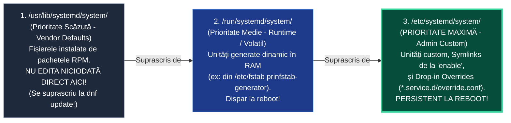

# Capitolul 2.1: Secvența de Boot, GRUB2, `systemd`, Targets și Resetarea Parolei de Root (Primul Task din EX200!)

> ### Obiectivul Capitolului, Ponderea în Examenul EX200 & Regula de Aur a Persistenței
>
> * **Obiectivul Capitolului:** Înțelegerea completă, etapă cu etapă, a secvenței de pornire a unui server Red Hat Enterprise Linux (RHEL 9 / RHEL 10) de la apăsarea butonului de Power (Firmware **BIOS/UEFI** -> Bootloader **GRUB2** -> Kernel **`vmlinuz`** & **`initramfs` / `dracut`** -> **`systemd` PID 1** -> **Targets**), stăpânirea arhitecturii de unități `systemd` (`/usr/lib/systemd/system/` vs. `/etc/systemd/system/`, `enable`, `mask`, Drop-in Overrides), schimbarea țintelor de boot (`multi-user.target` vs. `graphical.target`), configurarea jurnalului persistent `journald` (`/var/log/journal`) și stăpânirea cu ochii închiși a procedurii oficiale de spargere și resetare a parolei de `root` pe `node2` (**`rd.break`** vs. **`init=/bin/sh`**, **`chroot /sysroot`** și reetichetarea SELinux **`/.autorelabel`**).
>
> * **Ponderea în Examenul EX200:** **DECISIVĂ — „MAKE OR BREAK” (50% din întregul examen depinde de acest capitol!).**
>   * **Resetarea parolei de `root` pe `node2`:** Așa cum am stabilit în Capitolul 0.1, la începutul examenului EX200 nu cunoști parola de `root` a celei de-a doua mașini virtuale (`node2`). Dacă nu reușești să resetezi parola de `root` în primele 5 minute (sau dacă uiți pasul `touch /.autorelabel` și blochezi SELinux-ul la boot!), pierzi 100% din punctele de pe `node2` și pici examenul automat!
>   * În plus, în examen vei avea task-uri directe pentru: setarea target-ului implicit de boot (`systemctl set-default`), modificarea parametrilor de kernel în GRUB2 (`/etc/default/grub` + `grub2-mkconfig`), configurarea persistenței pentru `journalctl` și activarea serviciilor.
>
> * **Regula de Aur a Persistenței (EX200 Survival Rule):**
>   1. **La GRUB2:** Orice parametru adăugat manual apăsând tasta `e` în meniul GRUB la pornire (cum este `rd.break` sau `systemd.unit=emergency.target`) este **100% temporar** (doar pentru acel boot). Pentru a face un parametru de kernel persistent la fiecare reboot, trebuie adăugat pe linia **`GRUB_CMDLINE_LINUX`** din **`/etc/default/grub`** și compilat în `/boot/grub2/grub.cfg` rulând **`grub2-mkconfig -o /boot/grub2/grub.cfg`**!
>   2. **La `systemd`:** `systemctl start <serviciu>` sau `systemctl isolate multi-user.target` sunt acțiuni doar de runtime! Pentru persistență la reboot, folosește **`systemctl enable --now <serviciu>`** și **`systemctl set-default multi-user.target`**!

---

## 1. Introducerea Profesorului & Analogia Vizuală

De ce are nevoie nucleul Linux (`vmlinuz`) de un fișier auxiliar numit **`initramfs` (*Initial RAM Filesystem*)** ca să poată porni? Aceasta este întrebarea care separă inginerii adevărați de cei care doar tastează comenzi de pe foi.

Gândește-te la următorul paradox arhitectural (***The Chicken-and-Egg Problem of Linux Boot***):

Ca să păstreze kernelul Linux (`vmlinuz`) mic, rapid și modular (doar ~12 MB), Red Hat nu compilează toate driverele de stocare din lume (LVM, RAID, XFS, criptare LUKS, iSCSI, NVMe) direct în interiorul fișierului `vmlinuz`. Aceste drivere sunt stocate ca module separate (`.ko`) pe discul principal în directorul `/lib/modules/<kernel-version>/`, care se află pe partiția rădăcină `/` (montată pe un volum LVM formatat XFS).

**Paradoxul:** Cum poate kernelul la pornire să monteze volumul LVM și partiția XFS `/` pentru a-și încărca driverele de LVM și XFS din `/lib/modules/`, când el nu are încă driverele de LVM și XFS ca să poată citi partiția `/`?!

### Analogia Vizuală: Chirurgul (Kernelul), Trusa de Prim-Ajutor din Elicopter (`initramfs`) și Sala de Operații Reală (`/sysroot` -> `/`)

Imaginează-ți secvența de boot a serverului RHEL ca pe o **Misiune Medicală de Urgență**:

1. **BIOS / UEFI + Bootloader-ul GRUB2:** Este **Elicopterul SMURD**. El știe doar să decoleze de pe pista de aterizare simplă (partiția necriptată `/boot`) și să îi arunce din aer pe **Chirurg (`vmlinuz`)** împreună cu **Rucsacul lui de Urgență** în Memoria RAM (**`initramfs`**).
2. **`initramfs` (*Initial RAM Filesystem*):** Este **Cortul Mobil Gonflabil** instalat în RAM. În acest cort mic există un mini-Linux temporar care are exact cheile și uneltele necesare (driverele `xfs.ko`, `dm-mod.ko` pentru LVM) ca să descuie ușa blindată a Spitalului Real de pe Disc!
3. **Montarea `/sysroot` și `switch_root`:** Din interiorul cortului gonflabil (`initramfs`), mini-sistemul descuie ușa Spitalului Real (partiția `/` de pe disc) și o atașează temporar la o intrare laterală numită **`/sysroot`**. Odată ce ușa este deschisă, chirurgul se mută definitiv în Spitalul Real (**`switch_root`**), demontează cortul din RAM și îl trezește pe **Directorul General al Spitalului (`systemd` — PID 1)**!

**Cum funcționează spargerea parolei de `root` cu `rd.break` în această analogie?**
Parametrul **`rd.break`** (*RamDisk Break*) îi spune elicopterului: *„Oprește secvența de boot cu o secundă ÎNAINTE de a preda spitalul către Directorul General (`systemd`), exact când Spitalul Real este agățat la ușa laterală `/sysroot`!”*. Tu intri în `/sysroot` fără ca nimeni să îți ceară vreo parolă, schimbi parola din seiful `/etc/shadow`, pui biletul pentru ofițerul SELinux (`/.autorelabel`) și lași spitalul să se deschidă cu noua ta parolă!

---

## 2. Arhitectură Internă, Teorie & Mecanică Linux

### 2.1. Anatomia Completă în 6 Etape a Secvenței de Boot în RHEL 9 / RHEL 10

Iată arhitectura internă a pornirii unui server RHEL și punctul exact în care intervine parametrul `rd.break`:

```mermaid
flowchart TD
    Step1["1. Hardware Firmware (UEFI / Legacy BIOS)\n- Execută POST (Power-On Self-Test)\n- UEFI citește partiția FAT32 /boot/efi/EFI/redhat/grubx64.efi\n- Legacy BIOS citește primii 440 bytes (MBR) de pe disc"] --> Step2

    Step2["2. Bootloader: GRUB2 (GRand Unified Bootloader v2)\n- Citește meniul din /boot/grub2/grub.cfg + /boot/loader/entries/*.conf (BLS)\n- Încarcă în memoria RAM două fișiere din /boot:\n  a) Kernelul comprimat: vmlinuz-<version>\n  b) Imaginea RamDisk: initramfs-<version>.img"] --> Step3

    Step3["3. Inițializarea Kernelului în RAM & initramfs (dracut)\n- Kernelul se decomprimă în RAM, detectează CPU/RAM\n- Pornește /init (systemd din initramfs)\n- Încarcă driverele XFS și LVM, activează grupul LVM rhel/root\n- Montează partiția reală '/' în modul READ-ONLY (ro) la calea /sysroot!"] --> BreakPoint

    BreakPoint{"⚡ PUNCTUL DE INTERCEPȚIE EX200:\nExistă parametrul 'rd.break'\nîn /proc/cmdline?"}
    
    BreakPoint -->|"DA! (Mod Resetare Parolă Root)"| RdShell["🛑 initramfs oprește boot-ul și îți deschide\nshell-ul de urgență: switch_root:/#\n(Aici facem: mount -o remount,rw /sysroot -> chroot /sysroot)"]
    
    BreakPoint -->|"NU (Boot Normal)"| Step4["4. Tranziția switch_root\n- Kernelul mută /sysroot în '/' real\n- Eliberează memoria initramfs din RAM\n- Execută /usr/lib/systemd/systemd ca PID 1!"]

    RdShell -->|După două comenzi 'exit'| Step4

    Step4 --> Step5["5. Inițializarea systemd (PID 1)\n- Încarcă politica SELinux în Kernel\n- Citește /etc/systemd/system/default.target\n- Montează în paralel toate partițiile din /etc/fstab\n- Dacă există fișierul '/.autorelabel', reetichetează SELinux pe tot discul!"]

    Step5 --> Step6["6. Atingerea Target-ului Final & Login\n- multi-user.target (CLI: pornește sshd, crond, agetty pe tty1-6)\n- sau graphical.target (GUI: pornește gdm / GNOME Display Manager)"]

    style Step1 fill:#1e293b,stroke:#64748b,color:#ffffff
    style Step2 fill:#1e3a8a,stroke:#60a5fa,color:#ffffff
    style Step3 fill:#312e81,stroke:#818cf8,color:#ffffff
    style BreakPoint fill:#b91c1c,stroke:#f87171,color:#ffffff,stroke-width:3px
    style RdShell fill:#7f1d1d,stroke:#fca5a5,color:#ffffff,stroke-width:2px
    style Step4 fill:#065f46,stroke:#34d399,color:#ffffff
    style Step5 fill:#064e3b,stroke:#34d399,color:#ffffff
    style Step6 fill:#0f172a,stroke:#38bdf8,color:#ffffff,stroke-width:2px
```



---

### 2.2. PROCEDURA OFICIALĂ EX200: Spargerea și Resetarea Parolei de `root` pe `node2` (Memorare Obligatorie!)

În primele 5 minute ale examenului EX200, deschizi consola grafică (**VM Console**) a mașinii virtuale `node2` (căreia nu îi știi parola de `root`) și urmezi acești **7 Pași Chirurgicali**:

#### Metoda #1 (Recomandată Oficial pentru RHEL 9): Metoda `rd.break` + `/.autorelabel`

**Pasul 1 (Interceptarea Meniului GRUB2):**
Dă Reboot / Reset mașinii virtuale `node2`. Imediat ce apare meniul cu lista de kernele din GRUB2 (ai la dispoziție 5 secunde!), apasă săgeată-sus/jos pentru a opri cronometrul, selectează primul kernel din listă (cel normal, nu *rescue*) și apasă tasta **`e`** (de la *Edit*).

**Pasul 2 (Adăugarea parametrului `rd.break`):**
În editorul GRUB, coboară cu săgețile până la linia care începe cu cuvântul **`linux`** (sau `linuxefi`). Apasă tasta **`End`** (sau `Ctrl+e`) pentru a ajunge la capătul acelei linii, pune un spațiu și scrie exact:

```text
rd.break
```

*(Sfat Pro pentru console seriale/KVM unde uneori apare un bug de tastatură: dacă în `rd.break` nu îți merge tastatura, poți adăuga `rd.break enforcing=0` sau poți folosi Metoda #2 cu `rw init=/bin/sh` descrisă mai jos!).*

Apasă acum combinația de taste **`Ctrl + x`** pentru a porni sistemul cu acest parametru!

**Pasul 3 (Remontarea `/sysroot` în mod Read-Write):**
După câteva secunde, boot-ul se oprește la promptul **`switch_root:/#`**. În acest moment, discul real al serverului este montat la calea `/sysroot`, dar este montat **Read-Only (`ro`)**! Pentru a putea modifica `/etc/shadow`, îl remontăm în mod **Read-Write (`rw`)**:

```bash
switch_root:/# mount -o remount,rw /sysroot
```

**Pasul 4 (Intrarea în închisoarea `chroot` pe discul real):**
Schimbăm rădăcina aparentă a terminalului nostru din `initramfs` în `/sysroot` folosind comanda **`chroot` (*Change Root*)**:

```bash
switch_root:/# chroot /sysroot
sh-5.1#
```

*(Din această secundă, comanda `/usr/bin/passwd` și fișierul `/etc/shadow` sunt chiar cele de pe discul real al lui `node2`!)*

**Pasul 5 (Schimbarea Parolei de `root`):**
Rulează comanda `passwd` (sau `echo 'ParolaCerutaInExamen' | passwd --stdin root`) și introdu de două ori noua parolă de `root` cerută în instrucțiunile examenului:

```bash
sh-5.1# passwd root
New password:
Retype new password:
passwd: all authentication tokens updated successfully.
```

**Pasul 6 (PASUL VITAL DE SUPRAVIEȚUIRE SELINUX — `touch /.autorelabel`!):**
**DE CE ESTE ACEST PAS CRITIC?**
În momentul în care ești în `rd.break`, politica SELinux **NU este încă încărcată în Kernel**! Când comanda `passwd` rescrie fișierul `/etc/shadow`, ea creează un Inode nou pentru `/etc/shadow` care **NU are niciun context SELinux (`unlabeled_t`)**!
Dacă acum ai da `exit` fără să repari contextul SELinux, la pornirea serverului daemonul `sshd` și `login` (care rulează sub SELinux Enforcing) nu vor avea voie să citească `/etc/shadow` (`unlabeled_t`), și **NU TE VEI PUTEA LOGA NICI CU NOUA PAROLĂ, NICI CU CEA VECHE!**
Pentru a-i spune lui `systemd` să refacă automat etichetele SELinux la pornire, creăm fișierul ascuns **`.autorelabel`** direct în rădăcina `/`:

```bash
sh-5.1# touch /.autorelabel
```

*(Atenție maximă la ortografie: este slash `/`, urmat imediat de punct `.`, apoi `autorelabel` — fără spațiu între `/` și `.`!)*

**Pasul 7 (Dublul `exit` și Așteptarea Reetichetării):**
Scriem `exit` prima dată pentru a ieși din `chroot`, și `exit` a doua oară pentru a părăsi `initramfs` și a lăsa serverul să își continue boot-ul și reetichetarea SELinux (durează ~60–90 de secunde):

```bash
sh-5.1# exit
switch_root:/# exit
```

> **🔥 SECRETUL RHCA (Metoda #2 pentru RHEL 9.3+ / RHEL 10 și Repararea Instantanee în 2 Secunde FĂRĂ a aștepta `/.autorelabel`!):**
> Pe versiunile noi de RHEL 9.3+ și RHEL 10, sau când vrei să nu aștepți 90 de secunde după `/.autorelabel`, iată două secrete de arhitect:
> 1. **Alternativa `rw init=/bin/sh` în GRUB2:** Dacă pe linia `linux` din GRUB2 înlocuiești cuvântul `ro` cu `rw` și adaugi la capătul liniei `init=/bin/sh`, kernelul montează direct discul în `/` ca Read-Write și îți deschide direct shell-ul `sh-5.1#` fără să mai fie nevoie nici de `mount -o remount,rw /sysroot`, nici de `chroot /sysroot`! (La final, după `passwd` și `touch /.autorelabel`, pornești sistemul cu comanda `exec /sbin/init`!).
> 2. **Cum repari SELinux pe `/etc/shadow` în 2 secunde în loc de `touch /.autorelabel`?** Dacă în interiorul `chroot /sysroot` (sau în `init=/bin/sh`) încarci manual politica SELinux cu `/usr/sbin/load_policy -i` și apoi repari doar fișierul `/etc/shadow` cu `/usr/sbin/restorecon -v /etc/shadow`, eticheta `shadow_t` este pusă pe loc! Însă în examenul EX200, `touch /.autorelabel` rămâne metoda cea mai simplă și imposibil de uitat!

---

### 2.3. Configurarea Persistentă a Bootloader-ului GRUB2 (`/etc/default/grub` & BLS)

În examenul EX200 ți se poate cere: *„Modificați configurația bootloader-ului astfel încât timpul de așteptare în meniul GRUB (timeout) să fie de 10 secunde, și adăugați parametrul `audit=1` (sau ștergeți `rhgb quiet`) din linia de comandă a kernelului în mod persistent.”*

**REGULA DE FIER:** Nu edita **NICIODATĂ** manual fișierul `/boot/grub2/grub.cfg`! El este un fișier compilat automat.
Sursa unică de adevăr pe care o edităm este fișierul **`/etc/default/grub`**:

```bash
# 1. Inspectăm /etc/default/grub:
[root@node1 ~]# cat /etc/default/grub
GRUB_TIMEOUT=5
GRUB_DISTRIBUTOR="$(sed 's, release .*$,,g' /etc/system-release)"
GRUB_DEFAULT=saved
GRUB_DISABLE_SUBMENU=true
GRUB_TERMINAL_OUTPUT="console"
GRUB_CMDLINE_LINUX="crashkernel=1G-4G:192M,4G-64G:256M,64G-:512M resume=/dev/mapper/rhel-swap rd.lvm.lv=rhel/root rd.lvm.lv=rhel/swap rhgb quiet"
GRUB_DISABLE_RECOVERY="true"
GRUB_ENABLE_BLSCFG=true
```

**Cum aplicăm persistent modificările din `/etc/default/grub` în RHEL 9 / RHEL 10?**
După ce ai modificat `GRUB_TIMEOUT` sau `GRUB_CMDLINE_LINUX` în `/etc/default/grub`, trebuie să regenerezi configurația din `/boot` rulând:

```bash
grub2-mkconfig -o /boot/grub2/grub.cfg
```

*(Notă pentru RHEL 9.3+ / RHEL 10 cu **Boot Loader Specification — BLS**: în versiunile noi, dacă modifici `GRUB_CMDLINE_LINUX` în `/etc/default/grub`, pentru ca `grub2-mkconfig` să suprascrie și intrările individuale din `/boot/loader/entries/*.conf`, adaugă flag-ul `--update-bls-cmdline`, sau folosește utilitarul dedicat Red Hat **`grubby`**!):*

```bash
# Metoda 1 (grub2-mkconfig cu actualizarea BLS în RHEL 9.3+ / 10):
grub2-mkconfig -o /boot/grub2/grub.cfg --update-bls-cmdline

# Metoda 2 (Utilitarul oficial Red Hat 'grubby' — adaugă parametrul direct pe TOATE kernelele într-o secundă!):
grubby --update-kernel=ALL --args="audit=1"
# Pentru a șterge un parametru cu grubby:
grubby --update-kernel=ALL --remove-args="rhgb quiet"
# Pentru a verifica ce parametri sunt configurați pentru următorul boot:
grubby --info=DEFAULT
```

---

### 2.4. Arhitectura `systemd` (PID 1), Unități, Drop-ins și Targets

În RHEL 9 / RHEL 10, **`systemd`** este managerul de sistem și servicii (PID 1). El gestionează nu doar servicii (`.service`), ci și puncte de montare (`.mount`), timere (`.timer`), socket-uri (`.socket`), dispozitive (`.device`) și grupuri de unități numite **Targets (`.target`)**.

#### Ierarhia Celor 3 Directoare de Unități `systemd` (Ordinea de Prioritate!)



#### Regula de Aur: Cum modificăm un serviciu existent (`httpd.service`) fără a atinge `/usr/lib/systemd/system/`?

Folosim comanda **`systemctl edit <nume>.service`**! Această comandă creează automat directorul de Drop-in Override `/etc/systemd/system/<nume>.service.d/override.conf`, unde scriem doar directiva pe care vrem să o schimbăm (de ex., `Restart=always` sau `Nice=-5`), urmată obligatoriu de **`systemctl daemon-reload`**!

#### Tabelul Comenzilor `systemctl` Esențiale pentru Examenul EX200

| Comandă `systemctl` | Efect Runtime (Acum) | Efect la Boot (Persistent) | Ce face tehnic sub capotă? |
| :--- | :--- | :--- | :--- |
| **`systemctl start sshd`** | Pornește serviciul | Niciunul! | Pornește procesul, dar dacă nu era `enabled`, nu va porni la reboot. |
| **`systemctl enable sshd`** | Niciunul! | Activează la boot | Creează un Symbolic Link din `/etc/systemd/system/multi-user.target.wants/sshd.service` către `/usr/lib/systemd/system/sshd.service`. |
| **`systemctl enable --now sshd`** | Pornește ACUM | Activează la BOOT | **COMANDA REGE ÎN EX200!** Face și `enable`, și `start` într-un singur pas! |
| **`systemctl disable --now sshd`** | Oprește acum | Dezactivează la boot | Șterge symlink-ul din `/etc/systemd/system/` și oprește procesul. |
| **`systemctl mask sshd`** | — | Blocare Totală! | Creează un symlink `/etc/systemd/system/sshd.service -> /dev/null`! Un serviciu mascat (*masked*) nu mai poate fi pornit nici manual de `root`, nici automat de alt serviciu, până nu rulezi `systemctl unmask sshd`! |
| **`systemctl daemon-reload`** | Reîncarcă unitățile | — | **OBLIGATORIU** după orice modificare în `/etc/systemd/system/` sau în `/etc/fstab`! |

#### `systemd` Targets (Înlocuitorul vechilor SysVinit Runlevels)

Un **Target (`.target`)** este un punct de sincronizare care grupează mai multe servicii ce trebuie pornite împreună pentru a aduce sistemul într-o anumită stare:

| Numele `systemd` Target | Vechiul Runlevel | Ce servicii pornește și când îl folosim în EX200? |
| :--- | :---: | :--- |
| **`graphical.target`** | Runlevel 5 | Sistem complet cu rețea, multi-utilizator ȘI Interfață Grafică (GUI — GNOME / GDM). |
| **`multi-user.target`** | Runlevel 3 | **FAVORITUL EX200!** Sistem complet de server cu rețea, SSH, servicii și multi-utilizator, doar în Linie de Comandă (CLI — fără GUI). |
| **`rescue.target`** | Runlevel 1 (Single-User) | Montează toate sistemele de fișiere locale, pornește câteva servicii de bază (fără rețea/SSH) și cere parola de `root` pentru depanare. |
| **`emergency.target`** | Emergency Shell | Starea în care cade serverul când ai greșit `/etc/fstab`! Montează doar `/` în mod Read-Only (`ro`), nu pornește niciun serviciu și deschide un shell minimal de avarie. |

**Cele 3 comenzi pentru Targets în Examenul EX200:**

```bash
# 1. Verificăm care este target-ul implicit de boot:
systemctl get-default

# 2. Schimbăm PERSISTENT target-ul implicit la boot (de ex. în multi-user.target):
systemctl set-default multi-user.target

# 3. Comutăm IMEDIAT (la runtime, fără reboot) în noul target:
systemctl isolate multi-user.target
```

---

### 2.5. Configurarea Jurnalului Persistent `systemd-journald` (`/var/log/journal`)

Serviciul **`systemd-journald`** colectează toate mesajele de la kernel, `initramfs` și toate serviciile `systemd`. Putem interoga aceste loguri cu comanda **`journalctl`**:

* `journalctl -xe` (ultimele erori cu explicații);
* `journalctl -u sshd.service` (doar logurile serviciului `sshd`);
* `journalctl -p err` (doar mesajele cu severitate *Error (3)* sau mai gravă: *Crit, Alert, Emerg*);
* `journalctl -b -1` (logurile de la boot-ul anterior — disponibil doar dacă jurnalul este persistent!).

#### Subiect Clasic EX200 — Cum facem `journald` Persistent la Reboot?

Dacă în `/etc/systemd/journald.conf` directiva este `Storage=auto` (implicit), `journald` verifică la boot dacă există pe disc directorul `/var/log/journal`. Dacă nu există, scrie logurile în `/run/log/journal` (în RAM — se șterg la reboot!).

Pentru a face jurnalul 100% persistent pe disc în examen:

```bash
# Metoda 1 (Crearea directorului /var/log/journal și aplicarea permisiunilor prin systemd-tmpfiles):
mkdir -p /var/log/journal
systemd-tmpfiles --create --prefix /var/log/journal
systemctl restart systemd-journald

# Metoda 2 (Setarea explicită Storage=persistent în /etc/systemd/journald.conf):
sed -i 's/^#*Storage=.*/Storage=persistent/' /etc/systemd/journald.conf
systemctl restart systemd-journald
```

---

## 3. Cutia cu Secrete RHCA & Capcane Mortale de Examen (Exam Killers & Man Page Hacks)

### 💀 Capcana Mortală #1: Scrierea greșită a lui `touch /.autorelabel` la Resetarea Parolei de Root!
Aceasta este greșeala care a picat cei mai mulți candidați în istoria examenului RHCSA!
În graba primelor 5 minute, când ești în `chroot /sysroot`, dacă scrii:
* `touch /autorelabel` (fără punctul `.` în fața lui `autorelabel`!) SAU
* `touch ./autorelabel` (dacă nu ești în `/`) SAU
* `touch /.autolabel` (ai mâncat silaba `re`!),

atunci `systemd` nu va găsi fișierul `/.autorelabel` la boot, nu va reeticheta `/etc/shadow`, și vei rămâne blocat în afara mașinii `node2` pentru tot restul examenului!
* **Regula de Aur RHCA:** După ce ai rulat `touch /.autorelabel`, verifică cu `ls -la /.autorelabel` că fișierul există exact acolo și este scris literă cu literă corect!

### 💀 Capcana Mortală #2: Uitarea comenzii `chroot /sysroot` după `mount -o remount,rw /sysroot`!
Dacă în `rd.break` remontezi `/sysroot` în `rw`, dar uiți să rulezi `chroot /sysroot` și rulezi direct `passwd root`, tu schimbi parola din memoria RAM a lui `initramfs`, nu parola de pe discul real din `/sysroot/etc/shadow`! La reboot, parola ta nu va funcționa!

### 🛠️ Man Page Hacks pentru Capitolul 2.1
Ai uitat în timpul examenului cum se configurează `/etc/systemd/journald.conf`?
Rulează:
```bash
man journald.conf
```
Acolo vei vedea clar explicația pentru `Storage=persistent` și calea `/var/log/journal`!

---

## 4. Pregătire pentru Interviu (Linux SysAdmin & DevOps Job Readiness)

### Întrebarea 1 (Nivel Mid -> Senior):
> **Intervievator:** *„Încerci să pornești un serviciu cu `systemctl start httpd`, dar primești eroarea: `Failed to start httpd.service: Unit is masked.` Ce înseamnă că o unitate `systemd` este `masked`, prin ce diferă de `disabled` și cum o repari?”*

**Răspunsul Ideal:**
> „1. O unitate **`disabled`** nu pornește automat la boot (nu are symlink în `.target.wants/`), dar poate fi pornită oricând manual cu `systemctl start` sau automat ca dependență a altui serviciu.
> 2. O unitate **`masked`** are un Symbolic Link creat în `/etc/systemd/system/<unitate>.service` care pointează direct către `/dev/null`! Deoarece `/etc/systemd/system/` are prioritate maximă în `systemd`, când `systemd` încearcă să citească unitatea, citește `/dev/null` (0 bytes) și blochează complet pornirea serviciului, atât manual cât și prin dependențe.
>
> **Cum o repar:** Rulez `systemctl unmask httpd.service` (care șterge symlink-ul către `/dev/null`), apoi `systemctl enable --now httpd.service`.”

---

## 5. Laboratorul Practic Explicat & Scenarii de Examen (Hands-On Lab pe `node2` și `node1`)

### Pasul 1: Antrenament Cronometrat — Spargerea Parolei de `root` pe `node2.lab.example.com`

Deschide consola virtuală (VM Console din `virt-manager` / VMware / VirtualBox) pentru `node2` și exersează chiar acum procedura până o poți face în sub 2 minute fără să te uiți pe notițe:

```bash
# 1. Dă Reboot la node2 și apasă 'e' în meniul GRUB2.
# 2. La capătul liniei care începe cu 'linux', adaugă:
rd.break
# 3. Apasă Ctrl + x pentru a boota.
# 4. La promptul switch_root:/#, execută exact cele 6 comenzi:
switch_root:/# mount -o remount,rw /sysroot
switch_root:/# chroot /sysroot
sh-5.1# echo 'RedHatExam123!' | passwd --stdin root
sh-5.1# touch /.autorelabel
sh-5.1# ls -la /.autorelabel
sh-5.1# exit
switch_root:/# exit
```

Așteaptă finalizarea reetichetării SELinux și conectează-te prin SSH de pe `node1` pe `node2` (`ssh root@192.168.122.102`) folosind parola `RedHatExam123!`!

### Pasul 2: Configurarea GRUB2, Targets și `journald` Persistent pe `node1`

```bash
# 1. Setăm target-ul implicit de boot pe multi-user.target:
[root@node1 ~]# systemctl set-default multi-user.target
[root@node1 ~]# systemctl get-default
multi-user.target

# 2. Modificăm timeout-ul GRUB2 la 10 secunde în /etc/default/grub și regenerăm grub.cfg:
[root@node1 ~]# sed -i 's/^GRUB_TIMEOUT=.*/GRUB_TIMEOUT=10/' /etc/default/grub
[root@node1 ~]# grub2-mkconfig -o /boot/grub2/grub.cfg

# 3. Configurăm systemd-journald să stocheze logurile persistent pe disc în /var/log/journal:
[root@node1 ~]# mkdir -p /var/log/journal
[root@node1 ~]# systemd-tmpfiles --create --prefix /var/log/journal
[root@node1 ~]# sed -i 's/^#*Storage=.*/Storage=persistent/' /etc/systemd/journald.conf
[root@node1 ~]# systemctl restart systemd-journald
[root@node1 ~]# ls -la /var/log/journal/
```

---

## 6. Simulare de Examen EX200 (3 Task-uri Practice Cronometrate + 5 Întrebări de Diagnosticare)

Pune-ți cronometrul pe **15 minute** și rezolvă pe **`node1.lab.example.com`**:

### Partea A: Cele 3 Task-uri Practice (Stil Oficial EX200)

1. **Task 1 (Systemd Default Target & Service Masking):**
   Configurați sistemul `node1` astfel încât la pornire să intre automat în modul linie de comandă multi-utilizator fără interfață grafică (`multi-user.target`). În plus, blocați complet serviciul `postfix.service` (sau `bluetooth.service` / `cups.service` — pentru acest laborator vom folosi unitatea `rpcbind.socket` sau vom crea o unitate de test `/etc/systemd/system/legacy-app.service` pe care să o mascați) astfel încât serviciul `kdump.service` să fie oprit, dezactivat și mascat (`masked`) pentru a nu putea fi pornit nici manual, nici automat.
2. **Task 2 (Modificarea Parametrilor de Boot în GRUB2):**
   Configurați bootloader-ul GRUB2 astfel încât meniul de pornire să aștepte **8 secunde** înainte de a porni sistemul de operare implicit, și adăugați parametrul de kernel **`mitigations=auto`** la linia de comandă a kernelului în mod persistent (atât în `/etc/default/grub`, cât și aplicat pe intrările de boot curente).
3. **Task 3 (Persistența Jurnalului `systemd-journald` & Extragerea Erorilor):**
   Configurați serviciul `systemd-journald` astfel încât jurnalele de sistem să fie păstrate persistent după repornirea serverului în `/var/log/journal`. Apoi, extrageți toate mesajele din jurnalul de sistem curent (`-b`) care au prioritatea `err` (sau mai gravă) și salvați-le în fișierul `/root/boot_errors.log`.

### Partea B: Cele 5 Întrebări de Diagnosticare

1. Ce se întâmplă la reboot după ce ai schimbat parola de `root` în modul `rd.break` dacă ai uitat să rulezi `touch /.autorelabel`?
2. De ce este montat `/sysroot` în mod Read-Only (`ro`) în momentul în care `rd.break` oprește secvența de boot?
3. Care este diferența dintre `systemctl set-default multi-user.target` și `systemctl isolate multi-user.target`?
4. În care dintre cele 3 directoare `systemd` (`/usr/lib/systemd/system/`, `/run/systemd/system/` sau `/etc/systemd/system/`) au fișierele prioritatea cea mai mare?
5. Cum verifici după reboot că un parametru de kernel adăugat în GRUB2 a fost într-adevăr preluat de kernelul care rulează acum?

---

### Rezolvare Completă, Script de Verificare (Grading Script) și Explicații (Profesorul Explică)

#### Rezolvarea Pas cu Pas a Task-urilor Practice:

##### Rezolvare Task 1 (`multi-user.target` + Mascarea `kdump.service`):
```bash
# 1. Setăm target-ul implicit la multi-user.target:
systemctl set-default multi-user.target

# 2. Oprim, dezactivăm și mascăm kdump.service:
systemctl disable --now kdump.service 2>/dev/null
systemctl mask kdump.service
```

##### Rezolvare Task 2 (`GRUB_TIMEOUT=8` + parametrul `mitigations=auto`):
```bash
# 1. Modificăm GRUB_TIMEOUT=8 și adăugăm mitigations=auto în /etc/default/grub:
sed -i 's/^GRUB_TIMEOUT=.*/GRUB_TIMEOUT=8/' /etc/default/grub
if ! grep -q "mitigations=auto" /etc/default/grub; then
    sed -i 's/^GRUB_CMDLINE_LINUX="/GRUB_CMDLINE_LINUX="mitigations=auto /' /etc/default/grub
fi

# 2. Aplicăm cu grubby (pentru intrările BLS) și regenerăm /boot/grub2/grub.cfg:
grubby --update-kernel=ALL --args="mitigations=auto"
grub2-mkconfig -o /boot/grub2/grub.cfg
```

##### Rezolvare Task 3 (`journald` persistent + `/root/boot_errors.log`):
```bash
mkdir -p /var/log/journal
systemd-tmpfiles --create --prefix /var/log/journal
sed -i 's/^#*Storage=.*/Storage=persistent/' /etc/systemd/journald.conf
systemctl restart systemd-journald

# Extragem mesajele cu prioritate err (-p err) din boot-ul curent (-b):
journalctl -b -p err > /root/boot_errors.log
```

#### Răspunsurile la Întrebările de Diagnosticare:
1. Fișierul `/etc/shadow` rămâne fără context SELinux (`unlabeled_t`), iar la pornirea sistemului procesele `login` și `sshd` sunt blocate de SELinux să citească `/etc/shadow`, făcând autentificarea imposibilă.
2. Deoarece în acea etapă timpurie a lui `initramfs`, sistemul de fișiere rădăcină este montat inițial `ro` pentru verificări de integritate, înainte de tranziția `switch_root`.
3. `set-default` schimbă symlink-ul `/etc/systemd/system/default.target` pentru următorul boot, în timp ce `isolate` schimbă starea sistemului imediat (la runtime), fără a modifica setarea de la boot.
4. **`/etc/systemd/system/`**.
5. Citind fișierul virtual **`cat /proc/cmdline`**!

#### Scriptul de Verificare Automată (Grading Script pentru Capitolul 2.1)

```bash
#!/bin/bash
# ==============================================================================
# RHCSA (EX200) - Script Automat de Evaluare: Capitolul 2.1
# ==============================================================================
SCORE=0
TOTAL=30

echo "========================================================"
echo " Evaluare Obiective Capitolul 2.1 pe $(hostname)"
echo "========================================================"

# Verificare Task 1: multi-user.target + kdump masked
if [[ $(systemctl get-default) == "multi-user.target" ]] && \
   [[ $(systemctl is-enabled kdump.service 2>/dev/null) == "masked" ]]; then
    echo "[ PASS ] Task 1: Default target este multi-user.target și kdump.service este masked (+10p)"
    SCORE=$((SCORE + 10))
else
    echo "[ FAIL ] Task 1: Default target nu este multi-user.target sau kdump.service nu este masked (0p)"
fi

# Verificare Task 2: GRUB_TIMEOUT=8 + mitigations=auto
if grep -qE "^GRUB_TIMEOUT=8" /etc/default/grub && \
   grep -q "mitigations=auto" /etc/default/grub && \
   grubby --info=DEFAULT | grep -q "mitigations=auto"; then
    echo "[ PASS ] Task 2: GRUB2 este configurat cu timeout 8s și parametrul mitigations=auto (+10p)"
    SCORE=$((SCORE + 10))
else
    echo "[ FAIL ] Task 2: Configurația GRUB2 (/etc/default/grub sau BLS) este incompletă (0p)"
fi

# Verificare Task 3: /var/log/journal persistent + /root/boot_errors.log
if [[ -d /var/log/journal ]] && \
   grep -qE "^Storage=persistent" /etc/systemd/journald.conf && \
   [[ -f /root/boot_errors.log ]]; then
    echo "[ PASS ] Task 3: Jurnalul systemd-journald este persistent în /var/log/journal și /root/boot_errors.log există (+10p)"
    SCORE=$((SCORE + 10))
else
    echo "[ FAIL ] Task 3: Jurnalul nu este persistent sau /root/boot_errors.log lipsește (0p)"
fi

echo "--------------------------------------------------------"
echo " PUNCTAJ FINAL CAPITOLUL 2.1: $SCORE / $TOTAL"
echo "========================================================"
```

---

## 7. Bibliografie Oficială Red Hat și Surse de Aprofundare

1. **Cursurile Oficiale Red Hat:**
   * **RH124 (*Red Hat System Administration I*):** Capitolul 9 (*Control Services and Daemons* — `systemctl`) și Capitolul 11 (*Analyze and Store Logs* — `journalctl`, `/var/log/journal`).
   * **RH134 (*Red Hat System Administration II*):** Capitolul 9 (*Control the Boot Process* — GRUB2, Targets, `rd.break`, `chroot`, `/.autorelabel`).
2. **Pagini de Manual (`man`) Esențiale din Sistem:**
   * `man 1 systemctl`, `man 5 systemd.unit`, `man 7 bootup`
   * `man 8 dracut.cmdline` (Documentația oficială pentru `rd.break`!)
   * `man 8 grubby`, `man 8 grub2-mkconfig`
   * `man 1 journalctl`, `man 5 journald.conf`
