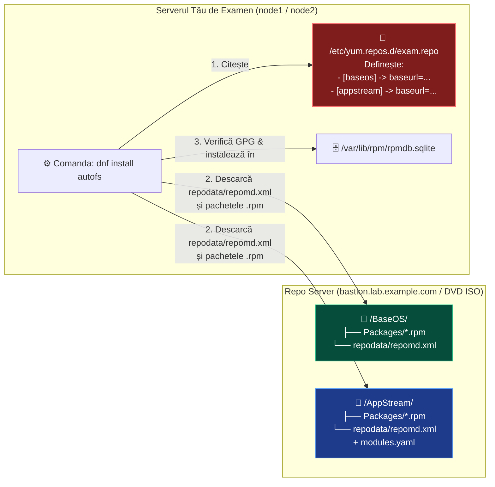

# Capitolul 2.2: Gestiunea Pachetelor Software (`rpm`, `dnf`, Repo-uri Locale/Remote, AppStreams & `Flatpak`)

> ### Obiectivul Capitolului, Ponderea în Examenul EX200 & Regula de Aur a Persistenței
>
> * **Obiectivul Capitolului:** Stăpânirea arhitecturii interne a sistemului de pachete **RPM (*Red Hat Package Manager*)** și a rezolvatorului modern de dependențe **DNF (*Dandified YUM*)**, interogarea avansată a bazei de date `/var/lib/rpm` (`rpm -qa`, `-qf`, `-ql`, `-qc`, `-qp --scripts`, `-Va`), configurarea manuală și automată a depozitelor software în **`/etc/yum.repos.d/*.repo`** (diferența fundamentală dintre **`BaseOS`** și **`AppStream`**), montarea unui ISO local ca depozit persistent pentru laborator, gestionarea fluxurilor modulare (**Application Streams / `dnf module`**) și a aplicațiilor izolate prin **`Flatpak`**.
>
> * **Ponderea în Examenul EX200:** **CRITICĂ — „GATEKEEPER TASK” (10% punctaj direct + 50% impact de blocaj asupra restului examenului!).**
>   În primele 20 de minute ale examenului EX200 (imediat după ce ai resetat parola de `root` pe `node2` și ai configurat rețeaua), **Task-ul #1 pe ambele mașini virtuale (`node1` și `node2`)** este:
>   * *„Configurați sistemul să utilizeze depozitele software oficiale disponibile la adresele `http://content.example.com/rhel9.0/x86_64/dvd/BaseOS` și `http://content.example.com/rhel9.0/x86_64/dvd/AppStream`.”*
>   * **De ce este un Gatekeeper Task?** Mașinile din examen vin fără niciun repository configurat! Dacă nu configurezi corect fișierul `.repo` în `/etc/yum.repos.d/`, **nu vei putea instala pachetele `autofs`, `httpd`, `container-tools` (Podman), `vdo`, `stratisd` sau `tuned`** și vei pica jumătate din subiectele examenului!
>
> * **Regula de Aur a Persistenței (EX200 Survival Rule):**
>   1. Orice depozit software trebuie definit într-un fișier terminat obligatoriu în extensia **`.repo`** în interiorul directorului **`/etc/yum.repos.d/`**!
>   2. Dacă în propriul tău *Home Lab* (sau într-un scenariu de examen cu ISO local) folosești o imagine `.iso` montată local drept sursă pentru `BaseOS` și `AppStream`, **nu o monta doar manual cu `mount /dev/sr0 /mnt`**, căci la reboot-ul de evaluare montarea dispare și depozitele `dnf` devin invalide (**0 puncte**)! Montează întotdeauna ISO-ul persistent prin **`/etc/fstab`**!

---

## 1. Introducerea Profesorului & Analogia Vizuală

De ce avem nevoie în Red Hat Enterprise Linux de **două** unelte diferite pentru pachete — **`rpm`** și **`dnf`** (vechiul `yum`) — și de ce este împărțit software-ul din RHEL 8, RHEL 9 și RHEL 10 în două depozite separate numite **`BaseOS`** și **`AppStream`**?

În anii '90, când instalai un pachet cu comanda de nivel jos `rpm -ivh httpd.rpm`, primeai adesea o listă frustrantă de erori: *„httpd are nevoie de librăria A; librăria A are nevoie de librăria B; librăria B are nevoie de librăria C”* — fenomen cunoscut în istoria Linux drept **„Dependency Hell” (Iadul Dependențelor)**.

### Analogia Vizuală: Constructorul cu Cărămizi (`rpm`), Arhitectul Aprovizionării (`dnf`) și Cele Două Aripi ale Clădirii (`BaseOS` vs. `AppStream`)

Imaginează-ți administrarea software-ului pe serverul tău RHEL astfel:

1. **Fișierul `.rpm` și Comanda `rpm`:** Comanda **`rpm`** este **Meșterul Zidar Orb**. Dacă îi dai în mână o cutie sigilată (`.rpm`), el știe să verifice sigiliul criptografic (**GPG Key**), să despacheteze fișierele în `/usr/bin` și `/etc` și să noteze în registrul clădirii (`/var/lib/rpm`) fiecare șurub instalat. Dar meșterul `rpm` **nu are acces la internet/rețea** și **nu știe de unde să aducă piesele lipsă**! Dacă îi lipsește un șurub (*o dependență*), se oprește și refuză lucrarea.
2. **Comanda `dnf` (*Dandified YUM*):** Este **Inginerul Șef de Aprovizionare**. Când îi spui `dnf install httpd`, el citește cataloagele furnizorilor din `/etc/yum.repos.d/*.repo`, descarcă automat metadatele (`repomd.xml`), calculează matematic tot arborele de dependențe (folosind biblioteca ultra-rapidă `libsolv` scrisă în C), descarcă toate cele 15 pachete `.rpm` necesare din rețea și, la final, **îl cheamă sub capotă tot pe meșterul `rpm`** ca să le instaleze în ordinea corectă!
3. **De ce există `BaseOS` și `AppStream`?**
   * **`BaseOS` (Fundația de Beton a Clădirii):** Conține nucleul sistemului de operare (Kernelul `vmlinuz`, `systemd`, `glibc`, `bash`, `lvm2`, `Chronyd`). Aceste componente au o singură versiune fixă și un ciclu de viață strict legat de cei 10 ani ai sistemului de operare.
   * **`AppStream` (*Application Stream* — Mobilierul și Echipamentele Modulare din Clădire):** Dezvoltatorii nu vor să fie blocați timp de 10 ani cu o versiune veche de Python, PHP, Node.js, PostgreSQL, Nginx sau Podman! De aceea, Red Hat a separat aplicațiile și limbajele de programare în depozitul **`AppStream`**, unde poți alege între mai multe versiuni paralele (de exemplu PostgreSQL 13, 15 sau 16) care primesc actualizări rapide, fără a destabiliza fundația `BaseOS`!

---

## 2. Arhitectură Internă, Teorie & Mecanică Linux

### 2.1. Anatomia unui Pachet `.rpm` și Comanda de Nivel Jos `rpm`

* **RPM (*RPM Package Manager*, inițial *Red Hat Package Manager*):**
  * *(1) Origine:* Creat în 1997 de Erik Troan și Marc Ewing pentru Red Hat Linux 5.0.
  * *(2) Ce reprezintă:* Formatul standardizat de pachete binare în ecosistemul Enterprise Linux (RHEL, Fedora, CentOS Stream, SUSE, Oracle Linux, AlmaLinux, Rocky Linux).
  * *(3) Cum funcționează tehnic sub capotă:* Un fișier `.rpm` este o arhivă comprimată **`cpio`** (cu `xz` sau `zstd`) precedată de un **Header RPM** care conține:
    * Semnătura criptografică **GPG (*GNU Privacy Guard*)** a lui Red Hat;
    * Metadatele (Nume, Versiune, Release, Arhitectură, listă de dependențe `Requires` și `Provides`);
    * Hash-ul criptografic **SHA-256** individual, permisiunile DAC, proprietarul și contextul **SELinux** pentru **fiecare fișier** din arhivă;
    * Scripturile de instalare/dezinstalare (**Scriptlets:** `%pre`, `%post`, `%preun`, `%postun` — de exemplu scriptul care creează automat utilizatorul de sistem `apache` înainte de a copia fișierele!).
  * Toate aceste metadate sunt salvate local în baza de date **SQLite** din **`/var/lib/rpm/rpmdb.sqlite`**!

#### Convenția Oficială de Denumire a unui Pachet RPM (N-V-R-A)

$$\underbrace{\text{httpd}}_{\text{1. Name (Nume)}} - \underbrace{\text{2.4.57}}_{\text{2. Version (Upstream)}} - \underbrace{\text{11.el9\_4.1}}_{\substack{\text{3. Release Red Hat}\\\text{(Backports \& DistTag)}}} . \underbrace{\text{x86\_64}}_{\substack{\text{4. Architecture}\\\text{(x86\_64, aarch64, noarch)}}} . \text{rpm}$$

* *(Notă: Arhitectura **`noarch`** înseamnă că pachetul nu conține cod binar compilat pentru un anumit procesor, ci doar scripturi Bash/Python, documentație sau fișiere de configurare care merg pe orice procesor!)*

#### Tabelul Comenzilor `rpm` de Interogare și Verificare (Favorite în EX200 & Troubleshooting!)

Comanda `rpm -q` (*Query*) interoghează instantaneu baza de date locală `/var/lib/rpm` fără a avea nevoie de rețea:

| Comandă `rpm` | Semnificația Flag-urilor | Ce problemă îți rezolvă în Examenul EX200 și în Producție? |
| :--- | :--- | :--- |
| **`rpm -qa`** *(+ `\| grep ...`)* | `-q` (*query*), `-a` (*all*) | Listează **toate** pachetele RPM instalate pe server. |
| **`rpm -qf /etc/chrony.conf`** | `-f` (*file*) | **SALVATOR ÎN EXAMEN!** Îți spune exact **cărui pachet RPM îi aparține un anumit fișier de pe disc**! *(Dacă ai șters din greșeală `/etc/chrony.conf`, afli cu `rpm -qf` că vine din pachetul `chrony` și îl recuperezi cu `dnf reinstall chrony`!)* |
| **`rpm -ql chrony`** | `-l` (*list*) | Listează **toate fișierele și directoarele** instalate de pachetul `chrony` (ideal ca să vezi cum se numește unitatea `.service` a unui pachet proaspăt instalat!). |
| **`rpm -qc chrony`** | `-c` (*configfiles*) | **MINĂ DE AUR ÎN EX200!** Afișează **DOAR fișierele de configurare (din `/etc`)** ale pachetului! Nu mai pierzi timp căutând prin sistem unde își ține un serviciu configurația! |
| **`rpm -qd chrony`** | `-d` (*docfiles*) | Afișează **DOAR fișierele de documentație și exemple** (din `/usr/share/doc` și `/usr/share/man`) ale pachetului! |
| **`rpm -qi chrony`** | `-i` (*info*) | Afișează descrierea detaliată, versiunea, data instalării și licența pachetului. |
| **`rpm -qp --scripts pachet.rpm`** | `-p` (*package file*), `--scripts` | Inspectează un fișier `.rpm` **NEINSTALAT încă** (de pe disc) și îți arată ce scripturi ascunse va rula ca `root` dacă îl instalezi! *(Esential pentru securitate!)* |
| **`rpm -V chrony`** *(sau `rpm -Va`)* | `-V` (*Verify*) | **AUDIT DE SECURITATE / TROUBLESHOOTING:** Compară toate fișierele de pe disc cu hash-urile SHA-256 și permisiunile originale din baza de date `/var/lib/rpm`! Îți arată imediat dacă cineva a modificat un fișier de configurare (`S` = Size, `5` = MD5/SHA256 sum, `M` = Mode/Permissions, `U` = User)! |

---

### 2.2. Configurarea Depozitelor `dnf` în `/etc/yum.repos.d/*.repo` (Primul Task pe Ambele Noduri în EX200!)

În RHEL 9 / RHEL 10, `yum` este doar un *Symbolic Link* către **`dnf`** (`/usr/bin/yum -> dnf-3`). Configurația globală a lui `dnf` se află în `/etc/dnf/dnf.conf`, dar **toate depozitele de pachete (repositories)** se definesc în directorul **`/etc/yum.repos.d/`** în fișiere care **TREBUIE să aibă extensia `.repo`**.



#### Anatomia Completă a unui Fișier `.repo` în `/etc/yum.repos.d/`

Iată structura exactă pe care o vei scrie în examenul EX200 (fie manual în `vim`, fie generată cu `dnf config-manager`):

```ini
[baseos]
name=Red Hat Enterprise Linux 9 - BaseOS
baseurl=http://content.example.com/rhel9.0/x86_64/dvd/BaseOS
enabled=1
gpgcheck=0

[appstream]
name=Red Hat Enterprise Linux 9 - AppStream
baseurl=http://content.example.com/rhel9.0/x86_64/dvd/AppStream
enabled=1
gpgcheck=0
```

Să disecăm fiecare directivă din acest fișier:
1. **`[baseos]` (*Repository ID*):** Identificatorul unic al depozitului pus între paranteze pătrate, fără spații!
2. **`name=...`:** Numele descriptiv uman al depozitului.
3. **`baseurl=...`:** Adresa exactă unde se află subdirectorul `repodata/`. Poate începe cu:
   * **`http://`** sau **`https://`** (pentru un server web din rețea — *cazul standard în examenul EX200!*);
   * **`file:///`** (**ATENȚIE: cu 3 slash-uri `///`!** Primele două sunt de la protocolul `file://`, iar al treilea este rădăcina `/` a căii locale, de ex. `baseurl=file:///mnt/disc/BaseOS`!).
4. **`enabled=1`:** Activează depozitul (`1` = activ, `0` = dezactivat).
5. **`gpgcheck=0` vs. `gpgcheck=1` + `gpgkey=...`:**
   * În examenul EX200, dacă în enunț **NU** ți se dă URL-ul unei chei GPG (sau ți se spune că pachetele nu sunt verificate prin cheie), setezi obligatoriu **`gpgcheck=0`**! *(Dacă lași `gpgcheck=1` fără să pui `gpgkey=`, `dnf` va refuza să instaleze orice pachet în examen!)*
   * Dacă în enunț ți se dă o cheie GPG (sau în producție), pui:
     ```ini
     gpgcheck=1
     gpgkey=file:///etc/pki/rpm-gpg/RPM-GPG-KEY-redhat-release
     ```

> **🔥 TRUCUL DE VITEZĂ RHCA PENTRU EXAMENUL EX200 (`dnf config-manager --add-repo`):**
> Nu vrei să scrii de mână `[baseos]`, `name=`, `baseurl=`? Poți genera automat fișierul `.repo` dintr-o singură comandă folosind:
> ```bash
> dnf config-manager --add-repo="http://content.example.com/rhel9.0/x86_64/dvd/BaseOS"
> dnf config-manager --add-repo="http://content.example.com/rhel9.0/x86_64/dvd/AppStream"
> ```
> **ATENȚIE ÎNSĂ LA CAPCANA `dnf config-manager`:** Fișierele `.repo` generate automat de `dnf config-manager` **NU conțin linia `gpgcheck=0`** (iar implicit în `/etc/dnf/dnf.conf`, `gpgcheck` este `1`)! Așa că după ce rulezi `dnf config-manager`, adaugă obligatoriu `gpgcheck=0` în acele fișiere sau dezactivează verificarea! Din acest motiv, mulți arhitecți RHCA preferă să scrie curat fișierul `/etc/yum.repos.d/exam.repo` în 15 secunde cu `cat << 'EOF'` sau `vim`!

---

### 2.3. Stăpânirea Completă a Comenzii `dnf` (Packages, Groups, History & Modules)

#### 1. Operațiuni pe Pachete Individuale și Căutarea Fișierelor (`dnf provides`)

```bash
# 1. Verificarea depozitelor configurate și descărcarea metadatelor:
dnf repolist
dnf makecache

# 2. Căutarea unui pachet după cuvinte cheie în nume/descriere:
dnf search web server

# 3. COMANDA SUPREMĂ CÂND NU ȘTII ÎN CE PACHET SE AFLĂ O COMANDĂ (dnf provides / whatprovides):
# Exemplu: Ai nevoie în examen de comanda 'semanage' sau 'vdo', dar nu e instalată și nu știi cum se numește pachetul RPM!
dnf provides */semanage
# Output: policycoreutils-python-utils-3.6-2.1.el9.noarch : SELinux policy core python utilities

# 4. Instalare, Reinstalare, Actualizare și Dezinstalare (-y răspunde automat 'yes'):
dnf install -y httpd
dnf reinstall -y chrony
dnf update -y
dnf remove -y httpd
```

#### 2. Grupuri de Pachete (`dnf group`) și Istoricul Tranzacțiilor (`dnf history undo`)

* **Grupuri `dnf`:** O colecție de pachete care servesc unui scop comun (ex: `"Development Tools"`, `"Container Management"`, `"Server with GUI"`).
  ```bash
  # Listăm toate grupurile (inclusiv cele ascunse cu --hidden):
  dnf group list --hidden

  # Vedem ce pachete obligatorii (Mandatory) și implicite (Default) conține un grup:
  dnf group info "Development Tools"

  # Instalăm întregul grup de pachete:
  dnf group install -y "Development Tools"
  ```
* **`dnf history` (Mașina Timpului în RHEL!):**
  Dacă ai instalat sau ai șters din greșeală un grup de 50 de pachete, nu trebuie să le ștergi manual unul câte unul!
  ```bash
  # Vezi lista tuturor comenzilor dnf rulate vreodată pe server, cu ID numeric:
  dnf history

  # Anulează complet tranzacția cu ID-ul 5 (șterge ce a instalat sau reinstalează ce a șters!):
  dnf history undo -y 5
  ```

#### 3. Application Streams și Module (`dnf module`) în RHEL 9 / RHEL 10

În depozitul `AppStream`, software-ul este livrat în două moduri: ca pachete RPM normale sau ca **Module (`Modules`)**.
Un **Modul** reprezintă un set de pachete pentru o componentă (ex: `postgresql`, `nodejs`, `ruby`, `php`) disponibil în mai multe **Streams (Versiuni paralele, ex: `13`, `15`, `16`)** și **Profiles (Seturi de instalare, ex: `server`, `client`, `minimal`)**.

*(Notă arhitecturală: În RHEL 9 și RHEL 10, Red Hat livrează fluxul implicit ca pachete standard, iar versiunile alternative ca module sau pachete versionate precum `python3.11`, însă obiectivul `dnf module` rămâne prezent în programa oficială EX200!).*

```bash
# 1. Listăm toate modulele și stream-urile disponibile în AppStream:
dnf module list

# 2. Listăm doar stream-urile și profilele pentru un anumit modul (ex: postgresql sau nodejs):
dnf module list postgresql

# 3. Activăm un anumit stream (versiune) și îl instalăm direct cu profilul dorit (ex: modulul:stream/profil):
dnf module enable -y postgresql:16
dnf module install -y postgresql:16/server

# 4. Cum schimbăm versiunea unui modul de la postgresql:15 la postgresql:16?
dnf remove -y postgresql*
dnf module reset -y postgresql
dnf module enable -y postgresql:16
dnf module install -y postgresql:16/server
```

---

### 2.4. Gestiunea Aplicațiilor Izolate cu `Flatpak` (Obiectiv Nou în RHEL 9 / RHEL 10!)

**Flatpak** este sistemul modern de împachetare a aplicațiilor (în special aplicații desktop și utilitare izolate) în care fiecare aplicație rulează într-un *sandbox* izolat (folosind *Bubblewrap*, *cgroups* și *namespaces*) și își aduce propriile librării (*Runtimes*), fără a depinde de versiunile din `/usr/lib64` ale sistemului gazdă!

```bash
# 1. Asigură-te că utilitarul flatpak este instalat:
dnf install -y flatpak

# 2. Adăugarea unui depozit remote Flatpak (numit 'remote', de ex. Flathub sau un server din examen):
flatpak remote-add --if-not-exists flathub https://dl.flathub.org/repo/flathub.flatpakrepo

# 3. Listarea depozitelor remote configurate:
flatpak remotes

# 4. Căutarea și instalarea unei aplicații prin Flatpak:
flatpak search gimp
flatpak install -y flathub org.gimp.GIMP

# 5. Listarea aplicațiilor Flatpak instalate, rularea și dezinstalarea lor:
flatpak list
flatpak run org.gimp.GIMP
flatpak uninstall -y org.gimp.GIMP
```

---

## 3. Cutia cu Secrete RHCA & Capcane Mortale de Examen (Exam Killers & Man Page Hacks)

### 💀 Capcana Mortală #1: Configurarea Depozitelor `BaseOS` și `AppStream` doar pe `node1` și Uitarea lui `node2`!
La începutul examenului EX200, cerința de configurare a depozitelor `dnf` este scrisă adesea la secțiunea lui `node1`, sau la începutul examenului. Mulți candidați configurează `/etc/yum.repos.d/exam.repo` pe `node1`, dar când trec la `node2` și vor să instaleze `vdo`, `stratisd` sau `lvm2`, primesc eroarea `There are no enabled repositories in "/etc/yum.repos.d"`!
* **Trucul de Viteză RHCA în 2 Secunde:** Imediat ce ai scris și ai testat cu `dnf repolist` fișierul `/etc/yum.repos.d/exam.repo` pe `node1`, **copiază-l direct prin `scp` pe `node2`**:
  ```bash
  scp /etc/yum.repos.d/exam.repo root@node2:/etc/yum.repos.d/
  ```
  Ai configurat ambele servere în 2 secunde cu 0% șanse de greșeală!

### 💀 Capcana Mortală #2: `baseurl=file:///cale` cu 2 slash-uri în loc de 3!
Dacă montezi un ISO local în `/mnt/dvd` și scrii în fișierul `.repo`:
`baseurl=file://mnt/dvd/BaseOS` (**doar 2 slash-uri!**),
`dnf` va interpreta `mnt` ca pe un *hostname* și va eșua! Pentru căi locale pe disc, sunt obligatorii **3 slash-uri (`file:///mnt/dvd/BaseOS`)**!

### 🛠️ Man Page Hacks pentru Capitolul 2.2
Ai uitat în examen cum se scriu directivele într-un fișier `/etc/yum.repos.d/*.repo`?
Rulează:
```bash
man 5 dnf.conf
```
și caută `/\[` sau scrollează la secțiunea **`OPTIONS FOR BOTH [MAIN] AND REPO`** — acolo găsești toate directivele (`baseurl`, `enabled`, `gpgcheck`, `gpgkey`) explicate în detaliu!

---

## 4. Pregătire pentru Interviu (Linux SysAdmin & DevOps Job Readiness)

### Întrebarea 1 (Nivel Mid -> Senior):
> **Intervievator:** *„Pe un server RHEL de producție, serviciul `sshd` nu mai pornește după ce un operator junior a lucrat pe server, și suspectezi că a modificat sau a corupt fișiere de configurare sau binare ale pachetului `openssh-server`. Cum identifici în 3 secunde exact ce fișiere instalate de acel pachet RPM au fost modificate față de starea lor originală din fabrică?”*

**Răspunsul Ideal:**
> „Folosesc funcția de verificare criptografică a bazei de date RPM rulând comanda:
> ```bash
> rpm -V openssh-server openssh
> ```
> Sub capotă, `rpm -V` (*Verify*) citește din `/var/lib/rpm/rpmdb.sqlite` metadatele originale ale pachetului (dimensiunea, permisiunile, proprietarul, timpul de modificare și **hash-ul SHA-256** al fiecărui fișier) și le compară cu fișierele reale de pe disc.
> Dacă un fișier este neschimbat, nu afișează nimic. Dacă a fost modificat, afișează un șir de 9 caractere indicând exact ce s-a schimbat:
> * **`5`** = Hash-ul criptografic (MD5/SHA-256) al conținutului a fost modificat;
> * **`S`** = Dimensiunea fișierului (*File Size*) diferă;
> * **`M`** = Modul (permisiunile `rwx` sau tipul fișierului) a fost schimbat;
> * **`U` / `G`** = Proprietarul (User / Group) a fost schimbat;
> * **`T`** = `mtime`-ul a fost modificat;
> * **`missing`** = Fișierul a fost șters complet de pe disc!”

---

## 5. Laboratorul Practic Explicat & Scenarii de Examen (Hands-On Lab pe `node1` și `node2`)

În laboratorul nostru avem atașat DVD-ul ISO oficial de 10 GB (`rhel-9.x-x86_64-dvd.iso`) în unitatea optică virtuală (`/dev/sr0`) a mașinilor `node1` și `node2`. Vom configura acum acest DVD ca depozit local persistent (`BaseOS` + `AppStream`), astfel încât să putem instala orice pachet instantaneu și 100% offline, exact ca la examenul EX200!

### Pasul 1: Montarea Persistentă a DVD-ului ISO RHEL și Crearea Fișierului `/etc/yum.repos.d/local_dvd.repo`

Execută acești pași atât pe **`node1`**, cât și pe **`node2`**:

```bash
# 1. Creăm punctul de montare /mnt/rhel_dvd:
[root@node1 ~]# mkdir -p /mnt/rhel_dvd

# 2. Adăugăm montarea PERSISTENTĂ în /etc/fstab pentru unitatea optică /dev/sr0 (tip iso9660, opțiuni ro,nofail):
[root@node1 ~]# echo "/dev/sr0  /mnt/rhel_dvd  iso9660  ro,nofail  0 0" >> /etc/fstab

# 3. Reîncărcăm systemd și montăm totul din /etc/fstab cu mount -a:
[root@node1 ~]# systemctl daemon-reload
[root@node1 ~]# mount -a

# 4. Verificăm că vedem directoarele BaseOS și AppStream pe DVD:
[root@node1 ~]# ls -la /mnt/rhel_dvd/
# Trebuie să vezi directoarele AppStream și BaseOS!

# 5. Creăm fișierul de repository /etc/yum.repos.d/local_dvd.repo:
[root@node1 ~]# cat << 'EOF' > /etc/yum.repos.d/local_dvd.repo
[Local-BaseOS]
name=RHEL DVD - BaseOS Repository
baseurl=file:///mnt/rhel_dvd/BaseOS
enabled=1
gpgcheck=1
gpgkey=file:///etc/pki/rpm-gpg/RPM-GPG-KEY-redhat-release

[Local-AppStream]
name=RHEL DVD - AppStream Repository
baseurl=file:///mnt/rhel_dvd/AppStream
enabled=1
gpgcheck=1
gpgkey=file:///etc/pki/rpm-gpg/RPM-GPG-KEY-redhat-release
EOF

# 6. Curățăm cache-ul dnf și verificăm că ambele depozite sunt active și văd mii de pachete!
[root@node1 ~]# dnf clean all
[root@node1 ~]# dnf repolist -v
```

### Pasul 2: Exerciții Practice cu `rpm` și `dnf`

```bash
# 1. Aflăm ce pachet furnizează utilitarul 'semanage' și îl instalăm:
[root@node1 ~]# dnf provides */semanage
[root@node1 ~]# dnf install -y policycoreutils-python-utils

# 2. Listăm toate fișierele de configurare ale pachetului openssh-server:
[root@node1 ~]# rpm -qc openssh-server

# 3. Modificăm un comentariu în /etc/ssh/sshd_config și vedem cum îl detectează rpm -V:
[root@node1 ~]# echo "# Test audit RPM" >> /etc/ssh/sshd_config
[root@node1 ~]# rpm -V openssh-server
S.5....T.  c /etc/ssh/sshd_config
# Observă: S (Size schimbat), 5 (Hash SHA256 schimbat), T (Timestamp mtime schimbat), c (Config file)!
# Ștergem ultima linie adăugată cu sed:
[root@node1 ~]# sed -i '$d' /etc/ssh/sshd_config
```

---

## 6. Simulare de Examen EX200 (3 Task-uri Practice Cronometrate + 5 Întrebări de Diagnosticare)

Pune-ți cronometrul pe **15 minute** și rezolvă pe **`node1.lab.example.com`**:

### Partea A: Cele 3 Task-uri Practice (Stil Oficial EX200)

1. **Task 1 (Configurarea Depozitelor Software `BaseOS` și `AppStream`):**
   Asigurați-vă că în `/etc/yum.repos.d/local_dvd.repo` sunt configurate și active depozitele `Local-BaseOS` și `Local-AppStream` care pointează către `/mnt/rhel_dvd/BaseOS` și `/mnt/rhel_dvd/AppStream`, și că DVD-ul este montat persistent în `/etc/fstab`.
2. **Task 2 (Căutarea Pachetelor după Fișiere și Instalare):**
   Identificați pachetul RPM care furnizează fișierul executabil `/usr/sbin/exportfs` (fără a-l ghici), instalați acel pachet pe sistem și salvați numele complet al pachetului RPM instalat (output-ul comenzii `rpm -qf /usr/sbin/exportfs`) în fișierul `/root/nfs_package.txt`.
3. **Task 3 (Auditul Fișierelor de Configurare cu `rpm`):**
   Extrageți lista tuturor fișierelor de configurare (`-qc`) care aparțin pachetului `systemd` și salvați această listă în fișierul `/root/systemd_configs.txt`.

### Partea B: Cele 5 Întrebări de Diagnosticare

1. Care este extensia obligatorie pe care trebuie să o aibă orice fișier de configurare a depozitelor din directorul `/etc/yum.repos.d/`?
2. Dacă în examen ți se dau URL-urile pentru `BaseOS` și `AppStream`, dar nu ți se specifică nicio cheie GPG, ce linie este obligatoriu să adaugi în fiecare secțiune a fișierului `.repo` pentru ca `dnf install` să nu eșueze?
3. Ce comandă `rpm` îți spune cărui pachet îi aparține fișierul `/etc/fstab` sau `/usr/bin/bash`?
4. Ce comandă `dnf` folosești când știi numele unei comenzi (de ex. `sar` sau `iostat`), dar nu știi în ce pachet RPM se găsește?
5. Cum anulezi complet ultima comandă `dnf install` rulată pe sistem (inclusiv toate dependențele pe care le-a tras după ea)?

---

### Rezolvare Completă, Script de Verificare (Grading Script) și Explicații (Profesorul Explică)

#### Rezolvarea Pas cu Pas a Task-urilor Practice:

##### Rezolvare Task 1 (Verificarea Depozitelor `Local-BaseOS` și `Local-AppStream`):
```bash
# Verificăm că /mnt/rhel_dvd este montat și că dnf repolist afișează ambele depozite:
df -h /mnt/rhel_dvd
dnf repolist
```

##### Rezolvare Task 2 (Identificarea și instalarea pachetului pentru `/usr/sbin/exportfs`):
```bash
# 1. Căutăm ce pachet oferă /usr/sbin/exportfs:
dnf provides /usr/sbin/exportfs
# Vedem că pachetul este 'nfs-utils'!

# 2. Instalăm pachetul nfs-utils:
dnf install -y nfs-utils

# 3. Salvăm numele exact al pachetului instalat în /root/nfs_package.txt:
rpm -qf /usr/sbin/exportfs > /root/nfs_package.txt
cat /root/nfs_package.txt
```

##### Rezolvare Task 3 (Lista fișierelor de configurare ale pachetului `systemd`):
```bash
rpm -qc systemd > /root/systemd_configs.txt
head -n 10 /root/systemd_configs.txt
```

#### Răspunsurile la Întrebările de Diagnosticare:
1. Extensia obligatorie este **`.repo`** (orice alt fișier din `/etc/yum.repos.d/` este ignorat de `dnf`).
2. **`gpgcheck=0`**.
3. **`rpm -qf <cale_fisier>`** (ex: `rpm -qf /usr/bin/bash`).
4. **`dnf provides */<nume_comanda>`** (ex: `dnf provides */iostat` -> găsește pachetul `sysstat`).
5. Aflăm ID-ul ultimei tranzacții cu **`dnf history`** și apoi rulăm **`dnf history undo last`** (sau `dnf history undo <ID>`).

#### Scriptul de Verificare Automată (Grading Script pentru Capitolul 2.2)

```bash
#!/bin/bash
# ==============================================================================
# RHCSA (EX200) - Script Automat de Evaluare: Capitolul 2.2
# ==============================================================================
SCORE=0
TOTAL=30

echo "========================================================"
echo " Evaluare Obiective Capitolul 2.2 pe $(hostname)"
echo "========================================================"

# Verificare Task 1: Depozitele BaseOS și AppStream funcționale
REPO_COUNT=$(dnf repolist --enabled -q | grep -cE "BaseOS|AppStream")
if [[ "$REPO_COUNT" -ge 2 ]]; then
    echo "[ PASS ] Task 1: Ambele depozite (BaseOS și AppStream) sunt active și funcționale (+10p)"
    SCORE=$((SCORE + 10))
else
    echo "[ FAIL ] Task 1: Depozitele BaseOS și AppStream nu sunt configurate corect în /etc/yum.repos.d/ (0p)"
fi

# Verificare Task 2: Pachetul nfs-utils instalat + /root/nfs_package.txt
if [[ -x /usr/sbin/exportfs ]] && \
   [[ -s /root/nfs_package.txt ]] && \
   grep -q "^nfs-utils-" /root/nfs_package.txt; then
    echo "[ PASS ] Task 2: Pachetul nfs-utils a fost identificat, instalat și salvat în /root/nfs_package.txt (+10p)"
    SCORE=$((SCORE + 10))
else
    echo "[ FAIL ] Task 2: /usr/sbin/exportfs nu este instalat sau /root/nfs_package.txt este incorect (0p)"
fi

# Verificare Task 3: /root/systemd_configs.txt
if [[ -s /root/systemd_configs.txt ]] && \
   grep -q "/etc/systemd/system.conf" /root/systemd_configs.txt; then
    echo "[ PASS ] Task 3: Lista fișierelor de configurare systemd a fost extrasă corect cu rpm -qc (+10p)"
    SCORE=$((SCORE + 10))
else
    echo "[ FAIL ] Task 3: Fișierul /root/systemd_configs.txt lipsește sau este incomplet (0p)"
fi

echo "--------------------------------------------------------"
echo " PUNCTAJ FINAL CAPITOLUL 2.2: $SCORE / $TOTAL"
echo "========================================================"
```

---

## 7. Bibliografie Oficială Red Hat și Surse de Aprofundare

1. **Cursurile Oficiale Red Hat:**
   * **RH124 (*Red Hat System Administration I*):** Capitolul 14 (*Install and Update Software Packages* — `rpm`, `dnf`, `BaseOS`, `AppStream`, `/etc/yum.repos.d/`).
   * **RH134 (*Red Hat System Administration II*):** Secțiunile privind `Flatpak` și gestionarea avansată a pachetelor.
2. **Pagini de Manual (`man`) Esențiale din Sistem:**
   * `man 8 dnf`, `man 5 dnf.conf`
   * `man 8 rpm`
   * `man 1 flatpak`, `man 1 flatpak-remote-add`, `man 1 flatpak-install`