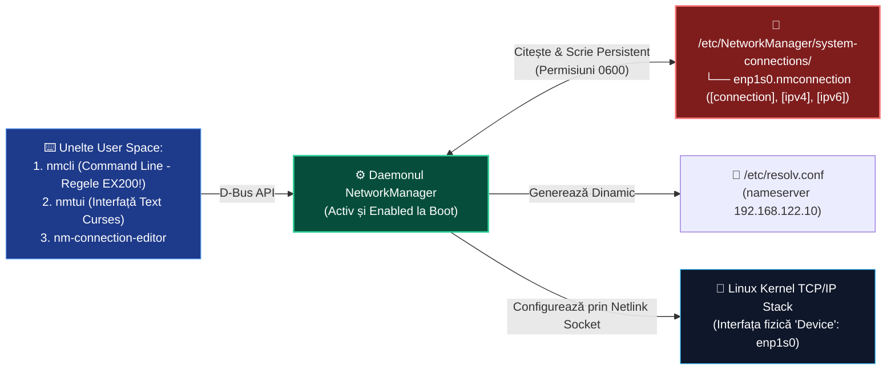

# Capitolul 4.1: Rețelistică în RHEL (`NetworkManager` / `nmcli`), DNS, Hostname și Sincronizarea Timpului (`chrony`)

> ### Obiectivul Capitolului, Ponderea în Examenul EX200 & Regula de Aur a Persistenței
>
> * **Obiectivul Capitolului:** Stăpânirea arhitecturii moderne de rețea din Red Hat Enterprise Linux (RHEL 9 / RHEL 10) bazată pe daemonul **`NetworkManager`** și noile fișiere de profil în format *keyfile* din **`/etc/NetworkManager/system-connections/*.nmconnection`**; înțelegerea diferenței fundamentale dintre un **Device (Dispozitiv Hardware / Interfață)** și o **Connection (Profil de Configurare)**; utilizarea la nivel de expert a comenzii **`nmcli`** (și `nmtui`) pentru configurarea adreselor statice IPv4/IPv6, Gateway și DNS; configurarea numelui de host (**`hostnamectl`**) și a rezoluției numelor (`/etc/hosts`, `/etc/resolv.conf`, `/etc/nsswitch.conf`); diagnosticarea stivei TCP/IP cu **`ip`** și **`ss -tulpn`**; securizarea accesului **`OpenSSH`** (`sshd_config`, autentificare prin chei `ssh-keygen` / `ssh-copy-id`) și sincronizarea precisă a timpului prin protocolul NTP folosind **`timedatectl`** și **`chrony`** (`/etc/chrony.conf`, `chronyc sources -v`).
>
> * **Ponderea în Examenul EX200:** **CRITICĂ — „FUNDAMENTUL CONECTIVITĂȚII” (10–15% punctaj direct + 100% impact asupra accesului SSH și DNF!).**
>   În primele 15 minute ale examenului EX200 (după ce ai spart parola de `root` pe `node2`), **Task-ul #1 de infrastructură** îți cere să configurezi rețeaua și hostname-ul pe una sau ambele mașini virtuale, urmat de un task dedicat pentru sincronizarea timpului NTP cu `chrony`:
>   1. **Configurare Rețea & Hostname:** *„Configurați `node2` cu următoarele setări de rețea: Hostname `node2.lab.example.com`, adresa IPv4 `192.168.122.102/24`, Gateway `192.168.122.1`, server DNS `192.168.122.10`, și asigurați-vă că interfața pornește automat la boot.”*
>   2. **Sincronizarea Timpului (`chrony`):** *„Configurați sistemul astfel încât să își sincronizeze timpul prin NTP cu serverul `bastion.lab.example.com` (sau `192.168.122.10`).”*
>
> * **Regula de Aur a Persistenței (EX200 Survival Rule):**
>   1. **NICIODATĂ nu configura IP-ul în examen cu `ip addr add ...` și nu edita manual `/etc/resolv.conf`!** Comanda `ip addr add` modifică doar starea în RAM a kernelului și **se șterge complet la reboot (0 puncte!)**, iar `/etc/resolv.conf` este suprascris automat de `NetworkManager`! Folosește **EXCLUSIV `nmcli`** (sau `nmtui`), verifică faptul că proprietatea `connection.autoconnect` este `yes`, și activează profilul cu **`nmcli con up "<nume_profil>"`**!
>   2. Pentru **Hostname**: Nu rula `hostname node1...` (este doar în RAM!). Folosește **`hostnamectl set-hostname node1.lab.example.com`** (care scrie persistent în **`/etc/hostname`**)!
>   3. Pentru **`chrony`**: După ce adaugi `server <adresa> iburst` în `/etc/chrony.conf`, asigură-te că rulezi **`systemctl enable --now chronyd`** și **`systemctl restart chronyd`**!

---

## 1. Introducerea Profesorului & Analogia Vizuală

De ce se încurcă atât de mulți administratori când trec la RHEL 8, RHEL 9 și RHEL 10 și încearcă să configureze rețeaua?
În primul rând, pentru că vechile scripturi din `/etc/sysconfig/network-scripts/ifcfg-*` (folosite timp de 20 de ani în RHEL 5/6/7) **au fost depreciate și eliminate în RHEL 9 / RHEL 10**! Astăzi, `NetworkManager` salvează toate profilurile în format INI standardizat (*keyfile*) în directorul **`/etc/NetworkManager/system-connections/*.nmconnection`** (cu permisiuni stricte `0600`).
În al doilea rând, pentru că nu înțeleg diferența arhitecturală dintre un **`Device` (Dispozitiv)** și o **`Connection` (Conexiune / Profil)** în `NetworkManager`!

### Analogia Vizuală: Telefonul Mobil (`Device`) vs. Cartela SIM / Profilul Wi-Fi (`Connection`) și Ceasornicarul Elvețian (`chronyd`)

1. **`Device` vs. `Connection` în `NetworkManager`:**
   * **`Device` (Dispozitivul — ex: `eth0`, `ens3`, `enp1s0`):** Este **Placa de Rețea Fizică sau Virtuală** lipită pe placa de bază (ca **Telefonul tău Mobil fizic**).
   * **`Connection` (Conexiunea / Profilul — ex: `"System eth0"`, `"Wired connection 1"`, `"static-lab"`):** Este **Profilul de Configurare salvat pe disc** (ca un **Profil Wi-Fi de Acasă vs. Birou** sau o **Cartelă e-SIM**). Poți avea 3 profiluri diferite salvate pe disc pentru aceeași placă de rețea `enp1s0` (un profil cu DHCP și un profil cu IP static), dar **doar o singură conexiune (`Connection`) poate fi activă pe un dispozitiv (`Device`) la un moment dat!**
2. **De ce folosim `chronyd` (NTP) și ce legătură are ceasul serverului cu securitatea?**
   * Dacă ceasul serverului tău `node1` rămâne în urmă cu 10 minute față de restul rețelei, autentificarea **Kerberos / Active Directory** eșuează instantaneu (pentru a preveni atacurile *Replay*), certificatele **TLS/SSL** apar ca invalide, clusterul de baze de date se corupe, iar logurile din `journalctl` devin imposibil de corelat! Daemonul **`chronyd`** este **Ceasornicarul Elvețian** al serverului: el nu „smucește” brusc limbile ceasului (ceea ce ar bloca bazele de date), ci accelerează sau încetinește fin frecvența ceasului din kernel (*Clock Slewing*) până se aliniază la nivel de nanosecundă cu ceasurile atomice din rețea!

---

## 2. Arhitectură Internă, Teorie & Mecanică Linux

### 2.1. Convenția `Predictable Network Interface Names` în RHEL 9 / RHEL 10

De ce în RHEL modern placa ta de rețea nu se mai numește mereu `eth0`, ci se numește **`enp1s0`**, **`ens3`** sau **`eno1`**?
În trecut, kernelul numea interfețele `eth0`, `eth1` în ordinea în care driverele răspundeau la boot. Pe un server cu 4 plăci de rețea, după un reboot, `eth0` (rețeaua internă) se putea inversa cu `eth1` (internetul public) — un dezastru de securitate!
De aceea, `systemd-udevd` atribuie astăzi nume deterministe bazate pe topologia hardware a magistralei PCIe (`man 7 systemd.net-naming-scheme`):

* Prefixe de tip: **`en`** = Ethernet (prin cablu); **`wl`** = Wireless LAN (Wi-Fi); **`ww`** = WWAN.
* Sufixe de locație hardware:
  * **`eno1`**: *On-board* (placă de rețea integrată direct pe placa de bază a serverului, index 1).
  * **`ens3`**: *Hotplug Slot* (placa din slotul PCIe virtual/fizic numărul 3).
  * **`enp1s0`**: *PCI Bus **1**, Slot **0*** (locația fizică exactă pe magistrala PCI!).

---

### 2.2. Arhitectura `NetworkManager` și Stăpânirea Completă a Comenzii `nmcli`

Daemonul **`NetworkManager.service`** gestionează toată configurația de rețea a serverului.



#### Anatomia unui Fișier `.nmconnection` în `/etc/NetworkManager/system-connections/`

Când rulezi o comandă `nmcli connection modify` sau `nmcli connection add`, `NetworkManager` scrie direct în fișierul `/etc/NetworkManager/system-connections/<nume>.nmconnection`:

```ini
[connection]
id=enp1s0
uuid=5fb06bd0-0bb0-7ffb-45f1-d6edd65f3e03
type=ethernet
interface-name=enp1s0
autoconnect=true

[ipv4]
method=manual
address1=192.168.122.101/24,192.168.122.1
dns=192.168.122.10;
dns-search=lab.example.com;

[ipv6]
addr-gen-mode=eui64
method=auto
```
*(Notă: Dacă editezi vreodată manual un fișier `.nmconnection` cu `vim`, `NetworkManager` **nu** îl va reciti automat până nu rulezi comanda **`nmcli connection reload`** urmată de **`nmcli connection up "<id>"`**!)*

#### Cele Două Scenarii Oficiale de Examen EX200 cu `nmcli` (Memorare și Practică!)

Înainte de a modifica rețeaua în examen, rulează **întotdeauna** aceste două comenzi de recunoaștere:
```bash
# 1. Vedem cum se numește DISPOZITIVUL hardware (coloana DEVICE, ex: enp1s0 sau eth0):
nmcli device status

# 2. Vedem dacă există deja un PROFIL DE CONEXIUNE (coloana NAME, ex: "Wired connection 1" sau "enp1s0"):
nmcli connection show
```

##### Scenariul A: Există deja o conexiune pe interfață și trebuie să îi modificăm IP-ul, Gateway-ul și DNS-ul (`nmcli con mod`)
Acesta este cel mai frecvent caz în EX200! Să presupunem că `nmcli con show` îți arată conexiunea `"enp1s0"` (sau `"System eth0"` — **pune mereu ghilimele `"` în jurul numelui conexiunii dacă are spații!**):

```bash
# 1. Setăm adresa IPv4 cu masca CIDR (/24), Gateway-ul, serverul DNS și domeniul de căutare:
nmcli con mod "enp1s0" ipv4.addresses 192.168.122.101/24
nmcli con mod "enp1s0" ipv4.gateway 192.168.122.1
nmcli con mod "enp1s0" ipv4.dns 192.168.122.10
nmcli con mod "enp1s0" ipv4.dns-search lab.example.com

# 2. PASUL CRITIC DE EXAMEN: Schimbăm metoda din 'auto' (DHCP) în 'manual' (Static) și activăm autoconnect la boot!
nmcli con mod "enp1s0" ipv4.method manual
nmcli con mod "enp1s0" connection.autoconnect yes

# 3. ACTIVĂM MODIFICĂRILE IMEDIAT ÎN KERNEL (fără acest pas, modificările stau doar pe disc!):
nmcli con up "enp1s0"
```

##### Scenariul B: Interfața este neconfigurată (nu există nicio conexiune în `nmcli con show`) și trebuie să creăm una de la zero (`nmcli con add`)

```bash
# Creăm o conexiune nouă numită "static-enp1s0" legată de placa fizică 'ifname enp1s0' dintr-o singură comandă:
nmcli con add con-name "static-enp1s0" ifname enp1s0 type ethernet \
    ipv4.method manual \
    ipv4.addresses 192.168.122.102/24 \
    ipv4.gateway 192.168.122.1 \
    ipv4.dns 192.168.122.10 \
    autoconnect yes

# O activăm imediat:
nmcli con up "static-enp1s0"
```

#### Cum adăugăm un al doilea IP (IP Secundar) sau un al doilea DNS fără a-l șterge pe primul? (`+ipv4.addresses` / `+ipv4.dns`)
În examen ți se poate cere: *„Adăugați o adresă IP secundară `10.0.0.101/24` pe interfața existentă fără a elimina adresa IP actuală!”*.
Dacă rulezi `nmcli con mod "enp1s0" ipv4.addresses 10.0.0.101/24` (**fără `+`**), vei **suprascrie** IP-ul principal și îți vei tăia singur conexiunea SSH!
Pentru a **adăuga (*append*)** un IP sau un DNS nou lângă cel existent, pune semnul **`+`** în fața proprietății:
```bash
nmcli con mod "enp1s0" +ipv4.addresses 10.0.0.101/24
nmcli con mod "enp1s0" +ipv4.dns 8.8.8.8
nmcli con up "enp1s0"
```
*(Iar pentru a șterge doar un IP secundar, folosești semnul minus **`-`**: `nmcli con mod "enp1s0" -ipv4.addresses 10.0.0.101/24`!)*

---

### 2.3. Hostname, Rezoluția Numelor (`/etc/hosts`, `/etc/resolv.conf`) și Diagnosticare (`ip`, `ss`)

#### 1. Configurarea Persistentă a Hostname-ului (`hostnamectl`)
```bash
# 1. Setăm numele complet (FQDN - Fully Qualified Domain Name) în mod persistent (scrie în /etc/hostname):
hostnamectl set-hostname node1.lab.example.com

# 2. Verificăm statusul:
hostnamectl
cat /etc/hostname
```

#### 2. Ordinea de Rezoluție a Numelor în Linux (`/etc/nsswitch.conf` -> `/etc/hosts` -> `/etc/resolv.conf`)
Când rulezi `ping bastion.lab.example.com`, de unde află sistemul adresa IP a lui `bastion`?
Biblioteca `glibc` citește linia `hosts:` din fișierul **`/etc/nsswitch.conf`**:
`hosts:      files dns myhostname`
1. **`files` (`/etc/hosts`):** Mai întâi, verifică tabela locală statică din **`/etc/hosts`**. Formatul unei linii în `/etc/hosts` este:
   `192.168.122.10   bastion.lab.example.com   bastion`
   *(IP-ul în prima coloană, urmat de FQDN și de alias-urile scurte!).*
2. **`dns` (`/etc/resolv.conf`):** Dacă numele nu se află în `/etc/hosts`, interoghează serverele DNS (`nameserver 192.168.122.10`) din **`/etc/resolv.conf`** (fișier generat automat de `NetworkManager` pe baza proprietății `ipv4.dns`!).

#### 3. Comenzile Moderne de Diagnosticare Rețea: `ip` și `ss` (Înlocuitorii vechilor `ifconfig` și `netstat`)

| Ce vrem să verificăm în Examen / Producție? | Comanda Modernă `iproute2` în RHEL 9 / 10 | Ce flag-uri folosim și cum citim rezultatul? |
| :--- | :--- | :--- |
| **Adresele IP și starea plăcilor (`UP`/`DOWN`)** | **`ip -br addr show`** *(sau `ip a`)* | Flag-ul **`-br` (*brief*)** afișează un tabel super-curat cu o singură linie per interfață! |
| **Tabela de Rutare și Default Gateway-ul** | **`ip route show`** *(sau `ip r`)* | Prima linie **`default via 192.168.122.1 dev enp1s0`** îți arată Default Gateway-ul activ! |
| **Statistici pachete și erori fizice pe placă** | **`ip -s link show`** | Afișează contoarele `RX` (recepție) și `TX` (transmisie), pachete `dropped` și `errors`. |
| **Porturile TCP/UDP deschise (în ascultare) și ce procese le dețin!** | **`ss -tulpn`** | **COMANDA REGE DE TROUBLESHOOTING ÎN EX200!**<br/>- **`-t`** = TCP<br/>- **`-u`** = UDP<br/>- **`-l`** = Listening (doar porturile deschise care așteaptă conexiuni!)<br/>- **`-p`** = Process (arată numele daemonului și PID-ul, ex: `sshd`, `httpd`!)<br/>- **`-n`** = Numeric (arată numărul portului `:22` sau `:80` în loc să îl traducă în `:ssh` sau `:http`!) |

---

### 2.4. Securizarea Accesului la Distanță cu `OpenSSH` (`sshd_config` & Autentificare prin Chei)

Serviciul **`sshd.service`** ascultă implicit pe portul **`22/tcp`** și este configurat prin fișierul **`/etc/ssh/sshd_config`** (și fișierele drop-in din `/etc/ssh/sshd_config.d/*.conf`).

* **Directive esențiale în `/etc/ssh/sshd_config`:**
  * `PermitRootLogin yes` (sau `prohibit-password` — permite lui `root` să se conecteze doar cu cheie SSH, interzicând autentificarea cu parolă; sau `no` — interzice complet login-ul direct ca `root`).
  * `PasswordAuthentication yes` / `no`.
  * `Port 22` *(Dacă în Capitolul 4.2 ni se va cere să schimbăm portul SSH sau HTTP pe un port non-standard, va trebui să autorizăm noul port în **SELinux** cu `semanage port` și în **firewalld**!)*.

* **Cum configurăm Autentificarea Fără Parolă bazată pe Chei Criptografice SSH (`ssh-keygen` + `ssh-copy-id`):**
  ```bash
  # 1. Generăm perechea de chei (Privată: ~/.ssh/id_ed25519 sau id_rsa | Publică: ~/.ssh/id_ed25519.pub) fără passphrase (-N ""):
  ssh-keygen -t ed25519 -N "" -f ~/.ssh/id_ed25519

  # 2. Copiem cheia publică pe serverul destinație (o adaugă automat în ~/.ssh/authorized_keys cu permisiunile corecte 0600!):
  ssh-copy-id root@node2.lab.example.com

  # 3. Testăm conectarea fără parolă:
  ssh root@node2.lab.example.com "hostname; uptime"
  ```

---

### 2.5. Fusul Orar (`timedatectl`) și Sincronizarea Timpului NTP cu `chrony` (Subiect Garantat în EX200!)

În RHEL 9 / RHEL 10, gestionarea timpului se face prin două componente care lucrează împreună:

#### 1. Comanda `timedatectl` (Setarea Fusului Orar / Timezone și Activarea NTP)
```bash
# 1. Afișăm starea curentă a ceasului (Local time, UTC, Time zone, System clock synchronized):
timedatectl status

# 2. Listăm toate fusurile orare disponibile (și filtrăm cu grep):
timedatectl list-timezones | grep -i bucharest

# 3. Setăm persistent fusul orar (de exemplu America/New_York sau Europe/Bucharest):
timedatectl set-timezone Europe/Bucharest
# (Sub capotă, creează symlink-ul /etc/localtime -> /usr/share/zoneinfo/Europe/Bucharest!)

# 4. Activăm sincronizarea automată prin NTP:
timedatectl set-ntp true
```

#### 2. Configurarea Clientului NTP `chrony` (`/etc/chrony.conf` & `chronyc sources -v`)

În examenul EX200 ți se va cere: *„Configurați sistemul astfel încât să își sincronizeze timpul prin NTP cu serverul `bastion.lab.example.com` (sau `192.168.122.10`).”*

**Receta Completă în 5 Pași pentru Task-ul `chrony` în Examenul EX200:**

1. **Pasul 1:** Ne asigurăm că pachetul `chrony` este instalat:
   ```bash
   dnf install -y chrony
   ```
2. **Pasul 2:** Deschidem fișierul **`/etc/chrony.conf`**. Comentăm cu `#` linia `pool 2.rhel.pool.ntp.org iburst` (care încearcă să iasă pe internet — inexistent în examen!) și adăugăm serverul cerut în enunț împreună cu opțiunea crucială **`iburst`**:
   ```ini
   server 192.168.122.10 iburst
   ```
   * **Ce face opțiunea `iburst` (*Initial Burst*) și de ce este VITALĂ în examenul EX200?**
     Fără `iburst`, `chronyd` așteaptă câteva minute bune (trimite câte 1 pachet la fiecare 64 de secunde) înainte de a sincroniza ceasul! Cu **`iburst`**, imediat ce pornește serviciul, `chronyd` trage o rafală rapidă de 4–8 pachete NTP în primele 2 secunde și **sincronizează ceasul instantaneu**!
3. **Pasul 3:** Activăm serviciul la boot și îl repornim pentru a citi `/etc/chrony.conf`:
   ```bash
   systemctl enable --now chronyd
   systemctl restart chronyd
   ```
4. **Pasul 4 (Verificarea de Aur cu `chronyc sources -v`):**
   ```bash
   chronyc sources -v
   ```
   Uităm-te la primele două caractere din fața adresei serverului tău în tabelul afișat de `chronyc sources`:
   * **`^*`** = **SINCRONIZARE PERFECTĂ!** (`^` = server, `*` = *Current Best Synced Source*!).
   * **`^?`** = Eroare de conectivitate / Serverul NTP nu răspunde (sau nu a terminat încă verificarea; dacă rămâne pe `^?`, verifică IP-ul și firewall-ul!).

---

## 3. Cutia cu Secrete RHCA & Capcane Mortale de Examen (Exam Killers & Man Page Hacks)

### 💀 Capcana Mortală #1: Uitarea lui `ipv4.method manual` și a lui `nmcli con up` în `nmcli`!
Dacă setezi o adresă IP cu `nmcli con mod "enp1s0" ipv4.addresses 192.168.122.101/24`, dar:
1. **Uiți să pui `ipv4.method manual`**: Dacă profilul era anterior pe `auto` (DHCP), iar în examen nu există server DHCP (sau DHCP-ul îți dă alt IP), conexiunea va eșua sau va lua IP-ul greșit!
2. **Uiți să rulezi `nmcli con up "enp1s0"`**: Comanda `nmcli con mod` modifică **doar fișierul `.nmconnection` de pe disc**, nu și interfața activă din RAM! Până nu dai `nmcli con up "enp1s0"`, serverul tău încă folosește vechile setări!

### 💀 Capcana Mortală #2: Folosirea unui Masci de Rețea Greșite (`/32` Implicit dacă uiți `/24`!)
În `nmcli`, dacă scrii `ipv4.addresses 192.168.122.101` (**fără `/24` la final!**), `NetworkManager` îi va pune automat masca **`/32`** (`255.255.255.255` — o singură gazdă)! Cu masca `/32`, serverul tău nu mai știe să ajungă nici măcar la Gateway-ul din aceeași rețea și **pierzi instantaneu conexiunea SSH**!
* **Regula de Fier:** Verifică întotdeauna în enunțul examenului masca de subrețea (`255.255.255.0` = **`/24`**, `255.255.0.0` = **`/16`**) și scrie prefixul `/24` lipit de IP!

### 🛠️ Man Page Hacks pentru Capitolul 4.1 (Pagina Magică `man nmcli-examples`!)
Ai uitat în timpul examenului sintaxa exactă a lui `nmcli` pentru crearea unei conexiuni statice?
Red Hat a inclus o pagină de manual **DOAR CU EXEMPLE GATA SCRISE**! Rulează:
```bash
man nmcli-examples
```
Acolo vei găsi mură-n gură Exemplele 1–10 cu `nmcli con add` și `nmcli con mod`!

---

## 4. Pregătire pentru Interviu (Linux SysAdmin & DevOps Job Readiness)

### Întrebarea 1 (Nivel Mid -> Senior):
> **Intervievator:** *„Pe un server RHEL, un dezvoltator spune că aplicația lui din container/sistem nu se poate conecta la `api.internal.corp`. Când el rulează `dig api.internal.corp` (sau `nslookup`), primește adresa IP corectă `10.20.30.40`. Dar când aplicația (sau comanda `ping api.internal.corp`) încearcă să se conecteze, se duce către o adresă IP complet greșită `127.0.0.1`! De ce dau `dig`/`nslookup` un răspuns diferit față de `ping` și `curl`?”*

**Răspunsul Ideal:**
> „Utilitarele de diagnosticare DNS precum **`dig`**, **`host`** și **`nslookup`** ocolesc complet biblioteca `glibc` (NSS) și **interoghează direct serverul DNS trecut în `/etc/resolv.conf`**!
> În schimb, aplicațiile reale (`ping`, `curl`, `ssh`, Python, Java) folosesc funcția de sistem `getaddrinfo()` din `glibc`, care respectă ordinea definită în **`/etc/nsswitch.conf`** (`hosts: files dns`).
> Deoarece `files` (`/etc/hosts`) este evaluat **ÎNAINTE** de `dns`, înseamnă că cineva a lăsat o intrare veche în **`/etc/hosts`** care mapează `api.internal.corp` la `127.0.0.1`! Pentru a testa rezoluția numelor exact așa cum o vede sistemul de operare și aplicațiile (respectând `/etc/nsswitch.conf`), folosesc comanda **`getent hosts api.internal.corp`**!”

---

## 5. Laboratorul Practic Explicat & Scenarii de Examen (Hands-On Lab pe `node2` și `node1`)

În acest laborator vom configura **`node2` (`192.168.122.102`)** ca Server NTP (`chronyd`) pentru rețeaua noastră de laborator, iar pe **`node1` (`192.168.122.101`)** vom exersa configurarea completă cu `nmcli`, `hostnamectl`, `/etc/hosts` și sincronizarea `chrony` către `node2`!

### Pasul 1: Configurarea `node2` ca Server NTP Local și Verificarea `nmcli`

Pe **`node2.lab.example.com` (`192.168.122.102`)**:
```bash
# 1. Configurăm chronyd pe node2 să accepte cereri NTP din rețeaua 192.168.122.0/24 chiar și fără internet (local stratum 10):
[root@node2 ~]# dnf install -y chrony
[root@node2 ~]# cat << 'EOF' >> /etc/chrony.conf
allow 192.168.122.0/24
local stratum 10
EOF
[root@node2 ~]# systemctl enable --now chronyd
[root@node2 ~]# systemctl restart chronyd

# 2. Deschidem serviciul ntp (port 123/udp) în firewall pe node2:
[root@node2 ~]# firewall-cmd --permanent --add-service=ntp
[root@node2 ~]# firewall-cmd --reload
```

### Pasul 2: Configurarea Rețelei cu `nmcli`, Hostname și Client `chrony` pe `node1`

Acum ne conectăm pe **`node1.lab.example.com` (`192.168.122.101`)**:

```bash
# 1. Setăm persistent Hostname-ul și populăm /etc/hosts pentru ambele noduri:
[root@node1 ~]# hostnamectl set-hostname node1.lab.example.com
[root@node1 ~]# cat << 'EOF' >> /etc/hosts
192.168.122.101   node1.lab.example.com   node1
192.168.122.102   node2.lab.example.com   node2
EOF

# 2. Identificăm numele conexiunii active în NetworkManager:
[root@node1 ~]# ACTIVE_CON=$(nmcli -t -f NAME con show --active | head -n 1)
[root@node1 ~]# echo "Conexiunea activa este: $ACTIVE_CON"

# 3. Adăugăm o adresă IP secundară de test (192.168.122.201/24) și ne asigurăm că autoconnect este yes:
[root@node1 ~]# nmcli con mod "$ACTIVE_CON" +ipv4.addresses 192.168.122.201/24
[root@node1 ~]# nmcli con mod "$ACTIVE_CON" connection.autoconnect yes
[root@node1 ~]# nmcli con up "$ACTIVE_CON"

# 4. Verificăm cu ip -br addr că ambele IP-uri (.101 și .201) sunt active pe interfață:
[root@node1 ~]# ip -br addr show

# 5. Configurăm clientul NTP chrony pe node1 să se sincronizeze cu node2 (192.168.122.102):
[root@node1 ~]# sed -i 's/^pool /#pool /g' /etc/chrony.conf
[root@node1 ~]# echo "server 192.168.122.102 iburst" >> /etc/chrony.conf
[root@node1 ~]# systemctl enable --now chronyd
[root@node1 ~]# systemctl restart chronyd

# 6. Verificăm sincronizarea cu chronyc sources -v (așteptăm 3 secunde pentru iburst):
[root@node1 ~]# sleep 3
[root@node1 ~]# chronyc sources -v
```

---

## 6. Simulare de Examen EX200 (3 Task-uri Practice Cronometrate + 5 Întrebări de Diagnosticare)

Pune-ți cronometrul pe **15 minute** și rezolvă pe **`node1.lab.example.com`**:

### Partea A: Cele 3 Task-uri Practice (Stil Oficial EX200)

1. **Task 1 (Configurare Rețea `nmcli`, IP Secundar & Hostname):**
   Asigurați-vă că hostname-ul static al mașinii `node1` este setat la `node1.lab.example.com`. Pe conexiunea de rețea activă, păstrați adresa IPv4 principală `192.168.122.101/24` și asigurați-vă că este configurată și adresa IPv4 secundară **`192.168.122.201/24`**, că domeniul de căutare DNS (`ipv4.dns-search`) este setat la **`lab.example.com`** și că profilul pornește automat la boot.
2. **Task 2 (Sincronizarea Timpului `chrony` & Fusul Orar):**
   Setati fusul orar (*timezone*) al sistemului `node1` la **`Europe/Bucharest`**. Configurați serviciul `chronyd` să fie activat la boot și să își sincronizeze timpul cu serverul `192.168.122.102` folosind opțiunea `iburst`.
3. **Task 3 (Auditarea Porturilor Deschise cu `ss`):**
   Extrageți lista tuturor socket-urilor TCP aflate în starea `LISTEN` (cu numere de port numerice și procesele aferente, folosind `ss -tlpn`) și salvați output-ul în fișierul `/root/listening_tcp_ports.txt`.

### Partea B: Cele 5 Întrebări de Diagnosticare

1. Unde își salvează `NetworkManager` fișierele de configurare a conexiunilor în RHEL 9 și RHEL 10?
2. Care este diferența dintre `nmcli con mod "enp1s0" ipv4.addresses 10.0.0.5/24` și `nmcli con mod "enp1s0" +ipv4.addresses 10.0.0.5/24`?
3. De ce este esențial cuvântul `iburst` la sfârșitul liniei `server 192.168.122.102 iburst` din `/etc/chrony.conf` în timpul examenului EX200?
4. Ce simbol apare în fața numelui serverului NTP în output-ul comenzii `chronyc sources` atunci când ceasul s-a sincronizat cu succes cu acel server?
5. Ce pagină de manual deschizi în timpul examenului dacă ai uitat sintaxa comenzii `nmcli` și vrei să vezi direct exemple complete?

---

### Rezolvare Completă, Script de Verificare (Grading Script) și Explicații (Profesorul Explică)

#### Rezolvarea Pas cu Pas a Task-urilor Practice (pe `node1`):

##### Rezolvare Task 1 (`hostnamectl` + `nmcli`):
```bash
hostnamectl set-hostname node1.lab.example.com

ACTIVE_CON=$(nmcli -t -f NAME con show --active | head -n 1)
if ! ip a | grep -q "192.168.122.201/24"; then
    nmcli con mod "$ACTIVE_CON" +ipv4.addresses 192.168.122.201/24
fi
nmcli con mod "$ACTIVE_CON" ipv4.dns-search lab.example.com
nmcli con mod "$ACTIVE_CON" connection.autoconnect yes
nmcli con up "$ACTIVE_CON"
```

##### Rezolvare Task 2 (`timedatectl` + `chronyd`):
```bash
timedatectl set-timezone Europe/Bucharest

if ! grep -q "^server 192.168.122.102 iburst" /etc/chrony.conf; then
    sed -i 's/^pool /#pool /g' /etc/chrony.conf
    echo "server 192.168.122.102 iburst" >> /etc/chrony.conf
fi
systemctl enable --now chronyd
systemctl restart chronyd
```

##### Rezolvare Task 3 (`ss -tlpn` în `/root/listening_tcp_ports.txt`):
```bash
ss -tlpn > /root/listening_tcp_ports.txt
cat /root/listening_tcp_ports.txt
```

#### Răspunsurile la Întrebările de Diagnosticare:
1. În directorul **`/etc/NetworkManager/system-connections/`** în fișiere cu extensia **`.nmconnection`**.
2. Fără `+`, comanda **înlocuiește (suprascrie)** toate adresele IP existente pe acea conexiune. Cu **`+ipv4.addresses`**, păstrează IP-ul existent și **adaugă** un IP secundar.
3. Opțiunea **`iburst`** forțează `chronyd` să trimită o rafală rapidă de pachete imediat la pornire, realizând sincronizarea în câteva secunde în loc de câteva minute.
4. Simbolul **`^*`** (*Current best synced source*).
5. **`man nmcli-examples`**.

#### Scriptul de Verificare Automată (Grading Script pentru Capitolul 4.1 — rulat pe `node1`)

```bash
#!/bin/bash
# ==============================================================================
# RHCSA (EX200) - Script Automat de Evaluare: Capitolul 4.1 (pe node1)
# ==============================================================================
SCORE=0
TOTAL=30

echo "========================================================"
echo " Evaluare Obiective Capitolul 4.1 pe $(hostname)"
echo "========================================================"

# Verificare Task 1: Hostname + IP secundar .201/24 + dns-search
if [[ $(hostname) == "node1.lab.example.com" ]] && \
   ip -4 addr show | grep -q "192.168.122.201/24" && \
   grep -q "lab.example.com" /etc/resolv.conf; then
    echo "[ PASS ] Task 1: Hostname, IP-ul secundar 192.168.122.201/24 și dns-search sunt active și persistente (+10p)"
    SCORE=$((SCORE + 10))
else
    echo "[ FAIL ] Task 1: Eroare la hostname, IP-ul secundar .201/24 sau dns-search (0p)"
fi

# Verificare Task 2: Timezone Europe/Bucharest + chrony sincronizat cu 192.168.122.102
if timedatectl status | grep -q "Europe/Bucharest" && \
   systemctl is-enabled chronyd &>/dev/null && \
   grep -qE "^server[[:space:]]+192\.168\.122\.102[[:space:]]+iburst" /etc/chrony.conf && \
   chronyc sources | grep -q "192.168.122.102"; then
    echo "[ PASS ] Task 2: Fusul orar Europe/Bucharest și sincronizarea NTP chrony cu 192.168.122.102 sunt corecte (+10p)"
    SCORE=$((SCORE + 10))
else
    echo "[ FAIL ] Task 2: Eroare la Timezone sau la configurarea /etc/chrony.conf (0p)"
fi

# Verificare Task 3: /root/listening_tcp_ports.txt
if [[ -s /root/listening_tcp_ports.txt ]] && \
   grep -q ":22" /root/listening_tcp_ports.txt; then
    echo "[ PASS ] Task 3: Porturile TCP în ascultare au fost extrase corect în /root/listening_tcp_ports.txt (+10p)"
    SCORE=$((SCORE + 10))
else
    echo "[ FAIL ] Task 3: Fișierul /root/listening_tcp_ports.txt lipsește sau este incomplet (0p)"
fi

echo "--------------------------------------------------------"
echo " PUNCTAJ FINAL CAPITOLUL 4.1: $SCORE / $TOTAL"
echo "========================================================"
```

---

## 7. Bibliografie Oficială Red Hat și Surse de Aprofundare

1. **Cursurile Oficiale Red Hat:**
   * **RH124 (*Red Hat System Administration I*):** Capitolul 10 (*Configure and Secure SSH*) și Capitolul 12 (*Manage Networking* — `nmcli`, `ip`, `ss`, `hostnamectl`).
   * **RH134 (*Red Hat System Administration II*):** Secțiunea privind menținerea timpului exact cu `timedatectl` și `chrony`.
2. **Pagini de Manual (`man`) Esențiale din Sistem:**
   * `man 1 nmcli`, **`man 7 nmcli-examples`**, `man 5 nm-settings-keyfile`
   * `man 8 ip`, `man 8 ss`, `man 1 hostnamectl`
   * `man 1 timedatectl`, `man 5 chrony.conf`, `man 1 chronyc`